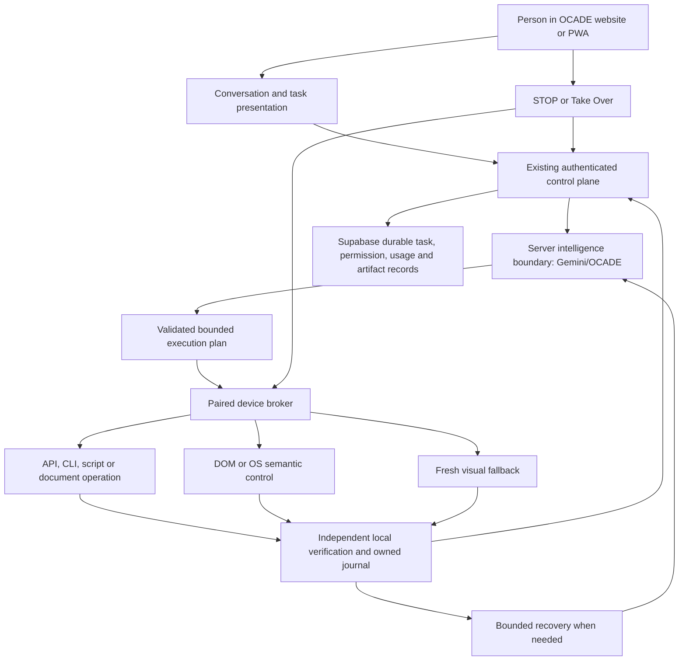

> Historical evidence only: this document describes its original snapshot and is not current implementation authority. Read [PLAN](PLAN.md) for current work. Old PASS labels, phase instructions and platform claims require current reproduction; original content is retained below.

# OCADE: elite product strategy

## Decision and evidence boundary

OCADE's strongest direction is a website/PWA that turns an intention into verified work on a person's own devices. Keep Gemini/OCADE reasoning behind the existing authenticated server boundary. Give a small trusted device broker a bounded, structured plan and let it perform deterministic operations locally. Ask the model again for uncertainty, a new decision, or recovery, rather than for each obvious click. This is a proposed architecture, not an implemented or benchmarked capability. Recommendations R01–R54 below have classification, priority, benefit, risk and implementation order.

The commercial promise should be **“describe the work, choose where it runs, receive a verified result”**. “Controls every application instantly” is not a credible promise: interfaces, permissions, document semantics, application versions and network conditions differ. Universal control means one general execution architecture with discovery and multiple legitimate routes, including unfamiliar software; it does not eliminate domain knowledge, integration work, platform restrictions or human authentication.

Prepared 2026-10-05 against product main **`f277408aaaf5381c949bb62119d84f7fa57ffb09`**. The two existing audit ledgers are frozen inputs, preserved byte-for-byte:

| Input                        | SHA256                                                             | Meaning                                                                |
| ---------------------------- | ------------------------------------------------------------------ | ---------------------------------------------------------------------- |
| `FULL_ERROR_AUDIT_LEDGER.md` | `54c82984a01c6c47caaee9b7152eecef11e8c0d2952d4d39afe3af52e32428df` | 235 unique findings: Critical0, Major69, Minor166; FAIL110, PARTIAL125 |
| `PONYTAIL_DEBLOAT_LEDGER.md` | `a36484edd3af8351396a7eba38b4fb944c5e67167d1cabbbcba4d67c3a7fc226` | 51 unique proposed opportunities; no cleanup executed                  |

Publication representation: the hashes above describe the frozen Windows working files. Existing `.gitattributes` requires Markdown text to use LF in Git. Staging therefore normalizes their CRLF line endings to LF, with no changed text, findings or ordering; the working ledgers remain byte-identical. No attribute/configuration was changed. Remote verification compares against those staged LF bytes and separately verifies the original working hashes.

First source pass:974/974 complete. Second pass:562/974 complete,57.7%; remaining412/974,42.3%, BLOCKED. All remaining second-pass paths belong to the previously rejected Supabase review dispatch. This strategy neither retries that workflow nor credits those files as second-reviewed. It uses prior first-pass evidence, the frozen findings, targeted ordinary-source cross-checks and public official documentation. Source, fixtures, deployed liveness and physical platform evidence remain separate. The audit is incomplete and the checked release blockers remain unresolved. No product fixes, new platform tests, deployments, migrations or configuration changes were performed for this document.

The latest attached request explicitly authorizes publication of these three documentation files after strategy verification, despite the unfinished audit. Publishing them does not certify commercial readiness. The audited SHA above identifies product source, not the later documentation publication commit. Old ledger statements that publication was conditional on audit completion remain intact as historical checkpoint instructions; the new request supersedes that publication condition only.

Repository authorities already reviewed throughout the audit: `AGENTS.md`, `CLAUDE.md`, `ToRemove.md`, `PLAN.md` through Phase56, domain authorities and immutable donor instructions. Targeted checks confirm the newer universal-engine, website/tray/mobile, server intelligence and owner authority in `AGENTS.md:158–212`, `CLAUDE.md:317–352`, `PLAN.md:1341–1449,1451–1642` and `ToRemove.md:114–194`. Historical statements of past successful tests are not new live proof. The approximately98% donor reuse aspiration is an authority goal, not a measured reuse percentage or a reason to retain unsafe mechanics.

## What the current product actually is

OCADE already has a useful spine: a React/TanStack website, authenticated conversations, server-backed Online intelligence, browser-local model installation for offline Chat, a separate JARVIS execution conversation, Library, Devices, Settings and integrated Owner/Staff consoles. Cloudflare hosts the web/server layer; Supabase supplies account/data/storage and intelligence-boundary components. A Python desktop agent and Java Android companion supply capabilities a website cannot exercise directly.

| Concern                | Current source owner / ordinary cross-check                                                                                                                   | Assessment                                                                                                                                                                                           |
| ---------------------- | ------------------------------------------------------------------------------------------------------------------------------------------------------------- | ---------------------------------------------------------------------------------------------------------------------------------------------------------------------------------------------------- |
| Website/navigation     | `src/components/shell/AppShell.tsx`, `src/router.tsx`, `src/routes/ocade-jarvis.tsx`                                                                          | Keep one website identity and normal-account privileged console entry. JARVIS still has substantial separate navigation/control density.                                                             |
| Chat                   | `src/lib/chat/use-chat.ts`, `src/lib/ocade-chat-store.ts`, `src/lib/chat/unsynced-turns.ts`                                                                   | Online/local selection, persistence and pending recovery exist. Races and durable-state defects in F095/F196/F198/F210/F220 prevent assuming seamless recovery.                                      |
| Intelligence           | `src/lib/intelligence/router.ts::createOcadeIntelligence`, `online-client.ts::createOnlineIntelligenceTransport`, `edge-handler.ts::handleOnlineIntelligence` | Preserve the existing contract and server credential boundary. Automatic Chat fallback occurs only before meaningful Online output.                                                                  |
| JARVIS                 | `src/jarvis/agent.ts::runJarvisTurn`, `live-deps.ts::liveDeps`, `JarvisWorkspace.tsx`                                                                         | Online-only model planning. Typed actions are queued and their results fed back. Autonomous offline JARVIS planning/control is not a shipped fallback.                                               |
| Task/device authority  | `task-authority.server.ts::queueTaskAction`, `device.server.ts::exchange`, `src/routes/api/jarvis/device.ts`                                                  | Permission/controller checks and acknowledgements are the right starting point. Persistent result ownership and STOP need stronger proof.                                                            |
| Desktop execution      | `jarvis-runtime/ocade_device.py::Agent`, `ocade_computer.py::Computer`, `ocade_accessibility.py`, `actions/browser_control.py`                                | Generic discovery, semantic controls, browser sessions, files, commands and document operations exist. An instructed route hierarchy is not an enforced capability selector or universal-task proof. |
| Android                | `android/src/in/ocade/app/{MainActivity,AgentService,Control,OcadeAccessibility,WakeService}.java`                                                            | Installed pairing, services, accessibility, bubble and wake are present. Physical end-to-end evidence is absent; the installed emulator build has only partial source alignment.                     |
| Background/schedules   | `src/jarvis/background.server.ts::{taskToCarryOn,carryOn}`, `schedules.server.ts`, `background-model.server.ts`                                               | Persisted continuation design exists. F060 records the missing deployed background intelligence endpoint; implementation is not deployment readiness.                                                |
| Usage                  | `src/lib/commercial/{usage-policy,generation-gate,entitlement-resolver,supabase-ledger}.ts`                                                                   | One canonical policy/gate/ledger separation is valuable. Current JARVIS charges delivered model steps separately, unlike one Chat request.                                                           |
| Offline installation   | `src/lib/brain/{installation-authority,model-transfer,model-store,model-vault,runtime-activation}.ts`                                                         | Separate transfer, verified bytes, durable activation and runtime readiness are useful boundaries. F069/F072/F077/F188/F192 show why these cannot simply be deleted as bloat.                        |
| Real-data visual graph | `src/jarvis/graph.ts`, `Orb.tsx`                                                                                                                              | Account-derived nodes and relations already have an owner. Keep that owner when adapting visual identity.                                                                                            |

### Strong foundations to keep — R01, R02, R05, R08, R15, R19

The product is web-first already. Customers need not learn developer MCP setup to ask for work. Server-held inference credentials, typed action contracts, account-scoped tasks, local execution, permission checks, versioned capability recipes and separate Online/offline modes are sound foundations. The local broker can preserve user data and use fast interfaces without transmitting every observation. Existing offline Chat is a differentiator when genuinely ready, but should stay optional on constrained mobile devices.

The audit provides a more useful basis than a clean-looking demo:493 bounded ordinary pure/mock/filesystem tests passed, plus selected local browser and native-readiness checks. They do not establish unrestricted device control or hosted customer isolation. Preserve this evidence discipline as a product capability.

### Broken, unfinished and weak — R03, R04, R10, R21, R29, R35

Trust failures outrank visual polish. F001/F002 concern wake signature authority; F003/F004/F009 concern preservation/fidelity; F005/F006/F007 concern coordinate safety; F028/F032/F099/F115/F116/F129/F151 concern cancellation, admission or controller lifecycle; F146/F159 concern durable outcomes and scheduling. These are different mechanisms, not one generic “STOP bug”. Some are source-only PARTIAL findings, but all require resolution or an explicit supported-scope exclusion before a release claim.

Misleading success is a recurring family: usage settlement F016, failed reads shown as empty F039/F097, deletion F098, stream health F208 and partial answer F210, notifications F079/F214/F215/F218. A polished interface cannot compensate for an unverified outcome. Account/staff/recovery issues F014/F018/F019/F035/F044/F062/F067/F093/F119/F164/F224 need independent qualified validation; fixture layouts and RLS-enabled metadata do not prove isolation.

Current orchestration can spend up to30 model steps (`agent.ts:36,583–664`); this is a source ceiling, not evidence that typical customers spend30. Each model turn can add permit acquisition, stream startup, durable writes, action queuing, device exchange, result reads and further inference. Multiple lifecycle implementations—Chat hook, foreground JARVIS, background continuation and native loops—can disagree about stopping, saving and terminal success. Simplify shared semantics, while retaining the distinct security and persistence boundaries.

### What is unnecessarily complicated — R05, R06, R30, R40

The expensive complexity is divergence: repeated request lifecycle logic, fragmented cancellation, independently computed displayed entitlements, duplicated overlay/focus behavior, manual Help indexing, stale source-string tests and historical checkpoint copies that look current. D014/D015/D021/D034/D035/D045/D052 identify concrete candidates. The database gate and ledger are not duplicates merely because both touch usage; reservation and server-side claimed settlement protect different transitions. Likewise, a local pending journal and a server task record serve different connectivity scopes.

Do not replace these with a new agent framework, workflow platform, plugin marketplace, distributed event system and vector database simultaneously. Start with the existing modules and a few shared contracts. Add infrastructure only after a measured bottleneck cannot be addressed there.

## Proposed minimum architecture — R01, R02, R05–R12

Use three principal runtime surfaces: **website/PWA**, **existing server control plane**, and **one local broker per supported device**. Supabase remains durable account/task/usage/file authority; Cloudflare remains web delivery and the existing server entry layer. Gemini reasons behind that boundary. These are logical concerns, not a recommendation to create nine new services.



| Concern                  | Single logical authority                                         | Replicas/adapters that may remain                                                     |
| ------------------------ | ---------------------------------------------------------------- | ------------------------------------------------------------------------------------- |
| Reasoning/model routing  | Existing intelligence boundary/contract                          | Online provider adapter; offline Chat adapter, explicitly separate capabilities       |
| Task lifecycle/ownership | Durable server task state with fencing generation                | Device journal and browser status projection; neither independently invents ownership |
| Device control           | Broker action dispatcher on the selected device                  | Windows/macOS/Android adapters under the same semantic contract                       |
| Browser control          | One broker browser-session owner                                 | Authorized attach, managed profile, semantic/native fallback; no parallel controller  |
| Files/projects           | Scoped artifact/file operations with owned preservation journal  | App-native save/export adapters, local files and Library references                   |
| Permissions              | Server grants plus broker enforcement of scoped capabilities     | Platform-owned prompts and a bounded cached grant; model cannot grant rights          |
| Usage                    | Existing transactional permit/ledger authority                   | Client estimates and displays; local counters only for signed offline leases          |
| Verification             | Typed postcondition contract and evidence receipts               | App-specific queries and output checks are permitted adapters                         |
| Recovery/cancellation    | One lifecycle coordinator with monotonic cancellation generation | Native cancellation, retry timers, voice cleanup and server acknowledgements          |

“One authority” does not mean every local keypress must query Postgres. A plan can carry a short-lived task/device capability, permitted resources, expiry and cancellation generation. The broker checks it locally before each action. Server revocation fences future work when communicated; a disconnected device cannot learn an immediate remote revocation. Require bounded expiry/control-loss behavior and honest pending-stop state. Keep a local STOP independent of cloud availability. Do not advertise instantaneous remote cancellation under a network partition.

Start by reusing task rows, device exchanges and current operation IDs. A durable task record and a small task-owned action journal are enough for the first implementation. Supabase Realtime or an existing authenticated event channel can signal state changes; a reconnect reads the durable record. Notification delivery is not the sole source of truth. Only introduce another Cloudflare coordination service if connection load/order/cost measurements justify it.

The server should handle short reasoning/dispatch operations and checkpoints; it should not host a CAD render loop or assume an Edge Function survives a customer's multi-hour task. Current Supabase documentation lists function wall-clock, memory and CPU limits; local long work needs durable resumability. Cloudflare limits likewise depend on the selected product/plan. Recheck before implementation rather than designing around a free unlimited worker. [Supabase function limits](https://supabase.com/docs/guides/functions/limits), [Cloudflare Workers limits](https://developers.cloudflare.com/workers/platform/limits/).

## Strongest execution hierarchy — R08, R09, R11, R12, R19

Choose the route with the best combination of fidelity, verifiability, permissions and total completion time. The hierarchy is a default, not an inflexible ranking: a badly supported API can be less reliable than an accessible UI. Never sacrifice workbook/CAD/project fidelity just because file editing is faster.

| Route                                       | Prefer when                                                        | Main advantage                                                      | Limit / required verification                                                                           |
| ------------------------------------------- | ------------------------------------------------------------------ | ------------------------------------------------------------------- | ------------------------------------------------------------------------------------------------------- |
| Documented app API / native OS API          | Operation has a supported object model or system method            | Semantic changes, direct outcome queries, fewer intermediate states | Discover installed version, licensing, permission and mutation semantics                                |
| CLI / app scripting / COM                   | App exposes command execution or local automation                  | Many operations in one bounded execution; no click planning         | Quote argv correctly, preserve working scope, bound children/output; scripts are not automatically safe |
| Direct file/project manipulation            | Format is understood and required features can be preserved        | Avoids GUI entirely; bulk transformations                           | Round-trip through target app; preserve formulas, styles, metadata and unsupported elements             |
| Browser DOM / Playwright / CDP              | Authorized webpage control has stable semantic targets             | Locators, assertions, downloads and navigation signals              | Requires legitimate browser ownership/attach; a PWA cannot inspect arbitrary other-origin tabs          |
| Windows UI Automation / macOS Accessibility | Desktop app exposes semantic controls                              | Invoke/Value/Toggle/Selection instead of coordinate guesses         | Provider completeness, elevation boundaries and state freshness vary                                    |
| Android intents / content APIs              | App/platform explicitly exposes requested function                 | Narrow, fast supported handoff                                      | Intent delivery is not completion; background/permission restrictions still apply                       |
| Android accessibility/UI hierarchy          | Supported, explicitly enabled assistive/automation use             | Structured node actions with live state                             | OS capability and distribution-policy permission are separate; protected content may be absent          |
| Vision/screenshot + fresh mouse/touch       | Canvas, image surface or incomplete semantics genuinely require it | General visual fallback                                             | Observe current target, crop/scale correctly, invalidate stale bounds; extra inference and ambiguity    |

Microsoft UI Automation provides cross-framework semantic control patterns and events, but has user/process access limits. macOS AXUIElement provides the accessibility surface. These APIs are preferable to maintaining coordinates for thousands of applications, where available. [Microsoft UI Automation](https://learn.microsoft.com/en-us/windows/win32/winauto/uiauto-uiautomationoverview), [Apple AXUIElement](https://developer.apple.com/documentation/applicationservices/axuielement).

Retain Office adapters if their measured preservation and native integration outperform a generic file library. COM is a Windows technique, not a universal macOS Office interface. Office Scripts is an optional Excel capability where the user's environment supports it; it does not imply every Office application supports the same API. [Office Scripts overview](https://learn.microsoft.com/en-us/office/dev/scripts/overview/excel).

App aliases can remain vocabulary conveniences—“my spreadsheet app” resolves to a discovered executable—but must not become the definition of support. Application-specific adapters deserve to stay when they demonstrably improve fidelity, safety, latency or integration. Route them through the same broker; remove a redundant active adapter only after equivalent workflows, STOP and recovery are proved. This follows `ToRemove.md:118–122`, not a blanket purge of specialized code.

## Universal-control flow and plan contract — R05–R12, R19–R23

1. Understand whether the person is asking a question, an obvious local command or a multi-step task. Reuse conversation context. Resolve device/project ambiguity only when multiple plausible targets materially change the outcome.
2. For a previously authorized unambiguous primitive or verified recipe, choose a deterministic route locally. This is a small rules/capability matcher, not another reasoning model. Commands outside that vocabulary go to server reasoning.
3. Snapshot the relevant capabilities: active target identity/version, current project, available APIs, scoped resources and supported verification. Cache stable inventory; inspect actual state before mutations.
4. For unfamiliar work, retrieve current official documentation for the installed version. Treat it as data, never as permission. Gemini chooses a strategy and produces a bounded structured plan with dependencies, resource limits and postconditions.
5. Validate the plan at the server and broker. A syntactically valid script or model assertion is not authorization. Bind consent to task, target, action digest and current resource/version.
6. Execute deterministic segments locally. Preserve one active writer for a UI/project; parallelize only independent reads/jobs with isolated resources. Stop a segment when its preconditions fail rather than blindly continuing a batch.
7. Verify actual side effects with an independent read. Persist action outcome before acknowledging removal from the server queue. Report partial work, blocked boundaries and created artifacts accurately.
8. Recover locally only within preapproved idempotent bounds. Escalate changed semantics or unresolved failure to Gemini with a compact state delta. Ask the person at a genuine decision boundary.
9. On completion, show artifact/semantic checks and a concise result. On STOP, fence all queued/new actions, cancel owned work and report acknowledged cessation separately from requested cancellation.

Illustrative future data contract, not existing executable code:

```json
{
  "planVersion": 1,
  "taskId": "stable-task-id",
  "ownerGeneration": 7,
  "target": { "deviceId": "paired-device", "appVersion": "observed-version" },
  "scope": { "projectRef": "approved-project", "network": "approved-destinations" },
  "budget": { "actions": 40, "recoveryAttempts": 1, "expiresAt": "server-approved-expiry" },
  "segments": [
    {
      "id": "edit-project",
      "requires": ["expected-project-open", "unchanged-input-version"],
      "route": "documented-app-script",
      "artifactRef": "reviewed-task-script",
      "verify": ["requested-property-values", "output-reopens", "preserved-required-content"],
      "onFailure": "pause-with-evidence"
    }
  ]
}
```

Do not let an action list include unlimited loops, unrestricted filesystem/network access or a “success” boolean accepted without evidence. Generated scripts can be constrained by process permissions, resource limits and approved artifact paths, but no general Python `exec` wrapper makes arbitrary native code safe. Use trusted primitives for common operations; isolate task-specific scripts and require additional approval for new privileges. A script that manipulates a live app may need to run on the application's required thread; a generic subprocess cannot assume app-context APIs exist there.

PhoneHarness is relevant as an architectural idea: its published project combines CLI/MCP and GUI routes, prioritizes exact executable routes and grades observable side effects using traces. Adopt that principle and failure taxonomy; its emulator/Termux/host-proxy setup is not a consumer phone distribution architecture. Do not copy its stack, benchmark results or assume its privileged test environment is available to an OCADE customer. [PhoneHarness primary README](https://github.com/PhoneHarness/PhoneHarness/blob/main/README.md).

## Latency: make the inner loop local — R06–R10, R16–R18, R23, R39

Current source settings identify opportunities, not measured end-user latency: `agent.ts` action-result polling400ms, timeout120s; `JarvisWorkspace.tsx` unfinished-task refresh4s and idle30s; `stop-everywhere.ts` acknowledgement poll1s and deadline8s. The desktop exchange loop in `ocade_device.py:196,409–411` waits up to1s during an active action (returning earlier when it finishes),1s while busy without an active action, and5s when dormant. Its application inventory reporting cadence is hourly (`:45,342`); the computer's separate app-lookup cache is600s (`ocade_computer.py:56,370`). These values exclude network/execution time and must be measured together with server/provider/device delays before tuning.

Approximate accounting model for a task:

`completion time = planning/recovery inference + necessary network/dispatch + app work + observation/verification + human boundaries + avoidable orchestration waits`.

This separates a fast broker from a slow render, upload, app launch, model response or human confirmation. Reducing model calls does not make those operations disappear. A goal involving unknown software may need multiple planning/recovery turns; one Gemini call is a design preference for a known bounded task, not a correctness constraint.

| Operation                                                 | Proposed warm-path objective, not measured result                          | Honest boundary                                                               |
| --------------------------------------------------------- | -------------------------------------------------------------------------- | ----------------------------------------------------------------------------- |
| Intent lookup / capability-cache access / local admission | Single-digit to tens of milliseconds; instrument p50/p95                   | Pure local computation only                                                   |
| Typed API/UIA request dispatch                            | Aim p95≤50ms in supported warm cases                                       | Request acceptance differs from app mutation completion                       |
| Cached semantic read / small file metadata query          | Aim≤100ms for bounded supported cases                                      | Cross-process providers or hierarchy dumps can take much longer               |
| Visible UI acknowledgement                                | Aim≤100ms input feedback and first status                                  | Show “queued/planning”; never invent completion                               |
| Local STOP cancellation flag                              | Aim≤100ms; controlled actions quiescent≤1s where cancellable               | Blocking COM, render and OS operations require truthful stopping state        |
| Remote acknowledgement                                    | Measure separately; network plus device wake/availability                  | No universal sub-second guarantee or zero-latency claim                       |
| Gemini planning / vision / documentation retrieval        | Network/provider latency, generally outside millisecond-class local budget | Stream meaningful progress; disclose actual measured distribution later       |
| CAD render, media export, large model transfer            | Application/data/hardware work                                             | Track actual progress; cache/reuse may help, dispatch speed does not bound it |

For20 dependent trivial operations, a GUI loop could require20 model requests; a validated API/script segment could require one planning request and one local verification summary. That is an architectural comparison, not a measured20× product speedup. If each cloud turn adds `t`, the removable planning overhead is approximately19×`t`, while actual app work and safety checks remain.

Concrete optimization sequence:

- R06/R07: share foreground/background lifecycle semantics; use event notifications for completed actions/status with durable reconnect and bounded polling fallback. Do not remove acknowledgement/fencing to shave milliseconds.
- R08/R09: execute a bounded multi-operation API/CLI segment instead of repeatedly choosing tools. Avoid a separate “select tool” model call when the plan already specifies a supported route.
- R16/R17: send only relevant semantic deltas or cropped images; reuse a recent still-valid observation. Do not repeatedly capture full desktops for unchanged deterministic work.
- R18: invalidate capability recipes selectively on app/version/schema/UI changes. Discovery can run once per relevant session with event/version checks, rather than before every operation.
- R23: coalesce progress/audit writes and batch independent results where durability permits. Save the outcome before acknowledgement; never batch away the only recovery checkpoint.
- R39: mount expensive task/detail/visual panels on demand, bound canvas work and avoid full-page redraws for every streamed token.

Do not parallelize two mutations in the same foreground UI, remove consequential confirmations or accept stale coordinates to win a benchmark. Prefer completion latency and correctness together to an isolated click-duration number.

## Efficient observation and grounding — R16–R19, R21

Use semantic trees before screenshots when the surface exposes names, roles, states, values, selected objects and stable identifiers. Return the active window/subtree and the controls relevant to the next segment, not an unbounded whole-desktop dump. A tree must retain disabled/error/selected/modal information; token reduction that hides a dialog is a false economy.

Observe using generation-bound IDs: device/window identity, document/tab identity, UI generation, viewport scale and an observation timestamp. A node index is only meaningful within its observation. The broker should reject an obsolete generation, reobserve and re-resolve a semantic target. Window title equality alone is insufficient; F007 records same-window layout drift.

Vision is necessary for canvas geometry, visual quality, complex custom widgets and missing semantic interfaces. Capture the relevant window or crop; include enough context to understand the target. Store crop origin, resolution and scale. Re-ground after scrolling, navigation, zoom/DPI/monitor changes, dialogs, window movement or meaningful UI updates. A “fresh within five seconds” coordinate can still be wrong after a one-millisecond layout change.

Use frame differencing to avoid retransmitting unchanged areas, with periodic full context or explicit re-grounding when ambiguity rises. Diffing cannot prove a control's semantic identity. OCR is a local optional helper for text-only gaps; a heavy local vision model is not the default companion requirement. For stable app scripts, verify through the object model and save/render checks instead of sending screenshots after every instruction.

Screenshots, project text and semantic trees can contain private data. Redact password/token fields locally, crop irrelevant windows, retain only task-needed evidence and let the user see what leaves the device. Do not build a shared recipe from private screenshots or customer document contents. Keep server-only model keys hidden while honestly disclosing that selected content is sent to an Online provider; “hidden intelligence” is not a promise of wholly local inference.

## Website and companion relationship — R01, R02, R13–R15, R24

Choose **website/PWA + small local broker**, not a new full desktop app and not a pure-web promise of unrestricted PC control. Browser sandboxes do not grant arbitrary native window access, COM, desktop input or background process ownership. Screen sharing supplies permissioned observation, not a general OS input authority. A broker is necessary for those deep local capabilities. [W3C Screen Capture](https://www.w3.org/TR/screen-capture/).

“Small/invisible” means low idle cost and no duplicate chat/settings desktop shell. Keep one recognizable tray/menu-bar identity, a first-run permissions/setup surface and an emergency STOP. Active control and microphone use must remain visible; invisibility must never mean covert operation. Website owns Chat, tasks, history, subscription, Library, Devices and permission management. Tray opens the website and offers STOP/Pause/Exit; it is not another product dashboard.

Reuse current Python broker first. Measure packaged size, cold start, idle memory/CPU and dependency footprint before rewriting it in Rust/C++/Swift. `jarvis-runtime/packaging/ocade-agent.spec:20–52` already excludes donor Qt/FastAPI/provider-heavy stacks. Native platform code is justified for a specific reliability/footprint requirement, not a speculative “tiny AI companion”. Do not bundle another large language model just to route obvious commands.

Use paired outbound authenticated connectivity for cross-device commands so customer PCs need no publicly exposed inbound ports. A same-device fast channel can be considered later, subject to browser local-network permissions, origin checks, authenticated pairing and current-browser testing. Do not use localhost as proof of trust, require disabling browser safeguards or assume HTTPS websites can always contact local software silently. [Chrome Local Network Access](https://developer.chrome.com/blog/local-network-access).

### Existing browser, managed browser or extension — R13

The current `ocade_existing_browser.py:1–12,58–109` attaches when a legitimate `DevToolsActivePort` endpoint exists and can open the browser's setup page. It does not magically grant DOM control of every signed-in browser. Historical “extension removed” entries in `ToRemove.md` remain evidence of that decision, not a reason to repeat cleanup.

Prefer, in order, an explicitly authorized supported browser attach; a product-owned managed profile in which the person signs in normally; and native accessibility/vision for the existing browser when attach is unavailable. Do not copy cookies/password stores to bridge profiles. Chrome136 changed remote-debugging switches for the default data directory; authorized browser features and version-specific attach paths must be evaluated separately. Never advertise that an arbitrary default-profile debug-port restart works. [Chrome remote-debugging changes](https://developer.chrome.com/blog/remote-debugging-port).

A browser extension can provide a consented DOM bridge, but adds installation, permissions, review/distribution and another lifecycle. It cannot replace the PC broker's native execution. Do not reintroduce the retired extension now. Consider one narrowly scoped bridge only if measured existing-profile workflows cannot be served reliably by legitimate product-owned routes, with an explicit authority decision and security/maintenance proof. Development Playwright/CDP/MCP tools are evidence tools; customers should receive OCADE's bundled capability rather than developer setup instructions. Playwright CDP attach is Chromium-specific and has compatibility limits. [Playwright BrowserType](https://playwright.dev/docs/api/class-browsertype).

## Mobile first, with honest platform limits — R24–R28

Mobile-first distribution can be cheap because the website is immediately available; mobile-first deep native control is a separate capability. Mobile users should get useful work before installing anything: conversation, file review, task requests, approvals, status, supported sharing and Remote PC. A phone can command a paired PC without pretending the work happened locally on the phone.

| Surface                             | Best initial customer experience                                          | Native capability boundary                                                                                            |
| ----------------------------------- | ------------------------------------------------------------------------- | --------------------------------------------------------------------------------------------------------------------- |
| Android browser/PWA                 | Full web product, foreground voice where supported, task/status/Remote PC | Cannot inspect/control arbitrary other apps or provide a reliable always-on global wake listener                      |
| Android installed companion         | Optional guided website APK installation and explicit capability setup    | Native intents/APIs and permitted enabled accessibility; foreground service, battery/overlay/microphone limits remain |
| iPhone/iPad browser/Home Screen PWA | Web product, notifications where supported, file/share links, Remote PC   | No unrestricted cross-app taps, global accessibility service or always-on browser wake                                |
| macOS website plus broker           | Same website with menu-bar companion when native work is needed           | Consent for Accessibility, Screen Recording/microphone where required; physical proof pending                         |

### Android no-store distribution — R25, R26

Android officially supports website-hosted release APKs, with the user's opt-in to install from that source. Use one OCADE package identity, owner-controlled signing, HTTPS download, verified update metadata and reversible update handling. Do not automate enabling unknown-source installation or Accessibility. No-store avoids a Play listing requirement, not security, identity, support or maintenance obligations. [Android alternative distribution](https://developer.android.com/distribute/marketing-tools/alternative-distribution).

Current policy must be budgeted accurately. Google's current verification pages describe September30,2026 enforcement for participating stores in selected regions, with broader rollout planned for2027; the current FAQ says direct sideloading is not subject to that initial participating-store deadline. It lists a$25 full-distribution Android Developer Console fee and a free limited-distribution account for up to20 specific devices. This is distinct from a Play Store account. A20-device path is testing/personal use, not a mass-market plan. Do not promise indefinitely fee-free unrestricted public distribution; recheck region/account requirements before release. [Android verification overview](https://developer.android.com/developer-verification), [current FAQ](https://developer.android.com/developer-verification/guides/faq?hl=en).

Accessibility requires special care. Android documentation treats services as specialized assistive tools; technical access is not permission to use it for every business purpose. Google Play's current policy prohibits Accessibility-based autonomous initiation/planning/execution by ordinary apps and distinguishes narrow static rule-based automation; qualifying disability-assistive tools have different treatment. Compiling Gemini's dynamic plan into steps does not automatically turn it into an allowed static human-defined script. Website distribution does not constitute legal/policy clearance. Obtain a qualified review of the actual companion purpose, disclosure, local permissions and chosen distribution channel before promoting cross-app autonomy. Do not mislabel OCADE as a disability tool or recommend OS-security bypass. [Android service guidance](https://developer.android.com/guide/topics/ui/accessibility/service), [Play Accessibility policy](https://support.google.com/googleplay/android-developer/answer/10964491?hl=en).

For the first low-capital release, keep the Android companion optional and its advertised native scope narrow. Prefer intents/official integrations for known operations and an explicitly user-controlled assistive mode where allowed. Do not rely on ADB, root, UiAutomator test privileges or emulator tools as customer onboarding. Android accessibility can expose meaningful trees, but custom canvas, protected content and some WebViews may require visual fallback or remain unsupported.

### iPhone/iPad and macOS — R27, R28

iOS/iPadOS sandboxing and entitlements prevent an ordinary OCADE application/PWA from becoming a general cross-app input controller. Use supported deep links, sharing and user-configured Shortcuts/App Intents integrations where the target app exposes them, plus Remote PC. These integrations act only within their supported capabilities; they do not grant general screen control. Lab WebDriverAgent/XCTest automation is test evidence, not legitimate consumer unrestricted iPhone automation. [Apple runtime security](https://support.apple.com/en-in/guide/security/sec15bfe098e/web), [Apple App Intents](https://developer.apple.com/documentation/appintents).

Home Screen web apps support Web Push on compatible iOS/iPadOS versions with user permission; this can support task-completion/approval notifications. It is not a guarantee that a suspended PWA can listen continuously or run arbitrary background work. Treat website foreground voice and push-driven re-entry as separate features. [WebKit Home Screen Web Push](https://webkit.org/blog/13878/web-push-for-web-apps-on-ios-and-ipados/).

No-store Apple distribution is not a general free alternative. Apple's current program page lists$99 annual membership; free Personal Team testing has short-lived provisioning and is not commercial distribution. EU Web Distribution has authorization, eligibility, notarization and commercial terms. The current support page, updated for unified terms effective October1,2026, lists multiple eligibility routes; it must not be reduced to the older universal “two years and one million EU installs” rule. These requirements are still not a suitable zero-budget global native launch assumption. Use the PWA now. [Apple Developer Program](https://developer.apple.com/programs/), [free testing/account limits](https://developer.apple.com/help/account/basics/about-your-developer-account), [current EU Web Distribution](https://developer.apple.com/support/web-distribution-eu/).

For macOS, direct website distribution of a broker can avoid a Mac App Store listing, but trusted Developer ID signing/notarization and hardware testing still require a real budget and appropriate program access. Do not recommend instructing customers to disable Gatekeeper or bypass TCC. Stage macOS after Windows reliability is proved, retaining the same web interface and action contract. Physical Apple evidence in this audit is BLOCKED; no claim of a working Mac or iPhone companion follows from source packaging files.

## Original JARVIS donor: retain the useful mechanics, not another product — R14, R19, R20, R40

The immutable original is `imports/ocade-jarvis/source-original/ocade jarvis 25-09/`; the ZIP's58 file members were cross-checked against those originals in the completed audit. Its control architecture is a local Python application with Qt/UI/audio/session state, dynamically discovered file-backed action tools, provider integration and screenshot/vision handling. `main.py:58–61,324–328,541–545,608–609` separates session-coupled vision/audio tools from action-file discovery. `core/gemini.py` and `core/llm_client.py` handle inference paths; `actions/computer_control.py`, `browser_control.py`, `open_app.py`, `file_controller.py`, `file_processor.py` and the settings/developer/media helpers perform work.

Its apparent speed comes from executing primitives on the machine: existing browser sessions, direct keyboard/hotkey operations, clipboard-based bulk typing, filesystem transformations and native/script operations. An already chosen operation does not need a server/device round trip. Persistent browser sessions also avoid repeated launch/setup. This is an architecture explanation, not a donor-vs-OCADE latency benchmark. The donor still relies on provider/network inference, synchronization, fixed waits and GUI feedback; its old app-specific macros are not proof of general reliable automation.

`docs/DONOR_CAPABILITY_LEDGER.md:7,11–32,45` maps previous adaptation to active OCADE paths and records historical removal of unwired active copies. Do not repeat those deletions or pretend old removed files remain product bloat. Current `ocade_computer.py:153,187,218` discovers/launches installed application identities; `ocade_discovery.py:124,162,251,361,367` supports SDK/readme/version/recipe discovery. `ocade_accessibility.py:243–300` adds semantic patterns. `ocade_computer.py:490,571,611,756` supplies file, sheet, document and command paths. These are the commercial evolution of useful donor primitives, under current device/task authority.

| Donor concept                             | Keep/adapt through current authority                                                     | Exclude from future active adaptations                                                                                |
| ----------------------------------------- | ---------------------------------------------------------------------------------------- | --------------------------------------------------------------------------------------------------------------------- |
| Generic input, focus and clipboard typing | Typed target-aware input, scoped clipboard restoration, native semantic alternatives     | App-coordinate scripts presented as universal support; global failsafe disabling                                      |
| Persistent browser sessions               | One owned session/page manager with navigation/download verification                     | A second independent browser stack, stale-page success and unsupported incognito claims                               |
| File/document transformations             | Native fidelity where needed, bounded reads, recoverable journal and independent reopen  | Whole-file rewrite from truncated previews; existence-only verification                                               |
| Tool registry/discovery                   | Small first-party typed capability registry and actual installed-app discovery           | Customer plugin marketplace, dynamic dependency installation and unconstrained plugin authority                       |
| Screenshots/vision                        | On-demand relevant observations, preserved coordinate transforms and cancellable capture | Always-streaming whole-screen images or a parallel screen-understanding loop                                          |
| Voice/wake/session state                  | Bundled verified model, explicit recorder/playback ownership and local STOP              | Plaintext provider keys, misleading Listening state, duplicate camera/TTS/wake workers                                |
| Undo/confirmation                         | Task-bound consent and preservation of original bytes/state                              | Time-colliding backups, wrong destination scope and unbound confirmation responses                                    |
| Qt avatar/dashboard                       | Visual inspiration/provenance only                                                       | Shipping the old desktop GUI, remote phone dashboard or separate chat system                                          |
| Per-app aliases/controllers               | Optional naming aliases and adapters with measured unique value                          | Obsolete flight/game/messaging routines, fixed itineraries or unverified “sent/working” shortcuts in a new adaptation |

F003/F004/F008/F066/F068/F070/F075/F087/F147/F162/F169/F172/F178/F189 explain why reuse must preserve semantics rather than copy declarations of success. F041/F084/F199/F216/F229/F230 expose state/resource ownership risks in originals. Many donor findings are conditional on reuse, not current production failures. Keep all immutable source/ZIP/license/provenance. A future deletion recommendation applies only to a redundant active/adapted path after equivalence proof; no original file is authorized for removal.

## Professional work: sell verified outcomes — R08, R11, R19–R22, R46

CAD, editing and creative tasks need domain semantics. A generic click broker is necessary but insufficient: “made a file” does not mean the part dimensions are correct, the workbook still calculates, the video uses the intended clips or the deliverable is editable. The same universal engine can discover official capabilities and generate task-specific scripts without adding a production controller for each new app. It still needs validated operations, application-context execution and independent verification.

Proposed unfamiliar-app procedure: identify app/version/edition and project; inspect supported commands or scripting/API manifests; fetch the relevant official documentation; construct a small scoped operation; validate in a disposable copy or read-only probe where feasible; execute against approved scope; query the real project and reopen/render/export; retain a sanitized verified recipe. Never install arbitrary documentation-suggested dependencies silently or let project text override the person's instructions.

| Work family               | Likely preferred route, subject to actual capability discovery                                                | Result verification beyond file existence                                                                                                           |
| ------------------------- | ------------------------------------------------------------------------------------------------------------- | --------------------------------------------------------------------------------------------------------------------------------------------------- |
| Fusion/CAD                | Supported application API/script, with semantic UI for setup/unsupported operations                           | Units, requested dimensions/constraints, feature/assembly relationships, valid solids, reopen, appropriate export and visual review                 |
| Blender                   | Installed-version Python API and background CLI for suitable batch work; app-context UI where required        | Object/material counts, transforms, camera/lights, editable `.blend`, missing assets, test render and requested visual properties                   |
| Video editing             | Editor-supported scripting/API or versioned project interchange; FFmpeg for appropriate media transformations | Timeline structure, source clips, cuts/transitions, frame rate/duration, audio channels, decoded samples, export completion and visual/audio checks |
| Office                    | Native COM on Windows or supported app/cloud API; format-aware editing only when it preserves requirements    | Formulas/calculation, formatting, charts, macros disabled during appropriate verification, document reopen and meaningful content checks            |
| Browser work              | Authorized semantic DOM actions and navigation/download events                                                | Correct target account/recipient/form values, confirmed actual submission or staged preview, downloaded bytes/content                               |
| IDE/developer work        | Repository tools/CLI, language tooling, source diff and real build/test output                                | Exit status, task-relevant tests, artifacts, regression scope and reproducible run; no “working” claim after failed execution                       |
| Unknown custom/canvas app | Capability discovery, semantic UI, then fresh visual fallback                                                 | Actual requested state, reopened/exported result where possible; disclose unsupported fidelity                                                      |

Fusion's official documentation supports scripts/add-ins and application APIs; discovery must match the installed version and execution context. Blender's official documentation documents background script execution; the fetched3.3 guide establishes the route, not the current API schema. Premiere's current UXP documentation exposes another editor-specific surface; it does not prove OCADE has a working Premiere integration. [Fusion script/add-in guide](https://help.autodesk.com/cloudhelp/ENU/Fusion-360-API/files/WritingDebugging_UM.htm), [Blender background scripting guide](https://docs.blender.org/api/3.3/info_tips_and_tricks.html), [Premiere UXP](https://developer.adobe.com/premiere-pro/uxp/).

For video, ffprobe can read container/stream metadata, while decoded sample frames and audio checks cover additional requirements; metadata alone is not visual quality. Application licensing, API edition availability, export codecs and automated-workflow terms must be checked locally before proposing a route. A private consumer license does not automatically authorize hosted multi-tenant execution. [ffprobe documentation](https://ffmpeg.org/ffprobe.html).

For a CAD edit, run a geometric query independently of the script's returned “success”; reopen a copied result and compare the requested properties. For a workbook, inspect specified formulas and preservation of unrelated structures. For a video, inspect rendered duration/frame rate and sample the requested edits, with human review for subjective quality. The verifier should not simply execute the generator's own assertions uncritically. A first-party trusted verifier can use task-specific values, but a model must not grant its own passing grade.

Commercially, begin with two or three coherent workflow families, such as spreadsheet-to-report, creative project/export preparation and phone-directed PC task continuation. Preserve the generic engine and test at least one unfamiliar app in each benchmark cycle. “Universal” should remain a bounded capability statement with a published support matrix; a narrow reliable launch wedge is stronger than a menu of fifty partial automations.

## UI/UX: calm surface, powerful work — R29–R39

The current visual authority is black/silver/white (`src/shared/ui/tokens/monochrome.css`, `src/styles.css`), with self-hosted Inter and a monospace face. Keep that identity. Premium should come from hierarchy, spacing, restraint and truthful feedback, not an imported rainbow control panel or perpetual motion. Proposed sizes below are design hypotheses to test at320px, zoom, keyboard and real touch; they are not changes performed now.

| Surface            | Specific target direction                                                                                                                                                  | Why / current evidence                                                                                   |
| ------------------ | -------------------------------------------------------------------------------------------------------------------------------------------------------------------------- | -------------------------------------------------------------------------------------------------------- |
| Navigation         | Keep Chat, JARVIS and Library in one shell; Devices as a contextual destination/current-target control, Settings under account; show Owner/Staff only to eligible accounts | Reduces parallel navigation. Preserve direct links/history and same-path drawer closure; F123            |
| Chat               | One stable composer, obvious attachment state, concise mode/readiness labels, accessible conversation actions and visible save/error state                                 | Avoid lost drafts/attachments and completed-looking partial replies; F049/F056/F057/F092/F198/F210       |
| JARVIS             | Same conversation conventions plus one compact task card: target, current phase, evidence, blocker and STOP/Take Over                                                      | Power is revealed when a task needs it, not all control panels at once; F151                             |
| Library            | Search across all retained items with pagination; touch-visible menu; distinguish uploading/indexed/stored/deleting/failed                                                 | F090/F091/F098/F212; a spinner or success toast cannot substitute for storage outcome                    |
| Devices            | Cards showing capability readiness and recent contact, selected execution target, guided pairing, separate permission repair/revoke                                        | “Online” alone does not prove browser/voice/native capability; F127/F171                                 |
| Settings           | Group account/security, appearance/accessibility, usage and devices; show saving/saved/failed per operation                                                                | D014/D015, F039/F040/F173/F215/F218; do not promise unsaved preferences took effect                      |
| Owner Console      | Keep normal-account entry, with Overview/Customers/Staff/Usage/Security as outcome-oriented groupings where existing modules fit                                           | Separate overview from rare dangerous operations; retain granular reauth/audit and stable UUID authority |
| Staff Console      | Render only granted operations, clear read-only data status, scoped search and consistent permission refresh                                                               | F019/F097/F119; hidden buttons do not establish backend enforcement                                      |
| Onboarding         | First ask what work and where; demonstrate one useful web task, then offer companion only for needed capability                                                            | Avoid six permissions before any value; retain genuine platform prompts                                  |
| Error/empty states | Distinguish zero data, unavailable query, denied capability and unfinished action; offer one next recovery step                                                            | Repeated false-empty/success families erode trust more than rough styling                                |

Owner and Staff privilege controls should not become convenient developer backdoors. Primary Owner unlimited usage and transferable ownership must remain canonical backend identity decisions, with recent verification, last-owner protection and audit. Staff uses ordinary limits unless granted timed/permanent unlimited use. Operational visibility must not expose private conversations by default; F014 is directly relevant.

### Spacing, type, theme and controls — R31, R34–R38

Use a small spacing scale, clear reading widths and consistent control heights. Aim for comfortable mobile targets around44px and generous separation for STOP/destructive controls; keep compact information rows readable. Use roughly16px body copy on mobile, with stronger headings rather than tiny grey labels everywhere. These are proposed design starting points, not a replacement for actual contrast/zoom measurements. Keep the monospace face for code/technical values, not for all account information. Ensure fallback fonts support languages outside the self-hosted Latin subsets.

Use restrained neutral gradients/glass on the orb or a small hero area, not behind every form. Light mode needs its own contrast hierarchy; dark mode must not use ultra-low-opacity silver for important status. Retain labels/icons/patterns so monochrome state remains understandable without hue. Apply soft corners consistently to cards/dialogs, bend/organic form only where it helps the orb identity, and preserve clear rectangular alignment for dense administrative tables.

Hover should enhance an already discoverable control, never be the only route to download/rename/actions. Focus-visible styles, keyboard activation, semantic labels, correct dialogs, focus containment/restoration and screen-reader announcements are launch requirements. F048/F057/F124 show that source scanners are not sufficient behavioral proof. Announce completed/error state changes, not every streamed token or animated point.

On mobile, use one primary action per task surface, a stable composer above the keyboard and sticky active-task STOP. Move secondary graphs/details into an accessible sheet with safe-area handling. Do not hide blocking permissions behind the keyboard or floating bubble. Responsive behavior must work with text enlargement and zoom, not just an emulated320px CSS snapshot.

### Orb, strings, threads and motion — R33, R38, R39

The separate `imports/UI OCADE JARVIS.zip` is a visual prototype, not a second product engine. Its `src/components/OrbCanvas.tsx` and CSS provide luminous points, strings/edges, depth, orbit movement and hover/zoom ideas. Its synthetic random graph, canned replies, microphone and color controls are not commercial behavior. F042/F043/F231–F236 cover prototype defects: initialization/cleanup, inert controls, lost pending draft, angular-distance math, mixed DPI coordinate spaces, moving tooltip anchor, narrow-panel clipping and ignored reduced motion.

Adapt the strongest visual language inside current `src/jarvis/Orb.tsx` and `graph.ts`, retaining real account/task relationships and the existing accessible list. Nodes should represent meaningful current objects—tasks, documents, conversation context or linked devices—with an explicit relationship legend and privacy scope. Threads can highlight “this task uses this file on this PC”; they should not be arbitrary connections suggesting knowledge the product does not possess.

The orb should communicate actual states: quiet ready, listening with real recorder liveness, planning, executing, waiting for the person and stopped. Pair every animation with visible text. Do not infer Listening from model availability or animate completion before verification; F160/F213 remain relevant. Graph selection should work through keyboard/touch and a list alternative, with hover treated as optional.

Performance design: one animation owner, reusable buffers, bounded visible nodes/edges, measured DPI scaling, lower-cost mobile density, static reduced-motion treatment and suspension when hidden/offscreen. Preserve needed voice feedback without spinning an expensive graph continuously. Avoid per-frame full-array sorting/allocation if profiling confirms it matters. Do not add WebGL/workers/new dependencies before the existing canvas is measured. D019/D050/D051 already establish the analysis boundary; duplicate PNG payload is archival evidence, not current bundle saving.

Use small transition durations for state continuity, not long reveals before actions. Prefer direct rendering when data is ready; progressive placeholders should preserve layout while real asynchronous content loads. Skeletons must not imitate filled customer records; empty/failed reads need their own state. Reserve motion for transitions, active work and a restrained orb identity. Reduced-motion preference and a deliberate user override should have one owner, not competing CSS rules.

### Ethical psychology and retention — R29, R31, R36, R41–R43

Reduce cognitive load by showing the next decision and the current result, while leaving advanced detail expandable. Make the selected device/project obvious. Use concrete progress—“exporting three clips; two finished”—when actual counters exist; otherwise say the true phase without invented percentages. Acknowledging an input instantly can make the product feel responsive while the slower work proceeds, provided the wording stays truthful.

Trust grows from reversibility, visible STOP, real artifacts, privacy controls and failure explanations. Remember legitimate task/device preferences, but never silently expand permissions. Ask once for routine scope and again for a materially different consequential action, such as sending externally or replacing an original. CAPTCHA, OTP, passkey/elevation and equivalent boundaries remain human/platform-owned.

Retention should come from useful repeatable work and safe cross-device continuation: a user returns because last week's workflow can be resumed/reused with the right inputs. Do not use fake social proof, fabricated success rates, hidden charges, panic countdowns, confirmshaming or notifications designed to manufacture anxiety. Offer opt-in completion/approval reminders with quiet defaults and truthful delivery status.

## Usage: keep the visible unit simple, account for the real cost — R04, R30, R41–R44

Current `usage-policy.ts` states one successful request is one use, with account-anchored6h28m sessions: Free28/session, Pro140/session and700/week, Max10×Pro. `agent.ts` currently gives each delivered JARVIS model step its own permit. This means a task consuming many reasoning turns can consume many visible uses even when much of the work consists of trivial clicks. The audit proves the structure, not current customer usage distribution.

Do not revive the retired Standard Work Equivalents system or introduce opaque token percentages. Separate a customer-readable task allowance from internal provider/token/tool cost telemetry. The default recommendation is one **standard completed work request** with an explicitly stated bounded planning/recovery budget; deterministic sub-actions and OCADE-caused retries should not become individual visible charges. Larger jobs can be quoted as multiple work units before they begin. This is a policy proposal requiring Owner approval, transactional design, anti-abuse limits and measured economics; the current source policy remains unchanged.

| Accounting fact                    | Proposed behavior                                                                                                                     |
| ---------------------------------- | ------------------------------------------------------------------------------------------------------------------------------------- |
| Local deterministic action         | No model-use charge; still authorized, logged and resource-bounded                                                                    |
| Model planning/recovery            | Record actual internal calls/tokens/provider cost under the task; do not hide an unbounded subsidy                                    |
| Initial task reservation           | Estimate maximum supported work units and internal budget, reserve once with stable task identity                                     |
| Successful completion              | Settle agreed charge exactly once after verified outcome                                                                              |
| Product/provider failure           | Release/refund unused reservation; protect any valid saved partial result and show actual status                                      |
| Cancel after material partial work | Apply a clearly disclosed bounded policy; do not surprise-charge each interrupted click                                               |
| Resumption                         | Reuse task/action identities and already verified checkpoints; no charge for replaying identical acknowledged work                    |
| Larger changed scope               | Explain added budget and obtain approval before extending it                                                                          |
| Primary Owner/unlimited grant      | Remove customer allowance gating according to canonical authority, while still recording internal cost and guarding runaway resources |
| Staff                              | Ordinary limits unless Owner grants unlimited; granular permissions and unlimited entitlement are independent                         |

Use the existing permit/reservation/settlement machinery rather than a second billing backend. The existing separation between client reservation and claimed server settlement is a trust boundary. Fix F016 and acknowledgement/stream outcome semantics before changing units. Parent task accounting should group child model requests with stable identities; transactional uniqueness must prevent retries from settling twice. Never count a task as completed because a model stream was handed off; F208/F210 distinguish delivery from successful terminal result.

For resumable work, record step outcome, input version, verification evidence, produced artifact and remaining budget. After interruption, reconcile device journal with durable server state. Never replay a send/payment/destructive mutation simply because its acknowledgement was lost. Query the real side effect or pause for a decision; exactly-once external effects cannot be guaranteed by a local retry flag. F146/F159/F196/F220 make this a release-level design concern.

Owner unlimited is an entitlement, not unlimited business expenditure or immunity from safety. Keep CPU/concurrency/time budgets, internal spend alerts and emergency resource controls without quietly charging Owner usage. Timed grants should display the same effective window selected by the canonical resolver, not an independently sorted badge; F168/D045. Revocation should fence future authority promptly while retaining honest disconnected-device limitations.

The usage UI should show remaining requests/work allowance, reset time, current task reservation and whether a model is ready. Keep advanced internal counters in Owner operations rather than the customer composer. Do not announce Offline ready from another tab's activation or future-window capacity; F184/F204 show these are separate facts. On mobile, offer Online/Remote PC first when local model storage/compute is unsuitable; optional offline Chat should not block first value.

## Security, privacy and release trust — R03, R12, R15, R21, R28, R44, R48

Keep provider keys and privileged Supabase credentials server-side. A typed plan sent to a device is visible to that device and cannot be treated as a secret. Hide provider internals from normal customer controls where appropriate, but disclose material data processing accurately. Browser/client keys are not interchangeable with service-role credentials. Supabase's official guidance distinguishes request-scoped auth/RLS from privileged access; every privileged path must bind the actual caller and account independently. This document does not re-audit blocked hosted isolation. [Supabase auth context](https://supabase.com/docs/guides/functions/auth-legacy-jwt).

Protect the local broker as an execution boundary: paired identity, scoped resources, short-lived capabilities, task fencing, authenticated transport, signed update/manifest validation and controlled process ownership. A valid model plan must still pass permission and current-state checks. Prompt instructions alone cannot enforce these boundaries. Treat webpages, docs, screenshots and tool outputs as untrusted task data.

STOP has two jobs: immediate local admission cancellation, and observed cessation across distributed components. A task can be stopping while an uninterruptible operation completes; show that distinction rather than reporting false success. Never kill unrelated browser/app processes. Bind Take Over to the current task/window, pause automation promptly and obtain fresh state before resuming. `stop-everywhere.ts`, foreground hooks, background controllers and device loops should coordinate rather than each inventing their own terminal flag.

Signed artifacts must validate exact packaged bytes on each platform. Keep F001/F002 visible until actual clean-install verification; no signature bypass. Updates require an atomically consistent release manifest/signature, correct multi-platform feed, rollback and preserved user task/data state; F118/F156/F157/F192 concern different parts of this chain. Do not delete historical migrations or donor evidence to make a checker quieter.

Release confidence needs real platform/customer evidence: clean Windows install/tray/browser/control/wake/update/rollback/uninstall, current physical Android, legitimate Apple evidence for any advertised Apple capability, hosted role/account isolation and provider/background availability. Qualified security validation is still required. PGlite/mocks, local health and an RLS-enabled table count do not establish these. No audit percentage should silently turn BLOCKED into PASS.

## Competing on workflow quality — R22, R45, R46, R48

OpenAI's official computer-use guidance includes browser/code-execution integrations and calls for environment restrictions, untrusted-screen handling and confirmation of consequential actions. Anthropic's current computer-use documentation likewise covers client-controlled execution and distinct safety risks. Neither reference supplies an OCADE-vs-competitor benchmark or guarantees every workflow. Compare real outcomes rather than claiming that competitors only click screenshots or that OCADE is already faster. [OpenAI computer use](https://developers.openai.com/api/docs/guides/tools-computer-use), [Claude computer use](https://platform.claude.com/docs/en/agents-and-tools/tool-use/computer-use-tool).

OCADE's credible potential advantages are local deterministic execution, transparent task verification, retained user-device data, low-friction web entry and phone-to-PC continuity. These are hypotheses until measured. The same workload must be compared with the same permissions, application versions, input files and correctness rubric. Include failed/unavailable runs rather than showing only successes.

| Measure                  | What to publish                                                                         | What would support a real advantage                                   |
| ------------------------ | --------------------------------------------------------------------------------------- | --------------------------------------------------------------------- |
| Verified completion rate | Passed required postconditions / eligible attempted tasks; report sample and confidence | Repeated gains on meaningful workflows, including an unfamiliar app   |
| Total task latency       | p50/p95, cold/warm, app work vs inference/dispatch breakdown                            | Faster completed correct work, not just quicker cursor movement       |
| Model efficiency         | Calls/tokens/cost per verified result, with failed-run cost                             | Deterministic segments reduce cost without reducing fidelity          |
| Human burden             | Setup time, interventions, permission prompts, retry count                              | Fewer unnecessary decisions and explicit consequential control        |
| Cancellation/recovery    | Local STOP latency, acknowledged stop, duplicate effects and recovery success           | Safe interruption and resumption under ordinary failures              |
| Fidelity                 | Preservation of files/project state and task-specific semantic checks                   | Deliverables remain editable and correct, not merely screenshots      |
| Device continuity        | Handoff/resume success under browser closure/disconnection                              | Phone controls a paired PC task with truthful status and no lost work |
| Privacy/resources        | Bytes uploaded, idle CPU/memory/battery, retention controls                             | Necessary observations only and low companion overhead                |

Use held-out installed applications selected at runtime to resist benchmark-specific controllers. Include one discovered official API/script route, one semantic UI route and one necessary visual fallback, plus a no-permission/unsupported case handled honestly. Test partial failures and actual output preservation. Existing test false-PASS findings F020/F027/F030/F101/F102/F125/F126/F128/F132/F138/F139 explain why passing counts alone cannot be the moat.

## Additional useful product ideas — R19, R21, R23, R46, R47, R49, R50

These are small extensions of the proposed task/artifact model, not another platform:

- **Work receipt:** a compact downloadable result containing task target, produced artifacts, verification checks, unresolved limits and elapsed/cost summary. Reuse task/activity evidence; do not expose private reasoning or screenshots by default.
- **Safe dry run/change preview:** show planned file diffs, recipient/target and expected scope before a consequential operation. Reuse the broker's plan validation and preservation journal.
- **Verified recipe replay:** let users rerun a successful workflow with new approved inputs, showing app/version compatibility. No global coordinate macro library or private-data sharing.
- **Device readiness card:** explain which capabilities are ready and one concrete repair step; distinguish browser permission, app availability, wake microphone and server contact.
- **Explicit workflow contracts:** for repeat business tasks, choose output format, acceptance criteria and limits up front. This improves verification and reduces ambiguous recovery calls.
- **Private team recipe sharing:** later share sanitized successful workflows with org access and review. Begin with existing account artifacts; no public plugin marketplace before safety/versioning economics are proved.

Skip autonomous app crawlers, massive plugin ecosystems, always-on screen recording, social-agent gimmicks and multiple local models until they solve a measured customer problem. A feature must improve verified completion, recurring usefulness or unit economics sufficiently to repay its maintenance and privacy cost.

## Monetization and profitability with limited capital — R41–R50

The current catalogue already defines Free/Pro/Max, weekly/monthly cadence and approved price/currency anchors (`src/lib/payments/pricing.ts`). Preserve it during this task. A business tier, new billing unit or altered pricing requires a separate Owner decision and working checkout/entitlement/settlement evidence. Do not assume a displayed price means a verified paid conversion path.

| Proposed value tier | Customer value                                                                                 | Cost discipline                                                                                         |
| ------------------- | ---------------------------------------------------------------------------------------------- | ------------------------------------------------------------------------------------------------------- |
| Free                | Useful web conversation, small bounded verified task trial, clear platform limits              | Tight model/task budgets, no indefinite free remote machines or unlimited retries                       |
| Paid personal       | More completed work, reusable recipes, local/Remote PC continuity and appropriate larger tasks | Budget expensive planning/render work explicitly; local deterministic execution reduces model expense   |
| Business, later     | Shared workflow contracts, org permissions/audit/export/retention, managed rollout and support | Charge for measured organizational value; do not promise compliance or unattended autonomy before proof |

Charge for reliably completed useful work and continuity, not for decorative animation. Examples worth testing with customers: recurring workbook cleanup/report production, version-correct creative exports, approved browser-to-document workflows and phone-requested PC work that is ready when they return. A prospective customer interview plus a paid repeat workflow is stronger pricing evidence than a broad market-size estimate.

Maintain internal cost per verified task:

`model input/output + vision + retrieval + server requests/database + storage/egress + optional relay + payment costs + support + refunds`.

Then compute contribution margin against actual realized revenue, including failed-task costs and support time. Local execution moves CPU to the user's device but does not make provider/relay/storage/free-tier operations free. A lower model-turn count can improve margin and latency together. Unlimited plans for ordinary customers need workload/rate boundaries; Owner unlimited is a distinct privileged entitlement.

A hypothetical$20 net-revenue account with$4 inference,$2 other infrastructure/payment/support allocation and$1 expected refunds leaves$13 before fixed engineering/acquisition/tax costs. These are illustrative assumptions, not OCADE's prices, measured costs, profitability or a revenue forecast. Track the distribution: a few heavy video/vision users can reverse an average margin.

Launch infrastructure should reuse Cloudflare/Supabase, store minimal artifacts, expire unnecessary observation data, cap per-task model recovery, use cached official capability references appropriately and avoid paid always-on cloud PCs. Native execution on a user's existing PC can be the initial value proposition. Hosted workstations or premium compliance features should follow demand and priced unit economics, not precede them.

Conversion should follow a real verified result: show the artifact and next useful repeat action, disclose the available allowance, offer paid capacity when that capacity solves the user's actual bottleneck. Do not trap outputs behind an unexpected paywall after promising a free task. Clear cancellation, export and privacy controls are part of paid trust. Track activation, first verified result, repeat successful work, paid retention and support/refund rate; visits and demo views alone do not show product-market fit.

Enterprise opportunities include managed approved recipes, scoped device permissions, audited tasks and configurable data retention. They require reliable role/account isolation, revocation and signed delivery first. Avoid “SOC2-ready” or compliance claims derived from architecture diagrams. Partnerships with application vendors/consultants may produce trustworthy workflow knowledge and distribution, but do not budget unagreed API access as free.

## Billion-dollar potential: conditions, not a valuation claim — R45–R54

Very large outcomes would require a large population of people who repeatedly pay for completed work, with favorable contribution margins and distribution that scales faster than support cost. No current repository metric demonstrates that. The architecture's potential comes from turning expensive reasoning into reusable verified local execution, not from the number of app names supported or lines of code.

| Requirement               | What would need to be true                                                                                | Present gap                                                                              |
| ------------------------- | --------------------------------------------------------------------------------------------------------- | ---------------------------------------------------------------------------------------- |
| Product moat              | Reliable capability discovery, safe plan execution, recovery and verifiers outperform easily copied demos | Universal unfamiliar-app completion and real-device reliability not established          |
| Learning/recipe advantage | Consented sanitized recipes improve compatibility and completion without leaking private data             | Version invalidation and reusable success evidence need production proof                 |
| Distribution              | Low-friction web entry plus compelling shared outputs/workflows brings suitable users economically        | No acquisition/conversion/retention evidence supplied                                    |
| Retention                 | Users repeat valuable work weekly/monthly and keep paying because it saves effort                         | No measured cohort retention or repeat-work economics supplied                           |
| Unit economics            | Cost per verified output remains below sustainable paid revenue after failures/support                    | Task-level cost and policy proposals need instrumentation                                |
| Trust/security            | Users accept paired-device control because scope, STOP, privacy, updates and recovery are reliable        | Audit69 Major findings include current and conditional defects; release proof incomplete |
| Ecosystem                 | A small reviewed capability/verification SDK eventually allows expert integrations under one authority    | A marketplace now would multiply security/support before product proof                   |
| Partnerships              | Vendors, educators, consultants or teams distribute credible workflows with legitimate API access         | Proposed relationship strategy, no agreements assumed                                    |
| Expansion                 | Windows workflows → mobile continuity → Android legitimate scope → macOS proof → deeper business value    | Apple/physical mobile evidence blocked; no symmetric iOS control assumption              |

Defensibility could be a high-quality library of verified versioned capability recipes, independent professional verifiers, privacy-preserving traces and strong task recovery integrated with user devices. It is not absolute: competitors can adopt deterministic tools too, apps can change interfaces and OS policy can constrain control. A durable moat requires maintained reliability, trusted distribution and customer switching value from completed workflows, rather than hiding a prompt or a provider name.

## Low-budget launch and attention — R45–R48, R52–R54

Earn attention with a few verifiable demonstrations after release blockers are corrected in separately authorized work. Show one request producing an editable professional output, a multi-app workflow and a phone-to-PC continuation. Record full runs, actual app/version/permission requirements, timing breakdown and postcondition evidence. Short clips can link to longer evidence and failure notes; do not fake a hidden hard-coded demo or cut away meaningful intervention.

Use before/after latency comparisons on the same machine/input/app. Publish local action dispatch separately from final completion and model time. Include at least one unfamiliar application chosen without adding app-specific product code and an honest blocked boundary. Transparent reliability numbers with denominators are more persuasive than “works with everything”.

Start distribution through small relevant communities, creator workflows and direct opt-in user feedback. Share useful output templates or sanitized recipes, not spam and unsolicited messages. A result can offer an optional “made with OCADE” provenance link when the user chooses to share it; no forced watermark, public customer content or automatic posting. Partnerships can begin with a consultant demonstrating a real weekly workflow before a developer ecosystem is built.

The first pilot should be small enough that one maintainer can understand every failure. Define a stop condition for a workflow that exceeds support/cost budgets. Improve verified repeat use before paid ads. Do not claim a launch date for unsupported native capabilities merely because the UI or packaging exists.

## Source-specific rerouting and cleanup map — R03–R23, R29–R40

This map names future work, not files changed in this task. References are current files and recorded findings; conditional donor/archive defects stay conditional.

| Current location                                                                   | Future action                                                                                   | Preservation / verification boundary                                                         |
| ---------------------------------------------------------------------------------- | ----------------------------------------------------------------------------------------------- | -------------------------------------------------------------------------------------------- |
| `src/jarvis/agent.ts`, `live-deps.ts`, `background.server.ts`                      | Reuse one task lifecycle/plan executor contract and reduce repeated model decisions             | Foreground/background adapters remain distinct; Online-only JARVIS boundary remains explicit |
| `task-authority.server.ts`, `device.server.ts`, `jarvis-runtime/ocade_device.py`   | Batch validated plan segments, durable outcome receipts, task fencing and event-driven progress | Preserve controller/account/permission checks and persist-before-ack; F146/F159              |
| `stop-everywhere.ts`, `JarvisWorkspace.tsx`, Android `AgentService.java`           | Coordinate monotonic cancellation across admission, active work, timers and acknowledged state  | Preserve local STOP and remote pending state; F028/F032/F099/F115/F116/F129/F151             |
| `ocade_discovery.py`, `ocade_computer.py`, `ocade_accessibility.py`                | Reuse discovery/semantic patterns and validated versioned recipes                               | Bound reads; preserve actual app/project identity and stale-target checks; F005–F008         |
| `ocade_existing_browser.py`, `actions/browser_control.py`, `actions/ocade_page.js` | One supported attach/managed browser owner and semantic verification                            | No secret extraction or unauthorized default-profile debugging; no duplicate extension now   |
| `ocade_documents.py`, `ocade_sheets.py`, `actions/ocade_{word,excel}.ps1`          | Shared narrow process/backup communication mechanics, native fidelity retained                  | F003/F004/F009/F165/F166; no generic file-library substitution without preservation proof    |
| `src/lib/commercial/{generation-gate,usage-policy,entitlement-resolver}.ts`        | Task-grouped accounting/display with canonical entitlement selection                            | Do not remove reservation/claimed-settlement separation or owner usage telemetry             |
| `src/lib/chat/{use-chat,unsynced-turns}.ts`, `ocade-chat-store.ts`                 | Stable durable operation identities and terminal states                                         | One existing pending journal; F095/F196/F198/F210/F220                                       |
| `src/lib/brain/{model-transfer,model-vault,runtime-activation}.ts`                 | Correct durable transfer/activation ownership before simplification                             | F069/F072/F077/F188/F192; keep signature and verified-version boundary                       |
| `public/sw.js`                                                                     | Network success independent of cache-write success; robust staged shell upgrade                 | F191/F194; do not delete offline capability or activate incomplete shell                     |
| `src/jarvis/Orb.tsx`, `src/jarvis/graph.ts`                                        | Keep graph ownership and adapt visual ideas in one renderer                                     | F133/D019 and archive F232–F236; retain real account relationships                           |
| `src/components/{settings,admin}`, `src/lib/admin`                                 | Share truthful async state and permission refresh/display semantics                             | Scoped backend authority remains; F039/F040/F097/F119/F168                                   |
| `src/routes/help.tsx`, `src/components/legal/LegalContent.tsx`                     | One search/contact destination and current truthful mode copy                                   | F064/F073/F108/F109; no invented support addresses                                           |
| `jarvis-runtime/packaging`, Android wake packaging                                 | One canonical release/verification contract and platform adapters                               | F001/F002/F114/F156/F157; signing/notarization and OS prompts remain                         |
| Immutable donor/UI ZIP, applied migrations, audit history                          | Keep original evidence; future adapted paths may omit obsolete duplication                      | D016/D050/D052; no original deletion or historical rewrite                                   |

Static-checker/parser simplifications D007/D017/D039 and generated-schema maintenance D010/D034 can eventually reduce false confidence. They are lower priority than STOP, preservation and hosted isolation. Do not delete a dependency because a local import search misses optional platform, packaging or recovery consumers. No complete current source file is established safe to remove solely by this strategy.

## Recommendation register

This register classifies every actionable proposal in this document. Section recommendations inherit their corresponding IDs; illustrative flows, targets and feature ideas are elaborations of those entries, not untracked implementation instructions. Each row has one primary classification from the requested vocabulary. P0=release trust/blocker, P1=core completion/latency, P2=validated polish/commercialization, P3=demand-dependent future. Order0–7 refers to the roadmap below; dependencies take precedence over the numeric order.

| ID  | Classification / priority / order | Recommendation and reason                                                                                    | Expected benefit                                                 | Risk / required proof                                                            |
| --- | --------------------------------- | ------------------------------------------------------------------------------------------------------------ | ---------------------------------------------------------------- | -------------------------------------------------------------------------------- |
| R01 | KEEP / P1 / 0                     | Keep website/PWA as the primary interface and one product identity                                           | Low-friction distribution and one coherent account/history       | Browser limits; prove deep capabilities via legitimate companions                |
| R02 | KEEP / P0 / 0                     | Keep server-owned Online reasoning/credentials and existing intelligence contract                            | Central policy/cost control without device API keys              | Data-processing transparency; boundary/isolation validation                      |
| R03 | SECURITY / P0 / 1                 | Resolve/exclude recorded STOP, signature, preservation, coordinate and account blockers before launch claims | Prevent lost work, unauthorized scope and misleading safety      | Cross-platform fixes require qualified independent evidence; no changes now      |
| R04 | CONSOLIDATE / P0 / 1              | Standardize verified terminal, persistence and settlement semantics                                          | Truthful success and reliable retry/refund behavior              | Different failure boundaries must not be collapsed; F016/F146/F208/F210          |
| R05 | CONSOLIDATE / P1 / 2              | One shared foreground/background task lifecycle contract with fencing                                        | Fewer ownership/recovery divergences                             | Controller transitions and offline journals need behavioral proof                |
| R06 | REROUTE / P1 / 2                  | Route model output into validated local execution segments                                                   | Less repeated tool selection/inference                           | Never treat a model batch as authorization or blindly run failed preconditions   |
| R07 | PERFORMANCE / P1 / 3              | Event-driven status with durable reconnect and bounded polling fallback                                      | Faster observed results and lower unnecessary request load       | Lost/reordered events; benchmark cost and reconnect consistency                  |
| R08 | REROUTE / P1 / 2                  | Prefer verified app/OS APIs, CLI/scripts and semantic controls by task fidelity                              | Fewer fragile clicks and stronger outcome queries                | Unsupported versions/editions/context; no universal API guarantee                |
| R09 | OPTIMIZE / P1 / 3                 | Batch bounded deterministic operations, avoid redundant discovery/plan/tool calls                            | Lower model cost and serial latency                              | Preserve stop/precondition checks between dependent actions                      |
| R10 | ADD / P1 / 2                      | A small local rule/capability router for obvious authorized commands                                         | Warm primitive actions can begin without another model call      | Narrow vocabulary only; no semantic guessing or permission bypass                |
| R11 | KEEP / P0 / 1                     | Retain native fidelity adapters and scoped files/projects with preservation                                  | Editable correct outputs and recoverable changes                 | Do not replace COM/project APIs with lossy generic files merely for brevity      |
| R12 | SECURITY / P0 / 1                 | Bind plan consent/capabilities to task/device/resource/generation/expiry                                     | Prevent stale authority and wrong-target execution               | Offline revocation cannot be instantaneous; require bounded fail-closed behavior |
| R13 | REROUTE / P1 / 2                  | One browser owner: legitimate attach, managed profile, native fallback                                       | Reliable browser work without duplicate controllers              | Current Chrome constraints; extension only if separately justified               |
| R14 | REMOVE / P2 / 5                   | Omit old donor GUI/provider/plugin/app-macro duplicates from future active adaptations                       | Smaller runtime and fewer conflicting authorities                | Preserve immutable originals; many active copies were already removed            |
| R15 | OPTIMIZE / P1 / 3                 | Reuse small visible-on-demand companion; profile before language rewrite/local AI                            | Lower idle/startup cost without a second desktop product         | Packaging footprint unmeasured; retain STOP/tray and permission visibility       |
| R16 | PERFORMANCE / P1 / 3              | Bounded semantic observations/deltas before full-screen vision                                               | Lower tokens/upload/observation latency                          | Do not hide modal/errors/disabled state; measure completeness                    |
| R17 | SECURITY / P0 / 1                 | Generation-bound targets and correct crop/DPI transforms; invalidate stale coordinates                       | Safer vision fallback on changing UI                             | F007 same-window changes; freshness age alone insufficient                       |
| R18 | OPTIMIZE / P1 / 3                 | Cache sanitized app/version capabilities and selectively invalidate recipes                                  | Faster repeated tasks with current grounding                     | UI/API/policy/account scope can change; no secret/private-data cache sharing     |
| R19 | KEEP / P1 / 2                     | Keep generic discovery, semantic action primitives and proven versioned recipes                              | Extensible unfamiliar-app control                                | Discovery is not completion; validated app-specific adapters may remain          |
| R20 | CONSOLIDATE / P1 / 2              | Adapt donor mechanics through current broker, not its full provider/UI stack                                 | Reuse useful speed without a duplicate product                   | Donor PARTIAL/FAIL findings constrain reuse; no measured98% claim                |
| R21 | ADD / P0 / 1                      | Independent typed postconditions and task-owned work receipts/change previews                                | Verifiable outputs, safer consequential actions                  | Verifier independence/subjective quality; existence alone insufficient           |
| R22 | ADD / P1 / 4                      | Professional workflow benchmarks with held-out apps and real outputs                                         | Measurable universal capability and commercial quality           | No benchmark-specific controllers; app licences/platform evidence required       |
| R23 | OPTIMIZE / P1 / 3                 | Coalesce progress/evidence writes and preserve stable task/action checkpoints                                | Lower chatter and reliable resumability                          | Persist outcome before ack; unknown external effects cannot be replayed blindly  |
| R24 | REROUTE / P1 / 2                  | Mobile-first web value and phone-to-PC continuation before compulsory installs                               | Larger accessible audience with limited capital                  | Remote work must be clearly identified; no false phone-local control             |
| R25 | ADD / P1 / 4                      | Optional signed website APK with guided legitimate permissions/updates                                       | No Play listing needed for a supported Android scope             | Verification fees/rollout and support obligations; physical proof missing        |
| R26 | SECURITY / P0 / 1                 | Review Accessibility purpose/policy/channel before advertising autonomy                                      | Avoid an architecture dependent on prohibited/misrepresented use | Compiled dynamic plans are not automatically static allowed rules; no OS bypass  |
| R27 | KEEP / P1 / 2                     | iOS/iPadOS PWA, supported integrations/Shortcuts/share and Remote PC                                         | Useful Apple mobile product without a native-store launch        | No general cross-app taps/wake; test real compatible Apple devices               |
| R28 | FUTURE / P2 / 6                   | macOS broker via trusted signing/notarization after Windows proof                                            | Deep Mac work within the same web identity                       | Hardware/program budget and TCC; no Gatekeeper workaround                        |
| R29 | UI/UX / P1 / 2                    | One shell/conversation pattern with task details progressively revealed                                      | Less clutter and cognitive load                                  | Preserve Chat/JARVIS semantics, links and visible execution target               |
| R30 | CONSOLIDATE / P1 / 2              | Canonical readiness/entitlement/state presentation across surfaces                                           | Less contradictory “ready/unlimited/saved” UI                    | Readiness, capacity and runtime activation are distinct facts                    |
| R31 | UI/UX / P1 / 2                    | Clear next action, truthful empty/error/progress states and useful onboarding                                | Faster first verified result and trust                           | No fake progress/capability claims or permissions before value                   |
| R32 | UI/UX / P1 / 2                    | Simplify Devices/Owner/Staff around target readiness and granted operations                                  | More understandable administration without customer clutter      | Backend isolation/reauth/granular permission proof still required                |
| R33 | UI/UX / P2 / 5                    | Adapt donor orb/threads into current real-data graph renderer                                                | Distinctive visual identity without fake memories                | Archive DPI/graph/tooltip defects; one data/theme/motion authority               |
| R34 | UI/UX / P1 / 2                    | Consistent mobile hierarchy/spacing/targets and monochrome typography                                        | Cleaner premium readable surfaces                                | Test zoom/languages/safe areas; preserve existing design authority               |
| R35 | UI/UX / P0 / 1                    | Truthful saved settings, theme/account reset and async acknowledgement                                       | Prevent false-success/control drift                              | Account-crossing state and save failure; behavioral tests required               |
| R36 | UI/UX / P0 / 1                    | Visible sticky STOP/Take Over and explicit stopping/blocked states                                           | User control and safer active task experience                    | UI acknowledgement cannot prove remote quiescence                                |
| R37 | UI/UX / P0 / 1                    | Shared keyboard/dialog focus and touch-discoverable actions                                                  | Accessible reliable navigation/forms                             | No source-scanner-only passing claim; test assistive flows                       |
| R38 | UI/UX / P1 / 2                    | One reduced-motion preference/override and truthful voice feedback                                           | Inclusive calming motion and clear listener state                | Real recorder/speech lifecycle needed; no simulated physical proof               |
| R39 | PERFORMANCE / P2 / 5              | Profile/render only needed graph/details, bound canvas buffers and mobile density                            | Lower startup/animation/battery cost                             | No current savings claim; benchmark cold TBT and real-device resources           |
| R40 | REMOVE / P2 / 5                   | Remove only proven redundant active paths/dependencies after replacement proof                               | Reduced maintenance and misleading historical guidance           | Keep applied migrations, platform packages, recovery, licences and originals     |
| R41 | BUSINESS / P1 / 3                 | Keep simple visible work units; evaluate task-grouped bounded billing                                        | Fairer predictable customer usage                                | Owner approval/economics needed; do not revive opaque work-equivalent formulas   |
| R42 | OPTIMIZE / P1 / 3                 | No individual model-use charge for deterministic actions or OCADE retries                                    | Less waste and understandable usage                              | Internal costs remain; abuse/concurrency budgets needed                          |
| R43 | UI/UX / P1 / 2                    | Clear task reservation, remaining allowance and resumable status                                             | Fewer quota surprises and useful repeat work                     | Policy transition must match server authority; no hidden partial charges         |
| R44 | SECURITY / P0 / 1                 | Canonical Owner/staff grants, telemetry, revocation and last-owner protection                                | Safe operational authority with unlimited-owner accounting       | Privilege distinct from capacity; hosted lifecycle/transfer validation pending   |
| R45 | BUSINESS / P1 / 4                 | Benchmark verified completion/latency/cost/privacy against equivalent workflows                              | Evidence-backed positioning                                      | No unsupported competitor superiority or selective success reporting             |
| R46 | BUSINESS / P1 / 4                 | Launch two–three high-value workflow families using the generic engine                                       | Focused commercial value and supportable quality                 | Pilot demand must validate task selection; avoid many partial features           |
| R47 | BUSINESS / P2 / 5                 | Free useful trial, paid repeat work/continuity, clear conversion and cancellation                            | Sustainable recurring value without dark patterns                | Existing prices unchanged; paid path and willingness-to-pay need proof           |
| R48 | BUSINESS / P0 / 1                 | Instrument cost per verified task, failed-run cost/support and release quality                               | Margin control and honest reliability                            | No revenue guarantees; budget distribution/tail costs matter                     |
| R49 | FUTURE / P3 / 7                   | Private team recipe sharing and explicit workflow contracts                                                  | Reusable organizational value and possible defensibility         | Org isolation/licensing/retention review; no marketplace now                     |
| R50 | FUTURE / P3 / 7                   | Small reviewed capability/verification SDK and vendor/consultant partnerships                                | Expertise and distribution beyond app-specific source growth     | Demand, agreements and security maintenance must precede ecosystem expansion     |
| R51 | BUSINESS / P2 / 5                 | Shareable voluntary output provenance and opt-in completion reminders                                        | Organic retention/discovery tied to useful results               | No forced watermark, public private content or spam                              |
| R52 | BUSINESS / P1 / 4                 | Full-run real multi-app/phone-PC demos with latency and failure denominators                                 | Earn attention without fake hype or large ad spend               | Only after supported-scope release proof; obtain consent for recordings          |
| R53 | KEEP / P0 / 0                     | Preserve audit/provenance and blocked evidence distinctions                                                  | Honest decisions and recoverable history                         | Docs publication does not certify audit completion                               |
| R54 | FUTURE / P3 / 7                   | Expand only after reliability/retention/margins/permissions support the next market                          | Large-company potential grounded in useful work                  | Moat and scale unproved; OS/API/competition constraints persist                  |

## Ordered roadmap and exit conditions

Implementation below requires a separately authorized product work task. This document creates no implementation/deployment authority.

| Order | Stage / principal recommendations                                                                                                                                                         | Exit evidence before proceeding                                                                                                                                               |
| ----- | ----------------------------------------------------------------------------------------------------------------------------------------------------------------------------------------- | ----------------------------------------------------------------------------------------------------------------------------------------------------------------------------- |
| 0     | Preserve current product/evidence and agree supported scope; R01/R02/R53                                                                                                                  | Frozen ledgers retained, product baseline known, current-vs-target and platform limits explicit                                                                               |
| 1     | Release trust: STOP/admission, signatures, preservation, truthful persistence/settlement, account/permission lifecycle, Accessibility review; R03/R04/R11/R12/R17/R21/R26/R35–R37/R44/R48 | No unexplained Critical/Major blocker in advertised scope; independent outcomes/cancellation/isolated-account and clean-install evidence; excluded platforms honestly labeled |
| 2     | One execution spine plus coherent web/mobile entry; R05/R06/R08/R10/R13/R19/R20/R24/R27/R29–R32/R34/R38/R43                                                                               | One task authority, deterministic segment with independent verifier, unfamiliar-app discovery, device target clarity, accessible active-task flow                             |
| 3     | Measured speed and usage; R07/R09/R15/R16/R18/R23/R41/R42                                                                                                                                 | Instrumented cold/warm p50/p95, lower cost/calls per verified task, durable reconnect/resume, no degraded fidelity/safety                                                     |
| 4     | Supported Windows/Android pilot and professional benchmark/demos; R22/R25/R45/R46/R52                                                                                                     | Physical supported-device evidence, verified outputs, transparent reliability sample, working paid entitlement path before paid claims                                        |
| 5     | Visual polish and evidence-backed cleanup/commercial retention; R14/R33/R39/R40/R47/R51                                                                                                   | One responsive/reduced-motion graph, measured resource/TBT budget, proven parity before removals, repeat successful customer work and cost margin                             |
| 6     | macOS trusted companion proof; R28                                                                                                                                                        | Genuine Mac hardware/TCC/signing/install/update/control/STOP/voice evidence; same website/task contract                                                                       |
| 7     | Business/team SDK/partnerships and broader expansion; R49/R50/R54                                                                                                                         | Real demand, org isolation, sustainable support/security maintenance, healthy retention and unit economics                                                                    |

Do not interpret a roadmap number as permission to skip P0 evidence because an animation or demo is ready. The existing `PLAN.md` phase gates remain product authority; this is a strategic grouping of work and dependencies, not an edit/replacement of that roadmap. Any conflict between a new policy proposal and current approved usage/design/distribution authority requires an explicit Owner decision before implementation.

## Final target, and what remains unproved

| Target            | Proposed outcome                                                                                                              | Acceptance boundary                                                                         |
| ----------------- | ----------------------------------------------------------------------------------------------------------------------------- | ------------------------------------------------------------------------------------------- |
| Architecture      | Website + existing server intelligence/task plane + one scoped broker per supported device                                    | No extra agent framework or duplicate authority without measured need                       |
| User experience   | Ask, select obvious target, watch one truthful task card, inspect verified output, STOP/Take Over at any time                 | No hidden wrong device, false completion or inaccessible blocking dialog                    |
| Universal control | Discover actual app/version; strongest legitimate route; bounded local segment; independent result; recovery only when needed | Held-out unfamiliar apps and honest unsupported boundaries                                  |
| Latency           | Local deterministic inner loop with few model turns and compact observations                                                  | Published measured dispatch/inference/app/completion distributions, not zero-latency claims |
| Mobile            | Useful PWA everywhere; optional legitimate Android companion; supported Apple integrations/Remote PC                          | No unrestricted iOS cross-app control promise or free-distribution assumption               |
| Website/companion | Website is the product; tray/menu/bubble is status/permission/local execution                                                 | Small resource footprint measured, active presence visible                                  |
| UI direction      | Monochrome premium hierarchy, real-data orb/threads, restrained motion and accessible alternatives                            | Real mobile/keyboard/contrast/reduced-motion and performance evidence                       |
| Usage             | Customer-readable bounded work allowance with internal cost telemetry and stable resumable task identity                      | Existing accounting reused, policy approved, settlement/retry correctness proved            |
| Commercial model  | Paid repeat verified workflows/continuity, later team controls and integrations                                               | Working conversion, repeat use, retention and positive contribution margin                  |

The present audit still has235 findings,51 debloat opportunities and412 blocked second-pass files. Required physical Apple/Android, native active control/voice/background, customer/provider/isolation and privileged deployment evidence remains BLOCKED/UNTESTED as recorded. Public docs research is architectural evidence only. No new operational testing or security-review workaround occurred, and no recommendation was implemented.

Final verification for documentation publication must check: both frozen ledger hashes; every referenced F/D ID; current source path/function/line anchors; recommendation metadata/roadmap consistency; exactly three staged documentation files; an empty product diff against the audited SHA; latest remote main and a non-forced publication; then remote file/content verification. The ledger counts remain audit counts, not the number of strategic recommendations or a claim that every Major finding is active production failure.
