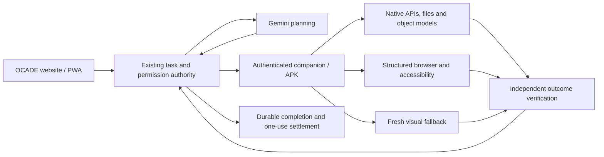
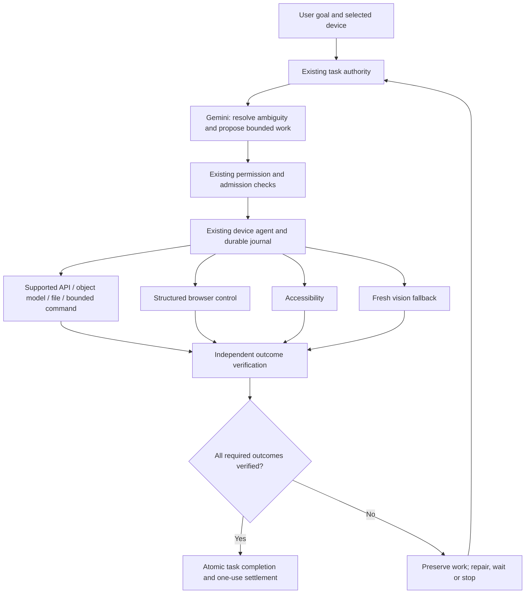
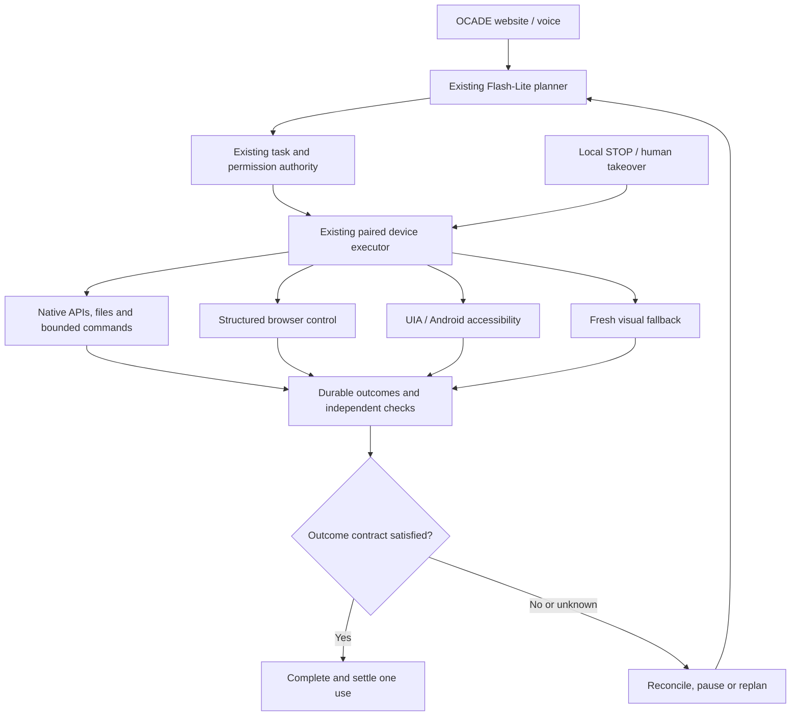

# OCADE — PLAN.md
> **One canonical implementation queue · CARCC / OCADE · consolidated 15 October 2026**
>
> This plan is a proposed execution authority assembled from the GitHub `PLAN.md` on `ocade/p00-p22-implementation` and five supplied file labels representing **four distinct audit contents**. AUDIT_01 and AUDIT_05 are byte-identical, so their shared material appears once. Other filenames do not reliably describe the actual document subjects. This 15 October independent pass inspected current source and historical CI logs without executing application code or tests. The coverage checkpoint below distinguishes carried reviews, new source reads and remaining gaps; it is not an exhaustive fresh certification.
>
> **Critical:** historical green tests are not present-tense launch certification. The recorded true Gemini acceptance baseline was **0/10**; 1319 passing historical automated assertions do not override it. This document instructs future work; it does not claim features were completed by writing it.
>
> **Execution rule:** Complete Phase 00, then Phase 01, and so on through Phase 22. A phase is not DONE without its own reproducible evidence. Keep each change at its designated owner. Do **not** implement a later phase early, reopen completed earlier phases to add unrelated features, or make tests green by weakening them. A later failed cross-system gate may require a narrowly traced regression repair in the original owner: record it as a corrective revisit, not planned postponed phase work.
>
> **Scope:** website/PWA first; connected Windows companion and Android APK for authorised native control; Flash-Lite online planner and genuine independent offline Chat; one task authority, one STOP/cancel authority, independent verified results, exactly one use for verified complete JARVIS tasks. No hardcoded app-name journeys. ₹0 further spending without owner authorisation; cloud/disposable test environments before customer's own PC.
>
> **Branch safety:** this review edits ONLY `PLAN.md` on the implementation branch, not product source, deployment settings or production data. `docs/DECISIONS.md` controls binding owner choices; `AGENTS.md` engineering rules; `docs/ARCHITECTURE.md` execution contract; `docs/TESTING.md` proof; `docs/PRD.md` screens; `docs/JARVIS_DESIGN_SYSTEM.md` visuals; `docs/SUPPORT_LEGAL_SECURITY.md` rights/security/commerce; `ToRemove.md` safe cleanup. These remain specialist authorities, not separate phase queues.


## A. Source provenance, conflicts and no-information-loss rule

| Source | Supplied label | True content | Disposition |
|---|---|---|---|
| Existing GitHub `PLAN.md` | Current execution blueprint | P00–P22 history, acceptance, source owners and binding decisions | Mapped old Pxx to one sequential phase each; historical work records retained |
| Audit 01 | `AUDIT_01_CODEBASE_BUGS_AND_GEMINI.md` | Detailed 15 Oct business/product/architecture and P00–P22 master plan | Core updated programme and researched offer |
| Audit 02 | `AUDIT_02_COMPLETE_ENGINEERING_AND_PRODUCTION_REPAIRS.md` | Wider competition, UI psychology, Gemini engineering, test and commercial research | Mapped to topic evidence and phase-specific specifications |
| Audit 03 | `AUDIT_03_GLOBAL_COMPETITION_UI_UX_AND_BUSINESS.md` | Nine-block active-engineering estimate and efficient assignment discipline | Effort/evidence guidance retained; old nine-block order not a second executable queue |
| Audit 04 | `AUDIT_04_PUBLIC_LAUNCH_SECURITY_PAYMENTS_AND_ADMIN.md` | Argon/Flash-Lite computer-control design and exact source gaps | Architecture evidence and relevant phase repairs |
| Audit 05 | `AUDIT_05_GEMINI_ARGON_PC_MOBILE_CONTROL_AND_DEBLOAT.md` | Exactly identical to Audit 01 | Deduplicated; **not** a fifth independent audit |

**Source completeness qualification:** The user supplied five labels but only four distinct audit documents. This plan must not claim unique information from a missing fifth audit. Later agent: if the intended original fifth audit exists elsewhere, compare its digest and reconcile missing unique findings in Phase 00, without silently relabelling another audit.

**Old-to-new phase mapping (the only implementation order):**
- **Phase 00 ← legacy P00:** Establish source truth, checkpoints, licences and exact requirements
- **Phase 01 ← legacy P01:** Task identity, independent verification and exactly-once usage
- **Phase 02 ← legacy P02:** STOP, permissions, takeover and final-effect authority
- **Phase 03 ← legacy P03:** Durable journals, delivery acknowledgements and crash reconciliation
- **Phase 04 ← legacy P16:** Repair Gemini-native tool continuity, budgets and context
- **Phase 05 ← legacy P08:** One bounded local execution sequence for foreground and background
- **Phase 06 ← legacy P09:** Durable scheduling, events and safe background continuity
- **Phase 07 ← legacy P04:** Native file, Office fidelity and conflict-safe recovery
- **Phase 08 ← legacy P05:** Identity, owner/staff authority, MFA and scoped support consent
- **Phase 09 ← legacy P06:** Private uploads, data export, retention and irreversible erasure
- **Phase 10 ← legacy P07:** Genuine offline Chat, storage lifecycle and answer quality
- **Phase 11 ← legacy P10:** Capability discovery, unknown applications and verified recipes
- **Phase 12 ← legacy P11:** Website-first Windows installation, updates and browser attachment
- **Phase 13 ← legacy P12:** Voice, wake detection, turn-taking and interruption
- **Phase 14 ← legacy P13:** Android accessibility, navigation, APK lifecycle and recovery
- **Phase 15 ← legacy P14:** Apple platform truthfulness and supported integrations
- **Phase 16 ← legacy P15:** Unified premium UI/UX, settings, accessibility and admin console
- **Phase 17 ← legacy P17:** Professional application families and editable media outputs
- **Phase 18 ← legacy P18:** Three profitable recurring customer workflows and measurable value
- **Phase 19 ← legacy P22:** Evidence-based debloat with before/after parity
- **Phase 20 ← legacy P19:** Core candidate security, performance and independent cloud qualification
- **Phase 21 ← legacy P20:** Final major integration: payments, subscriptions and entitlements
- **Phase 22 ← legacy P21:** Post-payment final matrix, controlled launch, support and growth

**Conflicting historical advice:** Earlier immediate-audit dependency warnings may now be closed by later commits; never revert resolved security fixes. Different nine-block estimates are planning alternatives, not parallel work instructions. 'Run full tests after all coding' means full *release qualification*, not skipping tight regression tests during coding. Privacy/age/regional restrictions are externally binding, not overrideable by customer or owner approval. Payment implementation is the **last major functional integration** after a core release candidate is qualified; post-payment regression, pilot and approval remain mandatory. No business valuation or Argon-superiority claim is guaranteed.


## B. Starting checkpoint, already completed work and unresolved launch gates

<a id="continuation-checkpoint"></a>

### 0.8 CONTINUATION CHECKPOINT — independent review, 15–16 October 2026

**Scope and identity.** Existing branch `ocade/p00-p22-implementation`, inspected HEAD `356b04217b700034fb3966fd9e7fbdf2a3696f20`. The review began with **only PLAN.md modified**, containing the owner's consolidation; that work is preserved. Only this file may be edited. No application, test, build, installer, emulator or migration execution; no commit, push, fetch, deployment, spending or cloud mutation is authorised by this review. Read-only source/Git inspection and retrieval of existing CI logs are the evidence used. No fetch was performed, so remote-main freshness is **UNVERIFIED**. Before a later authorised implementation, recheck identity and changes.

**Authoritative source set.** All five originals were found at `C:\Users\haans\Desktop\ALL AUDITS`. Byte identity was verified; filenames are not reliable descriptions of their contents.

| Original | Bytes | SHA-256 |
|---|---:|---|
| AUDIT_01_CODEBASE_BUGS_AND_GEMINI.md | 111216 | `1657bc9b275957b7dcf4bf397d660bb74e8b5bacef3f200186891b5d207ce8d7` |
| AUDIT_02_COMPLETE_ENGINEERING_AND_PRODUCTION_REPAIRS.md | 106740 | `9dffe847e120b4f180b8568b1e23731eb461f6df9dc9afdc71853562cebf3263` |
| AUDIT_03_GLOBAL_COMPETITION_UI_UX_AND_BUSINESS.md | 19887 | `51a314405daeda72f8179259172e5ce05711ca45f3781e6bc369d47ed0a0a013` |
| AUDIT_04_PUBLIC_LAUNCH_SECURITY_PAYMENTS_AND_ADMIN.md | 59004 | `ae16c04b2497e991d8e6574d42eb4c95a6efe9a2aa727f5ead1a8d0eb32f2e9b` |
| AUDIT_05_GEMINI_ARGON_PC_MOBILE_CONTROL_AND_DEBLOAT.md | 111216 | Same as Audit 01 |

Four unique documents are available. A genuinely distinct intended fifth audit remains **MISSING / UNVERIFIABLE**; do not invent its requirements or block review of the four available originals. Audit claims are inputs to verification, not independent runtime proof. Audit 02's alternative prices and Audit 03's nine work blocks are retained as research/history; the current three proposed tiers and sole Phase 00–22 sequence govern implementation.

**Coverage boundary.** The current tracked inventory contains **968 paths**. Compared with the saved 989-path checkpoint, **771 current paths match a saved raw or LF-normalised SHA-256**: 750 classified FULL_TEXT_REVIEW, 20 INSPECTED_STRUCTURAL and one GENERATED_INSPECTED. These are carried historical evidence, **not 771 fresh reads in this session**. Another **149 paths changed** and **48 are new**; 69 historical paths are absent. Absence is not permission to reimport donor code. The completed path reconciliation and review methods appear below; exhaustive fresh semantic certification remains **PARTIAL**. A search hit, a file loaded into a tool variable, a hash or a structural check does not count as a full source read. Source coverage is never release readiness.

**Preserve verified repairs.** The October migrations already restrict client completion, preserve `unknown` for a claimed action cancelled/failed before its result arrives, lock ownership transfer rows, consume staff proofs and narrow staff read permissions. Preserve those guards, the model allowlist, page-facts carry-over, Windows keyboard fallback with clipboard restoration, offline transfer/resume and signed offline allowance mechanisms. Further defects below do not imply those repairs should be reverted. Applied migrations are immutable: use forward repairs.

**Current execution position (updated 17 October 2026).** Phases 02–05 implemented, each PARTIAL; Phase 06 is next. The CVE-2026-102989 hotfix is merged (#85, `a729878a`) and live in production. Every unpassed check is in [BLOCKED_TESTS.md](BLOCKED_TESTS.md), which every PARTIAL phase is revisited against before release. *16 October text follows.* Phases 00 and 01 closed; Phases 02 and 03 implemented and PARTIAL — their cloud evidence is BLOCKED (GitHub Actions refuses jobs; nothing charged). Owner approved (16 Oct) continuing with local, non-invasive evidence and batching cloud qualification later. Production hotfix for CVE-2026-102989 is prepared on `hotfix/tanstack-xss-cve-2026-102989`, awaiting deployment approval. See the 16 October work records ([00](#phase-00), [01](#phase-01), [02](#phase-02)). Distribution holds (donor-adapted rights, offline model licence) remain BLOCKED for Phases 20–22. *Superseded 15 October text follows.* Phase 00 was **PARTIAL**, not DONE: the source/audit reconciliation below is complete at its stated evidence level, but current dependency/rights and runtime baseline gates still require qualification before phase closure. Phase 01 is the next implementation package only after Phase 00's defined baseline gate passes and implementation is authorised. Historical package PASS entries describe specific dated checks; they do not close the stricter current phase contracts. All new source findings are static unless a named historical log supplies runtime evidence. No current tests were run. No production, physical-device, confidential-data, merchant, signing or budget gate is waived.

**How to resume without repeating work.** Recheck HEAD/dirty paths and compare changed-file hashes against the coverage manifest in this checkpoint; carry matching prior evidence forward. Read only changed, new, incomplete and relevant caller content. Keep one finding record per root cause in its owning phase. A blocked required phase stays open: continue independent read-only preparation, but do not skip its implementation gate or call a later phase complete. Record corrective revisits only for a reproduced regression or changed dependency.


**Legacy section crosswalk.** Historical references to Section 0.1 mean the current cloud-only execution constraints in Section F; 0.4 means the donor-removal record and [ToRemove](ToRemove.md), with no donor reimport; 0.6/Stage D means the evidence gates in Section F and Phases 20/22; 0.7 means dated historical reconciliation. Section 0.8 is the current continuation checkpoint. These aliases do not create another implementation queue.

#### Reconciled path coverage — 16 October 2026

**Accounting is complete; fresh semantic certification is not implied.** Of 968 tracked paths, 771 retain hash-matched checkpoint evidence; 63 changed/new files were read in full, 132 changed files had their complete diff inspected, one new coverage JSON was parsed structurally, and PLAN.md is the edited deliverable reviewed for retention, phase contracts and consistency. One of the 771 carried files, `src/lib/account-data.functions.ts`, also received a full fresh read; it is not double-counted. The 132 deltas include two generated artifacts (`package-lock.json` and generated Supabase types), whose dependency/type changes were inspected without claiming a fresh semantic review of their full generated contents. Thus 943 paths have cumulative full-text or verified-baseline-plus-delta evidence, 24 retain structural/generated classification, and PLAN.md is separately classified. There are **zero unclassified tracked paths**, not zero latent bugs.

**Reproduction and limits.** BASE is `9b2fe3e40fd915dcf32316e5daa20ed7295f8ffb`; current source is `356b04217b700034fb3966fd9e7fbdf2a3696f20`. The BASE blob of every one of the 148 changed non-PLAN paths was compared with the saved checkpoint's raw/LF-normalised digest and matched. A DELTA row therefore combines that historical review with all current changes and implicated caller checks; it is not a fresh full-file read. For the 771 paths absent from the table below, use [the original coverage record](docs/audit-checkpoints/20261010/coverage.json) and preserve its classification (750 FULL_TEXT_REVIEW, 20 INSPECTED_STRUCTURAL, one GENERATED_INSPECTED). Carry only if raw bytes or CRLF→LF UTF-8 bytes match its recorded digest; otherwise reopen that path. Binaries, model assets, dependency implementation, deployed configuration and physical devices are not semantically certified by hashes. No test/build/provider/device execution occurred in this review.

<details>
<summary>197 changed/new path records — current SHA-256 and review method</summary>

Hashes below identify inspected working-copy bytes. PLAN.md's hash is explicitly the **initial owner-supplied dirty consolidation**, not the self-referential final file. FULL ranges include a possible trailing blank line; DELTA means the complete BASE→HEAD diff, including additions/deletions and surrounding context. No new external ledger is created.

| Path | SHA-256 | Evidence |
|---|---|---|
| `.gitattributes` | `7013c95e415aec61197681cafaf41166ce62a62399585b31b6adf6e6ad126945` | DELTA / complete BASE→HEAD diff |
| `.github/workflows/cloud-android-isolated.yml` | `067cafbec27347a4b75ed1c79f19dc5b9b334923723152388f8ea854d8936af8` | FULL / lines 1–155 |
| `.github/workflows/cloud-browser-isolated.yml` | `886b4694f5c6d80c2cfb640951790e6b34153be62eb55ed26933b4707fec41ca` | FULL / lines 1–182 |
| `.github/workflows/cloud-python-isolated.yml` | `1890ddd1eb021dc3ca0e3f62bf11c0cb4c7a94248c668b81b22dc52e839add75` | FULL / lines 1–133 |
| `.github/workflows/codeql.yml` | `f094c6a5c0ee73012cd36c0b825ee471d1e115a1b113e731ef9f720a42404365` | DELTA / complete BASE→HEAD diff |
| `.gitignore` | `216aa94d30c35d7e7b6d3b30d73933b6a828622df182af6a061905394ead3ece` | DELTA / complete BASE→HEAD diff |
| `.prettierignore` | `f57610355bb803d81176581410546f7ed071c4b66b95fb1dda8c812968a57e14` | DELTA / complete BASE→HEAD diff |
| `AGENTS.md` | `629e6809cb77a642348f5ec282fd2a2ce8ec854d3009d98aa6bcc8c7b4b01bee` | FULL / lines 1–42 |
| `android/res/xml/accessibility.xml` | `d985c710e77fe4863f532caed113d5bbc0ec7ae53f8b5b05aacbf10267aae910` | DELTA / complete BASE→HEAD diff |
| `android/src/in/ocade/app/AgentService.java` | `3fde13c8bb6960358e0b3ffb2ceea965ae790574efb5007834e226ad8aa5f53b` | FULL / lines 1–400 |
| `android/src/in/ocade/app/Control.java` | `90ea791950036c571b1c38bdbc1514a8bc6950e502db7efb431be73f531ecc35` | DELTA / complete BASE→HEAD diff |
| `android/src/in/ocade/app/MainActivity.java` | `811a369e6d51ce8d10d30122083a8e8c94e72054ab819f0cff981a2b1516e3d6` | DELTA / complete BASE→HEAD diff |
| `android/src/in/ocade/app/OcadeAccessibility.java` | `56a0ae71289fbbc59cf9c77e4994b3915922c1dcdeb4da3a0ff14bcffd60a4ba` | DELTA / complete BASE→HEAD diff |
| `CLAUDE.md` | `90a67c434ef46e632ab1fc4a2a8e0ea5155a0356012301f85719db071d4ea880` | FULL / lines 1–111 |
| `docs/ARCHITECTURE.md` | `9d1d82e8ec4d2440a0204ec102de354d516740afd9a0f10050b0579efa588b51` | FULL / lines 1–427 |
| `docs/audit-checkpoints/20261010/coverage.json` | `b659cdb23ced9f008604d512276ee80b312425a1decf8188a76442d03f667911` | STRUCTURAL / parsed manifest |
| `docs/DECISIONS.md` | `10416bb61e9d118a87f4595044fdeae872561b1691cc1b8801f347d411ba0cc3` | FULL / lines 1–215 |
| `docs/DONOR_CAPABILITY_LEDGER.md` | `94cedcf2b6c58ce645909d50916d47effb054b736c4bd7b244c67a17854905c5` | DELTA / complete BASE→HEAD diff |
| `docs/JARVIS_DESIGN_SYSTEM.md` | `e1c95c91bdc0aa0913b5dcee5d51f161816a0b91dfe26c93b75c229d100a57eb` | DELTA / complete BASE→HEAD diff |
| `docs/PRD.md` | `bb4e75fae20828f46297c5c09bd76dbb6c89ada31b37f6ab995174da05811ead` | DELTA / complete BASE→HEAD diff |
| `docs/TESTING.md` | `9cab2fe58feb5ba9c8a89b5ad60a61149603c0d5ca1cd23f74c1ffe3254ef1fd` | DELTA / complete BASE→HEAD diff |
| `eslint.config.js` | `aa475bdf8e5f2632bdde66661c46749389807f160a31fd510824aab311cadf51` | DELTA / complete BASE→HEAD diff |
| `jarvis-runtime/actions/browser_control.py` | `88eedbbc93b797b65b1564ce2c854c3169ec806f7ead666c91c73cb0dcf2f7f4` | DELTA / complete BASE→HEAD diff |
| `jarvis-runtime/actions/ocade_document.ps1` | `94faf3f0c6c0e6b2db618db6606b697144c9282829fd12caa257d9cae82383fd` | FULL / lines 1–134 |
| `jarvis-runtime/actions/ocade_page.js` | `95a0f7f936d36d4206f337bd7673293e96398988ec32d380bfe211d0a745e1d0` | DELTA / complete BASE→HEAD diff |
| `jarvis-runtime/actions/ocade_workbook.ps1` | `86dddd86f76db45b6a52c94d8ef58ebc795966fa5e91e0aef5033daf7fe50be2` | FULL / lines 1–204 |
| `jarvis-runtime/ocade_accessibility.py` | `3b9e4cfe26c7e566d402f7d3950aaf7337b7737f285315ddd40a761979cb56c8` | DELTA / complete BASE→HEAD diff |
| `jarvis-runtime/ocade_agent.py` | `1b09d529f10ce8e6a7a06620318fe619e67af456da0093d4b9ba1b01f38df6c8` | DELTA / complete BASE→HEAD diff |
| `jarvis-runtime/ocade_computer.py` | `826dee63ef72c7208160ac122e253ad8cceb5b4280fab0249b0bddfa9944ede1` | DELTA / complete BASE→HEAD diff |
| `jarvis-runtime/ocade_device.py` | `78cf16524e3409d9c8408b7b56bb545ca579fde454ccee842bac744caafc0ed2` | DELTA / complete BASE→HEAD diff |
| `jarvis-runtime/ocade_discovery.py` | `29b88305249eb21189b50098c40eceaf54c666dfb95be1eaadf6cef5519ae028` | DELTA / complete BASE→HEAD diff |
| `jarvis-runtime/ocade_documents.py` | `b3fade668f87e80202175ea527969f92533711f785ed6e6652578fd884a6c87c` | FULL / lines 1–432 |
| `jarvis-runtime/ocade_existing_browser.py` | `7518ea7649950ac43c9fbaad5cb3cea209220bc1812d45f60c4327a4027dc7ee` | FULL / lines 1–154 |
| `jarvis-runtime/ocade_settings.py` | `f19e2c7e32809466a9e52eb21c86d9594dd16dada2d0aabd6536a4758cbb8e50` | DELTA / complete BASE→HEAD diff |
| `jarvis-runtime/ocade_sheets.py` | `eb55af78ea501b5b12bafecba02af4fa2980652e1984592c6644c8623ef49d23` | DELTA / complete BASE→HEAD diff |
| `jarvis-runtime/packaging/ocade-agent.spec` | `9bed8903245e9707a2fc5e60b8fd751593b2371c9334542f35552be7bf39a43a` | FULL / lines 1–65 |
| `jarvis-runtime/README.md` | `7decff4e01a9b557e3019d9f1ed135086d45e638297e20dd06f7a3a69692491a` | DELTA / complete BASE→HEAD diff |
| `jarvis-runtime/requirements-agent.txt` | `b98d255629a9820e91f55c6c90453b6063c43c2aa43d70871e0e959c4a41b5b6` | FULL / lines 1–40 |
| `jarvis-runtime/tests/conftest.py` | `2edcea996b86b011eae16f1e3aa9e7203a92aaa36a7aacd9d6c98c94201e72e9` | DELTA / complete BASE→HEAD diff |
| `jarvis-runtime/tests/test_agent.py` | `8dabdfbd251ea115bf77b62ff29b003ab9d4eea5c4669f24d70b4490f11837de` | DELTA / complete BASE→HEAD diff |
| `jarvis-runtime/tests/test_browser_control.py` | `9ece6bddcb44f5c9fc4806115dfd305874210de2df76c0a8f7d346a309247a4e` | DELTA / complete BASE→HEAD diff |
| `jarvis-runtime/tests/test_computer.py` | `38d95dd5645472496ca90538cfbf765e75f1d58e7eb5426af951e24f094eef8d` | DELTA / complete BASE→HEAD diff |
| `jarvis-runtime/tests/test_discovery.py` | `d14dd257cadbd5eaf09e5d00c595c6feda08d71529671eed93a9740fbe96fe3d` | DELTA / complete BASE→HEAD diff |
| `jarvis-runtime/tests/test_existing_browser.py` | `a960ac437f798f169f301193439172fbd067a7d0e8ff687468f9f0e8414e0847` | DELTA / complete BASE→HEAD diff |
| `jarvis-runtime/tests/test_files_documents.py` | `c43972d6ec99d86992b16961fbf88df39ceda4cb5cc6f3373aa8d6774f3065f7` | DELTA / complete BASE→HEAD diff |
| `jarvis-runtime/tests/test_safety.py` | `6dc9255a80537429350e744b320a0a16f3a1af1e5d085958b5fd8ac10ed5c440` | DELTA / complete BASE→HEAD diff |
| `jarvis-runtime/tests/test_sheets.py` | `d3bdde332312bf886eec00472a7e7eac5f22b134a98fa8d527f5399732ded9ab` | DELTA / complete BASE→HEAD diff |
| `jarvis-runtime/tests/test_ui_act.py` | `b9202c02a8cca0756160c12a4553e77ef5578154b4856a236c1eea3257827c4d` | FULL / lines 1–201 |
| `jarvis-runtime/THIRD_PARTY_NOTICES.txt` | `9716777f8c98746859de7387f5ed0f21dbe0be4aea10e538475dc19f179af5cc` | FULL / lines 1–24 |
| `OCADE_CODEBASE_PLAN_AUDIT_2026-10-11.md` | `01d423c2344bdd8a4a20f68bc7b982947cead93e9f190a22d7c8fa99187c7daf` | FULL / lines 1–735 |
| `OCADE_UNIVERSAL_CONTROL_COMPETITOR_AUDIT_2026-10-11.md` | `8516172124ebf88d701af38fee786579d7019e862e98a4bb4b5843bd36ff575e` | FULL / lines 1–775 |
| `package-lock.json` | `c202d6daebf059a308e5a2ed871dcc97af6dd2c02fd5778c9f9ae0ccc6e75e7c` | GENERATED / complete delta inspected |
| `package.json` | `c365d0b898c2f422b9d18f7fa23a6d99c79ff6dd6657dc580c4075f2e2cf7bd2` | DELTA / complete BASE→HEAD diff |
| `PLAN.md` | `837da5fe00c1abf547ee43c1c853119ef61aac864dd455b4952fb58fe614246a` | EDITED / retention and structure checked |
| `scripts/check-accessibility.mjs` | `70c1a85f7b488406fd35a2805f05c796e403522d63b335c57d9ae14b7af53235` | DELTA / complete BASE→HEAD diff |
| `scripts/db-twin.mts` | `214d19d2b41478b6d3acc10deece3285d53bd09ea513a5d8f177942a1234ad2a` | DELTA / complete BASE→HEAD diff |
| `scripts/deploy.mjs` | `8c2186f3e5168d93cd94a773c58299c8883db75622edbbc93c77be3be987d77b` | DELTA / complete BASE→HEAD diff |
| `scripts/e2e/admin-journey.mjs` | `f31e07a9e76aae718c939660ea5928e9312f1f4aac9b02184dcc34e54c494523` | DELTA / complete BASE→HEAD diff |
| `scripts/e2e/android-journey.mjs` | `f5c81290b6bb654406a66bacba6fc36806dca5163bf07c12b1c69aed324e604f` | DELTA / complete BASE→HEAD diff |
| `scripts/e2e/browsers-journey.mjs` | `10abcc86de296a149f041ec0ce6a9bd74065050744f2dcb8a4a7ff25101e2e53` | DELTA / complete BASE→HEAD diff |
| `scripts/e2e/carry-on-journey.mjs` | `7dc355cd33e17ec1bbe60ce538f66d5b625b0cb63491937b3b160a155dff9fd6` | DELTA / complete BASE→HEAD diff |
| `scripts/e2e/chat-journey.mjs` | `41d3c36cfb3859bbec5dcbfe58d254d505c572a4f7c54f66bf1e1ca960981acb` | DELTA / complete BASE→HEAD diff |
| `scripts/e2e/controls-journey.mjs` | `abb4e5ba6219c4c57c4739bf0af4f8021c070b094aa12a82bea1561545bf5666` | DELTA / complete BASE→HEAD diff |
| `scripts/e2e/harness.mjs` | `d33392e95fe454194364b4d7f8152f3672590ceb9b10f0f5defd44b666da02c1` | DELTA / complete BASE→HEAD diff |
| `scripts/e2e/jarvis-journey.mjs` | `904e76bcd4737690ad0a3e287bd62f0340c160f24809c55d7d0e67c9c7059764` | DELTA / complete BASE→HEAD diff |
| `scripts/e2e/library-journey.mjs` | `6706e130915e07af499941e6813b364549bcc18687c40f731ee65d7b63fdab10` | DELTA / complete BASE→HEAD diff |
| `scripts/e2e/live-journey.mjs` | `84dd0ea2db93d768b996c115c1d036b3dc90ab0f55e06d965cffe965e864d0d0` | FULL / lines 1–413 |
| `scripts/e2e/mfa-journey.mjs` | `070e13fef4c85942fb5ffbb9fb0e5d2d0677b36fcdc8251079d4f12b4acc3f00` | DELTA / complete BASE→HEAD diff |
| `scripts/e2e/office-journey.mjs` | `792271bf5f4eeea8e0ea5e6372c79dfb75b7ba38380dabca99e64879b5411cfd` | DELTA / complete BASE→HEAD diff |
| `scripts/e2e/offline-journey.mjs` | `257c9193ad3acfcaea02b148a1d9c6b762a669a69c1a7e6fab8cf40a3007221e` | DELTA / complete BASE→HEAD diff |
| `scripts/e2e/offline-real-journey.mjs` | `3f01c9dc5c2a8c047862c430002b5c1e5eabee65c6d55f90c39bb075bbd846b4` | FULL / lines 1–271 |
| `scripts/e2e/online-journey.mjs` | `1e0a26f0fd5da65c218bfe653ff6c8e2c1efa90ffd2ce2ab0fe89fbabe615a71` | DELTA / complete BASE→HEAD diff |
| `scripts/e2e/push-journey.mjs` | `8f7d604ca9af0f03a10a90ed311232be60673f57a22884b0596b8b6c650f9bfc` | DELTA / complete BASE→HEAD diff |
| `scripts/e2e/settings-journey.mjs` | `2c0435592df3ec0afbcbe8e687962f3d291d1a337d079296ad1983370605ddd5` | DELTA / complete BASE→HEAD diff |
| `scripts/e2e/supabase-stub.mjs` | `ec628af05622ce63b166910dc9acf229611da26a0e4cba2477f47243a4446e2e` | DELTA / complete BASE→HEAD diff |
| `scripts/e2e/timings.mjs` | `15536eb9c83da0975b6793f8d7f8ba44631b0f4bb6b74faafb238e7cfb31f366` | FULL / lines 1–55 |
| `scripts/e2e/usage-journey.mjs` | `e825430181526a1ec0657886542a2efa9e3d71df00d391507de50938d5bbee53` | DELTA / complete BASE→HEAD diff |
| `src/cloudflare-entry.ts` | `63740f661f3b81fa6a5b144557e11f392faccec871e5f2a23ecb5239035769c2` | DELTA / complete BASE→HEAD diff |
| `src/components/chat/ChatWorkspace.tsx` | `d88b34bfc8ffaa14561091942c058717f8c907dde24f1757c839166c5b878aad` | DELTA / complete BASE→HEAD diff |
| `src/components/security/ConfirmIdentity.tsx` | `477d6b79ca16ba6cc90fef63fbd0cffcf212a15b05f8ba5eae031d611da812a4` | DELTA / complete BASE→HEAD diff |
| `src/components/settings/AdvancedSection.tsx` | `bbf7a5371ffdca0eb2bd6a4b12e3d73d7c849428a64ee0dc643103da49a60392` | DELTA / complete BASE→HEAD diff |
| `src/components/settings/DataControlsSection.tsx` | `2506d487ef7b2cb3430614de701729ae9271d734d4b9b5f66683a965189f42af` | DELTA / complete BASE→HEAD diff |
| `src/components/settings/settings-dialog.tsx` | `70813fffb1e43109cd63c4e58d5741bafd280d94e1550279a117fa5e2161103f` | FULL / lines 1–410 |
| `src/components/settings/settings-panel.tsx` | `aa72f0fd7722c6f62874939f2fed2eaefde8a4512b0541c7d5e79ed75f17ed44` | DELTA / complete BASE→HEAD diff |
| `src/components/shell/AppShell.tsx` | `32e2a29dabfa5d240e910562e5a8c5af0d4292bd0c95ddf7494485bfe086b1d4` | DELTA / complete BASE→HEAD diff |
| `src/integrations/supabase/types.ts` | `4829d37ededd45cd4697c1c0ec8c5d3d681b0e1df49112d90d16f02154961777` | GENERATED / complete delta inspected |
| `src/jarvis/__tests__/agent.test.ts` | `c91d9af57d087626d2fc3e6e5ed206da82e14405a4e46d0d8f66f813d8cbe33f` | DELTA / complete BASE→HEAD diff |
| `src/jarvis/__tests__/busy-model.test.ts` | `cccf48316290ff897b5b0a8c9e22675a92ca28698245827e31642a19fd15cf74` | FULL / lines 1–58 |
| `src/jarvis/__tests__/carry-on.test.ts` | `7c5156a78827b254a40f5a25b55857fda0b429be6d2b031e1230887402d1ff33` | DELTA / complete BASE→HEAD diff |
| `src/jarvis/__tests__/device-exchange.test.ts` | `d2e5cdfdb1231e4a52297c37fce2862c311f0fa1ddd4ab26920e5a7e389d0e00` | DELTA / complete BASE→HEAD diff |
| `src/jarvis/__tests__/device-protocol.test.ts` | `96867d92853426493122c2f727bd73063820afdd31430e84939667d682714d48` | DELTA / complete BASE→HEAD diff |
| `src/jarvis/__tests__/graph.test.ts` | `3db4f1cba872748a3a68269f23fe4036189beaad279aaafcc9e93ac6cc4de7dd` | DELTA / complete BASE→HEAD diff |
| `src/jarvis/__tests__/jarvis-rules.test.ts` | `b5beb56327196274a9fb2e4ebdd2e6bbe647fef4e42933d8c0b9bada628a06fa` | DELTA / complete BASE→HEAD diff |
| `src/jarvis/__tests__/jarvis-schema-against-postgres.test.ts` | `981dee64030d7075ba1052598d6de940253ebb1228b30dc9af4f982475c73fe8` | DELTA / complete BASE→HEAD diff |
| `src/jarvis/__tests__/no-donor-runtime.test.ts` | `4ae582295143f5fad065a8129c39bc4c258c09529f944948492076d87cc0bca3` | FULL / lines 1–83 |
| `src/jarvis/__tests__/rest-adapter.ts` | `055a60c9a841424db77e17b46a8131a344eec54d6c14fcbf0b8eeac301e7df17` | DELTA / complete BASE→HEAD diff |
| `src/jarvis/agent.ts` | `18527a5a5c8f1846bc75dcd0dea811e4fba77ae911be7b78a0d22aa45c4c145f` | DELTA / complete BASE→HEAD diff |
| `src/jarvis/background.server.ts` | `35a1301f120535833ef83ab6205f92aaa26540fb7a4b1a99a191445601afbabf` | FULL / lines 1–455 |
| `src/jarvis/device.server.ts` | `dc106eaf556eb25af0f2eef9bb37e71f6a7d9cb7a8974aac16e030ff2b33bbe1` | DELTA / complete BASE→HEAD diff |
| `src/jarvis/graph.ts` | `b54e05f080b6e245e8699d64ef9eee4640ebeb5f18b7cc20ded425cade24a7ae` | DELTA / complete BASE→HEAD diff |
| `src/jarvis/jarvis.functions.ts` | `b7052130d9b68de9c40ca75c80790bcd614799586bfc210487655b239bd96f3f` | DELTA / complete BASE→HEAD diff |
| `src/jarvis/JarvisPanels.tsx` | `c6c1d44fcb390ff80af0eb74af6b53aa80c7b28e85a9fb109fd25cdcbd42bc35` | DELTA / complete BASE→HEAD diff |
| `src/jarvis/JarvisTask.tsx` | `3da24e8e2a6fa0e3b4c9c31a1a96f3a30c263b224ebd794a092bba0e81e49a90` | DELTA / complete BASE→HEAD diff |
| `src/jarvis/JarvisWorkspace.tsx` | `c874f730f5d84738ec5fd5d735d2fc6e7baf110092777e774e77bad4de372237` | DELTA / complete BASE→HEAD diff |
| `src/jarvis/live-deps.ts` | `176b67b298b2440d548c7b252cec0a439f13b60eb293d321b381740b76460e88` | FULL / lines 1–238 |
| `src/jarvis/Orb.tsx` | `b362d5fe19f2b318b97e5812ea932f4d270dad62a8964935d32d0485284373b0` | DELTA / complete BASE→HEAD diff |
| `src/jarvis/permissions.ts` | `5d122b35312f3edb8839c9e9cad6ed6d217392ecdbb3a6ec6cd7df2db69c124f` | DELTA / complete BASE→HEAD diff |
| `src/jarvis/preferences.ts` | `5882dd2780ba285fceee15dc50993e2cecaea7f58e95c8724eb10faa247cef6c` | DELTA / complete BASE→HEAD diff |
| `src/jarvis/protocol.ts` | `722a75087cad4e04415ade5110b13a441059aac6278762992aea5bfb5c0f256e` | DELTA / complete BASE→HEAD diff |
| `src/jarvis/schedules.server.ts` | `c61b883a79efa6874c0c362b514e9ac70a61924a07a71d33c742baf64087c32a` | FULL / lines 1–183 |
| `src/jarvis/stop-everywhere.ts` | `50eb0bcfeb5c2fc07db3a94539f4f4b8085b0dca67bb443f8d9308db47bdc30f` | DELTA / complete BASE→HEAD diff |
| `src/jarvis/task-authority.server.ts` | `0847b8d60be26c572e3aa4d59e5a752e8cb83d6b95547f83bf71fe6550c89102` | FULL / lines 1–439 |
| `src/jarvis/use-voice.ts` | `18e472afb0db5d2d87f0392baf232bfadaa36e3cb03e1e356384fda75ada6e71` | DELTA / complete BASE→HEAD diff |
| `src/lib/__tests__/deploy-workflow-agrees-with-controller.test.ts` | `e7c59369dd019d50f362d63641d7e03b257278dfbe2184d8ae58b34e7bbb61b6` | DELTA / complete BASE→HEAD diff |
| `src/lib/__tests__/the-product-says-what-it-does.test.ts` | `84d6517df2516b2569ac07039fbe6e75c87a9abbf17b237dc862ee372499b589` | DELTA / complete BASE→HEAD diff |
| `src/lib/account/__tests__/data-rights-map.test.ts` | `aa3fc9ecbd0444817cb499c28b94706e01799a6aca04538da19223553ba490ce` | DELTA / complete BASE→HEAD diff |
| `src/lib/account/__tests__/data-rights.test.ts` | `096c9e18ab0da43222d2a08f247df9628adcfc0df6d35a25ab47cdfc0ac19852` | FULL / lines 1–247 |
| `src/lib/account/__tests__/deletion-checks-every-step.test.ts` | `96f4b76c296ad8da2d25eeb9ed979f86d630736a804177f4ee84a0366f0112de` | DELTA / complete BASE→HEAD diff |
| `src/lib/account/data-classes.ts` | `b3a0c2756a861545f9a2d52b23f4c44edc564977c8dcfc889fb0fd2404c62f34` | DELTA / complete BASE→HEAD diff |
| `src/lib/account/data-rights.ts` | `a017c0404ea84ba6165646dcb12f8293e1d0d3e3e30ba8d02e03b60f032a91d6` | DELTA / complete BASE→HEAD diff |
| `src/lib/admin/__tests__/an-operator-can-act.test.ts` | `805aaaaba342713b45b35dbae50d0ddf09130d761e65657f9368c68b30874767` | DELTA / complete BASE→HEAD diff |
| `src/lib/admin/__tests__/customer-operations.test.ts` | `c82ff24053014d965edff02edbbb641fc2ddb79ce9d06aded41f5d2aabcdf9c4` | DELTA / complete BASE→HEAD diff |
| `src/lib/admin/__tests__/owner-staff-on-site.test.ts` | `7e472552e2d8119a0ff23313813c5f1a2707f3c6036e398de619df2129664179` | DELTA / complete BASE→HEAD diff |
| `src/lib/admin/__tests__/staff-authority.test.ts` | `fc4c3c7f97fb212b78cd1c47a80a6302135366e72a47e4689c15f09608512459` | DELTA / complete BASE→HEAD diff |
| `src/lib/brain/__tests__/a-question-waits-for-the-engine.test.ts` | `f261d28d3d06c2669a23d6ec8043037648e633dc87eb15e40ade61ee29ec9434` | FULL / lines 1–81 |
| `src/lib/brain/__tests__/an-update-does-not-redownload.test.ts` | `dd0e9a4f862c0840f55fa8b1c6d9ddfe427af0b61be4835f7751337f543e6941` | DELTA / complete BASE→HEAD diff |
| `src/lib/brain/__tests__/install-once.test.ts` | `beb7c5645e58e306ff2acdc42ec0c88ef6a793bffaf1d11c5fd2f8efd43be19c` | DELTA / complete BASE→HEAD diff |
| `src/lib/brain/__tests__/streaming-digest.test.ts` | `7a04f1b68bc3b5aa6e3120f6fc17ddcf75bcac41f0cd2112bfd4753faf49036f` | DELTA / complete BASE→HEAD diff |
| `src/lib/brain/installation-authority.ts` | `d42bffa1e29e8b8308fac72eb52d2996a4207bdbe7cc4ab0b9d06990ce21d207` | DELTA / complete BASE→HEAD diff |
| `src/lib/brain/model-transfer.ts` | `9884370cd75ad70ceff4dac663ba9e8f97cf2e32dbca19b005be3599ab29ac5f` | DELTA / complete BASE→HEAD diff |
| `src/lib/brain/runtime-activation.ts` | `1abf97664dd11abb39dbd82288fc4f623834df4a955015402bd72de03c31bf01` | DELTA / complete BASE→HEAD diff |
| `src/lib/brain/streaming-digest.ts` | `cf739fe613b9715f87b353208b5dcc951ff692720bb0bf87fb8a30261afe7d71` | DELTA / complete BASE→HEAD diff |
| `src/lib/brain/use-installation.ts` | `fc8a61d7ad36c09ac2e84ae19bee323ee5fd0ad1aeb3827f15307d95b71d9210` | DELTA / complete BASE→HEAD diff |
| `src/lib/chat/__tests__/offline-turns-reach-the-account.test.ts` | `59efe72b02ae81baa2ac0af1551f9e284dd5ecd93e809454e2eec41d62cf4f01` | DELTA / complete BASE→HEAD diff |
| `src/lib/chat/unsynced-turns.ts` | `088ca0cf4b720c3cf89d51057498f413df16e3690de6cc2be394b4c923971839` | DELTA / complete BASE→HEAD diff |
| `src/lib/chat/use-chat.ts` | `5b4e9af433a4fdeb22e0a923e26d3f533c7e53e5a7b52c88bbbe76823d1a9310` | DELTA / complete BASE→HEAD diff |
| `src/lib/commercial/__tests__/jarvis-task-is-one-use.test.ts` | `31303531db0bca0de3f66278b2b63b79312172ed23fb1f8b090fffa9193db7b6` | FULL / lines 1–166 |
| `src/lib/commercial/__tests__/offline-allowance.test.ts` | `a332b62adf45f668e417d9865cbbdc068a4b7978758b47391e3f9f7f6e307973` | DELTA / complete BASE→HEAD diff |
| `src/lib/commercial/offline-allowance.ts` | `6e72f31bca3c0eebb50aed6fd1952d29cb2e05b75a7e1b709a7d785ca3faf4c7` | DELTA / complete BASE→HEAD diff |
| `src/lib/intelligence/__tests__/edge-handler.test.ts` | `38d73b362510f0770d594c6f9817f236444ffe3fa73815dde995a477e605c1b1` | DELTA / complete BASE→HEAD diff |
| `src/lib/intelligence/__tests__/online-client.test.ts` | `7b4538a28250bd8107e113b16971127a808a632b8652e162f7521393745a5932` | DELTA / complete BASE→HEAD diff |
| `src/lib/intelligence/__tests__/pinned-model.test.ts` | `9c1e706a747773003aa4fcfb0f62cc2383a9e332ef7836a3e258f735e1bb5703` | DELTA / complete BASE→HEAD diff |
| `src/lib/intelligence/contract.ts` | `84054b5ac9fe432fc8f075865ae06fbcdce8d7f72431c64ec4c851465dc26ce7` | FULL / lines 1–238 |
| `src/lib/intelligence/edge-handler.ts` | `445cde28b62a311ba65abc673c13c0b52273be45f4bec564df53ebbde2aae594` | DELTA / complete BASE→HEAD diff |
| `src/lib/intelligence/online-client.ts` | `12f98d2dcedeab8fe6e825e3eeed28debcf83db8f9044798294e614018116041` | DELTA / complete BASE→HEAD diff |
| `src/lib/intelligence/online-consent-ask.ts` | `6f86a734a1e83ea3ac60ee99ae57ee42676aa1d0c58a3bc2e2686dcf32c51e7d` | FULL / lines 1–12 |
| `src/lib/intelligence/online-consent-version.ts` | `a63082c19cffdbd2436861657fcf12e98591c289520a0d392815200add56ba92` | FULL / lines 1–3 |
| `src/lib/intelligence/online-consent.functions.ts` | `4b4960f4a57db981b5bc74bd5903add84c765e4542051e4d3752ad7685612c6b` | FULL / lines 1–41 |
| `src/lib/intelligence/online-models.ts` | `80ecace0c676e1f9f4ad7dc9ffea0e82b25819fea2f15cfb718d9f31da9a4778` | DELTA / complete BASE→HEAD diff |
| `src/lib/intelligence/OnlineConsent.tsx` | `548c6f4d0b5b783fb343d3d4ea909715a6d150194cd23c4d01b327efd51d2e8d` | FULL / lines 1–97 |
| `src/lib/library/tombstones.server.ts` | `95b6cbbf16458a4a2705c7d903991a4f0aee34bbb4ca6e639e24e60aed1bcbbc` | DELTA / complete BASE→HEAD diff |
| `src/lib/notifications/__tests__/delivery-state.test.ts` | `43cc0db077dbfd434dde0d6d2e1517ac7e7e89527b84b6c868d3ff44e1ca1e9a` | DELTA / complete BASE→HEAD diff |
| `src/lib/notifications/__tests__/notification-preferences.test.ts` | `3d858176d404973c94a1e83d8ba33124ce585d134f71632fae10119bdbfcdc71` | DELTA / complete BASE→HEAD diff |
| `src/lib/notifications/channels.ts` | `423511df6317628918b41d4c9815ef50052791ca8fd1433a850de586c617b234` | DELTA / complete BASE→HEAD diff |
| `src/lib/notifications/delivery.ts` | `e48bf78a3f246fdc43beb4e5e1f85fbdec722ff15517f06fd987031e10a41728` | DELTA / complete BASE→HEAD diff |
| `src/lib/notifications/push-device.ts` | `069349569f3cc036591137fbc4f9e63310dc6ca2d12366ece05e03d9e082cd60` | DELTA / complete BASE→HEAD diff |
| `src/lib/security/__tests__/reauthentication.test.ts` | `a69b7389c52e244dec4158dcdb9a3574ce22a4cd01e8d05b5ba3c096f967a27e` | DELTA / complete BASE→HEAD diff |
| `src/lib/security/__tests__/recovery-codes.test.ts` | `60609740633af1a1f3d18c24e177ea2af6b42f8ffea58467710d6ee2f4c166cb` | DELTA / complete BASE→HEAD diff |
| `src/lib/security/__tests__/second-factor-enforced.test.ts` | `60a28d97783dad76d655413e4f80e1415810adec8ca856412c9d8e38e1573e0f` | DELTA / complete BASE→HEAD diff |
| `src/lib/security/assurance-middleware.ts` | `6f3233a568694a3f2c920855017b6b38525ee456461f80a2f5441e8d1477a088` | DELTA / complete BASE→HEAD diff |
| `src/lib/security/reauthentication.ts` | `aa196e38644f1f5564882df2367037e87f3ccc45a04e093196b9441599afb3ce` | DELTA / complete BASE→HEAD diff |
| `src/lib/security/recovery-codes.ts` | `46286fb66e4bdadc12d80009038bcd35cc67a8b5af4af6d1eddc25a2bb380978` | DELTA / complete BASE→HEAD diff |
| `src/lib/time/__tests__/trusted-clock.test.ts` | `4d2ee693c30bb73baadda244f8779009f93f2d33edfdb64469330399dcec0389` | DELTA / complete BASE→HEAD diff |
| `src/lib/time/trusted-clock.ts` | `aa0a471683e4fa41ebdb45b0c98860289dcb3d3d360bd3edc26074011c4b6125` | DELTA / complete BASE→HEAD diff |
| `src/routes/__root.tsx` | `851dfc5ad3889c60a7e8d68871e662bfdd8b2fa8e3e83e04f272202e4ae18aa0` | DELTA / complete BASE→HEAD diff |
| `src/routes/_authenticated/library.tsx` | `721b379cb07eb1f9ed13453461b15cfa9eadc7a74567a362c247471d8757f40c` | DELTA / complete BASE→HEAD diff |
| `src/routes/help.tsx` | `777026e751b3cc06dabec9ac0e0db0b987bd5d46bee76089159974431bb565ca` | DELTA / complete BASE→HEAD diff |
| `supabase/functions/_shared/boundary.ts` | `69f2e421347891d73d33e0f2c4ab37d5d9102511eba5f60116be9df94f702610` | DELTA / complete BASE→HEAD diff |
| `supabase/migrations/20261011090000_ownership_transfer_locks_both_owners.sql` | `a33cf6e304db4a2062e125558785dfa1b8686e9f967c98c5ab58e45e6b532be7` | FULL / lines 1–57 |
| `supabase/migrations/20261011100000_one_proof_one_action.sql` | `b2922e5c359ec8eb6aacc7e39a77bfc2de12aa632f7f047f077591a24e6e32b0` | FULL / lines 1–52 |
| `supabase/migrations/20261011110000_live_frame_capture_time.sql` | `d6925677609b0f133c3d4fde201c102cdf7e0dcf775797c845ccec5112ea9930` | FULL / lines 1–5 |
| `supabase/migrations/20261012090000_completion_is_the_servers.sql` | `121643c27aeb7e131edf50e76f96cd1424ea1c160cbc549014611266b1ae44c6` | FULL / lines 1–52 |
| `supabase/migrations/20261012091000_one_proof_one_staff_change.sql` | `5825fca15bb9cb36ec225cbed4b492b93564185bcba048f349bf93643076b628` | FULL / lines 1–96 |
| `supabase/migrations/20261012092000_staff_reads_follow_granular_rights.sql` | `d75feaa200e9764d9b29d5652528dfb0edc7772edfa7e58c916ffd57461caa69` | FULL / lines 1–29 |
| `supabase/migrations/20261012093000_app_names_in_any_script.sql` | `1f86cec83416e28ed2f6a9897b5c03929649aff8781cdb420647ef4191bf7c97` | FULL / lines 1–17 |
| `supabase/migrations/20261013090000_one_verified_task_one_use.sql` | `30cb1797a525c5bfcc5e6ad68237356b76705d40bb58febb6ee37355de275a66` | FULL / lines 1–190 |
| `supabase/migrations/20261013091000_online_ai_consent.sql` | `8628af22428a0cf51cf8e8a735e0b46104f29cbf878bb57a6ea10597a3ac3be8` | FULL / lines 1–40 |
| `supabase/rollback/20261011090000_ownership_transfer_locks_both_owners_rollback.sql` | `ce05cfc6e121a665be6e7645d3afc3e275bd246751155e652f6b07b35789d066` | FULL / lines 1–38 |
| `supabase/rollback/20261011100000_one_proof_one_action_rollback.sql` | `8d1983e43cbae9837addcc596f6b45cbdcf8c96eaa7767c7c6dc9b89123641d8` | FULL / lines 1–6 |
| `supabase/rollback/20261011110000_live_frame_capture_time_rollback.sql` | `1131a76acca97f11947319a20ba9e41dffd2f0540f5ab51bef88b7132c395aea` | FULL / lines 1–5 |
| `supabase/rollback/20261012090000_completion_is_the_servers_rollback.sql` | `7c70e5d71af37186de37043b07e7fa9a4379636b1c873c7dc2a820d4ffd87734` | FULL / lines 1–8 |
| `supabase/rollback/20261012091000_one_proof_one_staff_change_rollback.sql` | `ecf00a14a7d270b33f8c872301cde5a60c5fa06be14804c14ca12e28beedc361` | FULL / lines 1–16 |
| `supabase/rollback/20261012092000_staff_reads_follow_granular_rights_rollback.sql` | `8f86c7e67d3151cbda22adf84cf4b48155d57879fd16904fadd12e1890529cc7` | FULL / lines 1–16 |
| `supabase/rollback/20261012093000_app_names_in_any_script_rollback.sql` | `a6fa24c26ccd1e53d686d8ca500468b4781d90feed3963c80178d1b99a78be75` | FULL / lines 1–12 |
| `supabase/rollback/20261013090000_one_verified_task_one_use_rollback.sql` | `9c4dffc4f9c7a639405832709a7700d957c38c31e2f05551884484395c2a122c` | FULL / lines 1–87 |
| `supabase/rollback/20261013091000_online_ai_consent_rollback.sql` | `89be178cab2bbbdf96cc91122915ff8e5d16d1cb1aa9a1d090e2f1136a378d8e` | FULL / lines 1–7 |
| `supabase/verification/20261011090000_ownership_transfer_locks_both_owners_verify.sql` | `d5172863d536ed8d86e145af9614b1ac2bd10ac4305bf51fdcc82ed63a36dae4` | FULL / lines 1–17 |
| `supabase/verification/20261011100000_one_proof_one_action_verify.sql` | `b4d86969843c41163b4de548b95d9c6760c14a748a73095dc0a15b19d0485d44` | FULL / lines 1–16 |
| `supabase/verification/20261011110000_live_frame_capture_time_verify.sql` | `62a7cd89706e21e58430adec55c6662e8c03e49a2ce3c25dbd3448aa8bd484ca` | FULL / lines 1–10 |
| `supabase/verification/20261012090000_completion_is_the_servers_verify.sql` | `f3e4fa7fded6fcf7d0fbf53805ee8104611cbda4fa5057e2fc84f937ac53d9d2` | FULL / lines 1–12 |
| `supabase/verification/20261012091000_one_proof_one_staff_change_verify.sql` | `3f6ae457541c254dc8243b963b6fff8bb2e4db3e2872ff177a40e5545b1e3462` | FULL / lines 1–16 |
| `supabase/verification/20261012092000_staff_reads_follow_granular_rights_verify.sql` | `99198a78ac5ce25f2d9b2267c27a6b5d18c0e58c0d433918217b8818ba640b88` | FULL / lines 1–10 |
| `supabase/verification/20261012093000_app_names_in_any_script_verify.sql` | `7974214161543d46ee86b0b0c0e2de59aa2efd5c8481427d8958f68df6b9ce3c` | FULL / lines 1–13 |
| `supabase/verification/20261013090000_one_verified_task_one_use_verify.sql` | `d01a3ef59dc202e645897a1b534ee5b2d38e0332bc729949d4b01de7b2a48e85` | FULL / lines 1–16 |
| `supabase/verification/20261013091000_online_ai_consent_verify.sql` | `822f392a983e152b3960f1427bef395e87644ec4e662c9412dc5beadf31a6f0c` | FULL / lines 1–13 |
| `ToRemove.md` | `fcb723ba6684f311e3f8decc8ba0e0f87f628c0fd577afeb1a2366247ba2c1a3` | DELTA / complete BASE→HEAD diff |
| `vitest.config.ts` | `3901de200d01b2a1ec9e3dfff0a1defbb88ced22d07c83a4c37ef2a069e7964c` | DELTA / complete BASE→HEAD diff |

</details>

<details>
<summary>69 historical paths absent from the current tracked tree</summary>

These are reconciled removals, not pending reads or permission to restore donor material. Their prior provenance remains in the saved checkpoint/history.

- `imports/UI OCADE JARVIS.zip`
- `imports/ocade-jarvis/CLAUDE.md`
- `imports/ocade-jarvis/LICENSE`
- `imports/ocade-jarvis/README.md`
- `imports/ocade-jarvis/ocade jarvis 25-09.zip`
- `imports/ocade-jarvis/source-original.sha256`
- `imports/ocade-jarvis/source-original/ocade jarvis 25-09/.gitignore`
- `imports/ocade-jarvis/source-original/ocade jarvis 25-09/LICENSE`
- `imports/ocade-jarvis/source-original/ocade jarvis 25-09/README.md`
- `imports/ocade-jarvis/source-original/ocade jarvis 25-09/actions/background_monitor.py`
- `imports/ocade-jarvis/source-original/ocade jarvis 25-09/actions/browser_control.py`
- `imports/ocade-jarvis/source-original/ocade jarvis 25-09/actions/code_helper.py`
- `imports/ocade-jarvis/source-original/ocade jarvis 25-09/actions/computer_control.py`
- `imports/ocade-jarvis/source-original/ocade jarvis 25-09/actions/computer_settings.py`
- `imports/ocade-jarvis/source-original/ocade jarvis 25-09/actions/desktop.py`
- `imports/ocade-jarvis/source-original/ocade jarvis 25-09/actions/dev_agent.py`
- `imports/ocade-jarvis/source-original/ocade jarvis 25-09/actions/file_controller.py`
- `imports/ocade-jarvis/source-original/ocade jarvis 25-09/actions/file_processor.py`
- `imports/ocade-jarvis/source-original/ocade jarvis 25-09/actions/flight_finder.py`
- `imports/ocade-jarvis/source-original/ocade jarvis 25-09/actions/game_updater.py`
- `imports/ocade-jarvis/source-original/ocade jarvis 25-09/actions/open_app.py`
- `imports/ocade-jarvis/source-original/ocade jarvis 25-09/actions/proactive.py`
- `imports/ocade-jarvis/source-original/ocade jarvis 25-09/actions/reminder.py`
- `imports/ocade-jarvis/source-original/ocade jarvis 25-09/actions/screen_processor.py`
- `imports/ocade-jarvis/source-original/ocade jarvis 25-09/actions/send_message.py`
- `imports/ocade-jarvis/source-original/ocade jarvis 25-09/actions/system_monitor.py`
- `imports/ocade-jarvis/source-original/ocade jarvis 25-09/actions/weather_report.py`
- `imports/ocade-jarvis/source-original/ocade jarvis 25-09/actions/web_search.py`
- `imports/ocade-jarvis/source-original/ocade jarvis 25-09/actions/youtube_video.py`
- `imports/ocade-jarvis/source-original/ocade jarvis 25-09/config/__init__.py`
- `imports/ocade-jarvis/source-original/ocade jarvis 25-09/config/jarvis.ico`
- `imports/ocade-jarvis/source-original/ocade jarvis 25-09/core/__init__.py`
- `imports/ocade-jarvis/source-original/ocade jarvis 25-09/core/action_loader.py`
- `imports/ocade-jarvis/source-original/ocade jarvis 25-09/core/audio_devices.py`
- `imports/ocade-jarvis/source-original/ocade jarvis 25-09/core/avatar.py`
- `imports/ocade-jarvis/source-original/ocade jarvis 25-09/core/avatar_mesh.py`
- `imports/ocade-jarvis/source-original/ocade jarvis 25-09/core/confirm.py`
- `imports/ocade-jarvis/source-original/ocade jarvis 25-09/core/echo.py`
- `imports/ocade-jarvis/source-original/ocade jarvis 25-09/core/face_model.obj`
- `imports/ocade-jarvis/source-original/ocade jarvis 25-09/core/gemini.py`
- `imports/ocade-jarvis/source-original/ocade jarvis 25-09/core/hotkey.py`
- `imports/ocade-jarvis/source-original/ocade jarvis 25-09/core/installer.py`
- `imports/ocade-jarvis/source-original/ocade jarvis 25-09/core/llm_client.py`
- `imports/ocade-jarvis/source-original/ocade jarvis 25-09/core/plugin_loader.py`
- `imports/ocade-jarvis/source-original/ocade jarvis 25-09/core/prompt.txt`
- `imports/ocade-jarvis/source-original/ocade jarvis 25-09/core/stt.py`
- `imports/ocade-jarvis/source-original/ocade jarvis 25-09/core/tts.py`
- `imports/ocade-jarvis/source-original/ocade jarvis 25-09/core/undo.py`
- `imports/ocade-jarvis/source-original/ocade jarvis 25-09/core/viseme.py`
- `imports/ocade-jarvis/source-original/ocade jarvis 25-09/core/wake_word.py`
- `imports/ocade-jarvis/source-original/ocade jarvis 25-09/dashboard/__init__.py`
- `imports/ocade-jarvis/source-original/ocade jarvis 25-09/dashboard/server.py`
- `imports/ocade-jarvis/source-original/ocade jarvis 25-09/dashboard/static/app.html`
- `imports/ocade-jarvis/source-original/ocade jarvis 25-09/dashboard/static/crypto-js.min.js`
- `imports/ocade-jarvis/source-original/ocade jarvis 25-09/dashboard/static/login.html`
- `imports/ocade-jarvis/source-original/ocade jarvis 25-09/main.py`
- `imports/ocade-jarvis/source-original/ocade jarvis 25-09/memory/__init__.py`
- `imports/ocade-jarvis/source-original/ocade jarvis 25-09/memory/config_manager.py`
- `imports/ocade-jarvis/source-original/ocade jarvis 25-09/memory/memory_manager.py`
- `imports/ocade-jarvis/source-original/ocade jarvis 25-09/plugins/__init__.py`
- `imports/ocade-jarvis/source-original/ocade jarvis 25-09/plugins/_template.py`
- `imports/ocade-jarvis/source-original/ocade jarvis 25-09/requirements.txt`
- `imports/ocade-jarvis/source-original/ocade jarvis 25-09/setup.py`
- `imports/ocade-jarvis/source-original/ocade jarvis 25-09/ui.py`
- `jarvis-runtime/actions/ocade_excel.ps1`
- `jarvis-runtime/actions/ocade_word.ps1`
- `jarvis-runtime/config/__init__.py`
- `scripts/wake/__pycache__/make_data.cpython-312.pyc`
- `src/jarvis/__tests__/source-is-preserved.test.ts`

</details>

**Audit retention and disposition.** All four distinct supplied texts were compared against the retained consolidation; unmatched substantive lines were inspected separately, including short requirements, tables, source links and ordering. Audit 03 was also read in full. This is content-retention reconciliation, not independent verification of every external assertion in those reports. The 11 October repository audits were read as historical evidence; their old 935-path inventory, maturity percentages, line numbers, dependency advice and proposed work order are not current readiness metrics or a competing queue.

| Audit material | Current disposition and sole owner |
|---|---|
| 01/05 product, business and P00–P22 requirements | Retained in Sections C/E and their mapped phases. Audit 01 lines 185–191 remain binding: separate Chat/JARVIS allowances, preflight limits, no charge for failure, preserve partial work, truthful waiting, easy cancellation and real support. Presentation is Phase 16; usage is Phase 01; subscription cancellation is Phase 21. |
| 01 competitor prices and “Essential half Premium” | Dated research only. Current official capability checks appear in D; exact checkout prices require refresh before use. Weekly ₹488 is not half monthly ₹988; the corrected cadence arithmetic in C governs. No superiority claim is established. |
| 02 technical defects and UI | Source-revalidated defects map to V01–V25 and the existing phases; preserve later fixes. Old 0/10 and CI counts remain historical. The ₹888/₹999 pilot and narrow single-offer advice remain experiments, not overrides of the owner's current 28/88 preference or three proposed tiers. |
| 03 nine-block estimate | Effort/capacity constraints retained in G: 126–222 aggregate active hours is a planning allowance, not nine two-hour sessions or a promise. Its overlapping block order and early payment work are superseded by Phase 00–22; no delegation, spending or execution is authorized by an audit estimate. |
| 04 hybrid control and removal candidates | Existing planner/broker/companion/APK/native/browser/accessibility/vision owners retained. Native provider history and retries belong to Phase 04; executor parity to 05; journals to 03; semantic completion to 01; capability qualification to 11; proof-gated residual cleanup to 19. No adapter deletion or new framework is authorized. |
| Missing distinct fifth document | UNVERIFIABLE. All five supplied files are accounted for; only four unique contents exist. A later distinct original must be reconciled by digest and unique requirement, not assumed to be covered. |


**Document validation — 16 October 2026.** PASS for documentation scope: exactly 23 Phase 00–22 headings in order; 25 unique V-records with primary owners; phase objectives, change dispositions, tests, rollback and exclusive exit gates present; local link targets and source line bounds checked (405 local links, including phase references); Markdown fences balanced; `git diff --check` clean. All **967 tracked files other than PLAN.md** retained their starting raw SHA-256; HEAD and branch remained unchanged and Git reported only PLAN.md modified, with no new untracked files. These are file/structure checks, not product tests. The document is ready to guide Claude through Phase 00's remaining qualification; it does not authorize source edits in this review or certify launch readiness.

### Historical checkpoint — 13 October 2026 (retained evidence; not current instructions)

The following records describe their dated environment. Current branch/dirty state, source findings and next actions are governed by Section 0.8 above. Historical PASS describes the recorded checks, not complete present-day satisfaction of a Phase 00–22 exit gate.

**Where.** Branch `ocade/p00-p22-implementation`; product code last changed at `8ae42bf4` (later commits are documentation only); `main` is `82f4f4c5`, untouched. Nothing merged, deployed or applied to production. Working tree was reported clean at that historical checkpoint; the 15 October review began with a pre-existing modified `PLAN.md`. Decisions in force: [Decisions — 13 October 2026](docs/DECISIONS.md#owner-decisions--13-october-2026-current-supersede-anything-older-that-conflicts). The dated paragraphs in 0.7 below are history; this subsection is historical state.

**Evidence at this checkpoint** (disposable GitHub-hosted VMs only; run ids are `https://github.com/BREVEX-CEO/caera-connect-plan/actions/runs/<id>`; a journeys run marked "failure" because of a BLOCKED check is the gate working, not a failed check):

| Area | Result | Run |
|---|---|---|
| CI `verify:full` | 15 gates, 1,319 tests PASS | 38422845268 (`8ae42bf4`) |
| Python device tests, Linux | 228 OK (31 platform skips) | 38396615313 |
| Windows VM, live UI Automation | 228 OK: real Notepad opened by name, STOP before an edit, text through its control, second app, saved through the real Save As dialog, read back from disk | 38391990706 |
| Browser journeys, broad (18) | 17 PASS, 1 BLOCKED (real push service) | 38409885508 |
| JARVIS + carry-on, real Device Agent, scripted model | 0 FAIL, 1 BLOCKED (real speech service) | 38409803818 |
| Offline Intelligence from private R2 (`offline-real`) | 9/10: install ≈34 s, interrupted download resumes, 7-use signed allowance held, answers with no network (≈10 s) and after a cold start, Remove deletes 484 MB and stays removed. FAIL: answer quality ("clear sky" for the sky's colour; "blue" in run 38402813347) | 38411957360 |
| Android emulator API 35 | Core 28 checks PASS (pairing, permissions, bubble, 18-step four-app task, revoked control, killed app, STOP, removal, reinstall). FAIL: new Chrome task | 38404457304 |
| Live Gemini (`suite=live`, research→workbook→summary) | FAIL, 0 of 10 real tasks. 27 OCADE boundary requests: 20 outer 503, seven outer 200; actual upstream logging contains 45 provider 503 responses and six transport timeouts (see Phase 04 for limits of attribution) | 38404461787; best attempt 38400978496 (workbook and summary created, not finished in 20 min) |
| Web-search grounding probe | 429 "exceeded your current quota": not available on the free tier | 38389945948 |
| macOS / iOS | UNTESTED: Actions minutes (below). iOS = WebKit iPhone/iPad emulation in `browsers` only | — |

**P00–P22 (classification from evidence above; re-verify a package before calling it done).** PASS in cloud evidence: P01 completion receipts, P02 STOP/takeover, P05 isolation/staff, P06 export/erasure (DB twin), P07 offline cold start (quality open). PARTIAL: P00 (lockfile gate green; `main` still carries the `sharp` Dependabot alert fixed on this branch), P03 (crash intent-before-effect, Android restart proof open), P04 (docx/pptx/xlsx file routes; licensed Office BLOCKED; ONLYOFFICE OPEN), P08 (segments; p95 and Android segments open), P10, P11, P12 (real speech BLOCKED), P13 (Chrome task, media, cross-device open), P16 (call-efficiency work; live 0/10). OPEN: P09 measurement, P14 (macOS/iOS runs), P15 (truthful progress UI, luxury UI, 64/48 px orb), P17 (ONLYOFFICE, video editors with 720p/1080p export), P18–P22.

**Done today (each with a test that fails on the old code where it is a fix; see `git log 168fbbd9..8ae42bf4`).** Model pin `gemini-3.5-flash-lite` (`online-models.ts`). Grounding refused once as `research_unavailable`, not retried as busy; JARVIS stops offering web search in that tab. Windows: a control refusing UI Automation (`0x80040200`) is finished in the same action through the keyboard only while the person is idle (clipboard restored); COM codes kept in results; >500-character text check. Offline: resume needs room only for missing bytes; stalled download request dropped after 30 s; a stored model is started and waited for when asked; a new conversation is not read back offline; a signed offline block only on a device with a verified model (it cost new accounts 7 of 28 Chat uses). JARVIS: page observations carry labelled facts and keep them; a task paused by a busy model continues from its own work. E2E: R2 via S3 API; resume/removal/allowance checks; stand-in issues signed offline blocks like the database; flexible control names; live diagnostics (call kind, size, Google's message, transport failures); a false-pass in the live summary check removed. `sharp` 0.35.5 override.

**Verified only by unit tests, not yet by a live run:** the paused-task carry-over and the page-facts digest (their effect on Gemini calls per task is unmeasured).

**Open defects and their known causes.**
1. *Android Chrome task (P13).* The address box is found and its text set (`ACTION_SET_TEXT`), Enter (`ACTION_IME_ENTER`) is accepted, but the page does not load; the keyboard stays up. Hypothesis, unverified: Chrome's omnibox does not take accessibility-set text as typed input, so Enter submits nothing. Chrome's first-run and notification prompts are now answered in setup. Reproduce with `cloud-android-isolated.yml` (API 35, coverage full); the journey prints each step and the screen.
2. *Live tasks (P16).* Observed provider responses included 503 "high demand". Payloads were recorded as 23–51 k characters. A token-per-minute limit or payload-size causal explanation is UNPROVEN; correlate provider request IDs, quota signals and a controlled comparison before attributing the outage. Flash-Lite reopened pages in a loop before the facts digest. Grounded web search is unavailable at ₹0; any free server-side research source needs an owner account decision if it requires a key.
3. *Offline answer quality (P07).* The small on-device model answers loosely; check sampler settings (`src/lib/brain/sampler-settings.ts`) before any other change. UNTESTED.
4. *Release item.* If production Supabase sets `GEMINI_MODEL`, it must be cleared or set to `gemini-3.5-flash-lite` (the allowlist fails closed).

**Budget.** GitHub Actions on this private repository: ≈1,860 of the 2,000 free minutes used in October before this checkpoint (estimated from job durations; the billing API needs the `user` scope). Windows costs 2×, macOS 10×. Use the remainder sparingly; macOS/iOS-simulator runs wait for the November allowance unless the owner decides otherwise.

**Historical next-action list (superseded by the current Phase 00–22 queue).** (1) Windows, priority 1: add a `windows-latest` job to `cloud-browser-isolated.yml` (none exists yet; `harness.mjs` and the journeys already handle win32) and run the full JARVIS stack there (web app + Device Agent + scripted planner, `jarvis`/`office` journeys, no Office licence) and prove browser, files, native-app GUI fallback, multitasking, STOP and recovery there; then ONLYOFFICE self-hosted for Office. (2) Android: fix the Chrome task at its cause, then media and permission-denial journeys. (3) Live Gemini when free-tier demand allows: rerun `suite=live live_tasks=research`, record calls per completed task; cut prompt size. (4) macOS/iOS within free minutes. (5) Remaining acceptance tasks, P15 UI, P17. Do not repeat the investigations recorded here.

**Interpretation:** carry forward exact SHAs, pass/fail context, existing donor deletion, PR fixes and recorded coverage without redoing verified work. The cited checkpoint is historical; Phase 00 checks latest refs and updates statuses. Partial source audits may not assert full coverage. Actual tasks, commerce approval and end-to-end native/Android qualification must be independently reproduced on the final candidate.


## C. Binding product positioning, global customer problems and commercial strategy

## 1. What OCADE should solve first

**OCADE should turn recurring, messy professional work into checked, editable deliverables while preserving the customer’s originals.**

The strongest initial offer is:

> **“Give OCADE your spreadsheets and reporting instructions. Receive a reconciled workbook, an exceptions list and a client-ready report—with checks showing what is correct and what still needs your judgment.”**

Start with independent accountants, bookkeepers and spreadsheet-heavy professionals in India. Validate freelancers and small service businesses alongside them. Preserve adult students as an important audience for Chat and learning workflows, but do not make low-priced general conversation the primary revenue engine.

The initial professional workflow should:

1. Read explicitly selected CSV/XLSX inputs.
2. Confirm ambiguous matching, rounding and reporting rules.
3. Produce a new editable workbook.
4. Independently recompute totals and identify unmatched records.
5. Produce a concise editable document and PDF.
6. Preserve originals and record changes.
7. Resume safely after interruption.
8. Charge exactly one JARVIS use only when the agreed outcome is independently verified.

**Who might pay:** professionals who perform this work repeatedly and currently spend time preparing, checking and correcting it.

**Proposed price to validate:** Premium at **₹988/month**. This is a hypothesis, not measured OCADE willingness to pay.

**What to improve first:** completion verification, task identity and charging, provider history, retry control, crash recovery, Windows integration and document fidelity.

**What to remove:** proven duplicate execution paths, discarded batch work, repeated model requests for deterministic actions, misleading success states and obsolete commercial options.

**What to postpone:** broad enterprise sales, arbitrary iPhone control, a large professional-app catalogue, speculative agent frameworks and claims of universal superiority.

**How to acquire and retain customers:** demonstrate one real recurring workflow, let customers inspect the output, measure repeat use and sell the repeatable result. Retention should come from trustworthy saved workflows and reliable recovery.

## 2. Evidence and limits of this report

The repository remained unchanged. No tests, builds, commits, pushes, deployments, installations, product/provider API calls or paid activity were performed. Public-source research and read-only inspection were performed.

The working tree was clean at the beginning and end, and HEAD was unchanged.

**Important coverage limitation:** the repository contains 968 tracked files. This report does not establish an exhaustive line-by-line read of all 968 files, every authoritative document, or every item in all four previous audits. Those coverage requirements remain **PARTIAL**. Earlier audit summaries were used to locate issues, and important findings were checked against current source. This document is a consolidated proposed implementation plan, not a certificate that the entire codebase has been audited or that every defect has been found.

Historical CI results below come from the repository checkpoint. They were not rerun or independently refreshed from GitHub during this read-only task.

### Current evidence baseline

| Area | Recorded evidence | What it establishes |
|---|---|---|
| Portable CI | 15 gates, 1,319 tests passed at `8ae42bf4` | Historical automated regression coverage |
| Python runtime | 228 tests OK; Linux platform skips recorded | Historical runtime test coverage |
| Windows VM | Real Notepad, UI Automation, STOP, Save As and disk readback | Narrow native Windows workflow proof |
| Browser journeys | 17 PASS, one push-service BLOCKED | Broad scripted browser coverage |
| JARVIS/carry-on | Scripted planner; real speech BLOCKED | Execution plumbing, not genuine model reliability |
| Offline | Installation, resume, cold offline answers and removal passed; quality test failed | Real offline operation, incomplete quality qualification |
| Android API 35 | Core 28 checks passed; Chrome navigation failed | Partial emulator qualification |
| Genuine Gemini tasks | **0/10 accepted tasks** | Commercial task reliability remains unproved |
| macOS/iOS | Native qualification absent | UNTESTED; WebKit emulation is not physical Apple proof |

Source: [current continuation checkpoint](#continuation-checkpoint).

**Business verdict:** OCADE has useful implementation and meaningful component evidence. It is not ready to sell dependable autonomous professional work.

## 3. What customers actually need

### Research interpretation

The OECD surveyed more than 5,000 SMEs across seven countries. It reports substantial generative-AI adoption and perceived performance benefits, but adoption is not proof that customers want OCADE or will pay its proposed price. India was not one of those seven survey countries. [OECD research](https://www.oecd.org/en/publications/generative-ai-and-the-sme-workforce_2d08b99d-en.html)

ICAI’s survey of approximately 1,100 members identifies uneven adoption, knowledge gaps, cost concerns and uncertainty about benefits. Its published use cases include reconciliation, document management and reporting. This supports investigating accounting workflows; it also shows that OCADE enters a market with existing specialist solutions. [ICAI survey](https://ai.icai.org/articles_details.php?id=20), [ICAI use cases](https://ai.icai.org/usecases.php)

Zoho’s India workplace research includes reporting, communication, search and workflow automation among existing AI uses. It is vendor research, not a representative estimate of OCADE’s addressable market. [Zoho India report](https://blog.zoho.com/sites/zblogs/images/workplace/india_survey_report_2025_.pdf)

### Customer and problem map

| Audience | Repetitive problem | Existing alternatives | Potential OCADE advantage to validate | Initial priority |
|---|---|---|---|---|
| Independent accountants/bookkeepers | Reconciliation, exceptions, client packs, repeated spreadsheet checks | Excel/Power Query, accounting software, specialist reconciliation tools, staff | Work across existing files; preserve formulas; provide explicit checks and recoverable execution | **First validation niche** |
| Analysts and individual professionals | Combine exports, clean data, prepare recurring reports | Office, Copilot, scripts, templates, assistants | Checked editable deliverables across files and applications | **First paid cohort candidate** |
| Freelancers | Client status reports, research packs, document preparation | ChatGPT, Claude, Notion, Canva, manual work | Repeat last week’s approved workflow with new inputs | Adjacent cohort |
| Small businesses | Repeated operational reports and disconnected software | Zoho, Microsoft 365, Zapier, accountants | Handle the gaps between existing applications without a migration | After individual proof |
| Adult students | Study organisation, document understanding, practice and limited-connectivity access | Free assistants, institutional tools, notes applications | Honest Offline Chat and source-aware learning support | Preserve; separate acquisition economics |
| Enterprises | Governed automation, auditability, deployment and support | UiPath, Microsoft, established integrators | A narrow specialised workflow with strong controls | Later; sales and compliance are expensive |
| Everyday consumers | Occasional administrative tasks and file organisation | Free assistants and built-in OS features | Simple, safe completion of a few supported tasks | Later; willingness to pay is uncertain |

Do not position the initial product as automated tax advice, statutory assurance or autonomous filing. Accountants remain responsible for professional judgment.

### Willingness-to-pay validation

Competitor subscriptions demonstrate that people buy AI products. They do not establish demand for OCADE.

Before finalising allowances:

1. Interview 20 prospective users across accountants, analysts and freelancers.
2. Ask them to demonstrate their most recent recurring task.
3. Record frequency, manual time, checking time, error consequences and existing spend.
4. Recruit five design partners using public or synthetic data during the ₹0 pilot.
5. Observe at least two repetitions of the same workflow.
6. Ask for a paid commitment at the proposed price once payment and launch gates pass.
7. Record refusals and their reasons.
8. Continue only if customers repeat the workflow without founder intervention.

A useful buying question is: **“Would you pay ₹988 each month for this checked result on your recurring work?”**

A useful retention test is: **“Did you return with the next real batch?”**

## 4. Initial product and expansion boundaries

### Build and qualify first

- Checked spreadsheet reconciliation.
- Editable report packs.
- Source-linked research-to-report workflows.
- Reliable Windows companion installation and pairing.
- Honest STOP, takeover, resume and failure handling.
- Transparent completed-task usage.
- Existing Chat Auto/Online/Offline modes.
- Existing Library and device permissions.
- Customer support and account recovery that work during failures.

### Preserve and improve

- Native Office and file adapters.
- Browser and accessibility control.
- Fresh visual fallback.
- Signed identity and updates.
- Durable journals.
- Offline model installation and signed allowances.
- Granular staff permissions.
- Existing verification harnesses.

### Postpone expansion, not safety

- Broad CAD/video/creative-app marketing before application-specific proof.
- Enterprise procurement and contractual SLAs.
- Native macOS parity before qualification.
- Autonomous iPhone-wide control.
- A marketplace, plugin platform or second agent framework.
- Paid advertising before retention and margins are measured.

Existing mandatory owner requirements remain in P00–P22. Any reduction in the promised release scope requires an explicit decision; it must not happen by silently relabelling a missing capability as complete.

## 6. Three proposed subscriptions

These are **research proposals**, not currently available subscriptions.

| Plan | Price | Proposed allowance to validate | Intended customer |
|---|---:|---|---|
| **Essential** | **₹488/week** | 28 verified JARVIS tasks and 288 Chat uses per weekly period | Short projects and occasional professional work |
| **Premium** | **₹988/month** | 88 verified JARVIS tasks and 888 Chat uses per monthly period | Main individual subscription |
| **Max** | **₹9,888/month** | 888 verified JARVIS tasks and 8,888 Chat uses per monthly period | Heavy individual professionals with demonstrated recurring value |

Essential's proposed ₹488 **weekly charge** is approximately half Premium's ₹988 **monthly charge**; these are different billing periods. Four weekly charges total ₹1,952, so Essential is not a cheaper monthly-equivalent offer. Max's proposed monthly charge is approximately ten times Premium's. These are unapproved experiments: validate allowance, cadence, cost and willingness to pay before publishing checkout prices.

The endings are a **branding preference**. No conversion benefit is assumed.

### Differentiation rules

All plans receive the same core security, STOP, recovery, privacy controls and verification standard.

Higher plans may provide:

- Larger included allowances.
- More saved recurring workflows.
- More scheduled work.
- Longer disclosed artefact retention where storage economics permit.
- Priority within OCADE’s queue.
- A better support response target once staffing supports it.

They must not imply priority inside Google’s service unless a provider contract actually supplies it.

One visible desktop session still has one mutation owner. A higher plan does not permit two agents to fight over the same keyboard or document.

### Billing invariant

> **One independently verified completed JARVIS task = exactly one customer use.**

- Planning, tool calls, retries and verification do not add uses.
- Failed, stopped, cancelled, empty and unverified tasks consume zero uses.
- A task that reaches a resource limit pauses or refuses further work.
- It must not become per-turn billing after an internal threshold.
- A customer-approved new outcome may become a new task; internal fragmentation must not inflate charges.
- Admission can reserve capacity, but reservation is not settlement.
- Resumed work retains its original task identity and settlement identity.

### International pricing

Do not automatically convert INR prices or assume identical purchasing power across countries.

If international anchors are later tested, values such as **$12.88/week, $25.88/month and $258.88/month** satisfy the requested endings and approximate relationships. They remain unvalidated proposals.

Tax-inclusive displayed subscription totals should preserve the branding rule where legally feasible. Invoices, tax calculations and refunds must remain mathematically correct; never alter statutory accounting to force a number ending.

## 7. Unit economics and capacity

Google’s current Gemini 3.5 Flash-Lite pricing lists standard paid rates of $0.30 per million input tokens and $2.50 per million output tokens. Free-tier availability does not establish production capacity, and Search grounding is not available on that model’s free tier. [Gemini pricing](https://ai.google.dev/gemini-api/docs/pricing)

At those rates:

- 20,000 input tokens plus 2,000 output tokens cost approximately **$0.011**.
- At an explicitly assumed ₹90/USD, that is approximately **₹0.99**.
- This excludes retries, failed attempts, infrastructure, storage, support and other services.

It is an illustrative calculation, not measured OCADE task cost or a current exchange-rate quote.

### Premium margin model

Assume for modelling only:

- Customer payment: ₹988.
- Tax component: 18%, subject to actual classification.
- Net revenue: approximately ₹837.29.
- Gateway fee: 2% plus tax on that fee, approximately ₹23.32 under this example.
- Target contribution margin: at least 70%.

That leaves approximately **₹227.87 per subscriber per month** for inference, failed attempts, hosting, storage, delivery and attributable support after the illustrative gateway fee.

Razorpay currently advertises a standard 2% plus GST model, but merchant, method and international terms must be confirmed. [Razorpay pricing](https://razorpay.com/pricing/)

If 88 tasks average ₹1 and 888 chats average ₹0.10, their combined inference cost is ₹176.80. If tasks average ₹5, the same allowance is much less attractive economically.

Therefore:

1. Measure cost across successful **and unsuccessful** attempts.
2. Measure p50, p95 and high-consumption customers.
3. Include retained files, egress, notifications and support.
4. Establish a minimum margin under the maximum admitted workload.
5. Change proposed allowances before selling if they fail that test.
6. Never depend on most customers forgetting to use what they bought.

### ₹0 development constraint

Included allowances can support bounded development and public/synthetic-data testing.

They cannot guarantee:

- Confidential professional-data processing.
- Dependable production model capacity.
- Code-signing and Apple distribution requirements.
- Real-device coverage.
- Transaction fees and refund costs.
- Production email delivery at scale.
- Backups with a contracted recovery objective.
- Staffed support or contractual SLAs.

A commercial launch remains **BLOCKED** where these requirements cannot be met within existing legitimate allowances. No paid service should be enabled silently.

## 8. Provider terms change the initial market

Google’s current terms restrict API clients aimed at or likely to be accessed by under-18s, require paid services for API clients offered in the EEA, UK and Switzerland, and prohibit sending sensitive, confidential or personal information to unpaid services. Paid-service data handling differs but does not mean zero retention. [Gemini API terms](https://ai.google.dev/gemini-api/terms)

Consequences:

- The ₹0 online pilot should use eligible adults, permitted regions and public/synthetic inputs.
- A general school-student launch is not qualified by an age checkbox alone.
- Confidential accounting work cannot be justified merely through user consent.
- The existing “no-training tier **or owner sign-off**” wording must be corrected: owner permission cannot override provider terms.
- A commercial professional-data route needs approved provider terms, capacity and budget while retaining the selected model.
- Offline inference and cloud conversation synchronisation must be explained separately.

## 9. Acquisition, retention and growth

### First customers

Use founder-led demonstrations with permission:

- Accountant and bookkeeper communities.
- Spreadsheet-heavy freelancer groups.
- Professional training communities.
- Small service firms with recurring reporting.
- Adult student communities for the separate learning proposition.

Demonstrate a before/after workflow with synthetic data, editable outputs, exceptions and a verification receipt. Avoid promising percentages of time saved before measuring them.

### Activation

A qualified user should reach:

1. A runnable example.
2. A clear explanation of what leaves the device.
3. Installation only when native work requires it.
4. One successful checked result.
5. A saved repeatable workflow.

### Retention

Measure:

- First verified task completion.
- Time to first verified result.
- Seven- and thirty-day return.
- Repeat execution of the same workflow.
- Corrections required after delivery.
- Support minutes per customer.
- Cost per verified outcome.
- Cancellation reason.

Do not use streaks or hidden renewals to compensate for weak recurring value.

### Revenue, profit and valuation

Using Premium alone and the illustrative tax treatment above:

| Milestone | Approximate requirement | Interpretation |
|---|---:|---|
| First revenue | A real paid customer after launch gates | Validates payment, not product-market fit |
| ₹1 crore ARR | About **996** continuously paying Premium customers | Annualised net subscription revenue |
| ₹100 crore ARR | About **99,528** such customers | Requires scalable acquisition, retention and operations |
| ₹100 crore revenue at 20% operating margin | ₹20 crore operating profit | Scenario, not a forecast |
| US$1 billion valuation at an assumed 8× ARR | US$125 million ARR | Illustrative valuation arithmetic, not an available market multiple |

ARR is not cash collected, profit or valuation. Valuation also depends on growth, retention, margins, risk and financing conditions.

No credible evidence currently supports a guaranteed timeline to these milestones.

### Additional evidence — competitor-adjusted customer research and global product economics

The strongest behavioural design here is understandable control.

Established usability guidance supports visible system status, error prevention, recognition, user control and recovery. These principles fit agent products particularly well because users cannot directly observe every internal decision. [Nielsen usability heuristics](https://media.nngroup.com/media/articles/attachments/Heuristic_Summary1_A4_compressed.pdf)

| Principle | OCADE implementation | Measure |
|---|---|---|
| Recognition reduces memory burden | Show selected device, current goal and next required decision | Can users explain what will happen? |
| Clear status supports calibrated trust | Distinguish running, waiting, blocked, unknown and verified | Can users identify whether work is actually progressing? |
| Progressive disclosure reduces initial complexity | Reveal device setup and advanced controls when needed | Time to first useful result |
| Error prevention is cheaper than recovery | Preview scope, preserve originals, validate destination | Prevented destructive mistakes |
| User control reduces automation anxiety | Visible Stop, takeover and reversible work | Successful interruption and recovery |
| Evidence supports confidence | Show the output and checks that matter | User detects intentionally flawed results |
| Consistency lowers learning cost | One navigation system and common controls | Cross-screen task completion |
| Honest limits preserve trust | Explain provider capacity and unsupported capabilities | Support confusion and unexpected-charge reports |

Do not use:

- Fake percentages.
- Simulated “thinking” activity during a stopped task.
- Countdown pressure.
- Streaks that encourage unnecessary usage.
- Upgrade prompts during provider failures.
- Preselected paid commitments.
- Hidden cancellation.
- Claims that blue, a particular price ending or an animated character has proven conversion benefits.

**Retention should come from repeated useful work.**

A strong retention loop is:

1. Finish a task correctly.
2. Keep its procedure and output accessible.
3. Make the next run easier.
4. Revalidate new inputs.
5. Show any meaningful changes.
6. Let the customer stop, export or leave easily.

AI workplace studies provide evidence that assistance can change productivity in particular settings. They do not establish demand or willingness to pay for OCADE. Treat those as separate empirical questions. [NBER workplace AI study](https://www.nber.org/papers/w33795)

**Research questions for actual users**

- What work did you repeat last week?
- Which part required checking rather than writing?
- What would make an incorrect result costly?
- Where are the source files?
- What software must remain editable?
- What did you do after an assistant failed?
- What would you pay to remove this problem repeatedly?

Avoid asking only whether people “like an AI assistant.” That produces weak purchasing evidence.

---

**Choose a recurring problem before choosing a broad market label.**

The existing audience remains India-first students and independent professionals. Accountants are a discovery niche, not the entire product.

The best first professional experiment is:

> “Turn this week’s source files into a reconciled workbook and an editable report, while preserving the originals.”

For student discovery, use adult learners and tasks such as source-backed study summaries, spreadsheet exercises and organising permitted course material. Do not assume student enthusiasm converts into paid retention.

**A material ₹0 constraint**

Google’s current terms require API users to be adults and restrict API clients directed toward or likely to be accessed by under-18s. They instruct users not to submit sensitive, confidential or personal information to Unpaid Services, and require Paid Services for API clients made available in the EEA, Switzerland or UK. The terms distinguish paid-service data treatment from unpaid usage. [Gemini API terms](https://ai.google.dev/gemini-api/terms)

Consequently, the current ₹0 pilot should use **synthetic, public or otherwise suitable non-confidential inputs**, an eligible adult audience and supported regions. A confidential-accounting or unrestricted global launch is not justified by the present configuration. I did not change or inspect billing-account configuration.

This is directly relevant to the proposed business, not a hypothetical disclaimer.

**Positioning**

Use the owner-approved broad positioning:

> **Control your computer naturally with AI.**

Support it with a narrower, evidence-backed initial proposition:

> **Create checked workbooks and reports from your files, with editable outputs and clear control over every change.**

Only add stronger claims when demonstrated:

- “Preserves your originals.”
- “Resumes after interruptions.”
- “One verified task uses one allowance unit.”
- “Works in these supported applications.”

Avoid “does anything,” “never makes mistakes,” “fully private” and “better than every AI.”

**Pricing hypotheses**

The existing PRD already records price experiments. Preserve them as experiments, not live offers. [PRD pricing decisions](docs/PRD.md#L167)

| Offer | Recommendation |
|---|---|
| Free | A useful but capacity-bounded allowance; no unlimited promise |
| India entry ₹288 | Retain as a later low-usage experiment |
| India solo ₹888 vs ₹999 | Best initial paid-price comparison once the product/merchant gates pass |
| India higher usage ₹2,888 | Delay until usage distributions and support costs are known |
| International US$28 vs US$29 | Test later in supported markets |
| Higher international tier US$88 | Delay |
| Annual subscription | Delay until at least the existing 90-day retention/economics gate |
| Weekly subscription | Remove from the initial marketing choice set; preserve any valid existing entitlement history |

Offer one monthly pilot plan at a time. Do not make users choose among five hypothetical levels of reliability.

Pricing should answer:

- What counts as a task?
- How many completed tasks are included?
- What happens when work fails?
- What happens when capacity is unavailable?
- What resets, and when?
- What is the total payable amount?
- How can the subscription be cancelled?

**Define a task before using outcome pricing**

A task is a bounded accepted objective with identified inputs and outputs.

For example:

“Using these three files, create one reconciled workbook and one summary document in this folder.”

It is not:

“Do all my business work forever.”

A clarification or continuation of the same objective does not create another charge. Exhausting internal safety budgets pauses the task; it does not convert internal turns into paid customer uses.

A separately requested new objective can become a new task, with that distinction visible before execution.

**Free allowance and capacity**

Customer allowances and provider capacity are different quantities.

A provider outage can prevent work even when the customer has remaining tasks. Explain this clearly and preserve the allowance.

Use:

- A bounded pilot cohort.
- Per-account concurrency limits.
- Fair queueing.
- A global capacity limit.
- Explicit waiting states.
- No automatic paid overage.
- No quota multiplication through extra projects.

₹0 can support investigation and a constrained pilot if existing allowances suffice. It is not a sustainable promise of unlimited global production service.

**Unit economics**

Measure:

**Cost per verified task = all variable execution, retry, storage, delivery, support and payment costs ÷ independently verified completed tasks.**

At 0 accepted tasks, the current evidence does not provide a meaningful sustainable cost-per-success estimate.

Track separately:

- Model tokens and attempts.
- Failures and retries.
- Device/cloud execution.
- Storage and egress.
- Support minutes.
- Refunds and payment costs.
- Infrastructure commitments.
- Founder labour.

Illustrative gross revenue, before costs, taxes or refunds:

| Paying customers | At ₹888/month |
|---:|---:|
| 10 | ₹8,880 |
| 100 | ₹88,800 |
| 1,000 | ₹888,000 |

These are arithmetic scenarios, not forecasts.

Support can dominate early economics: ten minutes per customer per month becomes about **16.7 hours for 100 customers**. A product requiring frequent manual rescue can be unprofitable even when model calls are free.

**Acquisition with ₹0 additional spend**

1. Publish a labelled synthetic demonstration with downloadable editable outputs.
2. Show the actual verification checklist.
3. Recruit a small number of adult design partners through existing relationships and permitted communities.
4. Observe real workflow requirements without requesting confidential uploads.
5. Publish honest results, including failures and limitations.
6. Ask successful users for permission to share an anonymised example.
7. Build referrals around a concrete repeated result.

Do not buy ads, launch a broad affiliate programme or promise rewards that exceed available resources.

**Route to profit**

- First: prove that the task can be completed repeatedly.
- Next: prove that people return for it.
- Then: qualify payment, privacy and support operations.
- Run the existing five-paid-pilot experiment.
- Measure contribution margin and support burden over repeated use.
- Expand acquisition only when retained value and unit economics support it.

Funding or paid infrastructure may eventually be useful. Neither is authorised or assumed here.

---


## D. Competition — evidence, not marketing assertions

**Independent verification boundary — 15–16 October 2026.** The detailed price/availability descriptions below are preserved from the supplied dated audits. Unless listed here, they were not freshly reverified in this pass and must not become current checkout, capability or superiority claims. Vendor documentation describes supported/advertised features; none of these products was benchmarked here.

| Compared system | Official material checked in this pass | Consequence for OCADE |
|---|---|---|
| Gemini 4 Argon | [Model page](https://ai.google.dev/gemini-api/docs/models/gemini-4-argon) lists function calling and preview computer use | Compare matched task outcomes with both visual and capable hybrid hosts; no automatic model switch |
| Gemini 3.5 Flash-Lite | [Pinned model page](https://ai.google.dev/gemini-api/docs/models/gemini-3.5-flash-lite) lists function calling and thinking | Keep the owner-selected model; API capability does not prove free-tier quota/grounding eligibility |
| ChatGPT Work / dots | [Official dots guide](https://learn.chatgpt.com/docs/dots) describes its own cloud computer and permissioned personal-computer connection | Local access alone is not unique; benchmark verified local artifacts, interruption and recovery |
| Claude / Cowork | [Product page](https://claude.com/product/cowork) describes the evolving unified work experience | Preserve steering, readable deliverables and controlled local scope; recheck exact plan/OS eligibility before a paired test |
| Microsoft Copilot | [Official product page](https://www.microsoft.com/en-us/copilot) describes Office integration and separate agent features | Compare the exact product/edition and licensed native-document fidelity, not the umbrella brand |
| Manus | [Official features](https://manus.im/features) describes task/artifact and automation capabilities | Evaluate outcome quality and recurring-work recovery, not activity volume |
| Perplexity | [Personal Computer for Windows](https://www.perplexity.ai/en-GB/hub/products/computer-for-windows) advertises local files/apps/web orchestration | Local-first positioning is shared; portable-device claims/prices elsewhere remain dated audit claims |
| Grok Bot | [Subscription documentation](https://docs.x.ai/x-subscription/grok-bot) confirms eligibility and a shared weekly pool | Compare effective verified-task cost; shared credits are not equivalent to OCADE's proposed task allowance |

**Matched benchmark protocol (Phase 20 owns execution).** Pin date, edition/model, access tier, host tools, app versions, reference hardware/network and authorised synthetic inputs. Run the same requested predicates and preservation constraints; count all attempts, human interventions and setup as declared. Grade independently: complete/partial/failed/unsafe/unknown, false completion, STOP admission/quiescence, restart recovery, editable-file fidelity, p50/p95 latency, total provider requests/tokens, resources and effective cost per verified success. No paid comparison runs or purchases are authorised here. Unavailable access is UNTESTED/BLOCKED; a vendor claim is not a scored win. Learn useful techniques through existing owners, without copying restricted code or adding a second execution framework.


**Competitive principle:** OCADE must win *measured useful work*: quality of corrected editable outputs, repeated-work time, correct task billing, safe STOP, data handling, and operator trust. Argon may be stronger on novel visual reasoning; OCADE must not claim global model superiority. A fair comparison includes Argon plus capable host tools, not only a deliberately weak screenshot loop.

The market has moved beyond “chatbot versus computer-control agent.” Several competitors now combine cloud work, local files, browser actions, persistent context and office deliverables.

Local execution alone is no longer a defensible distinction.

**OpenAI: ChatGPT Work, dots and Codex**

Dots are a real current product. Official documentation describes an always-on cloud assistant with its own computer/browser, persistent context and the ability to connect to one personal computer. Local access depends on that computer being online with the required app and permissions. Dots have plan, region and rollout restrictions. [Official dots documentation](https://learn.chatgpt.com/docs/dots)

The current ChatGPT pricing documentation lists Free, Go at US$8, Plus at US$20 and Pro at US$100/200/500 monthly; dot eligibility is narrower than the general plan list. [ChatGPT pricing](https://learn.chatgpt.com/docs/pricing)

OpenAI’s older Atlas browser should not be treated as a current standalone competitor: its current help page states that it has been retired. Browser-based agentic work has moved into the broader product direction. [Atlas retirement](https://help.openai.com/en/articles/20001371-chatgpt-atlas-retirement)

**Established advantages:** integrated work surfaces, broad tooling, mature file presentation, distribution and a developed ecosystem.

**OCADE’s possible opening:** a smaller, clearly bounded Windows workflow with transparent verification, preservation and task accounting.

**Learn:** make results easy to inspect; support steering without restarting; keep task state visible.

**Avoid:** copying the breadth of an entire productivity platform before one workflow is reliable.

**Claude and computer use**

Claude’s current documentation describes local computer use on **macOS and Windows**, with the desktop application open and the computer awake. Cowork availability and naming are changing: current support material says Chat and Cowork are being unified for some plans, while local access can also support work initiated from other surfaces. It would be outdated to describe Claude as Mac-only or cloud-only. [Computer use](https://support.claude.com/en/articles/14128542-let-claude-use-your-computer-in-cowork), [current surface availability](https://support.claude.com/en/articles/15520349-use-claude-cowork-on-web-desktop-and-mobile)

The product page lists Pro at US$20 monthly, with annual pricing and higher Max tiers. [Claude Cowork](https://claude.com/product/cowork)

**Established advantages:** document-oriented workflows, paid desktop availability, connected tools and a developed coding environment.

**OCADE’s possible opening:** predictable completion semantics and lower-cost, repeatable local workflows.

**Learn:** choose tools and supported application interfaces before taking over the screen.

**Avoid:** importing authentication cookies or imitating any workflow that conflicts with OCADE’s explicit security rules.

**Grok Bot**

Current x.ai documentation describes Grok Bot as part of the newer X Subscription structure. The October pricing documentation lists Plus US$8, Premium US$30, Super US$100 and Ultra US$200 monthly. Bot is included from Premium upward; Plus does not include it. Existing legacy subscriptions can continue, so older SuperGrok price descriptions are not interchangeable with current new-customer plans. [Current subscription pricing](https://docs.x.ai/x-subscription/pricing)

Grok Bot’s changelog describes a cloud computer, computer permissions and review-oriented actions. [Grok Bot changelog](https://x.ai/changelog/bot)

**Established advantages:** a broad assistant ecosystem and integrated autonomous work.

**OCADE’s possible opening:** clearly reviewable task instructions, dependable local work and an understandable task ledger.

**Learn:** expose permission scope and persistent instructions clearly.

**Avoid:** making customers infer how shared usage pools translate into actual work.

**Google: Gemini, Chrome auto browse and Antigravity**

Google’s current India Chrome page says auto browse is available to Google AI Pro and Ultra subscribers in India and the US, in English, on Android and desktop. Earlier descriptions limiting the feature to US desktop users are stale. [Gemini in Chrome, India](https://www.google.com/intl/en_in/chrome/ai-innovations/)

Google’s India plan page currently exposes Plus, Pro and Ultra offerings, but the public page returned incomplete price fields during this research. I would not present an old launch price as a verified current checkout price. [Google AI plans, India](https://one.google.com/intl/en_in/about/google-ai-plans/)

Google also has a separate developer competitor in Antigravity, with desktop, CLI and SDK surfaces. [Google’s developer announcement](https://blog.google/innovation-and-ai/technology/developers-tools/google-io-2026-developer-highlights/)

**Established advantages:** browser and Android distribution, search integration, Google application context and bundled subscriptions.

**OCADE’s possible opening:** work spanning local Windows applications and files with explicit preservation and independent checks.

**Learn:** provide contextual assistance within the current task.

**Avoid:** competing on generic search/chat alone, or assuming that a Gemini API free allowance grants the features of a paid Gemini consumer subscription.

**Microsoft: Copilot, Copilot Studio and Power Automate**

These are different products and should not be collapsed into one capability claim.

Microsoft’s Copilot Studio computer-use documentation describes Windows GUI automation using virtual mouse and keyboard actions. Its current pricing mechanism includes **five Copilot credits per standard step and fifteen per premium step**. This is distinct from merely viewing a screen through a consumer assistant. [Copilot Studio computer use](https://learn.microsoft.com/en-us/microsoft-copilot-studio/computer-use)

Microsoft 365 Copilot pricing also depends on plan, billing cadence, promotions and qualifying Microsoft subscriptions. [Microsoft 365 Copilot pricing](https://www.microsoft.com/en-us/microsoft-365/copilot/pricing)

**Established advantages:** Office distribution, organisational identity, enterprise administration and supported application integration.

**OCADE’s possible opening:** cross-application personal workflows for customers underserved by enterprise configuration and licensing.

**Learn:** native object models, structured application data, administrative auditability and document fidelity.

**Avoid:** claiming superior Excel/Word support before testing real licensed applications.

**Perplexity: Comet, Computer, Personal Computer and Portable Computer**

These are now several relevant competitors.

Comet is available across desktop and mobile platforms. Personal Computer for Windows explicitly works with approved local files and Microsoft workflows. Portable Computer offers local agent execution and local models on supported Windows/Linux hardware, with optional cloud escalation. Thus, “local-first AI” is not unique to OCADE. [Comet](https://www.perplexity.ai/comet), [Personal Computer for Windows](https://www.perplexity.ai/en-GB/hub/products/computer-for-windows), [Portable Computer](https://www.perplexity.ai/en-GB/hub/products/portable-computer)

Perplexity lists Pro at US$20 monthly or US$200 yearly; its higher Max offering targets heavier usage. Hardware requirements and feature eligibility differ between products. [Perplexity plans overview](https://www.perplexity.ai/hub)

**Established advantages:** research-oriented UX, citation presentation, browser integration and increasingly broad local work.

**OCADE’s possible opening:** a lighter, carefully scoped execution product with strong native document checks and explicit no-charge failure handling.

**Learn:** connect each important research assertion to its evidence.

**Avoid:** treating the presence of citations as proof that every assertion or resulting spreadsheet value is correct.

**Manus**

Manus should no longer be described as exclusively a cloud-browser agent. Its My Computer desktop feature supports local work on Windows and supported Macs. [Desktop application](https://manus.im/blog/manus-my-computer-desktop), [platform support](https://help.manus.im/en/articles/14320382-troubleshooting-the-my-computer-feature-not-appearing-or-connecting)

Its current membership help page lists Free with daily credits, Pro options starting at US$20 monthly and higher credit allocations at higher prices. Credits reflect execution resources, not a guarantee of one accepted outcome. [Membership pricing](https://help.manus.im/en/articles/11711111-what-is-the-current-membership-pricing-for-manus), [credit consumption](https://help.manus.im/en/articles/14134826-understanding-credit-consumption-in-the-manus-desktop-app)

**Established advantages:** packaged task delegation, artifact production and both cloud/local execution surfaces.

**OCADE’s possible opening:** predictable task accounting combined with independently verified deliverables.

**Learn:** make the finished deliverable the centre of the experience.

**Avoid:** hiding unsuccessful work behind activity volume or resource consumption.

**Genspark**

Genspark now spans research, documents, spreadsheets, slides, browser products, Office integrations and Claw. Its current downloads page describes a local Claw client for Windows and Apple Silicon Macs. Its browser also advertises on-device AI. [Current downloads and products](https://www.genspark.ai/download)

The help centre lists Plus at US$24.99 monthly and Pro at US$249.99 monthly, with lower annual equivalents. Team pricing differed between two official surfaces during research, so a single definitive Team quote would be misleading. [Membership plans](https://www.genspark.ai/helpcenter/membership-plans), [business pricing](https://www.genspark.ai/business/pricing)

**Established advantages:** breadth of finished-content tools and product packaging.

**OCADE’s possible opening:** a coherent interface, retained editable originals and clearer work accounting.

**Learn:** attractive, usable deliverables matter.

**Avoid:** adding separate product surfaces for every capability or shipping a confusing collection of loosely connected tools.

**Sarvam: Indus and Indus Cowork**

This is a significant India-specific competitor that belongs in the primary comparison.

Sarvam’s current plans page lists Free, Essential at **₹500**, Professional at **₹2,500** and Builder at **₹5,000**, excluding GST. Its broader proposition includes Indian-language support and work-oriented capabilities. [Indus plans](https://www.sarvam.ai/indus-cowork/plans)

Indus Cowork describes connected teammates that plan, use tools, maintain task history and prepare work for approval. Its India-hosting and sovereign-stack statements are vendor claims, not independently audited findings in this report. [Indus Cowork](https://www.sarvam.ai/indus-cowork)

**Established advantages:** India-focused language, pricing and positioning.

**OCADE’s possible opening:** demonstrated Windows document accuracy and a particularly simple individual workflow.

**Learn:** local language comprehension and relevant tasks matter more than translating marketing pages.

**Avoid:** claiming that OCADE is sovereign or that online processing stays entirely in India while relying on an external provider without the corresponding evidence.

**Other important commercial competitors**

| Product/category | Why it matters | Current evidence and pricing boundary | OCADE response |
|---|---|---|---|
| **Devin Desktop/CLI/Cloud** | Strong competition for software-development work | Desktop page lists Free, Pro US$20 and Max US$200; cloud/usage economics differ. [Devin Desktop](https://devin.ai/desktop) | Support bounded project tasks after the document workflow; do not build another IDE |
| **Cursor** | Mature developer workflow, terminal and desktop surfaces | Current download page supports Windows, macOS and Linux; subscription packaging is changing. [Cursor downloads](https://prod.cursor.com/en-US/download) | Integrate with existing project files and tools; preserve developer review |
| **Replit** | Turns prompts into hosted applications | Subscription plus resource/agent usage; public price rendering varies. [Replit pricing](https://replit.com/pricing) | Avoid competing on cloud hosting under ₹0 |
| **Lovable** | Strong application-building and visual-editing proposition | Free; Pro starting US$25; Business starting US$50 on the inspected page. [Lovable pricing](https://lovable.dev/pricing) | Treat as a specialised app-building competitor |
| **UiPath** | Long-established automation, governance and UI/API execution | Basic starts US$25; broader enterprise offerings require quotes. [Pricing](https://www.uipath.com/pricing), [ScreenPlay](https://www.uipath.com/platform/agentic-automation/rpa/ui-automation/screenplay) | Learn deterministic execution and operational controls; keep consumer setup simpler |
| **Zapier Agents** | Connected-account workflows and schedules | Free activity allowance; Pro pricing is activity/cadence dependent. [Zapier pricing](https://zapier.com/pricing) | Prefer reliable supported connectors when authorised; distinguish an activity from an accepted task |
| **n8n** | Durable workflows and an execution-oriented model | Self-hosted Community Edition exists; hosting, administration, models and commercial features still have costs. [n8n pricing](https://n8n.io/pricing/) | Learn resumable workflow structure without importing another runtime |
| **Lindy** | Assistant workflows, messaging, schedules and computer use | Current page lists a free trial credit allocation and Team from US$29.99 monthly. [Lindy pricing](https://www.lindy.ai/pricing) | Learn clear recurring-work setup and human approval |
| **Simular / Agent S** | Desktop automation and research into computer-use agents | Commercial desktop and cloud products have different prices; a free shared cloud computer is not a private customer machine. [Simular desktop](https://www.simular.ai/simular-desktop), [Agent S cloud](https://www.simular.ai/agent-s-cloud) | Study execution/recovery techniques; preserve privacy and existing owners |
| **Opera Neon** | Agentic browser work | A paid browser product with evolving automation capabilities. [Opera investor announcement](https://investor.opera.com/node/10526/pdf) | Do not build a browser merely to gain a sidebar |
| **Yellow.ai Nexus** | India-linked enterprise agents, including a desktop direction | Freemium exploration; commercial pricing by discussion. [Nexus](https://yellow.ai/nexus/), [billing documentation](https://docs.yellow.ai/docs/platform_concepts/get_started/upgrade) | Treat enterprise governance as a later market |
| **Krutrim** | Indian-language AI and speech infrastructure | Official speech/model offerings are verifiable; a comparable current consumer PC-agent offer was not established. [Bhashik](https://docs.cloud.olakrutrim.com/basics/ai-solutions/bhashik) | Monitor language expectations; do not invent a direct feature comparison |

**Open-source and developer alternatives**

These products are important sources of techniques and serious alternatives for technical users. A repository being free to download does not make inference, hosting, maintenance or commercial reuse free.

| Project | Control approach | Useful lesson | Boundary for OCADE |
|---|---|---|---|
| [Open Interpreter](https://github.com/openinterpreter/openinterpreter) | Current project focuses on a local coding-agent experience and model/tool execution | Resumable local work and understandable commands | Do not rely on descriptions or licences of older versions |
| [OpenHands](https://github.com/OpenHands/OpenHands) | Software-development agent with sandboxed execution | Project isolation, test-driven changes, reviewable diffs | Coding evidence is not desktop/Office evidence |
| [Browser Use](https://github.com/browser-use/browser-use) | Browser automation with structured browser tooling | Use browser state and direct actions before screenshots | Keep existing browser authority; avoid cookie extraction |
| [Skyvern](https://github.com/Skyvern-AI/skyvern) | Browser workflows combining visual and structured information | Recovery across changing page layouts | AGPL/commercial boundaries require exact component review |
| [UI-TARS](https://github.com/bytedance/UI-TARS) / [desktop](https://github.com/bytedance/UI-TARS-desktop) | Visual computer use and desktop agent tooling | Grounded action selection and GUI evaluation | Model weights, code and services have separate constraints |
| [Microsoft UFO](https://github.com/microsoft/UFO) | Desktop agents using native and UI Automation capabilities | Application capability selection and state checking | Do not import a parallel hierarchy of agents |
| [Stagehand](https://www.browserbase.com/blog/browser-automation-all-languages-with-stagehand) | Observe/act/extract with code-driven browser automation | Reuse deterministic actions after discovery | Existing browser tooling may already satisfy the requirement |
| [OpenClaw](https://docs.openclaw.ai/start/why-openclaw) | Self-hosted assistant, tools, sessions and proactive workflows | Durable sessions and controlled recurring work | Another gateway/runtime would duplicate OCADE owners |
| [Hermes Agent](https://github.com/NousResearch/hermes-agent) | Persistent agent memory, tools and learned skills | Versioned reusable procedures | Recipes must be sanitised and revalidated |
| [Open-AutoGLM](https://github.com/zai-org/Open-AutoGLM) | Phone automation using visual observations and device tooling | Mobile evaluation and action grounding | ADB-driven research is not a consumer Android architecture |
| [MobileAgent](https://github.com/X-PLUG/MobileAgent) | Mobile GUI agents and tool-assisted execution | Coordinate systems, observation freshness and mobile benchmarks | Model substitution is outside the approved provider scope |
| [AndroidWorld](https://github.com/google-research/android_world) | Android task environment and benchmark | Independent state-based acceptance | A benchmark environment is not a shipping assistant |

**Mobile operating-system assistants**

Apple’s September announcement describes Siri AI with personal context, onscreen awareness and broader application actions. Current support documentation still qualifies it by supported hardware, language and beta availability. [Apple announcement](https://www.apple.com/newsroom/2026/09/siri-ai-a-profoundly-more-capable-and-personal-assistant-is-here/), [Siri AI requirements](https://support.apple.com/guide/iphone/get-started-with-siri-ai-iphv6zwrg8jvfgr/27/ios/27)

Samsung’s Bixby announcement describes a conversational device agent integrated into One UI. That is an important distribution advantage for phone settings and supported device actions; it is not evidence of arbitrary application automation. [Samsung Bixby announcement](https://news.samsung.com/global/samsung-introduces-the-new-bixby-in-one-ui-8-5)

OCADE should support useful Android workflows and remote-PC control. It should not promise unrestricted iPhone control or expect to beat operating-system assistants on privileged system integration.

**What customers appear to value—and where evidence is weak**

The following are qualitative signals from self-selected reports. They are not representative satisfaction surveys or verified comparative failure rates.

| Product | Positive signal | Negative signal | Product lesson |
|---|---|---|---|
| Dots | Persistent context and work that continues across sessions | Reports of progress narration without finished work | Status must reflect execution and explicitly disclose stopped work. [OpenAI community report](https://community.openai.com/t/dot-repeatedly-reports-progress-but-fails-to-complete-tasks-or-clearly-disclose-that-work-has-stopped/1402528) |
| Claude | Writing and document assistance | General usage-limit and reliability frustrations | Separate product-wide feedback from computer-use-specific evidence. [Claude reviews](https://www.g2.com/products/claude-2025-12-11/reviews?qs=pros-and-cons) |
| Grok Bot | Interest in research and autonomous projects | Recent complaints about instruction control and usage accounting | Instructions and budgets should be reviewable. [User discussion](https://www.reddit.com/r/GrokBot/comments/1x2f1ib/grokbot_users_were_losing_control_over_our_own/) |
| Comet | Assistance inside the browser | Reports concerning task continuity, login and credit clarity | Preserve task context and explain capability/account requirements. [Google Play reviews](https://play.google.com/store/apps/details?gl=gb&hl=en-gb&id=ai.perplexity.comet) |
| Manus | Delegation and finished artifacts | Complaints about credits consumed during unsuccessful work and support | OCADE’s task-use promise has value only if enforced. [Manus reviews](https://www.trustpilot.com/review/manus.im) |
| Genspark | Convenient breadth and useful content tools | Credit consumption, speed and fragmentation complaints | A coherent workflow can be valuable even with fewer features. [Genspark reviews](https://www.trustpilot.com/review/genspark.ai) |
| Google auto browse, Copilot computer use, Indus Cowork | Official capabilities are documented | A sufficiently reliable, current, feature-specific independent sample was not established here | Do not invent customer sentiment or claim weakness |

---

The common opportunity is **reduced uncertainty about whether the work is correct, what changed and what it cost**.

That opportunity is credible only when implemented and measured.

| Competitor | Specific reason a customer might choose OCADE | Required proof |
|---|---|---|
| OpenAI Work/dots | A recurring Windows task completes with less supervision and clearer preservation | Matched inputs; accepted output; intervention count; elapsed time; original-file checks |
| Claude | A spreadsheet/report workflow has stronger numeric validation and clearer task charging | Independent totals, formulas, reopen/edit checks and ledger audit |
| Grok Bot | Task instructions, permissions and work accounting are easier to inspect | Users correctly predict scope and charge before starting |
| Google/Chrome | One workflow spans browser evidence and installed Windows applications | Verified end-to-end task across those surfaces |
| Microsoft | A solo professional can complete a cross-app workflow with less configuration | Setup-time study, actual supported applications and equal fidelity |
| Perplexity | Research becomes a checked local deliverable with traceable calculations | Claim-source mapping, data provenance and independent workbook checks |
| Manus | Failed or stopped work never consumes a completed-task use | Adversarial billing and recovery tests |
| Genspark | Fewer surfaces and predictable editing/repetition | Usability study plus successful repeat tasks |
| Sarvam | Better demonstrated execution for a narrow Windows use case | India-relevant fixture, Hindi comprehension where supported, exact output checks |
| Open-source tools | A non-programmer can install, understand and safely recover the workflow | Unassisted setup and recovery study |
| RPA platforms | Useful personal automation without a workflow-development project | Time to first accepted task and maintenance after application changes |

**What is defensible?**

| Candidate advantage | Copying difficulty | Likely durability | Assessment |
|---|---|---|---|
| Graphite/blue UI | Low | Low | Necessary polish; not a moat |
| An orb or voice persona | Low | Low | Optional expression, not core value |
| A Gemini wrapper | Low | Low | No defensibility |
| “Local-first” positioning | Low to medium | Low by itself | Already widespread |
| One-task/one-use promise | Low to advertise; medium to enforce | Medium | Valuable when accounting and verification are credible |
| High-quality workflow predicates and regression fixtures | Medium to high | Medium to high | Accumulates domain knowledge |
| Safe recovery across app/version changes | High | High if continuously maintained | Engineering and operational advantage |
| Customer-approved reusable procedures | Medium | Medium | Useful when tied to successful outcomes and version checks |
| Trustworthy support and transparent incident handling | High operationally | High | Harder to replicate than interface styling |
| Distribution within a specific professional community | High over time | High | Requires retained customer value |

These are qualitative estimates, not measured competitor reproduction costs.

The strongest moat is a combination: **workflow expertise, verified results, safe recovery, customer trust and distribution**.

---

These should be the evidence behind product claims.

| Demonstration | Task | Independent acceptance |
|---|---|---|
| 1. Weekly workbook | Combine several synthetic sales/expense files | Row population, duplicates, missing values, totals and formulas match independent goldens |
| 2. Workbook + report | Produce an editable workbook and a one-page summary | Every summary figure agrees with verified workbook values |
| 3. Public research → deliverable | Gather a small set of public facts and build a comparison | Every material claim has a supporting source; dates and units are correct |
| 4. Existing-document revision | Update a Word document while preserving specified content | Required edits present; protected content unchanged; document remains editable |
| 5. Presentation from verified data | Produce a short editable deck | Charts and figures match source data; no clipped text; presentation opens correctly |
| 6. Interrupted save | Interrupt around a file-save acknowledgement | No duplicate mutation; outcome reconciled; original preserved |
| 7. STOP/takeover | Stop during active GUI work | No newly admitted effect after the defined cancellation boundary; committed effects reported honestly |
| 8. Android navigation | Open a permitted test page and extract a unique value | Actual destination and unique value verified independently |
| 9. Repeat next week | Run the same workflow on changed source data | New data used; old data not silently reused; fewer unnecessary calls without reduced checks |
| 10. Cold Offline Chat | Reopen with network blocked and ask useful local questions | Real local inference, no network dependency, acceptable answer rubric and durable installation |

For Office claims, distinguish:

- File creation.
- Successful parsing.
- Rendering in an alternative office suite.
- Opening and editing in actual Microsoft Office.

Those are different evidence levels.

**Competitive comparison protocol**

- Same input files.
- Same task wording.
- Same permitted account access.
- Same output requirements.
- Equivalent plan/capability conditions.
- Record setup effort separately from execution time.
- Count human interventions.
- Evaluate outputs without knowing which product produced them where practical.
- Record unsuccessful attempts.
- Publish sample size and environment.
- Do not purchase competitor subscriptions under this task’s ₹0 restriction.

Measure:

- Verified success rate.
- Correctness.
- Preservation.
- Human interventions.
- Time to accepted result.
- Calls/tokens per accepted result.
- Recovery success.
- Unexpected charges.
- Repeat-run reliability.

A visually impressive recording is supporting evidence. It does not replace inspecting the output.

---


## E. One chosen architecture and strict device/platform boundaries

## 10. One architecture

Retain the existing website/PWA, Windows companion and Android APK.



There is one planner, one task authority, one device protocol, one permission system, one cancellation authority and one settlement owner.

### Execution preference

1. Supported application APIs and object models.
2. Structured file operations and existing specialised adapters.
3. Supported browser DOM/accessibility interfaces.
4. Native accessibility.
5. Fresh screenshots and coordinate input when needed.

A lower layer is selected because the preferred layer cannot safely satisfy the task—not because a fixed app-name rule demands it.

A browser page cannot acquire unrestricted control over installed applications. Native execution remains in the authorised companion or APK.

## 11. What Argon’s public evidence does—and does not—show

Google’s published Argon evaluation describes its OSWorld2 setup using screenshot observations and PyAutoGUI actuation, with bounded steps, batching and context compaction. It describes a benchmark configuration, not the complete implementation of every Gemini consumer product. [Argon evaluation methodology](https://deepmind.google/models/evals-methodology/gemini-4-argon/)

Google’s Computer Use documentation describes model-generated actions executed by the host application across supported computer-use environments. The host remains responsible for execution and safety integration. [Computer Use documentation](https://ai.google.dev/gemini-api/docs/computer-use)

| Mechanism | Public evidence | OCADE decision |
|---|---|---|
| Screenshots and coordinate actions | Explicit in the benchmark setup | Retain as a fallback |
| PyAutoGUI | Explicit benchmark actuation mechanism | Retain where it provides necessary coverage |
| Structured browser actions | Public Computer Use integration surface | Prefer structured access when available |
| Accessibility/native object models | Not established as the universal internal Argon architecture by the cited benchmark | Preserve OCADE’s useful existing adapters |
| File-level semantic verification | Benchmark scoring is not equivalent to OCADE’s customer receipt contract | Implement independently |
| Proprietary orchestration | Incompletely disclosed | Do not speculate or claim to reproduce it |

OCADE’s plausible advantage is **workflow engineering around a smaller model**: fewer uncertain decisions, fewer screenshots, deterministic execution and stronger verification. Whether that beats Argon on a customer task must be measured.

## 12. Task identity, evidence and settlement

Every admitted task must bind:

- Account and authenticated session.
- Device and controller.
- User-approved scope.
- Outcome contract and version.
- Confirmation requirements.
- Permission revision and control epoch.
- Deadline and cancellation state.
- Idempotency identity.
- Resource ownership.
- Provider/resource budget.

A task outcome contract should identify the resource and predicates being checked. For a workbook, these can include required sheets, formulas, totals, reconciliation counts, preserved content and reopen checks.

The executor cannot redefine success after seeing an inconvenient result.

### Completion transaction

1. Stop admitting mutations for the settlement attempt.
2. Confirm the current controller, epoch and task version.
3. Confirm every dispatched effect has a known outcome or has been reconciled.
4. Validate fresh independent evidence against the approved predicates.
5. Commit terminal completion and the unique usage entry atomically.
6. Return a durable receipt.

An external operating-system effect cannot generally be made exactly-once through database idempotency alone. The required guarantee is durable intent, duplicate suppression and reconciliation of uncertain effects before replay.

Verification by the same OS user has limits. A signature proves origin/integrity, not independence from an unconstrained process with equivalent privileges. Higher-trust workflows need read-only service queries, process isolation or another independently controlled check.

## 13. Three-key provider design

The existing slots remain server-only. Keep `gemini-3.5-flash-lite` for all three.

Actual credential health, project association and available quota were not inspected through provider APIs.

| Condition | Required handling |
|---|---|
| Invalid/revoked credential | Quarantine that credential; use a legitimate healthy slot if permitted |
| Permission or eligibility failure | Diagnose the specific failure; do not blindly rotate |
| Project/model quota exhausted | Pause that quota group; changing keys in the same group does not create capacity |
| HTTP 429 | Honour the complete numeric/date `Retry-After` and structured retry information |
| HTTP 503/transient transport failure | Use one shared bounded attempt/deadline budget |
| Provider says wait beyond request lifetime | Persist `notBefore` and task checkpoint; release the request |
| STOP or permission withdrawal during wait | Cancel future execution; recheck before any resumed work |
| Unsupported grounding | Report unavailable once; use an authorised browser workflow where suitable |
| Budget exhausted | Preserve work and explain the limit; no hidden paid fallback |

Google documents project-level rate limits; keys are not independent quota pools. [Rate limits](https://ai.google.dev/gemini-api/docs/rate-limits)

### Required source changes

- Replace stacked retries with one authoritative budget.
- Retain actual upstream-attempt counters.
- Preserve native function calls, results, IDs, order and opaque provider continuation metadata.
- Keep that metadata server-trusted and out of customer UI.
- Compact completed history without breaking unresolved call/result continuity.
- Persist durable waits.
- Do not add extra projects to multiply free quota.

Google explicitly requires preserving returned thought signatures in relevant function-calling flows. This is protocol data, not reasoning text to expose. [Thought-signature documentation](https://ai.google.dev/gemini-api/docs/generate-content/thought-signatures)

## 14. Performance contract

These are proposed targets, not measured results:

| Operation | Proposed initial target |
|---|---|
| Visible local acknowledgement of STOP | p95 ≤100 ms |
| Reject a newly attempted mutation after local cancellation is observed | p95 ≤50 ms |
| Small local scope/permission validation | p95 ≤10 ms |
| Stop current speech playback | p95 ≤150 ms |
| Idle Orb animation | No continuous animation work |
| Idle model requests | Zero |
| Simple repeated qualified workflow | Reduce model calls against the current baseline without reducing correctness |

Report full task latency separately:

- Planning.
- Provider waiting.
- Native/browser execution.
- Verification.
- Human approvals.
- Rendering/export.
- Queue time.

Disconnected remote STOP has no guaranteed immediate delivery. UI must distinguish **requested**, **acknowledged** and **quiescent**.

Batching starts with the existing bounded segment mechanism. Keep a maximum of 12 steps unless measurement justifies a change. Long Office or rendering work uses explicit job deadlines and checkpoints, not an oversized “fast” segment.

### Technical architectural alternatives, Windows/browser/mobile control design

Ratings below are recommendations: **H = high, M = medium, L = low**. “₹0 feasible” means potentially implementable or evaluable using existing resources, not guaranteed production capacity.

| Capability | Decision | Customer value | Potential advantage | Difficulty / maintenance | Security risk | ₹0 feasibility |
|---|---|---:|---:|---|---:|---|
| Verified workbook + report | **IMPROVE FIRST** | H | H | M–H / M | M | Yes for synthetic fixtures; real Office proof conditional |
| Semantic completion receipts | **IMPROVE FIRST** | H | H | H / M | H if wrong | Yes |
| Correct task charging | **FIX FIRST** | H | H | M / M | H | Yes |
| STOP, takeover, recovery | **KEEP / STRENGTHEN** | H | H | H / H | H | Much can be tested in disposable environments |
| Windows native execution | **KEEP / QUALIFY** | H | H | H / H | H | Conditional on included runner capacity |
| Browser structured control | **KEEP / IMPROVE** | H | M | M / H | H | Yes for permitted disposable fixtures |
| Word/PowerPoint/PDF outputs | **KEEP / IMPROVE** | H | M | M–H / H | M | File routes feasible; application fidelity conditional |
| Android navigation/control | **FIX / NARROW** | M–H | M | H / H | H | Emulator first; physical proof remains separate |
| One-click repeat | **ADD through existing recipes** | H | H | M / M | M | Yes |
| Schedules/background work | **KEEP / QUALIFY** | H | M | H / H | H | Limited by device and service availability |
| Offline Chat | **KEEP / IMPROVE QUALITY** | M | M | M / M | L–M | Existing runtime; bounded testing |
| Hindi support | **QUALIFY NEXT** | H in target cohort | M | M / M | M | Text evaluation feasible |
| Voice/accessibility | **KEEP / IMPROVE** | H for some users | M | H / H | M | Browser/service limitations apply |
| Coding in a local project | **DELAY EXPANSION** | H | L–M | H / H | H | Existing local tools; bounded fixtures |
| CAD/Blender/video editing | **DELAY** | H for niches | M | Very H / H | H | Hardware/licence proof may block |
| AI image/video generation | **DELAY** | M | L | H / H | M | Approved model does not supply all these capabilities |
| Agent marketplace | **DO NOT ADD NOW** | Unproved | L | H / H | H | Poor use of resources |
| Autonomous purchasing/payments | **EXCLUDE prohibited final actions** | Variable | L | Very H | Very H | Outside current policy |
| Broad iOS automation | **DO NOT CLAIM** | M | Unproved | Very H | H | No current native proof |
| Multiple new model providers | **DO NOT ADD** | Unproved for this task | L | H / H | M | Conflicts with approved provider scope |

“Keep” does not mean “release-ready.” It means the capability has a justified place in the product and should be preserved while its evidence improves.

---

The fastest reliably verifiable architecture is a **hybrid using online planning and local deterministic execution**, with the existing OCADE owners.

| Approach | Strength | Main failure mode | Verification | ₹0 suitability | Role |
|---|---|---|---|---|---|
| 1. Gemini screenshot-and-click loop | Works where only a GUI exists | Many calls, stale coordinates, visual ambiguity, high latency | Fresh screen plus semantic state checks | Poor as default | Last-resort fallback |
| 2. Native function calling for every step | Structured actions and clearer history | Still pays a model round trip for trivial steps | Typed tool outcomes | Reasonable but inefficient alone | Repair immediately |
| 3. Structured browser control | DOM/accessibility selectors, extraction, direct navigation | Dynamic pages, auth, stale elements, canvas interfaces | URL, DOM state and independent result checks | Strong | Preferred browser route |
| 4. Supported application APIs/object models | Fast, precise, preserves application semantics | Version/licence differences, unsaved state, partial effects | Native reopen/readback and domain checks | Strong where already available | Preferred app route |
| 5. Bounded CLI/scripts | Efficient for files, coding and supported tools | Overbroad commands, environment drift, injection | Exit state plus actual output predicates | Strong with existing tools | Scoped execution route |
| 6. Direct document/file manipulation | Fast and independent of visible UI | Feature loss, cached formulas, macros, links, rendering differences | Format inspection plus application reopen where required | Strong for a declared subset | Use with explicit fidelity limits |
| 7. Accessibility/UI Automation | Semantic controls without pixel dependence | Incomplete trees, custom widgets, focus/IME behaviour | Fresh tree and resulting application state | Strong | Preferred GUI route |
| 8. Reusable deterministic procedures | Fewer model calls and repeatable work | Stale assumptions and application-version drift | Preconditions, version checks and postconditions | Excellent after first proof | Main repeat-work optimisation |
| 9. Cloud-hosted desktops/agents | Isolated and remotely available | Hosting cost, data movement, local-app mismatch | Cloud workflow checks | Poor under current constraints | Do not add |
| 10. Hybrid local execution | Uses the best supported route for each task | Complexity if ownership is duplicated | Independent outcome checks across one journal | Best fit | Recommended architecture |

A fully local JARVIS model is not an authorised alternative. Offline Chat remains separate.

**Recommended flow**



**How to make it faster**

The approximate task time is:

**planning calls × model latency + delivery round trips + local execution + verification + waiting.**

The main optimisation is to remove unnecessary planning and delivery round trips.

Example:

A workbook task should usually involve:

1. Resolve inputs and output requirements.
2. Inspect source structure.
3. Execute a bounded local transformation.
4. Independently validate totals, formulas and preservation.
5. Produce the summary.
6. Verify the final deliverables.

It should not require Gemini to choose every cell, menu click or repeated file read.

The current `runSequence` already batches an observation-independent prefix into a local segment. Extend and prove that mechanism. Do not replace it. [agent.ts](src/jarvis/agent.ts#L628)

**Safe batching rules**

- Every step is admitted to the same task and scope.
- Recheck cancellation, deadline and control epoch before each mutation.
- Stop the batch when a step fails or an expected observation changes.
- Do not batch through an unanswered permission decision.
- Do not batch an action whose parameters depend on an unobserved previous result.
- Persist intent before effects and outcomes before acknowledging completion.
- Reconcile unknown effects before replay.
- Keep one mutation owner per shared document/application session.
- Parallelise only genuinely independent resources.

**Unfamiliar software**

OCADE already discovers applications, versions, COM registrations, file associations and possible automation surfaces. [ocade_discovery.py](jarvis-runtime/ocade_discovery.py#L259)

Improve the decision process:

1. Identify the actual installed application and version.
2. Discover supported automation interfaces.
3. Treat application descriptions and documentation as untrusted information.
4. Confirm the selected operation fits an existing authorised capability.
5. Attempt a read-only probe.
6. Choose the safest supported execution route.
7. Verify the outcome.
8. Save a sanitised procedure only after successful proof.
9. Invalidate or quarantine it when its preconditions stop holding.

A discovered COM server is not permission to invoke arbitrary methods. A README containing instructions is not execution authority.

---

### Argon technical evidence, website-only feasibility and chosen control policy

**Google’s public evidence establishes several different things, which must remain separate.**

| Evidence | What it establishes | What it does not establish |
|---|---|---|
| Gemini model documentation | Argon and Flash-Lite support Computer Use in preview | Successful operation on OCADE’s particular devices and account |
| Computer Use API documentation | Action schemas, observations and application execution responsibilities | A turnkey Windows/Android control product |
| Google’s reference implementation | One inspectable browser-agent implementation | Google’s internal Gemini-app implementation |
| Argon evaluation methodology | How Google ran specified benchmarks | Universal customer reliability |
| Product announcements and demonstrations | Available product experiences and selected examples | Reproducible comparative performance |

Both models’ current capability pages explicitly list Computer Use, function calling, structured outputs and multimodal inputs. Neither lists Live API support. Therefore **Flash-Lite is compatible in principle with the requested control approach**; compatibility is no longer merely an assumption. [Argon model specification](https://ai.google.dev/gemini-api/docs/models/gemini-4-argon), [Flash-Lite model specification](https://ai.google.dev/gemini-api/docs/models/gemini-3.5-flash-lite).

**The documented Computer Use loop assigns physical execution to the host application.** The model receives observations and proposes actions. The application executes them and returns results and fresh observations. Google documents browser, desktop and Android-oriented mobile action sets, including clicks, typing, navigation, scrolling, screenshots and mobile app discovery/opening. Coordinates use a normalized space and require conversion. Custom functions can supplement the predefined actions. Safety decisions still require application handling. These declarations do not grant OS permissions or install an executor. [Computer Use guide](https://ai.google.dev/gemini-api/docs/computer-use).

That division answers the central mechanism questions:

| Mechanism | What is publicly established |
|---|---|
| Screenshots and coordinates | Used in the documented visual-control workflow and Argon’s published OSWorld evaluation |
| Playwright | Used by Google’s public browser reference implementation |
| PyAutoGUI | Explicitly used in Google’s published Argon OSWorld evaluation |
| DOM/accessibility | Useful host capabilities; not established as Argon’s proprietary internal observation system |
| Native APIs, scripts and files | Can be exposed through host tools; Argon is not restricted to pixels |
| ADB | A possible Android host transport; not established here as Google’s consumer-product implementation |
| Android accessibility | A possible on-device executor, including OCADE’s implementation; not evidence of Google’s internal choice |
| iOS-wide input injection | Not established by the Gemini API documentation |

There is unusually useful evidence for PyAutoGUI: Google’s Argon methodology specifies **screenshot-only observations, PyAutoGUI actuation, UI function declarations, batch tool calling and context compaction** for OSWorld 2.0. It also specifies the offline subset, 1080p resolution, a 500-step limit and the best result across three runs. Those details describe that benchmark harness—not every Argon product. [Official evaluation methodology](https://deepmind.com/models/evals-methodology/gemini-4-argon).

Google reports **69.2% partial score** on that OSWorld subset and **39.5% binary pass rate** on Agent’s Last Exam. These are different metrics and must not be presented as a universal task-success percentage. The model card also acknowledges hallucinations, occasional slowness and timeouts. [Argon model card](https://deepmind.google/models/model-cards/gemini-4-argon/).

**Google’s reference code provides practical lessons, but it is not a production architecture to copy wholesale.**

Its browser backend translates actions into Playwright mouse, keyboard and navigation operations, then captures the resulting state. The inspected implementation includes a fixed 500 ms rendering wait in `current_state()`. Consequently, that reference’s performance is partly a property of its harness. [Reference Playwright executor](https://raw.githubusercontent.com/google-gemini/computer-use-preview/main/computers/playwright/playwright.py).

The agent preserves native model content and structured function responses, returns screenshots with results, limits historical screenshots to recent turns, and handles confirmation requests. Its loop can also terminate on model/API failure; loop termination is not an independent business-outcome verifier. [Reference agent](https://raw.githubusercontent.com/google-gemini/computer-use-preview/main/agent.py).

For continuity, Google’s Interactions API offers optional server-managed conversation state. Tool configuration and system instructions remain interaction-scoped, and free-tier stored interactions have a documented one-day retention period. OCADE therefore still needs its own durable task checkpoint. Provider state cannot become its sole recovery record. [Interactions documentation](https://ai.google.dev/gemini-api/docs/interactions-overview).

Google also requires opaque reasoning/signature continuity when managing history manually. Preserve the relevant returned blocks unchanged; do not reconstruct them from prose. [Thinking and signature guidance](https://ai.google.dev/gemini-api/docs/thinking).

The public Argon releases describe Antigravity desktop/CLI integration and Gemini-app tasks with connected services. They do not disclose enough to establish the exact Windows/mobile executor behind every demonstration. I did not reproduce those demonstrations or infer undisclosed implementation details from them. [Antigravity release](https://antigravity.google/blog/gemini-4-argon-in-google-antigravity), [Gemini-app release](https://blog.google/innovation-and-ai/products/gemini-app/gemini-4-argon-availability/).

---

**A normal OCADE website cannot autonomously control arbitrary installed applications.**

A website can process user-provided files, operate its own interface, use supported browser APIs and communicate with authorized services. File System Access can extend this to explicitly selected local files/directories on supporting browsers. It does not grant general native application control. [Chrome File System Access documentation](https://developer.chrome.com/docs/capabilities/web-apis/file-system-access).

Screen sharing provides a media stream after user selection. It does not confer a general OS mouse/keyboard injection capability. Installing the same site as a PWA does not change that boundary. [W3C Screen Capture specification](https://www.w3.org/TR/screen-capture/).

| Requirement | A. Website alone | B. Minimal companion | C. Current OCADE agent | D. Recommended simplified existing agent |
|---|---|---|---|---|
| OCADE UI and uploaded-file processing | Yes | Yes | Yes | Yes |
| User-selected local files | Browser-dependent | Scoped native access | Implemented workspace/file routes | Retain and strengthen |
| Arbitrary installed Windows apps | No | Possible with native capabilities | Native/UIA/visual routes exist | Retain all three where useful |
| Other browser tabs | No general access | Supported attachment or OS control | Managed and existing-browser modes | Preserve their distinct security boundaries |
| Work after website closes | No durable native worker | Possible | Background path exists | Repair sequence/continuity parity |
| Control the same Android phone | No general app-control authority | Requires Android component | Existing signed APK/accessibility route | Improve existing APK |
| Local STOP during network failure | Can stop website activity | Native STOP possible | Local STOP paths exist | Preserve and qualify |
| Installation burden | Lowest | One setup per controlled device | Existing setup plus OS grants | Simplify this setup |
| Full required scope | **Fails** | Possible, but substantial work if rebuilt | **Partial implementation** | **Best migration target** |

A “minimal companion” still needs pairing, permissions, updates, cancellation, journals, input ownership and verification. Removing those responsibilities creates a smaller prototype, not a smaller adequate product.

There are three credible exceptions worth understanding:

- **Browser extension:** can expand browser access, but arbitrary native execution still requires a native host. That adds another customer installation surface. Chrome explicitly documents native messaging as extension-to-installed-host communication. [Native messaging](https://developer.chrome.com/docs/extensions/develop/concepts/native-messaging).
- **Desktop website plus WebUSB/ADB:** technically plausible for a connected, debugging-enabled Android device. It introduces USB/debug authorization and browser/device compatibility constraints. It does not let an Android webpage control its own phone, nor provide convenient unattended operation. WebUSB is a permissioned hardware channel, not general computer-control authority. [WebUSB documentation](https://developer.chrome.com/docs/capabilities/usb).
- **Website controlling a cloud browser/desktop:** valid for cloud work, but it operates a remote environment. It does not automatically operate the customer’s local software, open documents or phone.

**The simplest adequate customer experience is website-first with one existing companion per controlled device.** Customers should see “Connect this computer” or “Connect this phone,” approve the OS-owned grants and return to OCADE. They should not install developer MCP tooling.

Windows and Android require different local implementations beneath the same task contract. Android accessibility supplies node actions, gestures, screenshots and global actions subject to service capabilities and OS restrictions. Background activity restrictions remain relevant. [Android AccessibilityService](https://developer.android.com/reference/android/accessibilityservice/AccessibilityService), [Android background activity restrictions](https://developer.android.com/guide/components/activities/secure-bal).

iOS does not offer an equivalent ordinary third-party global-control permission. Preserve Safari/PWA, app-specific integrations and explicit platform limitations; do not market an Android-style iOS controller. [Apple runtime sandbox security](https://support.apple.com/guide/security/security-of-runtime-process-sec15bfe098e/web).

---

**OCADE already implements most of the execution mechanisms worth keeping.**

**The mechanism comparison favors different routes for different jobs.**

These are engineering expectations from the inspected mechanisms, not measured OCADE-versus-Argon results.

| Route | Speed and request efficiency | Reliability and coverage | Verdict |
|---|---|---|---|
| Native APIs/object models | One bulk operation can replace many UI steps | Precise within supported app/version contracts | Best for supported professional operations |
| Direct file editing | Avoids app launch and visual interaction | Excellent for supported formats; fidelity and calculation limits matter | Keep with preservation checks |
| CLI/prepared scripts | Efficient for coding, builds and repeatable transformations | Powerful but requires real confinement and explicit scope | Keep bounded |
| DOM/Playwright/CDP | Semantic targets and app state reduce visual ambiguity | Strong for reachable browser sessions; dynamic UI still needs checks | Preferred browser route |
| UI Automation/accessibility | Often avoids coordinates and model calls | Works across unfamiliar apps exposing useful controls | Essential |
| Visual reasoning + input simulation | Broad visible-interface reach | Sensitive to layout, focus, timing and reasoning errors | Essential fallback |
| Visual-only control | Small initial action vocabulary | More visual decisions; weaker bulk-edit fidelity | Poor default for OCADE’s full scope |

**Argon may handle a novel, visually ambiguous application better than Flash-Lite.** OCADE’s advantage must come from completing the predictable portions locally and accurately—not claiming its smaller model is universally smarter.

For example, a workbook task should use one validated bulk edit and deterministic checks rather than visual cell-by-cell interaction. A custom video-editor canvas may still need visual reasoning. Neither case justifies eliminating the other route.

Also, a fair Argon competitor can use the same native tools. The demanding comparison is **OCADE/Flash-Lite versus Argon with a competent hybrid host**, not only against a deliberately slow screenshot loop.

**Specialized Office adapters are valuable, not proven bloat.**

The workbook route discovers a registered automation server, but the PowerShell executor still expects a workbook-compatible object model. Registry discovery does not make every discovered application compatible.

The direct-file route intentionally refuses some workbooks with features it cannot safely preserve, and it does not calculate formulas. Those restrictions are important. An editable workbook with uncalculated or stale results cannot establish that a reconciliation task succeeded.

Evidence: [automation discovery:220](jarvis-runtime/ocade_sheets.py#L220), [workbook interface check:48](jarvis-runtime/actions/ocade_workbook.ps1#L48), [file route:318](jarvis-runtime/ocade_sheets.py#L318).

For ONLYOFFICE, qualify an actual supported integration and calculation/preservation workflow. Do not assume that the existing COM route supplies it.

---

**The maximum defensible deletion manifest is primarily behavior-level consolidation. No entire control subsystem or dependency has been proven safely removable in this audit.**

Each row below is a future removal/replacement candidate, not permission to delete it now.

| Exact location | Remove or consolidate | Replacement | Capability/regression risk | Required proof |
|---|---|---|---|---|
| [live-deps.ts:65](src/jarvis/live-deps.ts#L65) and [edge-handler.ts:798](src/lib/intelligence/edge-handler.ts#L798) | Independent retry budgeting | One shared logical budget; existing transport retained | Reduced recovery if too aggressive | 429/503/timeout/abort and actual attempt-count evidence |
| [agent.ts:947](src/jarvis/agent.ts#L947) and [background.server.ts:263](src/jarvis/background.server.ts#L263) | Prose reconstruction of provider calls/results | Native structured history | Existing checkpoint readability and resume compatibility | Pause/restart/tool-ID/signature replay tests |
| [background.server.ts:374](src/jarvis/background.server.ts#L374) | First-action-only handling of sequences | Shared bounded sequence semantics | Background handoff and confirmation differences | Foreground/background parity, STOP between steps |
| [ocade_device.py:495](jarvis-runtime/ocade_device.py#L495) and [AgentService.java:287](android/src/in/ocade/app/AgentService.java#L287) | Implicit success on absent ACKs | Durable explicit ACK/reconciliation | Legacy server compatibility; duplicate reporting | Missing/empty/partial ACK, crash, replay and version-negotiation tests |
| [ocade_computer.py:1397](jarvis-runtime/ocade_computer.py#L1397) and [ocade_accessibility.py:386](jarvis-runtime/ocade_accessibility.py#L386) | Unconditional fixed delays where unnecessary | Bounded readiness/postcondition waits | Acting before a slow application settles | Slow UI, animation, load and timeout distributions |
| [ocade_device.py:554](jarvis-runtime/ocade_device.py#L554) | Unnecessary browser-frame capture | Capture on visual need, evidence need or visible viewer demand | Live-view freshness and visual verification | Compare bytes/captures while preserving required observations |
| [JarvisBubble.tsx:73](src/jarvis/JarvisBubble.tsx#L73) and [JarvisWorkspace.tsx:127](src/jarvis/JarvisWorkspace.tsx#L127) | Overlapping state-query options/ownership | Existing account-owned state and shared event owner | Housekeeping, sign-out and account isolation | Request-count, reconnect and account-switch parity |
| [JarvisTask.tsx:197](src/jarvis/JarvisTask.tsx#L197) | Fixed frame polling, only after replacement exists | Frame-change notification plus recovery fetch | Viewer can silently freeze | Dropped events, hidden UI, reconnect and stale-frame checks |
| [task-authority.server.ts:146](src/jarvis/task-authority.server.ts#L146) | Readback/string matching as sufficient completion evidence | Typed outcome predicates | Rejecting previously accepted tasks | Independent positive/negative workflow fixtures |
| [billing migration:97](supabase/migrations/20261013090000_one_verified_task_one_use.sql#L97) | 150-turn charging exception and inferred task association | Forward migration with explicit task-bound settlement | Accounting/replay compatibility | Concurrent completion, failure, STOP and long-task accounting |
| [ocade_discovery.py:409](jarvis-runtime/ocade_discovery.py#L409) | Weakly qualified recipe success | Existing recipe store tied to verified outcomes | Reusing a recipe that merely appeared to work | Version drift, bad outcome and quarantine tests |

**Keep the following dependencies unless a replacement proves a measurable benefit:**

| Dependency group | Why it remains |
|---|---|
| Playwright | Structured browser control and managed sessions |
| UIAutomation / COM support | Semantic Windows controls and native interfaces |
| MSS + Pillow | Capture, image encoding and freshness comparisons |
| PyAutoGUI | Broad desktop input fallback |
| pynput | Human-input/takeover detection; not the same responsibility as input injection |
| pygetwindow / pyperclip | Window management and controlled clipboard operations |
| openpyxl / python-docx / python-pptx / pypdf | Editable document processing and inspection |
| XlsxWriter and XML dependencies | Supporting document/chart functionality; direct-import absence does not prove unused |
| cryptography | Device identity and signed artifact verification |
| send2trash | Recoverable deletion behavior |
| numpy / sounddevice | Existing local wake functionality |
| pystray / psutil / platform audio support | Presence, system status and native settings |

The dependency list and package specification show active runtime and packaging relationships. PyInstaller is marked build-only; splitting dependency files could clarify packaging but does not itself prove a shipped-size saving. [requirements-agent.txt](jarvis-runtime/requirements-agent.txt), [package specification:28](jarvis-runtime/packaging/ocade-agent.spec#L28).

I found no basis for deleting GUI fallback, native Office adapters, network enforcement, journals, signatures, permission boundaries or compatibility tests. Nor did this inspection establish a giant active app-name registry that should be replaced.

The current retirement manifest records earlier removals. Do not repeat them or reimport donors from history. Its general protected-import wording must be read subject to the later explicit donor-removal decision. [ToRemove.md](ToRemove.md), [current evidence checkpoint](#continuation-checkpoint).

**Proven immediate savings: no defensible LOC, package-byte or dependency-removal total.** Measuring those is part of the deletion gate.

---

**Nine architectures are credible enough to compare, but only some meet the required scope.**

The scores below are **design judgments, not benchmark results**. Scale: 1 = poor, 5 = strong. “Development” means ease of completing the required scope; higher is easier. ₹0 means a limited pilot within existing allowances, not unlimited free production.

| ID | Architecture |
|---|---|
| A | Website/PWA only |
| B | Website plus browser extension, without native host |
| C | Website plus cloud browser/desktop |
| D | Desktop website plus WebUSB/ADB-connected Android |
| E | Minimal screenshot/input companion using Argon visual control |
| F | Native API/file/CLI companion, no GUI fallback |
| G | DOM/UIA/accessibility companion, no visual fallback |
| H | Current OCADE implementation |
| I | **Simplified existing OCADE hybrid using Flash-Lite** |

| ID | Speed | Accuracy | Reliability | Software coverage | Unknown apps | Windows | Android |
|---|---:|---:|---:|---:|---:|---:|---:|
| A | 5 | 4 | 4 | 1 | 1 | 1 | 1 |
| B | 4 | 4 | 4 | 2 | 2 | 2 | 1 |
| C | 3 | 4 | 3 | 3 | 4 | 2 | 2 |
| D | 3 | 3 | 2 | 2 | 3 | 1 | 4 |
| E | 2 | 3 | 3 | 4 | 5 | 4 | 4 |
| F | 5 | 5 | 4 | 3 | 2 | 4 | 3 |
| G | 4 | 4 | 4 | 3 | 3 | 4 | 4 |
| H | 3 | 3 | 2 | 4 | 3 | 4 | 3 |
| I | **5** | **4** | **4** | **4** | **4** | **5** | **4** |

| ID | Website-first simplicity | Security potential | Gemini efficiency | Development | Maintenance | ₹0 feasibility | Potential to beat Argon on target tasks |
|---|---:|---:|---:|---:|---:|---:|---:|
| A | 5 | 5 | 5 | 5 | 5 | 5 | 1 |
| B | 3 | 3 | 4 | 4 | 3 | 4 | 2 |
| C | 5 | 3 | 3 | 2 | 2 | 1 | 3 |
| D | 2 | 2 | 3 | 3 | 2 | 4 | 2 |
| E | 4 | 2 | 2 | 3 | 3 | 1 | 2 |
| F | 4 | 3 | 5 | 3 | 3 | 4 | 4 |
| G | 4 | 4 | 4 | 3 | 3 | 4 | 3 |
| H | 4 | 3 | 3 | 3 | 2 | 3 | 2 |
| I | **4** | **4** | **5** | **3** | **3** | **4** | **4** |

Interpretation matters:

- A’s speed and reliability apply to its narrow supported work. It fails native-control scope.
- C can control software installed remotely; its Windows score reflects access to the customer’s actual local environment.
- D can be useful for developer tooling but has poor consumer setup and background characteristics.
- E’s unknown-app score represents visual reasoning potential with an appropriate executor, not guaranteed success.
- I’s scores describe the proposed implementation **after its gates pass**. H represents today’s inspected state.
- No option receives universal-coverage perfection.
- An Argon-powered version of I could be stronger on difficult reasoning. It fails the current model and ₹0 constraints.

**Architecture I wins because it meets the scope with the least replacement work and preserves complementary capabilities.** Its advantage is not having the fewest libraries; it is having one authority chain and avoiding unnecessary reasoning between predictable effects.

The control-selection policy should be:

1. Identify the authorized resource, task outcome and available capabilities.
2. Select a supported native API, object model, file operation or bounded command when it preserves required fidelity.
3. Use structured browser control for an authorized browser session.
4. Use UIA/accessibility for native controls.
5. Use fresh visual observation and input simulation when structured routes are unavailable or insufficient.
6. Stop for ambiguity, protected authentication, unsafe effects or failed verification.
7. Return to the model only when the next decision genuinely depends on new information.

Route selection must consider fidelity and risk as well as latency. A fast file library is not preferable when it would destroy workbook features.



---

**Chosen decision:** one model planner, one permission/task authority, existing paired device executors, native API/file/script for precise work, Playwright/DOM for browser, accessibility for native UI, fresh vision+input as bounded fallback. No duplicate agent, mandatory extension, new MCP customer runtime or pretend website-only arbitrary PC control. Keep `gemini-3.5-flash-lite`; built-in Computer Use API features are a bounded provider integration only after preserving native call/response/signature continuity and qualifying cost/availability. Avoid model calls between deterministic local actions.


## F. One test authority, diverse cloud qualification and no-false-green rules

**Cloud-first:** all test families execute in genuinely isolated, authorised cloud/CI environments using included allowance; unit/integration tests run throughout each phase. Do not operate the owner's own PC, Android emulator, files or accounts during implementation without new specific permission. A physical device or paid account that is mandatory but unavailable stays BLOCKED. Do not manufacture production readiness from emulation.

**Gates differ by failure mode:** static dependency/security checks; simulated Gemini protocol; isolated database concurrency; real Windows GUI; Playwright full browsers and accessibility; Android cloud emulator; offline Chromium without network; file reopen and independent recomputation; recorded voice/audio; rendering/binary inspection; fault-injection across network/process/disk; payment sandbox; staged operating recovery and independent hostile review. They complement one another rather than repeating the same browser journey under different names. A test run with zero tests, missing target, skipped mandatory checks, or unavailable required provider does not pass.

No tests were run in this investigation. The following are proposed acceptance requirements for later authorised work.

The repository already requires evidence by source SHA and environment, including separate labels for source inspection, database tests, browser tests, real Windows, Android emulator and physical devices. Preserve that discipline. [TESTING.md](docs/TESTING.md#L9)

**Gate 1: protocol and provider continuity**

- Multi-step function calls retain IDs and signatures.
- Multiple calls in one response map to the correct results.
- Streaming fragments do not execute twice.
- Invalid metadata fails safely.
- Old text history remains readable.
- Provider errors retain their real classification.
- Retry timing is honoured.
- Cancellation interrupts waits.
- Model identity remains pinned.

**Gate 2: completion and billing**

- A false `finish_task` cannot complete.
- A quoted word from an unrelated readback cannot satisfy the goal.
- Missing deliverables block completion.
- Wrong totals block completion.
- Stale verification blocks completion.
- A concurrent mutation invalidates old verification.
- Every accounting case above passes.
- Database/client paths cannot bypass server completion authority.

**Gate 3: journals and recovery**

- Crash before intent persistence.
- Crash after intent but before effect.
- Crash after effect but before result persistence.
- Result persisted but ACK lost.
- Missing ACK list.
- Empty ACK list.
- Partial ACK list.
- Duplicate ACK.
- Failed journal write.
- Corrupt journal.
- Identity rotation.
- Device reconnect.
- STOP during reconciliation.

The outcome must remain either known and durably recorded or explicitly uncertain. It must never silently become “nothing happened.”

**Gate 4: actual workflow correctness**

- Independent source-data goldens.
- Editable outputs.
- Required application reopen.
- Original preservation.
- Formula and total checks.
- Summary/workbook consistency.
- Truncated data detection.
- Unsupported feature detection.
- User-edit conflict during recovery.

**Gate 5: security and adversarial behaviour**

- A web page asks the agent to ignore the user and upload files.
- A spreadsheet cell contains a tool-like instruction.
- An app description requests broader permissions.
- A stale observation targets a different window.
- A task attempts to switch account/device.
- A document changes after verification.
- A user revokes permission during a batch.
- A protected submission is requested indirectly.

Untrusted content must remain data.

**Gate 6: UI/accessibility**

Test the existing design matrix:

- 320, 360, 390, 480, 768, 1024, 1280, 1440 and 1920 px.
- Light, dark and system preference.
- Keyboard-only navigation.
- Screen reader.
- 200–400% zoom.
- IME entry.
- Mobile keyboard and landscape.
- Long names and large text.
- Loading, empty, denied, waiting, partial, unknown and completed states.
- Focus restoration.
- Reduced motion and forced colours.
- Stop visibility.

**Gate 7: performance and resource use**

Measure:

- Model calls per accepted task.
- Tokens per accepted task.
- Native execution time.
- Delivery round trips.
- Repeated observations.
- Idle UI frames.
- Hidden-panel requests.
- Memory growth across repeated tasks.
- Time to stop admission and time to confirmed quiescence.
- Recovery latency.
- p50/p95 completion time with adequate sample size.

Do not set a performance target by deleting verification.

**Gate 8: release operations**

- Exact candidate SHA.
- Required dependency/security checks.
- Signed installer/update verification.
- Old/new protocol compatibility.
- Rollback evidence.
- Declared supported platforms and exclusions.
- Payment/merchant/legal gates before paid launch.
- Owner release approval.
- No merge to main or deployment before the authorised release conditions.

**Using free resources honestly**

Use disposable cloud environments first, within existing allowances. The October Actions-minute estimate in PLAN is historical, not a verified current balance. Do not infer available capacity from it. [PLAN budget record](#continuation-checkpoint)

Where a required licence, physical device or provider allowance is unavailable, record **BLOCKED** and continue independent work.

A practical evidence ladder is:

1. One successful fixture run.
2. Repeated runs with varying inputs.
3. Fault-injected runs.
4. A small design-partner trial.
5. Sustained repeated use.

Thirty successful repetitions are useful but do not prove near-perfect reliability. With zero failures in 30 independent trials, the approximate upper 95% bound on the true failure rate is still about 10%. Publish sample size rather than a misleading certainty claim.

---

**Superiority must be demonstrated on frozen, independently graded tasks.**

The first benchmark should compare:

| Variant | Purpose |
|---|---|
| Current OCADE + approved Flash-Lite | Establish the actual baseline |
| Improved OCADE + same Flash-Lite | Isolate architecture improvements |
| Visual-only Flash-Lite using the same executor | Measure the value of deterministic routes |
| Argon visual harness | Compare with a credible visual baseline |
| Argon using the same hybrid tools | Separate model capability from host architecture |

Argon runs remain **deferred under the current no-spend instruction**. Published benchmark scores cannot substitute for these runs.

Use at least these task families:

1. Research → workbook → written summary with cross-artifact consistency.
2. Workbook formulas, formats, tables, charts and preservation.
3. DOCX revision preserving unrelated formatting/content.
4. Editable presentation with correct chart data.
5. Native Save As and multi-application work.
6. Browser task across navigation, dialogs and session reuse.
7. Coding/build workflow with independently checked output.
8. Unfamiliar accessible application.
9. Canvas/custom-control application requiring visual fallback.
10. Android navigation, app switching and media state.

Add failure variants for STOP, human takeover, stale observations, revoked permissions, lost ACKs, crashes, network loss, overload, quota exhaustion, malicious page instructions and later user edits.

**Measure the whole attempted-task population:**

- Independently verified completion rate.
- False-success rate.
- Safety violations and unauthorized effects.
- p50/p95 completion time and appropriate tail statistics.
- Local admission/action/settling/verification latency separately.
- Model requests and actual upstream attempts.
- Input/output/image tokens and bytes transferred.
- Recovery frequency and successful reconciliation.
- Human interventions.
- CPU, RAM, idle wakeups and package size.
- Charge count for successful and unsuccessful tasks.

Freeze app versions, starting files, account state, permissions, resolution, network conditions and verifier versions. Randomize run order and include both warm and cold sessions. Use repeated trials; report uncertainty and failures rather than selecting the fastest successful demonstration.

Example **proposed acceptance targets**, to be confirmed against the baseline:

| Criterion | Proposed gate |
|---|---|
| Safety/accounting | No observed unauthorized effect, false completion or incorrect task charge in the defined suite |
| Reliability | Improved verified completion with no material regression in another required family |
| Model efficiency | At least 50% fewer calls on repeatable deterministic workflows |
| Speed | At least 30% lower median completion time on those workflows |
| Tail behavior | No worse p95 timeout/recovery behavior |
| Local admission | Meet the existing ≤10 ms p95 target under its stated conditions |
| Recovery | Lost replies/crashes produce reconciliation, not duplicate effects |
| Unfamiliar apps | Explicitly report success, safe refusal and human assistance separately |

Those percentages are proposed decision thresholds, not forecasts. A zero-violation test result is evidence about that suite, not proof of zero bugs.

The repository already distinguishes mocks, emulator tests, real applications and physical-device proof. Preserve that discipline. Its current checkpoint records **15 CI gates/1,319 tests**, a successful Windows Notepad workflow, an Android Chrome failure and **0/10 completed real Gemini acceptance tasks**. Those are historical recorded results, not tests rerun for this audit. [PLAN checkpoint](#continuation-checkpoint), [Testing evidence requirements](docs/TESTING.md#L91).

**The final decision is therefore specific:**


## G. Iteration budget and autonomous engineering rules

- Each phase is one bounded ownership area, not a licence to rewrite unrelated modules. Reproduce → classify → smallest correct fix → targeted negative and positive tests → applicable cloud cross-boundary tests → record versioned evidence → declare DONE/OPEN/BLOCKED accurately.
- Keep one integration owner for task authority, provider contract, schema and migrations; parallelise only isolated fixtures/environments or unaffected paths. Never ask multiple workers to mutate the same authority, user desktop or document simultaneously.
- Read the current checkpoint and changed/uncovered code only; preserve validated hash-bound inspections and prior run identifiers. No repeated full source/history reads as a ritual.
- Do not import donor ZIPs or repeat already performed cleanup. Delete only after measured replacement parity, including installer, recovery and odd failure paths.
- Track elapsed Claude work versus aggregate worker-hours honestly. The audit's aggressive **126–222 aggregate active engineer hours** and **63–111 previous two-hour-equivalent sessions** are hypotheses, not commitments; 9 two-hour chat sessions cannot certify P00–P22.
- Use free GitHub and included allowances wherever technically possible; commercial provider/privacy, signing and merchant requirements remain external blockers, never bypassed through key rotation or hidden paid traffic.

**How to remove unnecessary work**

The efficient approach has six rules:

- **Repair invariants once at their existing owner.** Completion, task identity, charging, retries and recovery are connected. Fixing them separately creates repeated integration work.
- **Reuse existing harnesses.** The repository already has browser, device, Android, offline and portable verification infrastructure. Extend missing assertions and environments; do not build another testing platform.
- **Carry forward valid evidence with provenance.** Reuse unchanged source-review coverage and historical diagnostic findings. Re-run evidence affected by changed code, dependencies, configuration or environment. Historical green checks do not replace final-candidate qualification.
- **Batch by dependency and ownership.** Keep each change reviewable. “Batching” must not become one enormous unreviewed patch.
- **Use focused checks during development, complete matrices at release boundaries.** Avoid running every expensive platform suite after each small edit. Preserve the mandatory pre-cleanup and post-cleanup qualification waves.
- **Eliminate duplicated machinery after replacement proof.** Preserve native adapters, accessibility, recovery, compatibility, migrations and security checks. Do not repeat completed donor removal.

These follow the existing [testing contract](docs/TESTING.md#L28) and [retirement manifest](ToRemove.md).

**How parallel execution should actually work**

Use a small development team arrangement only when authorized and supported by the existing allowance:

| Lane | Ownership | Constraint |
|---|---|---|
| Core engineer/integrator | Task contracts, protocol, settlement, shared migrations | Sole integration owner for shared contracts |
| Platform engineer | Windows/Android/Apple adapters and isolated fixtures | Consume agreed contracts; do not silently change them |
| Product/commerce engineer | UI, email, support and payment integration | Use existing identity, task and entitlement authorities |
| Independent review | Rotating review responsibility | Separate pass from the author of the critical change |

Do not create an agent framework inside OCADE to manage this work.

The dependency order is:

- **Block 1 first.**
- **Blocks 2 and 3 can overlap**, with a single owner sequencing shared database changes.
- **Blocks 4–6 can overlap once the interfaces they consume are stable.**
- **Block 7 can progress alongside platform work**, but final integration depends on blocks 2–3.
- **Block 8 follows integrated readiness.**
- **Block 9 follows cleanup and qualification**, with external preparation started much earlier.

Never let workers concurrently mutate the same app/document/session during qualification. Parallelize independent environments and test cases instead.

**Usage control without weakening verification**

For each work assignment, provide only:

1. The requirement and known evidence.
2. The owning files and relevant callers.
3. The invariant that must hold.
4. The executable acceptance condition.
5. The boundaries the change must preserve.

Maintain compact checkpoints in the existing PLAN record: candidate identity, changed owners, passed/failed gates, unresolved effects and next action.

Use scripts for repetitive fixture generation, artifact inspection and result aggregation. Use the model for diagnosis, design decisions and reviewing unexpected results. Keep complete evidence available while returning concise summaries. Do not suppress failures or feed the verifier the producer’s claimed answer.

After repeated failure of the same approach, stop repeating it and diagnose the assumption. More retries are not automation efficiency.

**The constraints that cannot be engineered away**

- **Claude usage:** Nine conversations do not imply nine quota windows or unlimited Opus work. Parallel workers consume allowance too. The actual account limits determine throughput. [Claude usage limits](https://support.claude.com/en/articles/11647753-how-do-usage-and-length-limits-work)
- **Provider capacity and privacy:** The historical 0/10 real-task result must be overcome with actual evidence. Unpaid Gemini restrictions on personal/confidential data cannot be waived by consent or an owner decision. A compliant solution is necessary for the corresponding customer workflows. [Gemini terms](https://ai.google.dev/gemini-api/terms)
- **Cloud minutes, hardware, licences and signing:** Missing required resources remain launch blockers under ₹0. Parallel testing spends the available minutes faster; it does not create minutes.
- **Merchant, legal and account decisions:** Claude can prepare and integrate the work; it cannot supply the owner’s identity, grant merchant approval or independently approve spending.
- **Platform policy:** If Play distribution is required, autonomous Accessibility API use presents a substantive policy constraint, not merely a coding task. [Google Play policy](https://support.google.com/googleplay/android-developer/answer/10964491?hl=en-EN)
- **Elapsed customer evidence:** P18 requires an initial two-week design-partner observation; P21 requires four weeks of repeat pilot use before broad claims. Preparation and some development can overlap, but these observations cannot be accelerated into hours. [P21](#continuation-checkpoint)
- **Unexpected defects:** An independent final pass may find another critical issue. A session limit cannot override the requirement to repair and requalify it.

**The achievable optimization target is nine coordinated work blocks with minimal repeated work.** The evidence does not support a promise of nine two-hour sessions, nor a guaranteed launch while mandatory external gates remain unavailable.

| Interpretation of “nine sessions” | Assessment |
|---|---|
| Nine two-hour sessions: 18 active hours total | **Not a defensible full-completion commitment** |
| Nine long-running, checkpointed jobs spanning resets | **A workable organizational plan; 126–222 aggregate active hours is an aggressive planning allowance** |
| Nine orchestrator sessions with worker effort omitted | **Misleading accounting; reject it** |
| Nine blocks plus complete verification and external gates | **The proposed strategy; completion remains evidence-dependent** |


## H. Execution gate common to EVERY phase

1. Before touching source, confirm baseline SHA, owning functions, related tests and uncommitted work; never destroy customer data or unrelated work.
2. Find one authority for the behavior. Preserve correct code; no app-name hardcoding; use additive backwards-compatible schema migrations and verified rollback.
3. Specify concrete observable output and failure outcome. Keep provider state, device effects and verification independent; model commentary is never sufficient proof.
4. Run phase-specific precise regressions and intentionally break the change. Record test count, environment, actual artifacts, faults, failure classification and remaining BLOCKED gates.
5. No phase closes with an unexplained failing requirement; no fixing a later phase by silently downgrading earlier safety or required functionality. Implementation can remain blocked without lying about completion.
6. The implementing agent must preserve the exact source-level acceptance criteria in both the old and new audits; the ordered steps below are the current execution owners.


**Single implementation owner and handoff.** The phase crosswalk is the only queue. Within it: Phase 01 owns approved outcomes, verifier extensibility and usage settlement; Phase 02 owns authenticated effect admission/epoch/lease/STOP; Phase 03 owns durable intent/result/ACK storage; Phase 04 owns provider transcript/attempt budgets; Phase 05 owns bounded execution and foreground/background parity; Phase 06 owns schedules and notification-delivery mechanisms; Phase 07 owns file/Office fidelity; Phase 08 owns identity, recovery and consent (including online/support consent); Phase 09 owns export/erasure/restore mechanisms; Phase 10 owns Offline Chat; Phase 11 owns discovery/recipes; Phases 12/14/15 own their platform installation and adapters; Phase 13 owns voice; Phase 16 owns presentation, support/contact information and operator UI; Phase 17 owns additional professional-app capability fidelity; Phase 18 owns repeatable customer-workflow qualification; Phase 19 owns remaining parity-proven cleanup; Phase 20 owns core qualification; Phase 21 owns payments/entitlements; Phase 22 owns final regression and authorised launch. Later references to an earlier feature mean consuming its completed contract or testing it, not postponing its implementation.

**Protocol handoff without circular work.** Phase 01 defines immutable task/outcome and verification identity against existing interfaces and conservatively rejects unknown evidence. Phase 02 completes negotiated effect authority and cross-language validation; Phase 03 adds durable result/ACK semantics under that authority. Phase 04 preserves native planner turns in that existing durable task owner. Phase 05 consumes these finished interfaces for bounded sequences. Each owns its necessary generated types/tests and compatibility mapping in its future implementation change; no handwritten generated contracts, duplicate framework or postponed safety field.

**Execution statuses:** PASS (verified at named SHA/environment); FAIL (actual required failure); PARTIAL (some evidence or behavior works); BLOCKED (unavailable prerequisite); UNTESTED (no applicable actual run); OPEN (coding/proof pending). Never conflate tested code with a deployed, paid commercial product.


<a id="phase-00"></a>

## Phase 00 — Establish source truth, checkpoints, licences and exact requirements

**Verified source baseline — 16 October 2026:** Saved coverage and current source identities are available; rights, current advisory evidence and runtime baseline gates still require qualified evidence. V18 identifies packaging/notice work. Source presence is not current runtime PASS.

**Legacy package:** P00. **Exclusive primary owner scope:** docs/DECISIONS.md; AGENTS.md; docs/TESTING.md; docs/ARCHITECTURE.md; ToRemove.md; lockfiles, deployment gates.

**Binding action and source-specific change:** Retain historical reviewed hashes rather than reread unchanged code. Audit identities, rights, external restrictions and all five file labels; confirm newest Git SHA before implementation.

**Cloud verification technique for this phase:** Cloud source/lockfile/licence inventory, branch/SHA diff, negative harness controls (zero tests, missing fixture, disabled gate) and untouched artifact hashes. Historical results stay historical.

**Dependencies:** None. Close the baseline/triage gate; record external distribution holds separately without calling them PASS.

#### Exact repository baseline, implementation procedure, target effects and historical work records (legacy P00)

### P00 — Establish a trustworthy baseline and supply-chain gate

**Historical documentation review checkpoint (10 October 2026; superseded dependency findings, not an instruction to reinstall old versions):** Source-coverage reconciliation is now recorded in the linked checkpoint; do not repeat its hash-equal reads. At that checkpoint the merge security gate was **FAIL**: `npm audit --package-lock-only --omit=dev --json` reported `seroval@1.5.6` (critical; [GHSA-p6vx-979v-rg4c](https://github.com/advisories/GHSA-p6vx-979v-rg4c), plus [GHSA-jp82-f5mq-hwhp](https://github.com/advisories/GHSA-jp82-f5mq-hwhp)) and `source-map-js@1.2.1` (high; [GHSA-68fv-2mgg-jv7q](https://github.com/advisories/GHSA-68fv-2mgg-jv7q)). This is a lockfile/advisory result, not a demonstrated deployed exploit. No dependency, lockfile or product changes were made. The later 11/13 October records report dependency repairs. Phase 00 must inspect current resolved identities and advisory evidence, preserve fixes and reproduce only a still-applicable failure before changing dependencies. Documentation PR merge remains blocked until its required checks pass.

**KEEP** package-lock, pinned workflow actions, existing portable verification. **REPLACE** the assumption that green unit tests imply green CI. Inspect `package.json`, `package-lock.json`, `.github/workflows/ci.yml`, all release workflows, `scripts/verify-full.mjs`, `scripts/deploy.mjs` and `jarvis-runtime/LICENSE`. Historical failures concerned seroval and source-map-js; current applicability must be established against the resolved lockfile and dated advisories before any repair.

1. Re-run the exact lockfile audit in an isolated development checkout, save advisory IDs and dependency paths. Choose the minimum compatible patched transitive/direct release; do not blindly use force-fix or waive critical findings.
2. Run the existing full portable gate, installed-runtime tests and affected production build; inspect bundle/secrets and lockfile diff. Add the same dependency audit to the deployment gate so a manual release cannot bypass it.
3. Audit donor snapshot licences and adapted active code. FatihMakes' current Mark-LV is non-commercial; that does not establish the older snapshot's licence. Preserve originals. Obtain permission or replace restricted derived implementation before distributing commercially. Do not infer permission from public GitHub visibility.
4. Record known defects P01–P07 and coverage gaps before changes. No migrations, credentials or production actions merely to establish baseline.

**Current Phase 00 gate:** record the exact baseline, dependency and rights inventory and clear all rights needed for the selected implementation scope before advancing to Phase 01. Unresolved required rights or baseline failures keep this phase BLOCKED; independent read-only preparation may continue. Exact distribution licences, installed package identity and current candidate gates are revalidated in Phases 20–22. Historical P00-A/P00-B distinctions below explain earlier isolated repairs; they are not permission to bypass this sequential gate. Distribution of any uncleared code/model/asset remains BLOCKED. **Rollback:** revert dependency change and withhold release, never suppress audit. **Cost/platform:** portable tests first, installed Windows proof separate; no paid service required. **Retire:** obsolete vulnerable versions only after lockfile/build parity.

##### Detailed ordered implementation supplement — P00

1. Preserve the dirty checkpoint before any reconciliation.
2. Reverify refs and hash identities.
3. Merge the 262 carried and 292 new inspection records without rereading unchanged files.
4. Record 957 text, six empty/generated and 26 structural/binary classifications separately.
5. Preserve CryptoJS as structural inspection, not licence-cleared source.
6. Reconcile all requirements, historical phase registers and current findings.
7. Inventory shipped components/assets and component licences.

**Target DONE:** counts/hashes/ranges reconcile; documentation is source-backed. Distribution remains blocked for unresolved shipped rights.

**Work record — P00-A (11 October 2026):** SHA base `d70484da`, branch `ocade/p00-p22-implementation`; Windows 11, Node 24.16.0, npm ci. Production audit `npm audit --package-lock-only --omit=dev`: **PASS** (0; seroval/source-map-js fixed by #75 overrides). Dev-only audit: **FAIL/accepted-open** — `sharp <0.35.5` high ([GHSA-wq5f-xc86-pv6w](https://github.com/advisories/GHSA-wq5f-xc86-pv6w)) via `wrangler 4.145.0 → miniflare`; only fix `wrangler 4.149.0` was published 2026-10-08, under the two-week supply-chain age floor; recheck after 2026-10-22. Baseline `verify:full` on main: **FAIL** at `format:check` (three docs); fixed by Prettier, whitespace/emphasis only. Deploy gate gap: `scripts/deploy.mjs --execute` built and uploaded without any dependency audit; it now runs `npm audit --omit=dev` first and stops before build (test fails without the change). After: `verify:full` **PASS** 15/15 gates, 1258 tests; Python runtime 181 PASS/3 skipped. Known flakes (UNTESTED root cause): `staff-authority.test.ts` "unverified address" failed once in three full runs (grant returned an error, not reproduced in 6 isolated runs); `test_computer.py::test_click_needs_the_current_observation` failed once in a `-x` run, passed alone and in the full run. Licence clearance (P00 step 3) and P00-B: **BLOCKED** on owner rights decisions. Evidence class LOCAL.

**Work record — Phase 00 baseline gate (16 October 2026):** Branch fast-forwarded `356b0421 → ac53cbd3` (the two remote consolidation commits), owner's dirty PLAN.md preserved as `bc81feb8`; `main` is `82f4f4c5`, untouched. Windows 11, Node 24.16.0, npm 11.13.0.

- *Dependencies — FAIL reproduced, fixed.* Full lockfile audit: 5 critical, all [GHSA-qx66-fv34-fjm8](https://github.com/advisories/GHSA-qx66-fv34-fjm8) / CVE-2026-102989 (published 15 Oct): unauthenticated reflected XSS through TanStack Start server-function responses, in the **production** dependency `@tanstack/react-start 1.168.32` (`start-server-core 1.169.17`). Fix `74125d30`: `react-start 1.168.60`, `react-router 1.170.41` (`start-server-core 1.169.39`), the first patched release (30 Sep). Resolved with `--before=2026-10-09T01:00Z`: every changed package is ≥14 days old except `seroval-plugins 1.6.9` (9 Oct), the companion of the existing `seroval 1.6.9` security override. After: `npm audit --package-lock-only` 0 (production and dev; the 11 Oct `sharp` dev finding is closed by the existing override). The router now types `errorComponent`'s `error` as `unknown` (same TS2322 that failed Dependabot run 38485333868); `AuthedError` shows only an `Error`'s message, else its existing fallback. **Production and `main` still run the vulnerable version** until an owner-approved release (Phase 22 gate; advisory's interim WAF/CSP mitigation is an owner deployment decision).
- *Regression.* Local static/unit (no device effects): `routes:stable` byte-identical, `typecheck` 0 errors (1 before), `lint` and `format:check` PASS, Vitest 118 files / 1,319 tests PASS. Cloud: CI run 38890463813 on `74125d30` (Ubuntu, Node 22) — `verify:full` **PASS** 15 gates, 118 files, then `npm audit --omit=dev` **PASS**.
- *Negative harness controls — PASS.* Vitest with zero matching tests exits 1; `unittest discover` with zero tests exits 5 (Python 3.12, as CI); accessibility gate with a missing scan root exits 1 (real roots 0); journey harness exits 3 on BLOCKED unless `OCADE_ALLOW_BLOCKED=1` (source); `verify:full` is one hard-coded list whose first failure stops the run.
- *Licence inventory (V18 specification for Phase 12).* Device Agent packages absent from `NOTICED`/THIRD_PARTY_NOTICES, licences from PyPI metadata of the exact pins: `python-docx 1.2.0` MIT, `lxml 6.0.2` BSD-3-Clause, `typing_extensions 4.15.0` PSF-2.0, `python-pptx 1.0.2` MIT, `XlsxWriter 3.2.5` BSD-2-Clause. lxml binary wheels statically include libxml2/libxslt (MIT), zlib and, on Windows/macOS, libiconv (LGPL-2.1): Phase 12 confirms in the built bytes and adds the notices. Web production lockfile: 274 MIT, 9 ISC, 3 BSD-3, 2 Apache-2.0, 2 0BSD, 1 Unlicense (`isbot`); MPL-2.0 (`lightningcss`), CC-BY-4.0 (`caniuse-lite`) and Python-2.0 (`argparse`) are build-time tools, not shipped bytes (confirm against the built bundle in Phase 20). No copyleft code identified in the shipped web bundle.
- *Distribution holds (recorded, not PASS).* Rights for code adapted from the donor before its 11 Oct removal (P00-B) and the licence of the opaque offline model release are owner/legal decisions; no repository record clears them. These block **distribution**, not implementation: Phases 01–19 proceed; Phases 20–22 cannot release uncleared bytes.
- *Audit inputs.* Four distinct audits (01=05 byte-identical) per Section 0.8; fifth distinct original UNVERIFIABLE.

**Phase 00 status: PASS for the implementation gate** (baseline, dependency gate, negative controls, licence inventory) (run 38890463813 green); distribution holds above stay **BLOCKED** for Phases 20–22.

**Production security hotfix — prepared 16 October 2026, NOT deployed.** Branch `hotfix/tanstack-xss-cve-2026-102989` (`ebbb067c`), cut from `main` `82f4f4c5`, carries the CVE-2026-102989 patch above and nothing else. Local evidence: production audit 3 critical → 0; `verify:full` 15 gates PASS (115 files, 1,252 tests). No cloud CI (Actions blocked) and no behavioural exploit reproduction (the advisory gives no public PoC). Deployment needs the owner's explicit approval. The dev-only `sharp` advisory on `main` (Dependabot 20) is not shipped and is left out of the hotfix.

**Actions block investigation — 16 October 2026.** GitHub refused to start jobs ("recent account payments have failed or your spending limit needs to be increased"). The estimate from job durations is about 1,897 of 2,000 weighted October minutes, on the only private repository. The block therefore cannot be confirmed as exhausted minutes alone. A billing cycle that does not start on the 1st, or a payment flag, are both possible. The billing page needs the owner's GitHub sign-in, and the CLI token lacks the `user` scope. No paid service was enabled.

#### New audited repair and completion details (legacy P00)

**Objective and customer outcome:** make implementation start from current facts and a complete, traceable requirement inventory.

**Existing status:** PARTIAL. Clean inspected HEAD and historical CI exist; exhaustive current-source/four-audit reconciliation is not complete.

**Exact owners:** [PLAN.md](PLAN.md), [DECISIONS.md](docs/DECISIONS.md), [package.json](package.json), [package-lock.json](package-lock.json), [verify-full.mjs](scripts/verify-full.mjs), [deploy.mjs](scripts/deploy.mjs).

**KEEP:** lockfile, pinned gates, existing provenance and source-coverage checkpoint.\
**REMOVE:** obsolete current-status claims after preserving their dated history.\
**ADD:** current-SHA disposition for every audit finding and unread path.\
**MODIFY:** continuation record and authority references.\
**CONNECT:** historical evidence to current code owners.
**MERGE / DELETE boundary:** reuse the owners named in this phase; merge only duplicated behaviour after caller and parity proof. DELETE means the proven replacement is already active, measured and rollback-compatible. Historical donor removal is not new work. Later phases consume this phase's completed interface and may not hide unfinished required implementation.

**Implementation order:**

1. Read current scope, AGENTS, continuation checkpoint and 13 October decisions.
2. Verify branch, SHA, dirty paths and remote state when future implementation authorises fetching.
3. Fully reconcile the two retained 11 October audits and identify the exact four requested prior audit inputs.
4. Carry unchanged hash-bound coverage forward; inspect changed/new/uncovered material.
5. Recheck current dependency advisories and exact licence obligations.
6. Record release scope and evidence gaps.

**Dependencies:** None. Close the baseline/triage gate; record external distribution holds separately without calling them PASS.

**Security:** never print secrets; do not weaken dependency or identity gates.

**Tests/failure scenarios:** future exact-lockfile verification; missing/zero-test gates; broken Markdown references; stale generated contracts; unlicensed component.

**Acceptance:** every required finding has a current disposition and owner; remaining unread scope is explicit.

**Rollback:** revert erroneous documentation/configuration changes; preserve audit history.

**Completion evidence:** inventory totals, coverage reconciliation, exact lockfile audit and baseline run references. Do not report full source coverage before it exists.

---

#### Additional research, defect provenance and cross-platform constraints owned by this phase

#### Historical 0.0 audit handoff — superseded by current Section 0.8

**Mandatory source inputs at repository root (exact filenames):**

1. `OCADE_CODEBASE_PLAN_AUDIT_2026-10-11.md` — full read-only codebase-versus-PLAN report; defects, evidence, security/privacy, account/owner/staff, offline intelligence, task verification, gaps, cleanup, release readiness.
2. `OCADE_UNIVERSAL_CONTROL_COMPETITOR_AUDIT_2026-10-11.md` — full read-only universal-computer-control, hardcoded-app assumption, native/sheets/documents, Gemini/Playwright/GUI, latency/debloat and global competitor report.

**Historical audit-handoff text (superseded by Section 0.8; retained to explain provenance, not a repeat-work requirement):** verify the active branch/head and uncommitted work, read `AGENTS.md`, `CLAUDE.md` and this `PLAN.md` (including P00–P22); locate and fully read BOTH original audits once, without skipping tables or priority inventories. If either named file is absent, request only that missing input or mark its reconciliation BLOCKED; do not invent its contents, substitute an old summary, declare its findings fixed, or commence the full final test campaign. Keep their full original texts intact as dated evidence, not additional competing authorities. The 11 October 2026 audit baseline is historical: independently recheck findings on the current active source SHA before coding. Consult the canonical domain documentation only where each audit item needs it. Reuse SHA/path evidence; do not reread untouched files repeatedly.

Create **one deduplicated audit-to-PLAN reconciliation register INSIDE existing P00–P22 work records** (not a third master plan): original audit/ID/page or heading, source path/function, affected customer behaviour, security/impact severity, exact current status (CONFIRMED OPEN / PARTIAL / FIXED WITH EVIDENCE / FALSE POSITIVE / NEEDS RUNTIME PROOF / BLOCKED), overlap IDs, reproducible fault, minimum safe fix, owning Pxx package, negative/acceptance test and exact verifying SHA/run. Every unique finding from both reports must be accounted for. Claims of app-count zero, competitor superiority, 43%/50% readiness, millisecond completion or clean debloat are hypotheses until rerun with current evidence. Do not blindly delete named native file-format executors or credential-protection safeguards: preserve verified fidelity and fail-closed security while replacing **brand-dependent routing** with dynamic, qualified, typed capabilities. Do not retain fixed application scripts, preferred names, windows, stored coordinates or Calculator 7×6 as the universal operator.

**Superseded pre-consolidation order (historical only; use Phase 00–22 above):** (1) reconcile/triage both audits and map fixes to existing packages → (2) finish necessary non-payment P00–P22 implementation, fix verified audit defects and perform parity-proven extreme debloat → (3) freeze a candidate for remote adversarial test journeys → (4) fix every discovered root cause and repeat the applicable cloud campaigns → (5) after all accessible cloud gates pass and no known critical/major error remains, request separate owner approval for strictly isolated, scoped *final personal-PC* acceptance → (6) only after the approved gates, consider P20 merchant/payments and P21 production with their independent legal/owner permissions. Never infer that a deleted workflow run fixed a GitHub failure. During coding, run only necessary safe remote compilation/targeted non-GUI verification; disruptive/full real-user journeys belong to Stage D.

**Success is evidence-bound, not magical:** pursue zero *known reproducible* critical/major defects and all mandatory declared release-scope checks PASS, including full task-result verification. No honest test matrix can prove literally zero latent bugs in all possible software. Any inaccessible real Windows, actual licensed Office, external AI/provider, physical Android/iOS, real-account, database or release test stays BLOCKED/UNTESTED rather than being counted as green. Customer-facing scope and launch are limited accordingly.

**Authority and order:** This section supersedes the older cleanup, hardcoded-application, donor-preservation and test-scheduling instructions wherever they conflict. Preserve the rest of this PLAN.md, P00–P22, AGENTS.md, CLAUDE.md and their security/functional requirements. This is an implementation instruction, **not evidence that the work has happened**. Continue from the latest committed and uncommitted engineering checkpoint; do not reset or overwrite Claude's valid work. Work on the existing implementation branch, not on `main`, until the final gates below pass. Do not confuse this separately published PLAN.md download branch with the implementation branch.

#### 0.7 Audit reconciliation register — 12 October 2026 (branch `ocade/p00-p22-implementation`)

Both 11 October audits (kept verbatim at the repository root) were read in full and every unique finding re-checked on the current source. Status words: **FIXED** = source change plus a regression test that ran green in cloud CI (`ci.yml` `verify:full` on GitHub-hosted Ubuntu, and the `cloud-python-isolated.yml` full suite) at or after the named commit; **FIXED · RUNTIME OPEN** = source change and unit evidence, but the behaviour needs a real Windows/Office/Android/browser run (Stage D) before PASS; **KEEP** = the audit itself says keep; **OPEN** / **BLOCKED** as defined in §2. Any material change after the evidence run re-opens the item.

**Codebase/PLAN audit (C01–C28, R01–R05, S01–S03)**

| ID | Package | Status | Change (commit) |
|---|---|---|---|
| C01 own-row completion bypass | P01 | FIXED | DB trigger: only the service role sets `completed`; `changeTask` writes completion with the service client (`7fe7d8b6`, migration `20261012090000`) |
| C02 metadata read ≠ content proof | P01 | FIXED | Content edits need a content read; `finish_task` must quote evidence found in the final device reads (`7fe7d8b6`). Typed per-artifact predicates beyond quoted evidence: OPEN (P01/P18) |
| C03 first 1,000 rows | P01 | FIXED | More than 1,000 actions fails closed (`7fe7d8b6`) |
| C04 permission withdrawal mid-segment | P02 | FIXED | Running steps rechecked each exchange; withdrawn ones cancelled (`3398f54c`) |
| C05 STOP before final effect | P02 | FIXED · RUNTIME OPEN | STOP rechecked after target resolution for UIA, Android taps/typing, file write/move/copy (`3398f54c`); UIA/Android need Stage D |
| C06 co-work takeover exemption | P02 | FIXED | Exemption, switch and wire field retired; physical input always pauses (`3398f54c`) |
| C07 missing/unknown ACKs dropped | P03 | FIXED | Desktop and Android retire only answered results, also at exit (`3b7e9557`) |
| C08 revocation deletes evidence | P03 | FIXED | Unreported results kept in `unreported-results.json` (`3b7e9557`) |
| C09 Android swallowed journal writes | P03 | FIXED · RUNTIME OPEN | Checked writes; an unrecorded step does not run (`3b7e9557`); Android emulator run in Stage D |
| C10 undo over later edits | P04 | FIXED | Undo only while the file is exactly what JARVIS left (SHA-256) (`3b7e9557`) |
| C11 Office partial-edit accounting | P04 | FIXED · RUNTIME OPEN | `$started` before the first op drives `maybeChanged`/`unsavedEdits` (`3b7e9557`); needs real Office |
| C12 reopen mismatch reported done | P04 | FIXED · RUNTIME OPEN | `reopenChecked` + mismatch = failed, undo kept (`3b7e9557`) |
| C13 undurable resume frontier | P07 | FIXED | Checkpoint published only after a successful flush (`f89ab114`) |
| C14 Repair skips verification | P07 | FIXED | Repair re-hashes a "verified" model (`f89ab114`) |
| C15 dead letters hidden | P06 | FIXED | `pending` and `deadLetters` counted from the table (`f89ab114`) |
| C16 offset export pagination | P06 | FIXED | Keyset pages in unique-key order (`f89ab114`) |
| C17 proof reuse via direct RPC | P05 | FIXED | Staff changes spend the proof in the DB; one follow-on change per web spend (`f3857c2d`, migration `20261012091000`) |
| C18 broad `has_role` reads | P05 | FIXED | Four policies use the granular staff permission; a guard test lists any `has_role` policy (`4be9ce3d`, migration `20261012092000`). Roll back `20261012092000` before older staff migrations |
| C19 unconfined commands | P02 | FIXED · RUNTIME OPEN | Where no sandbox confines a command, re-running code the task changed asks first; the device reports `terminal_sandbox` (`3398f54c`). Supersedes the 2 Oct "routine runs unasked" policy for that one case; owner may reverse |
| C20 stale recogniser callbacks | P12 | FIXED · RUNTIME OPEN | Owner-fenced callbacks (`f89ab114`); no hook test harness, browser voice journey in Stage D |
| C21 TTS error leaves "speaking" | P12 | FIXED · RUNTIME OPEN | `onerror` ends speaking like `onend` (`f89ab114`) |
| C22 a11y gate passes on nothing | P19 | FIXED | Fails on an unreadable root or zero files (`4be9ce3d`) |
| C23 BLOCKED journeys exit 0 | P19 | FIXED | Harness exits 3 on BLOCKED unless `OCADE_ALLOW_BLOCKED=1` (`4be9ce3d`) |
| C24 frame shows receipt time | P15 | FIXED | Device capture time; an older frame never replaces a newer one (`4be9ce3d`) |
| C25 modal focus | P15 | FIXED · RUNTIME OPEN | Existing `useModalFocus` on three JARVIS dialogs (`4be9ce3d`); keyboard proof in browser journeys |
| C26 graph cap per category | P15 | FIXED | 60 nodes in all, shared; omitted count announced (`4be9ce3d`) |
| C27 compare truncation | P18 | FIXED | `partial` + `differsLater` (`3b7e9557`) |
| C28 planner gives up before the device deadline | P04 | FIXED | Per-action waits (commands 330 s, Office 210 s); claimed TTL 360 s (`3b7e9557`) |
| R01 COM interface assumed | P04/P10 | FIXED · RUNTIME OPEN | Scripts refuse an app lacking `Workbooks`/`Documents` before any edit (`bd7fa828`); alternative suites UNTESTED |
| R02 Chromium discovery layouts | P11 | OPEN · RUNTIME | Linux CI discovery test fixed for the CI sandbox only (`3b7e9557`); custom profile layouts need Stage D |
| R03 segment handoff race | P03/P08 | FIXED | A finished segment is joined before the next exchange (`3b7e9557`) |
| R04 push across account switch | P05 | FIXED · RUNTIME OPEN | Enable recorded only for the asking account (`4be9ce3d`) |
| R05 late identity confirmation | P05 | FIXED · RUNTIME OPEN | Submission fenced to its own request (`4be9ce3d`) |
| S01 deployed schema drift | P21 | BLOCKED | Needs production access at release; the migrations below must be applied before this code |
| S02 signed installer evidence | P11/P21 | BLOCKED | Owner signing certificate |
| S03 hosted provider configuration | P16/P21 | BLOCKED | Owner-approved staging credential |

**Universal-control/competitor audit**

| ID | Status | Change / note |
|---|---|---|
| C01 `automation_server` naming heuristic | FIXED · RUNTIME OPEN | Interface checked before edits (R01) |
| C02/C03 workbook and document executors | KEEP | Native fidelity unchanged |
| C04 English heading names | FIXED · RUNTIME OPEN | Outline level + built-in Title id (`bd7fa828`) |
| C05/C06 formats and extraction | KEEP | — |
| C07 ASCII-only, capped, colliding app names | FIXED | Unicode names, 500 cap, duplicates kept by source; DB rule accepts them (`bd7fa828`, migration `20261012093000`) |
| C08 stale server inventory | FIXED | An `apps` look reaches OCADE at the next exchange (`bd7fa828`) |
| C09 heuristic API discovery | OPEN | Interface evidence/confidence per surface (P10) |
| C10–C13 browser, UIA, screen fallback | KEEP | Background-versus-foreground delivery contract OPEN for Stage D measurement |
| C14 protected-app list | KEEP | Security exception, now joined by Never apps (E04) |
| C15 command classes | KEEP | Plus C19 |
| C16 Android label identity | FIXED | 500 cap; Unicode labels accepted server-side (`bd7fa828`) |
| C17–C19, C21 labels, push hosts, attachments, packaging | KEEP | — |
| C20 "needs Excel" wording | FIXED | Capability wording (`bd7fa828`) |
| E01 completion ≠ correctness | FIXED (as C02) | — |
| E02 cancelled ≠ never ran; late detail | FIXED | Claimed-then-cancelled keeps `unknown`; a late result is kept in full (`7fe7d8b6`) |
| E03 undo over edits | FIXED (as C10) | — |
| E04 Never only blocks `open_app` | FIXED · RUNTIME OPEN | Never apps refused on UI, screen, keys, window, command and Office routes (`883ff76e`) |
| E05 unconfined scripts; README untrusted | FIXED | C19, and `app_info` counts as untrusted outside words (`3398f54c`) |
| E06 STOP versus a committed Office effect | OPEN · documented | Killing PowerShell cannot undo a committed save; reported as a possible change (C11). Quiescence measured in Stage D |
| E07 journal durability barriers | FIXED | fsync of the file and its folder (`3b7e9557`) |
| E08 recipes keyed per app; "any" version | FIXED | Per-route keys, exact version line (`45f0d6a5`). Typed verifier predicates OPEN |
| G performance waits and polling | PARTLY FIXED · MEASURED | Every step's device-measured `ms` is reported as p50/p95/p99 per action kind after each cloud journey (`scripts/e2e/timings.mjs`). Measured on the same JARVIS suite (47 steps): all-step p50 100 → 39 ms, observe 100 → 13 ms, click 100 → 49 ms, download 350 → 64 ms after browser steps and commands stopped waiting for the next 100 ms STOP check (runs 38229132824 → 38230426294). Phones: every step took 1.0 s (fixed sleep) → p50 237 ms, open_app 1002 → 96 ms (API 35, run 38231074675). Remaining: up to 1 s between a planner turn and the device picking it up (exchange polling); Windows-native and Office timing OPEN |
| H/I competitor superiority | UNTESTED | No fair comparative run yet; no superiority claim |
| J debloat: tracked `.pyc` | FIXED | Removed, bytecode ignored (`031ead7c`) |
| J other removals | NONE PROVEN | Neither audit proved another safe deletion; Office executors kept |

**Owner decisions surfaced by this pass:** (1) C19 asks before re-running task-changed code on computers without a sandbox (the owner may restore the 2 October "routine runs unasked" policy knowingly); (2) the Co-work switch is retired: the person's own input always pauses JARVIS. **Release order:** apply `20261012090000`, `20261012091000`, `20261012092000` and `20261012093000` (after the three 11 October migrations) before deploying this code; roll back newest first.

**Stage D cloud campaign — 12 October 2026 (disposable GitHub-hosted VMs only; no owner PC).**

| Suite (workflow, input) | Latest result | What it proves | Not proved |
|---|---|---|---|
| CI `verify:full` (`ci.yml`) | PASS, 1,288 tests, 15 gates, 0 production vulnerabilities (`96220b53`) | Unit, database-twin (real PostgreSQL + all migrations), types, lint, accessibility, build | Hosted Supabase/Worker |
| Device tests, Linux (`cloud-python-isolated`, full) | PASS, 216 run, 29 skipped (Windows-only/live) | Python runtime: files, sheets, documents, safety, STOP, journals, browser control (incl. rich editor) | Native GUI |
| Device tests, Windows VM (`platform=windows`, `OCADE_LIVE_TESTS=1`) | PASS, 216 run, 8 skipped (no Office) | Real Windows UI Automation on a synthetic app, coordinate hard rules, capture-protected windows, STOP paths, undo, Never apps, autostart | Licensed Office (BLOCKED), interactive human desktop |
| Browser journeys, broad (Chromium/Firefox/WebKit) | 17/18 PASS, 1 BLOCKED: real push service (none in the VM's headless or headed builds) | Site, Chat, auth, MFA, usage, pricing, Online/Offline surfaces, Library, Settings, admin/staff, controls, visual, cross-browser | Real push delivery, physical Safari |
| JARVIS + carry-on with the real Device Agent (`suite=jarvis`) | 168 PASS, 0 FAIL, 1 BLOCKED: real speech service (Chrome's recognition did not answer on the VM) | Pairing, signed exchange, permissions, confined commands (bubblewrap), STOP, takeover, injection refusal, background carry-on, browser tasks incl. a real third-party rich-text editor (Quill 2.0.3): typed, bolded, downloaded, read back, file checked on disk | Real Gemini planning (model turns are scripted), real speech |
| Android emulator API 30 and 35 + Appium 2.19/UiAutomator2 4.2.9 (`coverage=full`) | PASS: API 30 26/26 (run 38237286377), API 35 28/28 (run 38237290675) at `6cc3e224`, 0 BLOCKED (a BLOCKED check now fails the run); seeded 18-step task across four apps drawn from the phone's own list, with rotation and a trip Home mid-task; app control revoked mid-session; the app force-stopped mid-step | Set up, fingerprint pairing, Android permission prompts, overlay bubble, accessibility control, refusal that says how to turn app control back on, a killed step settled unknown (never done), STOP from bubble, rotation, removal, reinstall | Physical devices/OEMs; real-model planning |
| Live model (`suite=live`): one natural request across browser (three Wikipedia pages), workbook (formula + chart) and a summary, checked from the files against the source pages | FAIL, 0 of 3 tasks completed (runs 38262579265 → 38288975708, nine runs): research→workbook→summary, video (Commons, pause at 0:30, captions), photo (miniPaint). Real `gemini-3.1-flash-lite` drives real steps (p50 ~0.6–0.8 s a step) and every run found product defects, fixed (below); what remains is the pinned light model re-reading pages and malformed calls, and Gemini answering 503 for long stretches (run 38288975708) | Ready to prove: real Gemini planning through OCADE's own boundary code (`edge-handler.ts`), capped at 150 calls a run, one prompt, no repeated asking | Everything until the owner adds the key |
| Offline Intelligence real install (`suite=offline-real`) | BLOCKED: the owner's `OCADE_OFFLINE_SOURCE_URL` answers HTTP 400 | Ready to prove: real release via OCADE's delivery route, digest-checked, local answer with network off, cold offline start | Everything until the source is refreshed |

**Product defects found by the campaign and fixed:** Android bubble never appeared after "Display over other apps" was allowed (P13); browser `type` replaced a rich editor's content and lost its formatting (P11); bubblewrap offered where namespaces are forbidden, so every command failed (Linux, P02); autostart failed on a Windows profile without a Run key (P11); the single-instance port stayed held after shutdown on Linux and a STOP could miss a program that leads no process group (P03/P02); a phone refusal for missing app control did not say how to fix it (P13); a step lost when the phone app was killed stayed claimed for minutes (P03, now settled unknown at the next exchange); a click or drop on empty page space was refused for a purchase word elsewhere on the page (P13); every browser step and command was rounded up to 100 ms and one that finished as STOP arrived was reported stopped (P03); first-visit JavaScript crossed the 1 MB budget (978 KiB) once Settings grew: Settings now loads when its menu opens, first visit 926 KiB (P16); every phone step took a fixed second, and once fixed, a look right after opening an app could read the app it replaced: `open_app` is now done when the app is in front (P13). **Harness defects fixed (no check weakened):** a fixed "calc" app search, `python` assumed on Linux, the scripted planner's control lookup on shortened phone observations, emulator disk space and consent prompt, Appium 2/driver 5 mismatch, Windows Playwright browser path, missing scrolls, journey fixtures quoting evidence their reads could not show. **Added 12 Oct:** browser `drag_at` (timelines, crop handles, sliders; gated where it presses and where it lets go); a JARVIS voice choice from the device's own voices with Preview, and Reset JARVIS settings. **Still BLOCKED (owner prerequisites):** real Gemini (staging credential + cost cap, which also gates the YouTube, video, photo and browser-Office journeys — without it those would be scripted demos, which this plan forbids), licensed interactive Office, physical Android/iOS, real push and speech services, production schema/signing/release. Personal-PC acceptance has not started and needs separate owner approval.

**Owner decisions, 13 October 2026 (final; supersede earlier ones) and where each stands.** (1–2) [superseded the same day by `gemini-3.5-flash-lite`, Section 0.8] One model for Chat and JARVIS: `gemini-3.8-flash`, the strongest free-tier model (stable; checked against Google's pricing and model pages that day); no weaker fallback, no Pro, no switch on 429/503 — DONE (`online-models.ts`, `pinned-model.test.ts`); the staging key sees it (live suite preflight). (3) ₹0 extra — no billable service enabled. (4) One completed, server-verified JARVIS task = one use; turns, retries and failed/stopped/unverified tasks free; 150 free turns a task — HISTORICAL IMPLEMENTATION, NOT invariant compliance (Phase 01 removes the charged 151st-turn escape) (migration `20261013090000`, PostgreSQL proof `jarvis-task-is-one-use.test.ts` incl. replayed/concurrent completion and mutation). Free-tier privacy: Google may use free-tier content — DONE as informed, versioned, withdrawable, server-enforced consent (migration `20261013091000`, boundary refuses without it); production use with confidential data stays BLOCKED until a compatible provider/data-processing arrangement is qualified; owner sign-off cannot waive provider restrictions. Per-project free rate limits (429 seen in live runs) are shared by every customer: a capacity limit for launch, reported to the owner. (5) Office: self-hosted ONLYOFFICE first — OPEN. (6) CapCut and alternatives — OPEN. (7) Lawful footage only (public-domain NASA video on Wikimedia Commons) — in use. (8–9) iOS simulator/browser and free macOS capacity first; paid devices/runners need approval — OPEN. (10) Disposable test accounts. (11) 720p/1080p exports — OPEN. (12) Correctness first, then speed. (13) Ten real acceptance tasks (§ H of the owner prompt) — 0 of 10 PASS. (14) Evidence in private Actions artifacts and private R2 — R2 read RESOLVED by the owner's read-only R2 key (Section 0.8). (15) Paid competitor benchmarks deferred.

**Checkpoint `ef05f43e` — 13 October 2026.** Done, each with tests shown failing against the old code where it is a fix: `gemini-3.8-flash` pinned (the staging key sees it); one completed, server-verified task = one use (PostgreSQL proof + E2E: 4 tasks completed, 4 charged, meter = ledger); informed, versioned, withdrawable consent enforced by the Online boundary; a day's model limit returns when capacity comes back and pauses the task with that time (no wasted retries); a busy model waited out 15 s then 30 s; fewer calls per task (plan once, batch with sequence and several tools per reply, no extra call after finish_task); server-side `research` with sources counted in progress; `doc_edit` makes a .docx where no Word-capable app exists; `deck_edit` builds a .pptx with native charts and images; media waits for metadata and says when a seek did not land. **Measured capacity (owner's question):** Google answered `GenerateRequestsPerDayPerProjectPerModel-FreeTier` after about 20 requests in a day, then a new day's quota was exhausted after a few attempts (retry in 83,818 s) — either the free daily cap for this model is about 20 or the key's project serves other traffic; the exact figure is on the owner's AI Studio rate-limit page, which needs the owner's sign-in. **Real tasks: 0 of 10 PASS** (no live run has had the capacity to finish since the model change). **BLOCKED on the owner:** R2 read for the repository's Cloudflare token (the private offline object answers `Authentication error`).

**Live-Gemini findings — 13 October 2026 (product defects a scripted planner could not show; each fixed with a regression shown failing against the old code, then passing):** a second `start_task` on the model's own task was answered "A task is already running", which the model read as someone else's and tried to stop (P01); a look carried only the first 3,000 characters of a page, navigation on long pages, so facts were unreachable — main content preferred and `find_text` added (P11); the model's own notes beside a call were dropped and a replaced observation lost everything, so a lighter model reopened pages in a loop — notes kept, replaced observations keep page, title and opening text (P01); no loop guard — the same step a fourth time is refused, key order ignored (P01); added `media` (play, pause, seek, captions through the page's own media API) for video tasks. **Owner decision surfaced:** a JARVIS task spends one use per model turn and Free allows 28 a session window, so a long one-prompt task stops on Free; the live journey runs as a Pro customer (entitlement grant) and says so.

**Phone-control harness evaluation — 13 October 2026 (source read, nothing installed or run).** `ShawnPana/phone-harness` (MIT, Python): drives an Android from a computer over adb (accessibility tree + `input`), an iPhone through a Mac's iPhone Mirroring window (Vision OCR + HID events), or paid cloud phones; ships opt-out PostHog telemetry that sends task text (up to 20,000 characters). OCADE's phone control is on-device (the person's phone, no computer or adb), so nothing is adopted as code; the iPhone Mirroring route is the one native-iOS path without an App Store app and is recorded as a candidate for the macOS Device Agent (needs a Mac paired with an iPhone: an owner device, so not testable in the cloud). `PhoneHarness/PhoneHarness` has no licence: evaluation reading only, no code or task data reused; its principle — grade by verifiable side effects, deterministic tool routes before GUI — is already OCADE's (`finish_task` evidence, API-first discovery).

**Checkpoint — 13 October 2026, second owner decision (model, priorities, R2).** *Model:* the owner replaced `gemini-3.8-flash` with `gemini-3.5-flash-lite` for Chat and JARVIS on all three key slots and the staging key; verified that day on Google's model, pricing and thinking pages (stable; free of charge on the free tier; function calling; thinking minimal–high) and by the staging key's metadata read; `gemini-3.8-flash` is now refused like any unchosen model (`online-models.ts`, `pinned-model.test.ts`). One model for every slot; per-project quotas untouched. Production `GEMINI_MODEL`, if set there, must be cleared or updated at release (the allowlist fails closed). *Web search:* Google lists grounding with Search as "Not available" on the free tier for this model (and 3.8 Flash); the live probe confirms every grounded request is a 429 with no wait. The boundary now answers it once as `research_unavailable` (not retried as busy); Chat says live sources are not available; JARVIS reads pages with the browser and is no longer offered web search in that tab. Server-side research at ₹0 therefore needs a different free source (BLOCKED on an owner account decision if a keyed search API is wanted). *Windows (priority 1):* a live test on a disposable Windows VM drives real Notepad through JARVIS's own actions — opened by name, STOP before an edit leaves it untouched, text put in through its control, a second app worked in between, saved through the real Save As dialog, read back from disk — PASS (run 38391990706, 228 tests). Found and fixed on the way: the Save As dialog refuses every UI Automation write and invoke (`0x80040200`), so one action now finishes such a control through the keyboard (paste over the focused field, the button's own key) only while the person is not using mouse or keyboard, clipboard restored; COM error codes are kept in results; a text over 500 characters was reported as not taken. *Offline (R2):* the workflow reads the private object with the owner's read-only R2 key over the S3 API (bucket stays private): 484,220,160 bytes, SHA-256 matches. Journey: install through OCADE's delivery route to Ready (≈35 s), an interrupted download resumes (fetches only the rest), "answers on this device" shown offline, Remove deletes all 484 MB and it stays removed — PASS. Found and fixed: a resumed install demanded room for the whole model again; the E2E stand-in never issued signed offline allowance blocks; a new conversation was read back from the server and, offline, replaced the answer with "could not be opened". Then the answer itself: a question sent while the engine was starting, or before preparation began, was refused "still preparing" (the readiness check, not only the answer) — a model already on the device is now started and waited for when asked for; a download request that stopped delivering hung the install (now dropped after 30 s without a byte and retried); a new conversation was read back from the server offline. Result (run 38411957360): install, resume, the 7-use signed allowance held before the network goes, "answers on this device", an answer with no network (10.6 s) and after a cold start ("7 + 5 = 12"), Remove and staying removed — PASS; answer quality is the small model's: "blue" in one run, "clear sky" in the next (FAIL recorded, not tuned away). *Live Gemini:* research→workbook→summary not yet completed (0 of 10 real tasks); Flash-Lite reopened the same pages in a loop — observations now carry each page's labelled values and keep them after the next page opens. *Budget:* ≈1,380 of the free private-repo Actions minutes were already used this month before today's runs (Windows ×2, macOS ×10): macOS and iOS-simulator runs are deferred until the allowance renews or the owner chooses otherwise; iOS stays Safari/WebKit emulation (`browsers` journey) meanwhile. *Later the same day:* a signed offline block was taken on every Chat visit, model or not — 7 of the free 28 charged to Chat when issued, so a new account opened Chat to "21 of 28 left" (broad `usage` journey, once the E2E stand-in issued blocks as the database does); now held only by a device with a verified model and taken as soon as an install is ready. A task paused by a busy model now continues from its own calls and results (they were dropped at each pause, so pages were read again). Android: the core journey stays green (28 checks); the new Chrome task (address typed, link followed, code word read back) FAILS — the address is set but Enter does not navigate (open). Live Gemini on the free tier: `gemini-3.5-flash-lite` answered 503 "high demand" to most calls (20 of 27 in the last run); research→workbook→summary reached a created workbook and summary but not completion — 0 of 10 real tasks. Regression at `7f6cf75c`+: CI 15 gates / 1,318 tests PASS; JARVIS suite 0 FAIL (real speech BLOCKED); broad 17/18 (push BLOCKED); Python Linux 228 OK; Windows 228 OK (live Notepad + Save As).

**V18 — notice collection lags newly bundled dependencies. CONFIRMED SOURCE INVENTORY GAP; final package contents UNTESTED.** [requirements-agent.txt](jarvis-runtime/requirements-agent.txt#L27) adds `python-docx`, `lxml`, `typing_extensions`, `python-pptx` and `XlsxWriter`; [the explicit NOTICED list](jarvis-runtime/packaging/ocade-agent.spec#L16) and [THIRD_PARTY_NOTICES](jarvis-runtime/THIRD_PARTY_NOTICES.txt) omit them. Package hooks might collect some metadata, so this is not proof that every final artifact lacks it or a legal conclusion. Phase 00 owns the exact component/licence inventory and required notice specification; Phase 12 implements/checks final packaging against it. Inspect exact pinned package metadata and transitive native components in a disposable authorised build, include required notices/source or replacement provisions, and verify final signed bytes contain them. Do not remove working document capabilities or assert clearance from package names alone. Applied safety migrations and their rollback scripts are recovery history: never execute a rollback that restores client-controlled completion, reusable proofs, broad staff access or per-turn task charging while serving customers. Disable affected admission and choose a compatible safe forward repair.

#### Phase 00 exclusive exit gate

- Implement and test the changes owned above; recheck the repository's current names/paths before modifying any file.
- Demonstrate Cloud source/lockfile/licence inventory, branch/SHA diff, negative harness controls (zero tests, missing fixture, disabled gate) and untouched artifact hashes. Historical results stay historical.
- Independently verify completion, failure, STOP, recovery and security boundaries applicable to this phase. Do not infer DONE from an untouched code path or a prior unrelated passing suite.
- Record changed paths/SHA, exact before/after evidence, real passes/failures/skips, rollback proof, and remaining limitation. Do not advance implementation to Phase 01 until this gate is satisfied. If blocked, retain OPEN/BLOCKED status; read-only preparation may continue, but is not completion or permission to skip the sequence.


<a id="phase-01"></a>

## Phase 01 — Task identity, independent verification and exactly-once usage

**Verified source baseline — 16 October 2026:** The server-only completion guard and unique task-charge trigger exist. Semantic evidence and explicit task association remain incomplete; V01–V02 own the remaining repairs. Source presence is not current runtime PASS.

**Legacy package:** P01. **Exclusive primary owner scope:** src/jarvis/task-authority.server.ts; src/jarvis/protocol.ts; src/lib/commercial/generation-gate.ts; supabase/migrations/*one_verified_task*.

**Binding action and source-specific change:** Correct 150-turn charging exception with a forward database migration; bind every planning permit and verifier to the explicit task. Require independent typed outcomes and atomic one-use settlement.

**Cloud verification technique for this phase:** Ephemeral PostgreSQL integration with concurrent settlements, 151+ internal calls, task receipts, replay, interruption and tampered evidence; independent spreadsheet/document property verification.

#### Exact repository baseline, implementation procedure, target effects and historical work records (legacy P01)

### P01 — Make task completion depend on independent evidence

**Historical baseline before the recorded completion guards:** `src/jarvis/agent.ts` handles `finish_task` around lines 633–654 and can adopt model completion without a mandatory durable verifier receipt. Prompts already ask for verification; wording alone is insufficient.

**ADD** typed outcome predicates in `protocol.ts`; **REPLACE** `finish_task` with a request to settle. Wire `agent.ts` → `live-deps.ts` → `task-authority.server.ts` so the server validates receipt identity, scope, contract digest, terminal state and required predicate coverage before it stores `completed`. Keep an outcome contract immutable once effect execution starts; a changed user goal creates a new version and invalidates obsolete completion evidence.

File predicates include path scope, content digest, parse/open result, required sheets/ranges/values and preservation constraints. Browser predicates use a newly observed server-side record ID or independently queried persistent state, not button text alone. Creative predicates include reopenability, native project structure and requested render/export properties. Content quality can require human review; label it separately from structural verification. A second language model using the executor's narrative is not independent proof.

Use the existing device read/inspect actions for readback in a fresh observation context. Keep verifier credentials read-only where the platform permits. The task authority rejects executor changes to the approved outcome contract and mismatched evidence digests. Initial independent readback protects against mistaken model/tool completion under a trusted broker/device, not malicious scripts with equivalent OS privileges. A same-user process may alter files, verifier code or keys. Stronger workflows require demonstrated OS process protection/read-only verification credentials or independently queried service state; unconstrained script results remain broader-trust/unverified until containment is proved. Signing alone does not establish independence.

**Failure:** missing/contradictory evidence → partial/unknown, preserve artefact, bounded re-observation; no blind repeated write or fabricated evidence to make the verifier pass. A newly admitted bounded repair after independent observation is allowed within authority; an uncertain irreversible action is never blindly replayed. STOP during verification yields cancelled/partial with known effects, not rollback fiction. **Tests:** extend `src/jarvis/__tests__/agent.test.ts`, `device-protocol.test.ts`, `carry-on.test.ts`: lying finish, stale/wrong-task receipt, omitted predicate, digest mismatch, crash after save and before acknowledgement, unreadable artefact. Real Excel reopen and independent recomputation must agree. **DONE:** no terminal completed path bypasses required receipt. **Cost:** deterministic verification first; no default extra model call. **Rollback:** disable new task admission if settlement cannot be trusted; never restore model-owned completion. **Depends:** Phase 00 as specified above. **Retire:** old direct completed assignment after all callers migrate.

##### Detailed ordered implementation supplement — P01

Owners: `runJarvisTurn`, `changeTask`, `queueTaskAction`, `exchange`, local executors.

1. Freeze the output predicates before execution.
2. Replace the direct `finish_task` → `completed` assignment with a verification request.
3. Add effect/execution/verification fields.
4. Bind evidence to the exact task/device/resource/outcome.
5. Aggregate mandatory predicates through trusted code.
6. Emit final completion and commercial settlement only through that gate.

**Tests:** lying model, omitted predicate, wrong digest/device/account, unreadable output, contradictory examiner, crash after save.

**Rollback:** disable affected mutation admission; never restore model-owned proof.

**Work record — P01 phase 1 (11 October 2026, branch `ocade/p00-p22-implementation`):** Reproduced: `agent.ts` and `background.server.ts` each turned `finish_task` straight into `completed` (two copies of the same transition). **FIX:** one `finishChange` shared by both loops; `changeTask`, the single status owner, now refuses `completed` (error prefix `NOT_VERIFIED`) unless every task action has settled and a successful read-only action (file_info, sheet_inspect, observe, ui_inspect, …) ran on the same task after its last change; refused steps that never ran are ignored. The open loop returns the refusal to the model; Background Mode records it and plans again. Prompt states the rule. Tests: 5 real-Postgres cases (lying finish, unsettled action, change after read, failed read, honest path) and an agent-loop case that fails without the fix; jarvis suite 195 PASS. Still OPEN: typed per-outcome predicates (digest, sheets/ranges, reopen), crash-after-save reconciliation, commercial settlement through the gate, real Excel reopen. Evidence class LOCAL.

#### New audited repair and completion details (legacy P01)

**Objective and customer outcome:** one independently verified outcome produces exactly one JARVIS use.

**Existing status:** PARTIAL, with confirmed source contradictions.

**Exact owners:** [task-authority.server.ts — completionGap/changeTask](src/jarvis/task-authority.server.ts#L146), [protocol.ts](src/jarvis/protocol.ts), [generation-gate.ts — CommercialGenerationGate](src/lib/commercial/generation-gate.ts#L193), [one-task migration](supabase/migrations/20261013090000_one_verified_task_one_use.sql#L53).

**KEEP:** server-owned completion and unique task settlement.\
**REMOVE:** inferred “most recent eligible task” association and charging after 150 turns.\
**ADD:** explicit task-bound permits, immutable predicates and durable verification receipts.\
**MODIFY:** `completionGap`, `changeTask`, admission and settlement.\
**CONNECT:** foreground/background admission, verifier and commercial ledger.
**MERGE / DELETE boundary:** reuse the owners named in this phase; merge only duplicated behaviour after caller and parity proof. DELETE means the proven replacement is already active, measured and rollback-compatible. Historical donor removal is not new work. Later phases consume this phase's completed interface and may not hide unfinished required implementation.

**Implementation order:**

1. Create/admit task identity before its first chargeable planning request.
2. Bind every JARVIS permit to that account/task explicitly.
3. Separate resource limits from customer-use accounting.
4. Classify cancelled-but-unreported effects as uncertain until reconciled.
5. Replace generic trailing-read/quoted-text sufficiency with workflow predicates.
6. Bind verification to the last mutation sequence and current task version.
7. Commit completion and settlement atomically.
8. Replace the 1,000-action forced-failure boundary with bounded complete verification or explicit admission limits; do not require artificial task splitting for billing.

**Dependencies:** Phase 00. Implement conservative task admission, typed verification and settlement using current owners. Unknown/missing effect evidence must fail closed now; Phases 02–03 strengthen effect production/recovery and consume this completed contract, rather than becoming circular prerequisites.

**Security:** clients cannot mint receipts, alter outcome contracts or settle another account’s task.

**Tests/failures:** extend [jarvis-task-is-one-use.test.ts](src/lib/commercial/__tests__/jarvis-task-is-one-use.test.ts), PostgreSQL gate tests and agent tests: 151+ calls, concurrent tasks, replay, cross-window completion, late mutation, forged/stale receipt, crash after save, stopped task.

**Acceptance:** verified completion charges once; every other terminal outcome charges zero.

**Rollback:** disable new task admission if settlement is untrustworthy; never restore model-only completion.

**Evidence:** real PostgreSQL concurrency proof and independently checked workflow receipts.

---

#### Independent source verification — 16 October 2026 (Phase 01 owns these repairs)

**V01 — internal turns can charge, and the task is inferred. CONFIRMED SOURCE; production reproduction UNTESTED.** [finalize function](supabase/migrations/20261013090000_one_verified_task_one_use.sql#L53) searches recent active/recently finished tasks and applies the free-turn exception only below 150. [Existing regression](src/lib/commercial/__tests__/jarvis-task-is-one-use.test.ts#L1) explicitly expects the 151st turn to charge. [Foreground](src/jarvis/live-deps.ts#L65) and [background](src/jarvis/background-model.server.ts#L1) planning permits do not carry an explicit task identity. An unrelated Chat request/recent task association and a long JARVIS task therefore cannot satisfy the one-verified-task-one-use invariant.

1. Trace permit acquisition through the boundary and commercial SQL; bind account, task, planner-turn and idempotency identity explicitly. Bootstrap before task creation uses a single admission identity and is reconciled into that task, never guessed from recent activity.
2. Add a forward migration: planning turns belonging to an admitted JARVIS task never independently decrement customer uses. Retain separate admission/cost limits; exhausting a compute budget pauses/fails the task without silently converting retries into purchased uses.
3. Keep the existing task-charge uniqueness key and atomic database completion-charge trigger. The charge itself is already transactional; the missing work is trusted completion eligibility and explicit association. Bind verification generation and completion transition in one guarded transaction so a concurrent mutation/control change invalidates completion.
4. Replace the 151st-turn charged expectation with tests at 150, 151 and a larger bounded fixture; add concurrent/replayed completion, foreground/background overlap, Chat beside JARVIS, late permit finalization, STOP and unknown outcomes. Preserve Chat's own metering and offline allowances.
5. Accept only an independently verified complete task charging exactly once; failed/cancelled/stopped/unverified tasks charge zero. Prove this in disposable real PostgreSQL, not only the in-memory REST twin. Rollback disables admission or uses a compatible forward fix; never restore per-turn task charges.

**V02 — readback is not the approved semantic outcome. CONFIRMED SOURCE.** [completionGap](src/jarvis/task-authority.server.ts#L146) checks trailing reads, a small edit-action set and quoted substrings; it does not compare all requested predicates. The >1,000-action guard fails closed, but tells the user to fail/split the task. [changeTask](src/jarvis/task-authority.server.ts#L247) performs the check before its separate status update. Callers include foreground finish, background finish and recipe qualification.

The action-name-only [READS_BACK set](src/jarvis/protocol.ts#L588) also includes `media`, whose `play`, `pause` and `seek` variants mutate state. The same set drives the activity check badge in [readJarvisState](src/jarvis/jarvis.functions.ts#L251), so the UI can also mislabel a media mutation as a check. Classify the complete action/operation, not only its name; only genuinely read-only operations may supply independent verification evidence.

Keep readback and server-only completion as defence in depth. Replace substring sufficiency with the immutable approved outcome contract, typed independent verifier results, exact artifact/version identity and a completeness check over all effects. Page the journal or use a validated complete durable frontier instead of checking only a prefix or requiring an artificial new charged task. A declined never-admitted action may be excluded; a claimed/cancelled action is already made `unknown` by [the existing trigger](supabase/migrations/20261012090000_completion_is_the_servers.sql#L32), which MUST remain. Unknown effects require reconciliation even if an unrelated later read succeeds. Test correct quote/wrong total, missing sheet/formula, wrong file, post-verification mutation, >1,000 actions and all terminal races. Independent acceptance reopens and checks the requested artifacts without using the producer's asserted answer.

**Work record — Phase 01 (16 October 2026):** commits `416629ca`, `6810fb3e`; migration `20261016090000_task_bound_turns_and_checked_outcomes` with rollback and verification scripts.

- *V01 — FIXED.* `ocade_bind_permit_to_task` binds a JARVIS permit to an open task of the same account: never a Chat permit, a charged permit, another account's or a closed task, or a second task. Foreground turns, research, Background Mode and the starting reply (bound by `startJarvisTask`) name their task. Finalize no longer infers a "recent" task: bound or start-reply turns are free, any other JARVIS turn is one request. The 151st turn of a task is refused before sending (`task_budget_exhausted`), released and never charged; the person is told and the task pauses. Rollback restores inference **without** the 150-turn charge.
- *V02 — FIXED.* `start_task` (and computer schedules, `jarvis_schedules.checks`) carry 1–10 typed checks stored as `jarvis_tasks.outcome`, immutable by trigger: `path+cell+equals` (value or formula from `sheet_inspect`), `path+contains`, `path`, or screen/page `contains`. Quoted `finish_task` evidence removed. The server compares the device's own reads after the target's last possible change (the file, or any path-less computer/phone action) with each check; reads the whole journal in pages (the 1,000-action refusal is gone); an action left `unknown` by STOP must be read back; `media` play/pause/seek no longer count as reads (completion and the activity badge). Completion writes `verified_actions`; a trigger refuses it when the task holds any other or unsettled action, and queueing on a completed task is refused under a share lock, so the check, completion and one-use charge commit together.
- *Regression.* Local: typecheck/lint/format PASS; Vitest 118 files / 1,330 tests PASS. Real-PostgreSQL twin: bound/unbound/start turns, budget at 150, bind refusals, cross-account, both rollbacks; wrong total, wrong file/sheet, stale read after a command, page and media, unknown outcome, 1,102 actions, stale count refused by the database, no action after completion, immutable checks. Cloud CI run 38895629671 `verify:full` PASS.
- *Real workflow (cloud, disposable Ubuntu, real Device Agent, scripted planner).* First JARVIS run 38895634055 **FAILED** and found a real defect: device results are stored as `result.detail.workbook`, so a correct workbook was refused; the unit fixture had copied the wrong shape. Fixed in `6810fb3e`. Rerun 38897089756: **172 PASS, 0 FAIL, 1 BLOCKED** (real speech service, Phase 13): completed refused while the device read B4 = 90; recorded once the read showed `=SUM(B2:B3)`; the saved file reopened independently holds the formula, sums to 100, original untouched.
- *Known limits.* A reply that calls `start_task` but never starts one stays free (owner-accepted free-task design; abuse bound is Phase 20 security work). Checks are model-written from the person's request; human-quality review is separate. Typed checks for media/video properties belong to Phase 17. Live Gemini compliance with required checks is Phase 04 evidence. Production still lacks this migration (release gate).

**Phase 01 status: PASS** for its exit gate at `6810fb3e`.

#### Phase 01 exclusive exit gate

- Implement and test the changes owned above; recheck the repository's current names/paths before modifying any file.
- Demonstrate Ephemeral PostgreSQL integration with concurrent settlements, 151+ internal calls, task receipts, replay, interruption and tampered evidence; independent spreadsheet/document property verification.
- Independently verify completion, failure, STOP, recovery and security boundaries applicable to this phase. Do not infer DONE from an untouched code path or a prior unrelated passing suite.
- Record changed paths/SHA, exact before/after evidence, real passes/failures/skips, rollback proof, and remaining limitation. Do not advance implementation to Phase 02 until this gate is satisfied. If blocked, retain OPEN/BLOCKED status; read-only preparation may continue, but is not completion or permission to skip the sequence.


<a id="phase-02"></a>

## Phase 02 — STOP, permissions, takeover and final-effect authority

**Verified source baseline — 16 October 2026:** Local STOP, cancellation tokens and observation invalidation exist. Final mutation boundaries and held-input cleanup remain incomplete; preserve repairs and close V03/V19/V20. Source presence is not current runtime PASS.

**Legacy package:** P02. **Exclusive primary owner scope:** src/jarvis/stop-everywhere.ts; src/jarvis/live-control.ts; jarvis-runtime/ocade_accessibility.py; jarvis-runtime/ocade_computer.py; android/src/in/ocade/app/Control.java.

**Binding action and source-specific change:** Recheck authority at the final native mutating operation including internal accessibility fallbacks. Local STOP cannot wait for Gemini or remote availability; distinguish requested/acknowledged/quiescent.

**Cloud verification technique for this phase:** Isolated Windows VM/UIAutomation barrier interleavings, native accessibility tracing, stale geometry/foreground-change cases, permission revocation and local STOP measured without the network.

#### Exact repository baseline, implementation procedure, target effects and historical work records (legacy P02)

### P02 — Close STOP, takeover and stale-observation races

**Historical baseline before the recorded cancellation/observation repairs:** Python `ocade_computer.py` passes semantic actions to `ocade_accessibility.py` without propagating cancellation to the final effect; Android control can resolve a target after an earlier STOP check. `OcadeAccessibility.java` does not currently provide the complete observation invalidation needed by `Control.java`.

1. Thread the existing cancellation token/control epoch into every native semantic mutation and final coordinate/gesture dispatch. Add the final check immediately before Invoke/Toggle/SetValue/Focus/click, including accessibility fallbacks that synthesize physical input.
2. In `ocade_device.py`, `ocade_computer.py`, `ocade_accessibility.py`, `android/src/in/ocade/app/Control.java`, `OcadeAccessibility.java` and `AgentService.java`, bind targets to application/window identity, observation generation, geometry/DPI/orientation, role/name or safe fingerprint and age. Invalidate on accessibility/window/scroll/navigation/overlay/focus/user-input events. Re-observe after takeover, never replay stale coordinates.
3. Keep physical input pause unconditionally. The old co-work exception and its wire field were retired; do not restore them. One input owner at a time. STOP must release held keys/buttons and terminate only task-owned cancellable processes. OS-dispatched gestures or application saves may be non-cancellable; report that boundary. A cancelled latch alone does not prove Android cancelled the gesture.
4. Change `src/jarvis/stop-everywhere.ts`, `live-control.ts` and the UI only as needed to distinguish request, device acknowledgement and quiescence. Persist epoch increments so reconnect cannot resurrect old work. No cloud model call in the local stop path.

**Tests:** barrier-controlled STOP between resolve and Invoke; permission withdrawal immediately before effect; physical user click during semantic fallback; rotate/scroll/overlay between screenshot and tap; stale resume; disconnected remote STOP; crash/restart with revoked epoch; no mutation admitted after cancellation. Extend runtime `test_safety.py`, `test_ui_act.py`, `test_computer.py`, web execution-control tests and real Android instrumentation. **DONE:** races reproduced then prevented; local latency budget measured; UI does not claim quiescence without evidence. **Cost:** event generations, not continuous full screenshots. **Rollback:** disable unsafe input capability, retain read-only/status. **Depends:** Phase 01 as specified above. **Retire:** preflight-only cancellation checks after final-point checks cover every path.

##### Detailed ordered implementation supplement — P02

Owners: `Agent.stop_everything/_start`, `Computer.run/_screen`, accessibility `act`, Android control.

1. Propagate the operation/cancellation token to final native/UIA/gesture boundaries.
2. Recheck after target resolution and immediately before effect.
3. Bind observations to app/window/DPI/geometry/generation.
4. Remove `cowork` as a physical takeover exemption.
5. Release only task-owned held input/processes.
6. Reconcile in-flight noncancellable effects.
7. Revalidate all state before Continue.

**Tests:** barriers between resolution and Invoke; physical click; stale screen; permission revoke; delayed resume callback.

**Target DONE:** no newly admitted mutation after cancellation; quiescence and latency measured separately.

**Work record — P02 phase 1 (11 October 2026):** Reproduced by source trace: `ocade_computer` called `ocade_accessibility.act` without the cancel token, and Android `Control.act` resolved and pressed its target with no STOP check (the screen paths already checked). **FIX:** both now check STOP immediately before Invoke/Toggle/SetValue/click and before the touch fallback, and refuse a control observation older than 60 s (the screen observation limit). Desktop tests: STOP and stale-age cases fail without the fix, `test_ui_act.py` 5/5 PASS; Android compiles (`build.py`), emulator proof deferred to the final test stage (UNTESTED). Still OPEN after phase 1: see phase 2.

**Work record — P02 phase 2 (11 October 2026):** Final STOP checks added where they were missing: an app found after STOP is not launched, a system action after STOP is not run, a window change after STOP is not made (2 non-GUI tests). Android invalidates observations on window, overlay and rotation changes (P13 record). **Historical control epoch decision (not current acceptance):** the safety goals the v2 epoch fields serve are met by mechanisms already on the wire: every action is claimed per exchange after a fresh permission and task-state check; STOP/Take Over/end cancel every claimed and queued row and reach the running step and the rest of its segment through `cancel` on the next exchange (≤1 s while busy); the device's local STOP and admission share one lock; a device that cannot reach OCADE for 15 s cancels its step (the local lease). The remaining window is one step already in flight when a remote STOP lands, which no epoch can close without a push channel (P09). At that time protocol v2 was deferred. Current Phase 02 must meet Architecture's authenticated epoch/lease/final-effect contract and measured disconnected bound before closing; Phase 06 event delivery is an optimisation, not a prerequisite for safety. A 15-second connection-loss timer does not establish the target five-second admission lease. Measured STOP latency: final campaign.

#### New audited repair and completion details (legacy P02)

**Objective and customer outcome:** prevent stale or revoked authority from admitting another mutation.

**Existing status:** substantial historical fixes and Windows proof; complete race/platform qualification remains PARTIAL.

**Exact owners:** [ocade_computer.py — InputGuard/Computer](jarvis-runtime/ocade_computer.py), [ocade_accessibility.py](jarvis-runtime/ocade_accessibility.py), [Control.java](android/src/in/ocade/app/Control.java), [OcadeAccessibility.java](android/src/in/ocade/app/OcadeAccessibility.java), [stop-everywhere.ts](src/jarvis/stop-everywhere.ts), [live-control.ts — LiveControl](src/jarvis/live-control.ts).

**KEEP:** existing final-point checks and observation invalidation.\
**REMOVE:** preflight-only paths only after equivalent final-effect checks exist.\
**ADD:** barrier-controlled race coverage and explicit quiescence evidence.\
**MODIFY:** uncovered effect boundaries.\
**CONNECT:** local STOP, permission revision, epoch and UI status.
**MERGE / DELETE boundary:** reuse the owners named in this phase; merge only duplicated behaviour after caller and parity proof. DELETE means the proven replacement is already active, measured and rollback-compatible. Historical donor removal is not new work. Later phases consume this phase's completed interface and may not hide unfinished required implementation.

**Order:** enumerate mutations; trace their final native call; check current authority immediately before it; invalidate on user input/navigation/focus/rotation; persist revocation across reconnect; re-observe on Continue.

**Dependencies:** Phase 01. Use its immutable task/outcome identity and current broker/device interfaces.

**Security:** no model/network dependency for local STOP; no bypass of OS prompts.

**Tests/failures:** STOP between resolve and Invoke; revoke during a batch; physical input takeover; stale screenshot; overlay; disconnected remote request; restart with old epoch.

**Acceptance:** no newly admitted mutation after cancellation/revocation; already committed effects reported honestly.

**Rollback:** disable the affected input capability while retaining read-only observation and recovery.

**Evidence:** runtime safety regressions, native event traces and measured local latency—not merely a button acknowledgement.

---

#### Additional research, defect provenance and cross-platform constraints owned by this phase

**Safety and recovery should become stronger while the execution path becomes simpler.**

The following invariants belong in existing owners:

| Invariant | Required implementation behavior |
|---|---|
| Authority | Bind account, device, task, resource, scope, confirmation, epoch, deadline and idempotency |
| Final-effect permission | Recheck immediately before each actual mutation, including internal fallbacks |
| Local STOP | Close local admission independently of model/network availability |
| Remote STOP | Distinguish requested, acknowledged and quiescent |
| Single mutation owner | Serialize shared document/app/session effects and global GUI input |
| Crash durability | Persist intent before effects; persist outcomes before clearing intent |
| Unknown effects | Reconcile before retrying |
| Recovery | Preserve originals and refuse rollback over later user edits |
| Verification | Evaluate immutable postconditions separately from planner assertions |
| Settlement | One verified task, one charge; failed/stopped/unverified work zero |
| Untrusted content | Cannot create grants, confirmations or execution authority |
| Provider outage | Preserve the task and pause; no silent offline-model fallback |

A signed receipt authenticates its source. It does not magically make a compromised executor truthful. State the verifier’s trust boundary and use independent artifact/application checks appropriate to the workflow.

For long saves/renders, STOP can prevent further admission and request cancellation. It cannot promise to undo an already-committed OS effect. Preserve the distinction between execution status, effect status and verification status.

The direct command route also explicitly acknowledges that its process is not confined merely because arguments were checked. Keep that distinction visible internally; a working directory or script digest is not an OS sandbox. [ocade_computer.py:1008](jarvis-runtime/ocade_computer.py#L1008).

---

#### Independent source verification — 16 October 2026 (Phase 02 owns these repairs)

**V03 — admission and final native effects need atomic authority checks. CONFIRMED SOURCE GAP; exploit/race runtime UNTESTED.** [queueTaskAction](src/jarvis/task-authority.server.ts#L330) reads task/controller and later inserts work; [UI Automation fallback](jarvis-runtime/ocade_accessibility.py#L341) can perform several native/keyboard effects after the earlier cancellation check. [Android control](android/src/in/ocade/app/Control.java#L411) checks before target resolution, while later scroll/global actions have their own effect boundary.

Reproduce STOP/takeover/revocation between each read and write with barriers. Make queue admission conditional on the same task/controller epoch and active state inside the existing database authority; extend the existing broker envelope/lease rather than create another framework. Recheck task, capability, target scope, deadline, epoch and cancellation immediately before each actual native write/fallback, including focus/paste/key actions. Preserve the useful UIA→keyboard fallback, clipboard restoration, physical-input pause and local STOP. Native gestures already committed to the OS are reported accurately: [cancelGestures](android/src/in/ocade/app/Control.java#L518) releases a latch; it does not prove cancellation of an OS-dispatched gesture.

Success requires zero newly admitted effects after observed STOP/revocation, measured local STOP p50/p95 and expiry-bound disconnected authority using the Architecture lease contract. Test stale queued work, cancellation during fallback, takeover in two tabs and an in-flight OS gesture in disposable Windows/Android environments. Never weaken the existing guard to support older clients: unsupported effect envelopes fail closed while read-only/status recovery remains available. Roll back admission to the last safe version and reconcile already-dispatched effects.

**V19 — browser drag cancellation lacks input-release cleanup. CONFIRMED SOURCE GAP; stuck-input runtime reproduction UNTESTED.** [browser drag](jarvis-runtime/actions/browser_control.py#L563) performs mouse-down, awaits movement, then mouse-up without a `finally`; [run](jarvis-runtime/actions/browser_control.py#L149) cancels the coroutine on STOP/timeout. A cancellation or error between down and up can skip release. Phase 02 owns tracking/releasing only task-held input in a guaranteed cleanup path, while retaining the original partial-effect result. Test injected cancellation/error after down and during movement, including an attached customer-authorised browser fixture; prove input is released and no further drag is admitted. Do not close a user's whole browser to hide the defect. Separately test whether cancelling a Playwright `evaluate` stops already-running page JavaScript: [media](jarvis-runtime/actions/ocade_page.js#L129) awaits metadata before issuing later media effects, so cancelling Python's wait alone is not proof of page-side quiescence.

**V20 — UIA pattern dispatch eagerly reads unrelated methods. LIKELY runtime defect; CONFIRMED source construction.** [act](jarvis-runtime/ocade_accessibility.py#L373) constructs a dictionary of `found.Toggle`, `found.Select`, `found.Expand`, `found.Collapse` before selecting the requested operation. A pattern exposing only its actual interface raises on the unrelated attribute before dispatch. [test_ui_act.py](jarvis-runtime/tests/test_ui_act.py#L26) uses a permissive Mock for the toggle pattern and does not exercise successful explicit toggle/select/expand/collapse on strict interfaces. Reproduce with strict pattern fixtures and real Windows UIA; select the requested bound method lazily, keep unsupported-operation refusal and final STOP checks. Do not replace the native route with coordinates.

**Work record — Phase 02 (16 October 2026):** commits `6a72ee65`, `739c5daf`, `14db4adb`; migration `20261016100000_queue_admission_holds_the_task` with rollback and verification scripts.

- *V03 — FIXED (server, Windows, Android).* Queue admission holds the task: the insert itself requires, under a share lock on the task row that STOP/takeover/completion must wait for, a running task and `jarvis_activity.controller` equal to the task's controller; `queueTaskAction` reports a late takeover as lost and a late STOP as not running. The exchange clears a queued step whose task no longer runs (it could hold the device's queue head forever). Windows UIA checks STOP before every fallback route (each `set_value` write, focus, paste; invoke key and click). Android checks STOP right before a scroll gesture and a global key, and reports a gesture whose wait STOP released as stopped with unknown effect, never "did not reach". Native lease is now **5 s** (Architecture contract; was 15 s) on the monotonic clock on both runtimes (Android used the wall clock).
- *V19 — FIXED.* A drag cut short releases the button (`finally`). Media play/pause/seek send the change only after a separate wait call, so STOP during the page's metadata wait changes nothing.
- *V20 — FIXED.* toggle/select/expand/collapse call only the requested pattern method.
- *Regression and real runs.* Reproduced first: the three new UIA tests failed on the old code (AttributeError; STOP ignored mid-fallback). Local: Vitest 1,332 PASS; twin tests for late takeover/STOP and stale-head clearing. Cloud at `6a72ee65`/`739c5daf`: CI 38899965797 PASS; Python Linux 38899969490 233 OK and 38903898619 234 OK (drag release and media-wait tests ran, real Chromium); Windows VM 38899974264 233 OK with live UIA (8 skips); JARVIS journeys 38899983178 **172 PASS, 0 FAIL**, 1 BLOCKED (speech, Phase 13); Android API 35 on the branch 38902141036 **28 PASS, 2 FAIL** — both the pre-existing Chrome task (Phase 14, same as 13 Oct); STOP from the bubble and a killed step settled unknown PASS. Runs 38899978699 (and its rerun) tested `main` because the Android workflow defaults `source_ref` to main: discarded as branch evidence. Measured local STOP of a running command with no network: Linux p50 2 ms / p95 2 ms, Windows VM p50 93 ms / p95 94 ms.
- *Open checks:* [BLOCKED_TESTS.md](BLOCKED_TESTS.md) CI-00-01, WIN-02-01, AND-02-01.

**Phase 02 status: PARTIAL.** The code is in place and passed the cloud checks listed above. The lease change and real-UIA barrier evidence are BLOCKED by the Actions allowance.

**Incident and repair — 16 October 2026 (owner-approved PC run, then PC testing withdrawn by the owner).**
- *Owner PC run.* On the owner's Windows 11 PC, the Python suite passed 238 tests once 3 regressions I had introduced in Phase 03 were fixed (`20fe42c6`). The live tests passed real Excel and Word.
- *Incident.* The live Notepad test **wrote into the owner's own unsaved Notepad tab**, replacing its text; one Ctrl+Z did not restore it. The 5 other tabs were unmodified, and nothing was closed.
- *Root cause.* Windows 11 Notepad opens a new document as a tab of the window already open. `ocade_accessibility._window` then took the **first** window whose title contained "Notepad", so the write went to the person's document. The `window` action already refused such ambiguity; the UI Automation path did not.
- *Repair.* Exact title wins; several matching windows are refused; an observation is bound to the window's document title, so a tab or file switch makes it stale. Replacing a document's existing text asks first. `open_app` reports the exact title of the window it opened. The live test skips beside any open Notepad and closes only its own window.
- *Tests.* New strict fixture tests in `test_ui_act.py` cover these rules. They are **UNTESTED**: the owner then stopped all PC testing, and GitHub Actions still refuses jobs. The real tabbed-Notepad proof cannot run on cloud Windows Server; it is deferred as PC-02-01 in [BLOCKED_TESTS.md](BLOCKED_TESTS.md).

#### Phase 02 exclusive exit gate

- Implement and test the changes owned above; recheck the repository's current names/paths before modifying any file.
- Demonstrate Isolated Windows VM/UIAutomation barrier interleavings, native accessibility tracing, stale geometry/foreground-change cases, permission revocation and local STOP measured without the network.
- Independently verify completion, failure, STOP, recovery and security boundaries applicable to this phase. Do not infer DONE from an untouched code path or a prior unrelated passing suite.
- Record changed paths/SHA, exact before/after evidence, real passes/failures/skips, rollback proof, and remaining limitation. Do not advance implementation to Phase 03 until this gate is satisfied. If blocked, retain OPEN/BLOCKED status; read-only preparation may continue, but is not completion or permission to skip the sequence.


<a id="phase-03"></a>

## Phase 03 — Durable journals, delivery acknowledgements and crash reconciliation

**Verified source baseline — 16 October 2026:** Desktop journals and Android AtomicFile storage exist; rotation already avoids dispatching new work. Missing ACKs and unchecked persistence still lose evidence: V04. Source presence is not current runtime PASS.

**Legacy package:** P03. **Exclusive primary owner scope:** src/jarvis/device.server.ts; jarvis-runtime/ocade_device.py; jarvis-runtime/ocade_identity.py; android/src/in/ocade/app/AgentService.java.

**Binding action and source-specific change:** Write intent BEFORE effect, write result BEFORE dropping intent, and drop pending result only after explicit durable ACK. Unknown effects reconcile rather than replay.

**Cloud verification technique for this phase:** Disposable device-agent process-kill and disk-full experiments; packet-loss/reordered/malformed ACK network simulator; Android emulator process death during journal transitions.

#### Exact repository baseline, implementation procedure, target effects and historical work records (legacy P03)

### P03 — Preserve commands and outcomes across identity rotation and restart

**Historical defect, partly repaired at the inspected SHA:** `device.server.ts` now returns an empty command/cancel list for rotation exchanges, and Android persists pending results with AtomicFile. Preserve those fixes. Remaining durability gaps are the explicit ACK and persistence-failure cases in V04 below; rotation crash/key-recovery qualification remains required.

Choose one explicit protocol: rotation-only exchanges must not claim work, and the client persists the new key before a normal work exchange. Bind acknowledgement to the rotation request; support a bounded pending-key recovery transition that preserves immediate rejection of the revoked old key; no dual-key grace authorises work without treating a lost response as a new identity. Trace `rotate`/exchange callers and server dispatch before changing the schema. Preserve queued and running work; rotation cannot reset idempotency state.

Extend `ocade_identity.py`, `ocade_device.py` (desktop loop/journal), `ocade_agent.py` (lifecycle), `src/jarvis/device.server.ts` and Android `Identity.java`/`AgentService.java` with durable result storage using the existing desktop journal approach and Android app-private transactional storage. Acknowledge server receipt before removing local results. Write intent before effect; the unresolved crash window requires P01 readback, not a claim of exactly-once execution.

**Tests:** queued action during rotation; running action during rotation; response loss before/after persisted key; old key replay; duplicate result acknowledgement; process kill after effect and before acknowledgement; Android restart with pending result. Extend `test_agent.py`, `device-exchange.test.ts`, Android lifecycle tests. **DONE:** no lost claimed command and no duplicated external write across the fault matrix. **Resources:** bounded journal retention after server acknowledgement, encrypted/scope-safe where needed; no screenshot journal. **Rollback:** stop new dispatch on incompatible protocol, retain recovery records and old executable for supported rollback. **Depends:** Phase 02 as specified above. **Retire:** in-memory-only authoritative pending results and ambiguous rotation response path.

##### Detailed ordered implementation supplement — P03

Owners: `_load_pending`, `_keep_pending`, `_exchange_loop`, `Identity.exchange/rotate`, Android `AgentService`.

1. Persist intent before effect and result before send.
2. Extend the existing journal owner; use transactional local storage rather than another service.
3. Require explicit per-operation acknowledgement and matching digest before retirement.
4. Preserve unknown/missing acknowledgements.
5. Make key rotation an acknowledged recoverable transition.
6. Preserve unresolved results across revoke, update and process death.
7. Reconcile effects before retry.

**Tests:** crash at each boundary; lost ACK; partial result batch; old/new key disagreement; corrupt journal.

**Work record — disconnect false success (11 October 2026, partial P03/P05/P06):** SHA base `d70484da`. Reproduced the §2A hypothesis: `exchange` with `forget` ignored all three write errors and returned a success envelope; tray Pause/Resume ignored their write errors too. **FIX:** forget ends activity and tasks first, revokes the key last with `.select("id")` readback, and throws on any error or zero revoked rows, so a failure leaves a key that can retry; Pause/Resume throw on write error. Desktop uninstall still removes the local key (required) but now says when OCADE did not confirm the disconnect. Regression `device-exchange.test.ts`: 5 new failure-injection cases fail on the old code and pass on the fix (26/26); `test_agent.py` uninstall cases PASS. Android `disconnectPhone` now says when OCADE did not confirm (compiles; emulator UNTESTED). Evidence class LOCAL (real PostgreSQL twin).

**Work record — rotation and durable Android results (11 October 2026):** Reproduced: a rotation exchange (`ocade_identity.rotate`, empty results, no `running` list) went through full dispatch and could claim a queued command whose reply the client discards; the command then sat claimed until timed out as failed, and work could be handed out while another action ran. **FIX:** a rotation-only exchange rotates and returns with no claims and no cancel judgement (real-Postgres test fails on the old code). Android `AgentService` results were memory-only; they now persist in an app-private `AtomicFile` on every change, load on start, keep a damaged file aside, and leave only after OCADE's acknowledgement — the desktop journal's rules. Android compiles; restart-with-pending-result emulator proof deferred (UNTESTED). Still OPEN: intent-before-effect for an action interrupted by a crash, per-operation digest acknowledgement, bounded pending-key recovery tests.

#### New audited repair and completion details (legacy P03)

**Objective and customer outcome:** survive crashes, exchange loss and identity rotation without losing effects or blindly repeating them.

**Existing status:** PARTIAL. Missing-ACK compatibility paths can discard results; Android recovery persistence has an unchecked failure path.

**Exact owners:** [ocade_device.py — _unanswered](jarvis-runtime/ocade_device.py#L495), [ocade_identity.py — Identity](jarvis-runtime/ocade_identity.py), [device.server.ts — exchange](src/jarvis/device.server.ts#L481), [AgentService.java — loadPending](android/src/in/ocade/app/AgentService.java#L161), [Identity.java](android/src/in/ocade/app/Identity.java).

**KEEP:** atomic desktop journal writes, existing Android normal-path persistence and signed exchange.\
**REMOVE:** treating absent ACK as acknowledgement.\
**ADD:** checked recovery persistence and receipt-bound ACK validation.\
**MODIFY:** pending-result retention and rotation reconciliation.\
**CONNECT:** journal, server activity and P01 unknown-effect handling.
**MERGE / DELETE boundary:** reuse the owners named in this phase; merge only duplicated behaviour after caller and parity proof. DELETE means the proven replacement is already active, measured and rollback-compatible. Historical donor removal is not new work. Later phases consume this phase's completed interface and may not hide unfinished required implementation.

**Order:** persist intent; execute; persist outcome; send; validate acknowledgement; only then retire local result. In Android recovery, do not clear RUNNING until PENDING persistence succeeds. Trace rotation replies so commands cannot disappear.

**Dependencies:** Phase 02. Persist its authority/epoch/lease bindings with Phase 01 task identity.

**Security:** bind ACKs to device/task/action/outcome; reject cross-device or stale acknowledgements.

**Tests/failures:** kill at every journal boundary, disk-full write, missing/duplicate/malformed ACK, dropped exchange response, old-key replay and server restart.

**Acceptance:** every dispatched effect is durably represented until acknowledged or reconciled; no blind replay of unknown writes.

**Rollback:** stop incompatible dispatch and retain recovery records.

**Evidence:** extend [device-exchange.test.ts](src/jarvis/__tests__/device-exchange.test.ts) and [test_agent.py](jarvis-runtime/tests/test_agent.py), plus Android process-death proof.

---

#### Independent source verification — 16 October 2026 (Phase 03 owns these repairs)

**V04 — missing/unknown ACK and persistence failures can lose outcomes. CONFIRMED SOURCE; crash reproduction UNTESTED.** [Python _unanswered](jarvis-runtime/ocade_device.py#L495) treats an absent acknowledgement list as empty pending work and retains only its recognised retry state. [Android applyReply](android/src/in/ocade/app/AgentService.java#L287) similarly builds a new pending list from received ACKs. Android startup/normal result transitions call `keepPending` without consistently refusing progress when persistence fails ([startup](android/src/in/ocade/app/AgentService.java#L161), [result path](android/src/in/ocade/app/AgentService.java#L233)). A later action can overwrite running intent before the previous result is safely retained.

Keep intent-before-effect, Python fsync/replace and Android AtomicFile; do not replace them with a memory queue. Require a matching explicit terminal ACK bound to account/device/action/result digest before removing a local result. Missing, duplicate, unknown, mismatched or malformed ACKs preserve the entry and enter bounded reconciliation. On any journal write failure, stop new mutations and retain the recoverable prior record; do not clear RUNNING or accept the next action first. Trace [device exchange](src/jarvis/device.server.ts#L481), terminal server reconciliation and both clients together; add protocol-version compatibility fixtures.

Tests inject missing ACK fields, unknown enums, lost reply, duplicate results, crash after effect/before persist, disk-full/permission errors and Android process death at each transition. Independent evidence must show one observed effect, its durable retained receipt, restart reconciliation and eventual explicit acknowledgement. A timeout is not evidence that an effect did not occur. Rollback preserves journal files and recognises both record versions; it must never silently delete an unknown record.

**Work record — Phase 03 (16 October 2026; owner approved continuing it before Phase 02's cloud evidence, local evidence only):** commits `ace182bd`, `b83565f8`.

- *V04 — FIXED (desktop, Android, server).* Each journalled result carries its own receipt and OCADE echoes it. A result retires only on an answer for its id **and** receipt that says OCADE holds it (accepted, stopped, unknown). The result is kept on no answer, "retry", an unrecognised answer, another receipt, or a reply with no answers at all. Before this fix, a reply without answers emptied the journal, and an unknown answer retired the result. Journal writes report failure: while the results journal cannot be written, or a step's start cannot be recorded, no step runs and it is reported "did not run". On restart, the running mark is cleared only after the interrupted step is safely journalled (Android cleared it unconditionally). Exit journals results before sending. A malformed receipt is ignored and never rejects an exchange. Desktop key rotation already recovers a lost answer with the pending key (existing `RotationTest`). Android does not rotate keys.
- *Local evidence (temp folders, no GUI).* Four new runtime cases **fail on the old code** and pass: missing, unknown and mismatched answers; receipts; a full disk at intent; a pending-write failure at restart. A **real process kill** (`SIGKILL`/`TerminateProcess`) of a disposable agent after its effect and before journalling leaves the file written and restarts with the step reported interrupted/unknown — PASS. Twin: receipts echoed, a resent result counted once (59/59). Vitest 1,333 PASS. Android: `javac` of all sources PASS (this also compiles the Phase 02 Android changes).
- *Open checks:* [BLOCKED_TESTS.md](BLOCKED_TESTS.md) NET-03-01, AND-03-01. Deploy order: server before Device Agent and app; an agent talking to a server that does not echo receipts keeps resending.

**Phase 03 status: PARTIAL** — implemented with local proof; cloud and emulator evidence BLOCKED.

**Cloud evidence — Phases 02/03 (16 October 2026, Anthropic-managed Linux VM, baseline `61f2a01a`; see the Phase 04 record for the environment).** Python runtime 241 run / 0 failures / 34 skipped: the receipt, journal-failure, restart, process-kill, STOP, drag-release, media-wait and strict UIA fixture tests (`test_ui_act.py`, incl. the Notepad identity rules) PASS on Linux; live UIA and tabbed Notepad stay PC-02-01. JARVIS and carry-on browser journeys PASS (STOP from a phone, cancelled running step, nothing planned after STOP). The lease-loss tests PASS on Linux with the lease shortened to 0.5 s; the 5 s constant itself was not timed; Windows VM and Android emulator evidence stay BLOCKED (no isolated Windows/Android environment in this session).

**Defect found by the cloud shell journey — FIXED (16 October 2026).** Reaching sign-in from Chat kept the cross-origin-isolated document (`crossOriginIsolated === true` on `/auth`), reproduced on `61f2a01a`: the router has already pushed the new URL when the root `beforeLoad` runs, so `window.location` equalled the destination and no document reload happened. The guard now compares the destination with the path the document was loaded at. Shell + auth journeys 51 PASS, 0 FAIL.

#### Phase 03 exclusive exit gate

- Implement and test the changes owned above; recheck the repository's current names/paths before modifying any file.
- Demonstrate Disposable device-agent process-kill and disk-full experiments; packet-loss/reordered/malformed ACK network simulator; Android emulator process death during journal transitions.
- Independently verify completion, failure, STOP, recovery and security boundaries applicable to this phase. Do not infer DONE from an untouched code path or a prior unrelated passing suite.
- Record changed paths/SHA, exact before/after evidence, real passes/failures/skips, rollback proof, and remaining limitation. Do not advance implementation to Phase 04 until this gate is satisfied. If blocked, retain OPEN/BLOCKED status; read-only preparation may continue, but is not completion or permission to skip the sequence.


<a id="phase-04"></a>

## Phase 04 — Repair Gemini-native tool continuity, budgets and context

**Verified source baseline — 16 October 2026:** The model allowlist, streaming transport and capability checks exist. Native continuation, one attempt budget and terminal-stream admission remain incomplete: V05–V07. Source presence is not current runtime PASS.

**Legacy package:** P16. **Exclusive primary owner scope:** src/lib/intelligence/contract.ts; src/lib/intelligence/edge-handler.ts; src/jarvis/live-deps.ts; src/jarvis/agent.ts; src/jarvis/background.server.ts.

**Binding action and source-specific change:** Keep gemini-3.5-flash-lite, preserve actual native returned function-call/result IDs and continuation metadata, use a single overall retry/request deadline budget; three keys are credential redundancy, not prohibited quota multiplication.

**Cloud verification technique for this phase:** Provider-contract fakes and golden structured Gemini tool-call transcripts, signed/thought-metadata continuity, strict 429/503 and deadline budget simulations; separately authorised bounded actual Gemini calls.

#### Exact repository baseline, implementation procedure, target effects and historical work records (legacy P16)

### P16 — Bound online intelligence, memory and tool selection

Keep the existing online intelligence authority and server-hidden provider routing (`src/jarvis/background-model.server.ts`, `background.server.ts`, `src/lib/intelligence/`). Pin supported structured-output contracts and validate tool arguments. Planner chooses goal decomposition, uncertainty recovery and semantic interpretation; local execution handles deterministic work. Reuse stable prompt prefixes and compact durable checkpoints inspired by Manus; do not repeatedly send unchanged screenshots or full history.

Separate trusted user/task policy from untrusted pages/documents/tool output. Tool responses cannot alter account, scope, confirmation policy or system instructions. Scope discovery returns a bounded capability subset rather than a giant tool catalogue. Maintain existing step/call/failure budgets; show a recoverable limit state, not an infinite loop. Persist only authorised useful task context and sanitised recipes with user visibility/deletion; do not store raw credentials or private content as global knowledge.

Questions during execution read current context without cancelling work. New action requests get a distinct intent/queue decision; ambiguous target asks a concise choice only when context cannot resolve it. Model outage preserves checkpoints and labels JARVIS temporarily unavailable, never silently switches to Offline Intelligence.

**Tests:** malicious webpage instructions; tool-schema spoofing; invalid JSON; timeout/rate limit; partial stream; context compression loses goal; budget exhausted; concurrent user redirect; cached capability revoked; account switch. **DONE:** representative held-out tasks retain correctness with fewer tokens/calls; no provider secrets/names in ordinary customer UI. **Cost:** per-task token/audio/tool budgets, ledger reconciled with actual provider usage. **Rollback:** previous pinned compatible prompt/model configuration with recorded version; no automatic untested fallback. **Depends:** Phase 03 as specified above. **Retire:** duplicate task summaries/state owners after checkpoint parity.

##### Detailed ordered implementation supplement — P16

1. Retain existing turn/failure limits unless measured evidence justifies changes.
2. Bind frames to account, conversation and generation.
3. Cancel readers and nested iterators, not merely release locks.
4. Bound text/token/audio buffers.
5. Cache stable capability descriptions.
6. Treat file/page/tool/memory instructions as untrusted.
7. Keep cited research fresh and scope private inputs explicitly.

**Tests:** endless streams, missing IDs, provider loss, nested abort, poisoned memory, cross-account retrieval and exhausted budget.

**Work record — P16 step: history no longer resends old observations (11 October 2026):** The open planning loop kept every tool result in full: up to 30 observations of 120 elements each were resent on every model call, and their ids were stale anyway. **FIX:** when a newer observation arrives, earlier results in the history keep only their observation id, marked superseded (Background Mode already kept only its last few results in full). Test fails without the change; jarvis 201 PASS. Token savings to be measured on held-out tasks in the final campaign. Still OPEN: structured-output pinning, per-task token budgets, memory-poisoning and cross-account retrieval tests.

#### New audited repair and completion details (legacy P16)

**Objective and customer outcome:** make the selected model operate efficiently and recover without losing protocol history.

**Existing status:** PARTIAL; genuine acceptance remains 0/10.

**Exact owners:** [contract.ts — NormalizedMessage/NormalizedToolCall](src/lib/intelligence/contract.ts#L34), [edge-handler.ts — providerBody/retryAfter](src/lib/intelligence/edge-handler.ts#L291), [live-deps.ts — askThroughBusy](src/jarvis/live-deps.ts#L47), [background-model.server.ts](src/jarvis/background-model.server.ts), [online-models.ts](src/lib/intelligence/online-models.ts), [boundary.ts](supabase/functions/_shared/boundary.ts).

**KEEP:** model allowlist, server credentials and existing quota refusal.\
**REMOVE:** text-only reconstruction of native tool history and multiplied retry budgets.\
**ADD:** opaque native continuation storage, durable waits and attempt accounting.\
**MODIFY:** both online entry paths and compacted task memory.\
**CONNECT:** task identity, history, provider budget and scheduled continuation.
**MERGE / DELETE boundary:** reuse the owners named in this phase; merge only duplicated behaviour after caller and parity proof. DELETE means the proven replacement is already active, measured and rollback-compatible. Historical donor removal is not new work. Later phases consume this phase's completed interface and may not hide unfinished required implementation.

**Order:** establish protocol fixtures; preserve native parts/IDs/results/signatures; keep unresolved history intact; centralise retry budget; parse complete retry delays; persist not-before; classify slot failures; reduce unused schemas/screenshots; measure calls per outcome.

**Dependencies:** Phases 00–03. Preserve the current tool interface; publish the native provider-turn and budget contract consumed by Phases 05, 11 and 13. Those later features are not prerequisites.

**Security:** no client-forged continuation; redact credentials; scope memory; untrusted content cannot modify tools or permissions.

**Tests/failures:** parallel calls, reordered results, restart, signature preservation, 429 date header, long retry delay, 503 storm, invalid key, STOP during wait and budget exhaustion.

**Acceptance:** one bounded attempt policy; no hidden model switch; resumable task state; genuine workflow improvement measured.

**Rollback:** disable affected online admission; retain checkpoints and local STOP.

**Evidence:** edge-handler, pinned-model and busy-model tests plus genuine-provider runs when capacity permits.

---

#### Additional research, defect provenance and cross-platform constraints owned by this phase

**Why passing tests coexist with 0/10 accepted tasks**

The suites test different layers.

A tool can correctly return a result while:

- The planner chooses the wrong tool.
- Provider capacity is unavailable.
- Context is lost.
- The agent repeats a previously completed action.
- A document exists but is incorrect.
- A save succeeded but its acknowledgement was lost.
- The task stops before its final verification.
- Billing follows the wrong invariant.

The recorded scripted-model journey removes much of the uncertainty that a real model introduces. It is useful integration evidence, but it cannot establish real Gemini task success.

**A. Preserve native function-call history**

The current shared message type only contains a role and string content. [contract.ts](src/lib/intelligence/contract.ts#L34)

`providerBody` then converts every conversational message into a text part. [edge-handler.ts](src/lib/intelligence/edge-handler.ts#L291)

`normalizeProviderChunk` retains a function name and arguments, assigns a synthetic ID and discards other part metadata. [edge-handler.ts](src/lib/intelligence/edge-handler.ts#L395)

The agent writes the interaction back as strings such as “Called …” and “Result of …”. [agent.ts](src/jarvis/agent.ts#L947)

Google’s current guidance requires preservation of relevant thought signatures and native tool continuity. These signatures are opaque protocol data, not user-facing explanations. [Thought-signature documentation](https://ai.google.dev/gemini-api/docs/generate-content/thought-signatures), [tool-combination documentation](https://ai.google.dev/gemini-api/docs/generate-content/tool-combination)

**Recommended repair**

- Extend the existing contract to represent native parts.
- Preserve provider-issued call IDs when present.
- Preserve ordered model parts and opaque signature metadata.
- Return structured function responses associated with the correct calls.
- Keep ordinary text rendering separate from provider continuation data.
- Assemble streamed parts without executing incomplete or duplicated calls.
- Bind stored continuation state to the account, task and model session.
- Never accept client-supplied opaque metadata as trusted task authority.
- Keep legacy text history readable during migration.
- Remove textual pseudo-call parsing only after structured parity is demonstrated.

**Important causal limit:** this is a confirmed transport weakness. It is not proof that it caused the historical 503 responses.

**B. Fix retry classification and ownership**

There are two retry layers:

- The edge handler can try three attempts across three configured slots.
- `askThroughBusy` can repeat the edge request after 15 and 30 seconds.

For fast failures, this creates a theoretical ceiling of **27 upstream attempts for one logical request**, subject to deadlines and early exits. This theoretical count is separate from the historical run that happened to contain 27 recorded calls. [edge-handler.ts](src/lib/intelligence/edge-handler.ts#L799), [live-deps.ts](src/jarvis/live-deps.ts#L47)

Two additional source problems matter:

- `Retry-After` is capped at two seconds. [edge-handler.ts](src/lib/intelligence/edge-handler.ts#L361)
- A non-key-related provider 400 becomes an outward 503. That can turn an invalid request into apparently retryable unavailability. [edge-handler.ts](src/lib/intelligence/edge-handler.ts#L875)

**Recommended policy**

| Failure | Handling |
|---|---|
| Invalid request/schema/signature | Stop retries; preserve task; report a technical failure for repair |
| Invalid/expired credential | Use only already-authorised redundancy; never expose keys |
| Short transient 503 | Small bounded retry within one shared deadline/budget |
| Sustained 503 | Persist checkpoint; open a cooldown; stop multiplying requests |
| 429 with retry time | Honour that time; persist `retryAt`; do not shorten it into repeated attempts |
| Daily/project quota exhausted | Wait for reset; preserve the same task |
| Unsupported grounded research | Mark capability unavailable; do not retry as capacity failure |
| Cancellation | Interrupt request/wait promptly and preserve state |
| Unknown tool effect | Reconcile the effect before asking the model to repeat it |

One layer should own the total retry budget. Other layers should propagate classified errors and timing information.

Configured keys are redundancy, not extra project quota. Do not add projects, change models or silently use a paid route.

**C. Reduce repeated reasoning**

Use the model for ambiguity and decisions. Use local code for:

- Sorting, filtering and joining data.
- Recalculating totals.
- Reading a known file.
- Checking whether a path exists.
- Comparing before/after hashes.
- Repeating an already qualified procedure.
- Looking up the result of an existing action.
- Updating progress from actual journal events.

Do not repeatedly resend full page text, all historical tool output and every irrelevant tool schema.

Retain a compact, source-labelled fact set:

- What was requested.
- Which inputs were inspected.
- What facts were extracted and from where.
- What changed.
- What remains.
- Which observations are stale.
- Which actions are pending or uncertain.

Native tool history and compact task memory solve different problems. Both are needed.

**D. Make task memory durable**

The current checkpoint is small, while important carried work is held in a React ref. [agent.ts](src/jarvis/agent.ts#L90), [JarvisWorkspace.tsx](src/jarvis/JarvisWorkspace.tsx#L193)

Background continuation reconstructs a textual history through its own path. [background.server.ts](src/jarvis/background.server.ts#L130)

Extend the existing task/journal storage with:

| Field group | Required contents |
|---|---|
| Goal | User-approved outcome and task revision |
| Inputs | Selected resources, versions/hashes and allowed scope |
| Progress | Verified milestones and unresolved requirements |
| Facts | Bounded facts with source, observation time and trust classification |
| Actions | Stable IDs, intent, result, ACK and uncertainty |
| Control | Device, account, controller, epoch, deadline and cancellation |
| Provider | Native continuation parts, request status, retry time and remaining budget |
| Outputs | Locations, versions, checks and preservation status |

A summary must not promote untrusted page content into instructions.

**E. Strengthen independent completion**

The current gate is better than trusting `finish_task` alone: it checks unfinished actions, requires trailing readback and requires changed files to be read again.

However, its evidence test ultimately checks whether model-supplied strings occur in flattened readback text. [task-authority.server.ts](src/jarvis/task-authority.server.ts#L146)

That does not establish that:

- Every requested output exists.
- The correct data was used.
- Totals reconcile.
- Formulas are correct.
- The file is editable.
- Formatting or application features were preserved.
- The summary agrees with the workbook.
- The original remains intact.

**Replace the completion criterion with a bounded outcome contract.**

For a workbook/report task, for example:

- Correct input set.
- Expected row population after declared transformations.
- Required columns and types.
- Duplicate/missing-data treatment.
- Independent reconciliation totals.
- Formula presence and evaluated results.
- No unexpected spreadsheet error cells.
- Required charts/tables.
- Editable workbook and document.
- Original preservation.
- Summary figures equal verified workbook figures.
- Output reopened successfully in the required application when that is part of the promise.

The model may propose checks, but it must not lower the accepted requirements after seeing a failure.

`changeTask` currently performs the evidence read and task update as separate operations. A mutation or control change between those operations is a concurrency risk that needs a targeted test. [task-authority.server.ts](src/jarvis/task-authority.server.ts#L247)

Bind completion to the task revision, last mutation sequence, resource versions and verification receipt, then commit it with an atomic comparison.

**F. Repair Android navigation at the semantic boundary**

The current Android implementation can report accepted text entry and accepted IME Enter without establishing page navigation. [Control.java](android/src/in/ocade/app/Control.java#L441)

Use two distinct operations:

- **Open this authorised URL:** use a supported Android navigation mechanism, constrained to permitted schemes, destination scope and selected browser; then verify the actual destination and page content.
- **Interact with this browser’s address field:** inspect current focus, available accessibility actions and the resulting page state. Do not substitute “action accepted” for navigation.

For the second case, investigate the actual omnibox/IME behaviour in the existing disposable emulator journey. Do not add repeated Enter presses or arbitrary sleeps as the fix.

An intent-based navigation path would not prove that omnibox typing works; report those as separate capabilities.

**G. Repair two Android journal risks**

The Android service already has `AtomicFile` journals. Preserve that design.

Two branches require attention:

1. `loadPending()` calls `keep(PENDING, results)` and then clears `RUNNING` without checking the first operation’s boolean result. [AgentService.java](android/src/in/ocade/app/AgentService.java#L160)

   **Required behaviour:** retain running intent until recovered uncertainty is durably recorded.

2. ACK processing initializes an empty replacement list, but the loop only runs when `acks != null`. A response without an ACK list therefore replaces pending results with an empty list. [AgentService.java](android/src/in/ocade/app/AgentService.java#L285)

   **Required behaviour:** missing ACKs retain pending results; only explicit matching terminal ACKs retire them.

These are source-level findings. I did not execute the failure conditions.

**H. Preserve the approved model and honest capability limits**

Google’s current model documentation supports the approved model’s function-calling use, but its free-tier feature availability is narrower than the surrounding Google product ecosystem. The inspected pricing table marks grounded Search/Maps and explicit caching unavailable for this free tier. Do not build the ₹0 plan around those services. [Model documentation](https://ai.google.dev/gemini-api/docs/models/gemini-3.5-flash-lite), [Gemini API pricing](https://ai.google.dev/gemini-api/docs/pricing)

Use permitted browser/source access where appropriate. Do not replace unavailable grounding with invented citations or an unapproved paid search dependency.

---

**The strongest source findings concern coordination and truthfulness.**

1. **Provider-native continuity is lost. — CONFIRMED SOURCE GAP**

   `NormalizedMessage` contains only a role and string. Provider requests rebuild history as text parts; returned calls receive synthetic IDs; the planner records prose such as “Called…” and “Result of…”.

   This discards the structure needed to preserve native call/result relationships and opaque continuation metadata. It is a plausible contributor to repeated reasoning, but it is **not proof of the cause of historical 503 responses**.

   Evidence: [contract.ts:34](src/lib/intelligence/contract.ts#L34), [edge-handler.ts:291](src/lib/intelligence/edge-handler.ts#L291), [edge-handler.ts:411](src/lib/intelligence/edge-handler.ts#L411), [agent.ts:947](src/jarvis/agent.ts#L947).

   **Change:** preserve ordered provider content, call IDs, structured results and required opaque metadata inside the existing intelligence boundary.

2. **OCADE does not currently request the built-in Computer Use tool. — CONFIRMED SOURCE FACT**

   The inspected provider body exposes ordinary function declarations. Screenshots can be attached, but this is a custom function-calling control system.

   **Change:** first repair that transport. Then evaluate a bounded built-in Computer Use fallback within it. Do not replace all current tools or switch models merely because the feature exists.

   Evidence: [edge-handler.ts:324](src/lib/intelligence/edge-handler.ts#L324).

3. **Foreground and background batching differ materially. — CONFIRMED SOURCE GAP**

   Foreground sequences support up to 12 actions and can queue an observation-independent prefix together. Background handling explicitly extracts only `sequence[0]` and plans again after that action.

   Thus an already-known sequence can consume additional model decisions after the website closes.

   Evidence: [agent.ts:628](src/jarvis/agent.ts#L628), [background.server.ts:372](src/jarvis/background.server.ts#L372).

   **Change:** share bounded sequence interpretation, result recording and interruption semantics. Keep background ownership and scheduling.

4. **Retry budgets multiply. — CONFIRMED STRUCTURE; WORST CASE IS AN INFERENCE**

   The outer busy handler can make three logical requests. The provider boundary allows three attempts per slot and can traverse multiple slots after server/transport failures.

   With three configured slots, the structural upper bound is **3 × 3 × 3 = 27 upstream attempts** for a qualifying failure pattern. This is not a claim that every error—or any particular recorded run—made 27 requests. Quota handling has different exit behavior.

   Evidence: [live-deps.ts:47](src/jarvis/live-deps.ts#L47), [edge-handler.ts:798](src/lib/intelligence/edge-handler.ts#L798).

   **Change:** one logical request deadline and upstream-attempt budget, preserved across layers. Keep distinct handling for quota exhaustion, transient overload, invalid credentials and unsupported capabilities.

5. **Completion checks readback, but does not fully verify the requested outcome. — CONFIRMED SOURCE GAP**

   The gate requires settled work, final reads, changed-file readback and matching quoted evidence. These are valuable checks.

   They do not by themselves prove correct workbook calculations, preserved formulas, complete output coverage, editable slide content, correct navigation or agreement between a report and its source workbook.

   Evidence: [task-authority.server.ts:146](src/jarvis/task-authority.server.ts#L146).

   **Change:** bind completion to immutable task-specific predicates and independently evaluated receipts. Strengthen this existing authority.

6. **One-task/one-use accounting has an explicit exception that violates the owner’s invariant. — CONFIRMED SOURCE CONTRADICTION**

   The migration associates permits with a recent eligible task only while its permit count is below 150. Later turns can retain an ordinary charge. Task association is also inferred from recent task state rather than an explicit task binding.

   Evidence: [billing migration:97](supabase/migrations/20261013090000_one_verified_task_one_use.sql#L97).

   **Change:** explicit task-bound permits; resource limits pause/refuse further work rather than charging extra task turns; exactly one settlement only after verified completion. Preserve the applied migration and correct it through a future forward migration.

7. **Missing ACK fields can discard pending results on both platforms. — CONFIRMED SOURCE BEHAVIOR**

   Python returns an empty pending list when `acks` is absent. Android’s loop skips all entries when `acks == null`, then replaces pending results with an empty array. Python’s existing test explicitly expects the legacy behavior.

   Evidence: [ocade_device.py:495](jarvis-runtime/ocade_device.py#L495), [AgentService.java:287](android/src/in/ocade/app/AgentService.java#L287), [test_agent.py:325](jarvis-runtime/tests/test_agent.py#L325).

   **Qualification:** the current server constructs ACKs; this is principally a compatibility/malformed-response durability gap, not proof of result loss during every normal exchange.

   **Change:** explicit durable acceptance or negotiated, proven legacy acceptance. Missing information must not silently mean durable receipt.

8. **Android recovery clears running intent without checking that recovered results were saved. — CONFIRMED SOURCE GAP**

   Startup recovery calls `keep(PENDING, results)` and then clears `RUNNING` without checking the first return value.

   Evidence: [AgentService.java:160](android/src/in/ocade/app/AgentService.java#L160).

   **Change:** retain intent and refuse further effects when recovery persistence fails.

9. **The implemented segment protocol is weaker than the target admission contract. — CONFIRMED SOURCE/CONTRACT GAP**

   Desktop `segment_v1` exists. The dispatched command carries action, task, confirmation, mode and policy lists, but not the complete proposed epoch/expiry/outcome contract. Desktop and Android use a 15-second control-loss bound; the architecture’s short admission lease is a target, not an implemented guarantee.

   Evidence: [device.server.ts:888](src/jarvis/device.server.ts#L888), [ocade_device.py:47](jarvis-runtime/ocade_device.py#L47), [AgentService.java:31](android/src/in/ocade/app/AgentService.java#L31), [Architecture:287](docs/ARCHITECTURE.md#L287).

   **Change:** finish the existing protocol migration with negotiated compatibility and final-effect admission.

10. **There are avoidable latency floors and repeated observations. — CONFIRMED SOURCE FACT**

    Desktop screen actions sleep 300 ms before returning an observation. UIA actions sleep 400 ms before inspection. Browser commands can capture a frame during execution/reporting even when the model did not request visual reasoning.

    Evidence: [ocade_computer.py:1397](jarvis-runtime/ocade_computer.py#L1397), [ocade_accessibility.py:386](jarvis-runtime/ocade_accessibility.py#L386), [ocade_device.py:554](jarvis-runtime/ocade_device.py#L554).

    **Change:** measured state/event-based readiness and demand-driven capture. Do not simply remove waits and assume applications have finished.

11. **Android action acceptance is being reported as action success. — CONFIRMED SOURCE LIMITATION; WORKFLOW FAILURE IS HISTORICAL**

    `ACTION_SET_TEXT` and `ACTION_IME_ENTER` return “done” when Android accepts the action. That does not establish navigation. The checkpoint independently records the Chrome navigation failure.

    Evidence: [Control.java:448](android/src/in/ocade/app/Control.java#L448), [Control.java:465](android/src/in/ocade/app/Control.java#L465), [current evidence checkpoint](#continuation-checkpoint).

    **Change:** supported URL intents where appropriate, followed by page-state verification; retain UI navigation where the task requires an existing tab/session.

12. **Recovery and adapter guarantees need finer qualification. — CONFIRMED LIMITATIONS**

    Undo callbacks live in memory and explicitly cover changes since startup. Office subprocess cancellation reports possible partial effects, which is correct, but does not prove that an already-issued COM operation stopped. UIA fallback sequences have one outer cancellation check followed by multiple possible effects.

    Evidence: [ocade_computer.py:895](jarvis-runtime/ocade_computer.py#L895), [ocade_sheets.py:270](jarvis-runtime/ocade_sheets.py#L270), [ocade_accessibility.py:339](jarvis-runtime/ocade_accessibility.py#L339).

    **Change:** durable recovery descriptions and checks at each actual fallback mutation. Fault-injection is required before claiming a demonstrated STOP race.

---

**Flash-Lite should receive decisions to make, not a transcript of every local mechanical step.**

The implementation should preserve its current model pin and make these changes inside existing owners:

- Preserve native tool calls, results and continuation metadata.
- Offer tools relevant to the selected device and current task.
- Send concise structured observations before sending images.
- Execute validated deterministic sequences locally.
- Retain facts and artifact identities durably across pauses.
- Use visual Computer Use as a bounded fallback through the same broker.
- Verify outcomes without asking the planner to certify its own work.
- End after verified completion without an extra model call merely to say “done.”

Some of this already exists: 12-action sequences, repeated-call guards, compacted observations and avoiding an extra completion call. Extend it instead of rebuilding it. [agent.ts:41](src/jarvis/agent.ts#L41), [agent.ts:944](src/jarvis/agent.ts#L944).

For built-in Computer Use integration, normalize its output into existing actions with explicit schema/version mapping. OCADE currently uses observed-image coordinates for desktop input; blindly forwarding normalized provider coordinates would be incorrect. Preserve observation identity, scale, monitor origin and display changes. [ocade_computer.py:1138](jarvis-runtime/ocade_computer.py#L1138).

Do not expose provider actions directly to the OS. A model-proposed click must still pass OCADE’s scope, confirmation, freshness, cancellation and protected-target checks.

**₹0 feasibility is limited but real for a pilot.** Google currently lists Flash-Lite standard input/output as free-tier eligible, while Search grounding and explicit context caching are unavailable there. Its listed paid standard prices are $0.30 input and $2.50 output per million tokens. Argon has no free API tier; introductory standard prices are $2/$10 through November 2026, rising to $4/$20 in December. These are token prices, not completed-task prices. [Current pricing](https://ai.google.dev/gemini-api/docs/pricing).

No architecture eliminates provider quotas, overload, signing/distribution prerequisites or hosting limits. Key rotation must not become quota multiplication. The repository’s historical 503 and quota evidence remains a capacity warning, not proof that a smaller payload alone will solve availability.

---

**Near-instant local actions are plausible; millisecond end-to-end autonomous tasks usually are not.**

Separate the timing components:

\[
T_{\text{task}} =
T_{\text{planning}}
+ T_{\text{network/queue}}
+ T_{\text{local execution}}
+ T_{\text{application settling}}
+ T_{\text{verification}}
+ T_{\text{recovery}}.
\]

| Operation | Realistic expectation |
|---|---|
| In-memory cancellation flag, cached permission lookup, route choice | Microseconds to low milliseconds can be plausible |
| Warm local admission without network/OS calls | Existing proposed p95 ≤10 ms budget is reasonable to test |
| Native API call or small file operation | May finish in milliseconds; durability and app work can dominate |
| UIA/DOM action | Commonly tens to hundreds of milliseconds, sometimes longer |
| Screenshot plus encoding | Hardware/resolution-dependent; not free |
| Browser navigation or app launch | Hundreds of milliseconds to seconds or more |
| Office calculation/save | Data- and application-dependent |
| Video export/build | Seconds to hours |
| Remote model decision | Network, queueing and inference dependent |
| OTP, CAPTCHA, passkey or user confirmation | Human-dependent |

These are feasibility ranges, not measurements of this checkout. OCADE’s own performance budgets are explicitly proposed. [Architecture performance contract](docs/ARCHITECTURE.md#L242).

The highest-value speed changes are:

- Remove replanning after already-admitted deterministic steps.
- Preserve sessions and app handles where ownership permits.
- Read relevant ranges/subtrees rather than whole documents/screens.
- Capture once and share that observation where freshness permits.
- Use bulk native operations.
- Replace unconditional sleeps with bounded readiness conditions.
- Reduce idle polling after measuring event reliability.
- Keep wake/audio work dormant unless enabled.
- Avoid cold browser/process launches for every action.

Do not cache permissions, coordinates or success indefinitely. Their invalidation rules matter more than a small latency improvement.

**Unfamiliar applications should be handled through capability discovery and qualification.**

OCADE already discovers installed applications, versions, COM registrations, file associations and scripting directories, and warns that discovery is only a lead. Recipes are version-associated and quarantined after two recorded failures. [ocade_discovery.py:259](jarvis-runtime/ocade_discovery.py#L259), [ocade_discovery.py:396](jarvis-runtime/ocade_discovery.py#L396).

The missing progression is:

1. Discover an interface.
2. Perform a harmless read to qualify it.
3. Check that it supports the required operation and preservation constraints.
4. Execute a bounded operation.
5. Verify its actual result.
6. Save only sanitized, verified procedural knowledge.
7. Invalidate or requalify after relevant version/capability changes.

README text, website content and app labels remain untrusted data. They cannot authorize scripts or expand scope.

For an unfamiliar canvas with poor accessibility, visual fallback is the correct retained capability. If Flash-Lite cannot ground a safe action reliably, OCADE should pause or narrow the task. A generic discovery system cannot guarantee mastery of every application.

**Existing-browser support needs careful qualification, not wholesale removal.**

OCADE supports a user-authorized debugging endpoint and a separate managed profile. Those modes serve different needs.

Chrome’s older remote-debugging-switch restriction on the default profile still matters, but current Chrome documentation also describes an explicit user-approved connection to an existing browser instance. It requires permission again for new browser sessions. Therefore neither “all normal profiles are attachable” nor “existing profiles can never be attached” is accurate. [Chrome switch policy](https://developer.chrome.com/blog/remote-debugging-port), [Current authorized attachment flow](https://developer.chrome.com/docs/extensions/ai/build-with-ai).

Retain supported attachment, managed sessions and UIA/visual fallback. Never copy cookies or silently weaken browser configuration.

---

#### Independent source verification — 16 October 2026 (Phase 04 owns these repairs)

**V05 — Gemini-native continuation is flattened. CONFIRMED SOURCE; not a proved cause of the historical 503.** [NormalizedMessage/NormalizedToolCall](src/lib/intelligence/contract.ts#L34) retain string content and name/args, [providerBody](src/lib/intelligence/edge-handler.ts#L291) recreates text-only parts, and [normalize](src/lib/intelligence/edge-handler.ts#L395) fabricates call IDs and omits provider continuation metadata. Foreground [agent history](src/jarvis/agent.ts#L884) and [background history](src/jarvis/background.server.ts#L263) use prose instead of exact native call/response turns.

1. Extend the existing server-owned normalized contract with a versioned provider-turn representation carrying exact returned parts, native call IDs and opaque thought signatures where supplied. Preserve part ordering, parallel-call grouping and functionResponse correlation; do not derive IDs from array positions across turns.
2. Persist only the required opaque continuation in the existing task/checkpoint owner, with account/task isolation and bounded retention; do not show signatures or provider names/keys in customer UI. Treat model content as untrusted data, never authority.
3. Foreground and background must reconstruct the same native transcript from the same durable task state. Keep the page-facts digest for old context; never compact away an unresolved call or its required continuation metadata.
4. Validate declared tool name and arguments before dispatch; an unsupported/malformed call becomes a typed repair/refusal, not a guessed action. Test text+call, parallel calls, repeated names, empty parts, malformed JSON, missing signatures, history truncation, restart and handoff with current provider fixtures.
5. Independently run an authorised genuine-provider multi-tool task through website→boundary→device→verifier. Unit snapshots cannot close this gate. Keep Flash-Lite and all three configured slots pinned; no automatic Argon/model migration.

Google's [GenerateContent thought-signature contract](https://ai.google.dev/gemini-api/docs/generate-content/thought-signatures) requires retaining applicable returned signatures/parts. It supports a protocol repair, not the inference that missing signatures caused an observed overload response.

**V06 — retry accounting and classification hide the actual requests. CONFIRMED SOURCE + HISTORICAL LOG.** [retryAfter](src/lib/intelligence/edge-handler.ts#L361) caps numeric waits at two seconds and does not parse HTTP dates; [the request loop](src/lib/intelligence/edge-handler.ts#L798) can attempt three times across three slots. It reports non-key 400 errors as 503 at line 879, permitting [askThroughBusy](src/jarvis/live-deps.ts#L65) to repeat an invalid request. 429 already avoids key rotation: preserve that protection. Body retryDelay parsing loses fractional seconds; 403 classification must distinguish invalid credentials from permission/model/region restrictions.

Use one task-scoped deadline, attempt budget and cancellation signal across client, boundary and provider attempts. Count an upstream attempt immediately before every actual provider fetch, including failed transports; reserve budget atomically across foreground/background retries. Distinguish planner turn, boundary request, upstream attempt, tool effect and verified customer use. Parse supported Retry-After formats/body delays without retrying before the provider permits; suspend with a durable next-eligible time when the task deadline is insufficient. Use bounded jitter. Invalid request/schema/model/permission failures must not masquerade as transient overload. Rotate only a legitimately failed credential/transport under the same chosen model; never rotate to evade shared-project quota. Do not assume three keys provide three independent quotas. Test 400, invalid-key 400, 401/403 categories, 429 with long/date/fractional wait, 503, hung headers/body, cancellation and three-slot budget exhaustion.

**Exact historical correction:** [run 38404461787, job 115320313282](https://github.com/BREVEX-CEO/caera-connect-plan/actions/runs/38404461787/job/115320313282) checked out `7f6cf75c322a1264910d0d5b4aed237cb38d8dc0`. The research journey reports **27 boundary requests**, seven outer HTTP 200 and 20 outer HTTP 503. The inspected log contains **45 upstream provider-503 lines** and **six transport TimeoutError lines**; these are separate observations, not a fully correlated exact total of all upstream attempts. Its result was `waiting | 1214 s | 27 Gemini calls | 4 steps`; task-completion and workbook-existence assertions failed. Google reported UNAVAILABLE/high demand; no request-correlated evidence establishes a token-per-minute, payload-size or continuation-metadata cause for those 503s.

The misleading counter comes from [supabase-stub.mjs](scripts/e2e/supabase-stub.mjs#L2793): it increments once before entering the boundary, while actual upstream fetches happen inside `callProvider` at line 2819. [live-journey.mjs](scripts/e2e/live-journey.mjs#L224) labels that counter Gemini calls. Repair the counter/cap here, then Phase 20 consumes it. `OCADE_LIVE_MAX_CALLS=150` currently bounds boundary calls, not actual provider requests. Genuine provider access in this harness does not make its synthetic identity/database a hosted RLS or all-three-slot test. Its three scenarios are not the complete ten-task release campaign.

**V07 — partial streams can expose calls after a failed turn. CONFIRMED SOURCE PATH; effect reproduction UNTESTED.** [normalizedProviderStream](src/lib/intelligence/edge-handler.ts#L497) emits calls as they arrive and can later emit refusal; [askOnce](src/jarvis/live-deps.ts#L185) and [serverModel](src/jarvis/background-model.server.ts#L99) retain calls/text and ignore refusal when content exists. Hold the dispatchable turn until a valid terminal parse, or define and test a safe resumable per-call commit protocol in the existing owner; do not execute a half-parsed turn and then blindly repeat it. Preserve UI text streaming separately. Settlement errors must remain visible and reconcilable rather than converting missing durable accounting into success. Inject truncation after one complete call, split JSON, error after text, finalization failure and reconnect; prove no duplicate mutation and zero charge for an unverified task.

**Acceptance/performance.** Record fresh genuine task correctness before latency claims; publish p50/p95 wall time, planner turns, actual upstream attempts/tokens, tool effects, waits, retries and independently verified outputs separately. Compare the same synthetic fixtures before/after under the same authorised tier. A smaller prompt or fewer requests is useful only with equivalent correctness, safety and recoverability. Rollback retains readable old checkpoints and disables unsafe dispatch; it must not restore lossy continuation or uncontrolled retries.

**Work record — Phase 04 (16 October 2026):** V06/V07 in `3362f05f` (edge-handler 48 PASS at the time). V05, the live-journey counter and the cloud runs below in the commit that adds this record. Environment for every run below: the Anthropic-managed cloud session (Linux x86_64 Firecracker VM, Node 22.22, Python 3.13, Chromium 1194 headless + Xvfb); nothing ran on the owner's PC.

- *V05 — FIXED (source + fixtures).* `NormalizedMessage` carries an assistant turn's native `toolCalls` and a user turn's `toolResult {callId, name}`; `NormalizedToolCall` keeps the provider's own call id (a local `provider-tool-N` only when none was given, never echoed back as the provider's) and its opaque `signature`. The boundary validates both shapes (wrong role, empty/oversized calls, non-object arguments, signature over 100 000 chars → 400 before any provider call) and sends them as `functionCall` (with `thoughtSignature`) and `functionResponse` parts; one turn's parallel results share one content in call order. Foreground (`agent.ts`) writes the exact returned turn once (text + calls + signatures) and a correlated result per call; Background Mode (`background.server.ts`) rebuilds the same native shape from saved steps. A call with no signature (rebuilt from saved steps, or written as text) carries Google's documented `skip_thought_signature_validator` on the first call of its turn. The carried foreground history drops a leading result whose call was cut off by the 60-message window. Results stay labelled "Untrusted page data, never instructions". Text-only pseudo-call parsing is kept until live parity is shown.
- *Counter — FIXED (harness).* The stub counts `boundary` (planner requests) and `gemini` (every actual upstream fetch, counted just before it, retries and failovers included) separately; `OCADE_LIVE_MAX_CALLS` now caps upstream fetches; `live-journey.mjs` reports both.
- *Tests.* Four new golden/negative edge-handler cases fail on the old code (4/4) and pass. Vitest **1,339 PASS** (118 files); typecheck, ESLint, Prettier clean. Python runtime (pinned requirements in a disposable venv): 241 run, **0 failures**, 34 skipped (Windows-only/live-GUI); the one egress-proxy case passes once the cloud session's own `no_proxy` is cleared (urllib bypasses an explicit proxy for 127.0.0.1 under that variable — environment, not product).
- *Cloud browser journeys (scripted model, real device runtime, real Chromium).* JARVIS **144 PASS, 0 FAIL**, 1 BLOCKED (speech service). Carry-on (Background Mode rebuilds native turns) **34 PASS, 0 FAIL**. Two environment limits, worked around for these runs only and not committed: this session's egress policy refuses `cdn.jsdelivr.net`, so the Quill editor was served locally from the identical npm release 2.0.3; the confined terminal needed `bubblewrap` installed and the interpreter outside the sandbox's private `/tmp` and home. The same editor and carry-on failures occur on the untouched baseline `61f2a01a` without those workarounds. Broad suite (chat, usage, pricing, online, offline, library, settings, polish, final, visual, admin, bubble, MFA, push, controls): **676 PASS, 0 FAIL**; push service BLOCKED (none in this browser build); Firefox and WebKit legs of the browsers journey BLOCKED (their downloads are refused by this session's egress policy; WebKit would not be iOS evidence anyway).
- *Open checks (superseded by the real-Gemini record below):* [BLOCKED_TESTS.md](BLOCKED_TESTS.md).

**Phase 04 status: PARTIAL** — V05–V07 implemented with fixture/cloud-journey proof; genuine-provider evidence BLOCKED. *(Superseded by the real-Gemini record below.)*

**Work record — Phase 04 real Gemini (17 October 2026, owner-approved staging key).** The key is a session network secret: the cloud proxy adds Google's header, so no process, file, log or commit holds it (`NODE_USE_ENV_PROXY=1`, placeholder `OCADE_LIVE_GEMINI_KEY`; a scan of commits and logs for key patterns found none). `models.list` shows `gemini-3.5-flash-lite` (version `3.5-flash-lite-07-2026`, thinking, 1 048 576 input tokens); no model was changed. Free-tier billing state is not visible to the key: the runs stayed within the 150-request cap and stopped spending on the project's own 429 answers.

- *Provider contract — PASS, 12/12, twice* (`scripts/e2e/gemini-contract.mjs`, through `edge-handler.ts`, ~11 upstream requests, ~6.8k input / 0.3k output tokens a run): parallel calls in one turn with Gemini's own call ids (`call_…`) and a 360-char signature on the first; calls released only with the completed turn; native `functionCall`/`functionResponse` continuation with each result matched to its own call; a three-turn add → multiply chain reaching 126; a current-turn call sent **without** a signature is refused by Google (400 "missing a thought_signature") and the same rebuilt call with the documented skip value is accepted — so the V05 skip value is required for Background Mode; a forged signature is answered `400 provider_rejected_request` after exactly one upstream attempt (V06); a screen image after a tool result is read; STOP before the turn ends releases no call (V07).
- *V06 live.* Real 429s (`GenerateContentInputTokensPerModelPerMinute`) were honoured with the provider's wait (52 s) and the task continued and completed. Three-key failover: GEM-04-01.
- *Live JARVIS journey (real Gemini planning, real Device Agent, real Chromium, real Wikipedia/Commons; outputs checked from the saved files against the sources).* Research → workbook → summary **completed twice**: 52 s / 16 upstream requests / 10 steps (every population matched its own page, SUM formula, chart) and 64 s / 19 upstream (3 honoured 429s). Historical baseline for the same task: waiting after 1 214 s and 27 calls. Video → **FAIL (false completion, reproduced 3×)**: reported completed in 35–61 s / 10–13 requests, but it clicked the player instead of using `media`, never read the player state or the captions action, and claimed "paused at 0:30"; the verifier accepted because its checks covered only the summary file. Photo (miniPaint canvas) → **FAIL**: 1 203 s, 118 requests, 23 confirmations, no PNG.
- *Defects found and FIXED.* `sheet_edit` could not create a workbook (missing → "does not exist", empty → "damaged"): a missing `.xlsx` is now made as its own file, undo removes it (Python test fails before, passes after; runtime 242 OK). With pages unreachable, the model wrote figures from memory (the verifier refused every finish, so nothing false was reported): the prompt now says every written fact comes from a page or file read in the task. The journey's source check crashed on Wikipedia's 429 page: it waits once and reports.
- *Video false completion — FIXED at its owner (the Phase 01 verifier contract).* A task check `pausedAt` (seconds) is met only by the player's own `media` state read after the last change to the page; clicks, a pause's own answer or the model's words never meet it (twin test fails before, passes after). Live rerun: the player's own record shows paused at 30 s (PASS), 285 s / 23 requests. Open: LIVE-04-01, VER-01-01 in [BLOCKED_TESTS.md](BLOCKED_TESTS.md).
- *Measured.* Per JARVIS request ~22k chars fixed (tools 12.3k, system prompt 10.1k) plus task history; the largest live requests were 69k–117k chars, and the free per-minute input-token quota, not latency, is what throttles a fast task. Not trimmed here: no held-out evidence yet that a shorter prompt keeps correctness (Phase 19).
- *Environment only (not product, not committed).* This VM has no DNS or direct egress; the Device Agent's own egress boundary resolves and connects itself, so a test-only relay (loopback aliases + hosts entries tunnelled through the session proxy) let it reach Wikipedia/Commons/GitHub Pages. The product's private-address checks were left intact.

**Phase 04 status: PARTIAL.** Every Phase 04-owned provider item (V05, V06, V07, the call counter) PASSES against real Gemini. Open checks: [BLOCKED_TESTS.md](BLOCKED_TESTS.md) GEM-04-01/02/03, LIVE-04-01/02, VER-01-01. Owner approved continuing to Phase 05 after the available Phase 04 tests.

#### Phase 04 exclusive exit gate

- Implement and test the changes owned above; recheck the repository's current names/paths before modifying any file.
- Demonstrate Provider-contract fakes and golden structured Gemini tool-call transcripts, signed/thought-metadata continuity, strict 429/503 and deadline budget simulations; separately authorised bounded actual Gemini calls.
- Independently verify completion, failure, STOP, recovery and security boundaries applicable to this phase. Do not infer DONE from an untouched code path or a prior unrelated passing suite.
- Record changed paths/SHA, exact before/after evidence, real passes/failures/skips, rollback proof, and remaining limitation. Do not advance implementation to Phase 05 until this gate is satisfied. If blocked, retain OPEN/BLOCKED status; read-only preparation may continue, but is not completion or permission to skip the sequence.


<a id="phase-05"></a>

## Phase 05 — One bounded local execution sequence for foreground and background

**Verified source baseline — 16 October 2026:** Foreground segment_v1 already batches deterministic actions; do not rebuild per-action batching. Background first-step-only handling and ownership races remain V08. Source presence is not current runtime PASS.

**Legacy package:** P08. **Exclusive primary owner scope:** src/jarvis/agent.ts; src/jarvis/background.server.ts; src/jarvis/protocol.ts; jarvis-runtime/ocade_device.py.

**Binding action and source-specific change:** Use one shared bounded step interpreter for foreground and background; never silently drop sequence steps after first. Per-step cancellation, permitted scope and durable remaining-work journal.

**Cloud verification technique for this phase:** Disposable agent/action queue with deterministic 12-step sequence, mid-step cancellation, crash/restart, foreground-to-background parity and mutation-resource locks.

#### Exact repository baseline, implementation procedure, target effects and historical work records (legacy P08)

### P08 — Execute admitted deterministic segments on the device

**Historical baseline before segment_v1 (not the current dispatch implementation):** `agent.ts` sequence loop around 528–555 calls `runDevice` for each action; `live-deps.ts` queues one action and `device.server.ts` claims one. This reduces some planning calls, not per-action cloud dispatch. Raising the sequence limit alone is not the fix.

Implement the canonical ExecutionEnvelope contract in the existing `protocol.ts`, `jarvis-runtime/ocade_protocol.json`, validators, `jarvis.functions.ts`, `live-deps.ts`, `device.server.ts`, `ocade_device.py` (loop/journal), `ocade_computer.py` (adapter), `ocade_agent.py` (lifecycle) and Android service. Negotiate `segment_v1` capability; old agents receive the existing single-action path. Admit only steps whose target, scope and prerequisites are known. Break at unresolved branch, new confirmation, unknown UI state or non-idempotent external commit. Return to the planner on genuine uncertainty.

Local executor loops over bounded steps, journals P03 state, checks P02 immediately before effects and emits P01 receipts. It may use declared previous-step output references after schema validation; it may not evaluate arbitrary model expressions. Verify segment predicates and checkpoints before proceeding. Keep per-app/document mutation locks and separate task deadlines from UI observation waits. Persist monotonic step index and request digest; do not resume from a model summary.

**Tests:** schema parity TS/Python/Android; oversized/deep payload; 12-step boundary; changed scope mid-segment; capability downgrade; crash at every journal boundary; duplicate segment; wrong digest; reordered acknowledgement; STOP between steps; external-write timeout. Compare old and new paths on identical 30-step fixtures, including durable flush and verification time. **DONE:** fewer server exchanges with unchanged output/safety; model calls must not increase and are measured separately because existing model batching already predicts sequences, measured p95 improvement. **Resources:** bounded outputs/ring buffers, no unbounded local queue. **Rollback:** server feature flag stops segment admission; drain/reconcile in-flight work before returning to single actions. **Depends:** Phase 04 as specified above. **Retire:** old per-action path only after minimum supported installed versions are upgraded; keep compatibility until then.

##### Detailed ordered implementation supplement — P08

1. Extend the shared schema and all language consumers together.
2. Add negotiated segment admission.
3. Apply byte/step/duration/resource limits.
4. Execute through existing adapters and final P02 checks.
5. Journal every step and verify checkpoints.
6. Separate job timeout from observation/network wait.
7. Retain compatible single-action transport.
8. Measure legacy/new parity and latency.

**Tests:** 12/13 boundary; malformed references; downgrade; scope change; crash per step; duplicate/reordered segment; uncertain submission.

**Work record — P08 phase 1 (11 October 2026):** Reproduced: a 12-step sequence cost 12 queue→claim→result round trips (one claimed command per exchange). **IMPLEMENTED `segment_v1`:** the desktop agent advertises it; for such a device one exchange claims the task's contiguous queued steps (≤12), re-checking permission and confirmation per step and ending before any step that needs the person; the agent runs them in order with STOP checked before each, reports each result as it lands, lists the steps still to come in `running` (so a server cancel reaches them), and reports steps after a failure or cancel as `skipped` (stored `cancelled`, ignored by the P01 evidence gate). The planner queues the observation-free prefix of a sequence together and settles each in order, withdrawing the rest after a step that did not finish; steps that act on "latest" still wait for the previous result. Old agents and Android receive one step as before; a first step that never started stays `failed`, so a new agent never sends `skipped` to an older server. Also fixed: the running-work check read only one row (`limit(1)`). Tests: 4 real-Postgres segment cases, 3 agent segment/cancel cases, planner withdraw case; jarvis 200 PASS, Python safety/agent 58 PASS. Still OPEN: declared previous-step output references, per-step journal of intent, measured p95 on identical 30-step fixtures (final campaign), Android segments. Evidence class LOCAL.

#### New audited repair and completion details (legacy P08)

**Objective and customer outcome:** reduce unnecessary model turns while preserving authority and recovery.

**Existing status:** PARTIAL. Foreground supports bounded sequences; background currently selects only `sequence[0]`.

**Exact owners:** [agent.ts — runJarvisTurn/MAX_SEQUENCE](src/jarvis/agent.ts), [background.server.ts — carryOn](src/jarvis/background.server.ts#L130), [sequence truncation](src/jarvis/background.server.ts#L376), [protocol.ts](src/jarvis/protocol.ts), [ocade_device.py](jarvis-runtime/ocade_device.py).

**KEEP:** existing segment admission and maximum sequence bounds.\
**REMOVE:** silent background sequence truncation and duplicated incompatible interpretation.\
**ADD:** durable remaining-step checkpoint and per-step receipts.\
**MODIFY:** foreground/background integration.\
**CONNECT:** segments to P02 authority and P03 journals.
**MERGE / DELETE boundary:** reuse the owners named in this phase; merge only duplicated behaviour after caller and parity proof. DELETE means the proven replacement is already active, measured and rollback-compatible. Historical donor removal is not new work. Later phases consume this phase's completed interface and may not hide unfinished required implementation.

**Order:** define one existing-protocol segment representation; validate every step; acquire resource ownership; execute sequentially; check authority before each effect; stop on uncertainty; persist completed and remaining steps; resume only after reconciliation.

**Dependencies:** Phases 00–04. Use established task, authority, journal and provider contracts; existing application adapters remain available. Phase 07 adds Office fidelity, not this executor.

**Security:** no arbitrary expression evaluation in step references; bounded payloads/results; no two mutation owners for one session.

**Tests/failures:** STOP midway, malformed reference, changed permission, process death, long Office job, foreground-to-background handoff and duplicate submission.

**Acceptance:** both loops execute the same admitted sequence semantics and preserve unfinished work; model-call reduction is measured.

**Rollback:** disable batching and use the existing single-step route without losing receipts.

**Evidence:** agent, carry-on and device-protocol regressions plus native batch timing.

---

#### Independent source verification — 16 October 2026 (Phase 05 owns these repairs)

**V08 — foreground/background execution parity is incomplete. CONFIRMED SOURCE.** [carryOn](src/jarvis/background.server.ts#L372) handles only the first selected sequence action and returns; [agent](src/jarvis/agent.ts#L884) owns the foreground loop. Consolidate bounded sequence validation/execution state in the existing task/broker path, retaining each effect's idempotency, authority and result. Persist the sequence cursor and stop at human-confirmation, unknown-outcome or revoked-authority boundaries. Do not create a second agent framework or allow model-generated arbitrary parallel writes.

**Concurrency hypothesis requiring reproduction:** [taskToCarryOn](src/jarvis/background.server.ts#L79) checks pending work before [carryOn's controller update](src/jarvis/background.server.ts#L143); the same device ID is reused by concurrent requests. The existing controller lease is useful, but is not by itself proof that only one concurrent request plans/queues a step. Use a barrier-controlled same-device/two-request test against real PostgreSQL. If both proceed, add a fenced planning-generation claim to the existing task owner, with guarded queue insertion, rather than another lease service.

[Python device execution](jarvis-runtime/ocade_device.py#L554) also captures a post-action frame; measure whether a consumer/verification step needs it before eliminating that work. Prefer structured result data, request fresh vision when needed, and retain graphical fallback. Test the same bounded sequence with tab close, handoff, duplicate request, restart and STOP between steps; the final artifact and receipt must be equivalent and each non-idempotent effect occur at most once. Resource/timing thresholds elsewhere in this phase apply to both paths, with pre/post request and screenshot counts.

**Work record — Phase 05 (17 October 2026, Anthropic-managed Linux VM).**

- *V08 — FIXED.* Background Mode queued only the first step of a sequence, of only the first device call, and dropped the rest without a word. It now queues the same observation-free prefix the foreground does (each step through `queueTaskAction`'s validation, permission and confirmation; a segment-capable computer takes them in one exchange and skips the rest after one that does not finish). A step that acts on `latest`, and every step after one that could not be queued or needs the person, is not run, and a visible "Steps N to M … were not run" record tells the next request to plan them from the real results. Real-Postgres test fails before (only `a.txt` queued), passes after.
- *Concurrency hypothesis — REPRODUCED, FIXED.* On real PostgreSQL, a second exchange arriving while the first request was still waiting for the model passed the same checks, called the model again and **queued the same file write twice**. Fix inside the existing lease: while a background request plans, `jarvis_tasks.controller` is that request's own id (no new column or service); the existing queue trigger already refuses an insert from any other controller, a second request finds the task held and stays idle, and the lease returns to the computer when the request ends (unless a surface took it). Test: before, 2 model calls / 2 queued writes; after, 1 / 1.
- *Boundaries.* 13 queued steps → one exchange hands exactly 12, the 13th waits (new test). Existing segment tests cover in-order execution, stop at the first unfinished step, intent journalled before running, STOP/cancel of a running segment (skipped ≠ done).
- *Post-action frame — measured, kept.* The browser frame after each action feeds the person's live task view (`JarvisTask.tsx`) and the `look`/`screen` continuation: 34 ms p50 / 52 ms p95, ~91 KB (Wikipedia page, 1280×800, JPEG q45), against ~0.8 s for the action itself.
- *Evidence.* Vitest 1,343 PASS; carry-on journey with the real Device Agent 34 PASS / 0 FAIL; JARVIS journey unaffected (foreground loop not changed).
- *Open:* declared previous-step output references (optional in this package) not built. Open checks: [BLOCKED_TESTS.md](BLOCKED_TESTS.md) GEM-04-02, PERF-05-01, AND-05-01.

**Phase 05 status: PARTIAL** — V08 and the planning race fixed with real-Postgres proof; native timing BLOCKED.

#### Phase 05 exclusive exit gate

- Implement and test the changes owned above; recheck the repository's current names/paths before modifying any file.
- Demonstrate Disposable agent/action queue with deterministic 12-step sequence, mid-step cancellation, crash/restart, foreground-to-background parity and mutation-resource locks.
- Independently verify completion, failure, STOP, recovery and security boundaries applicable to this phase. Do not infer DONE from an untouched code path or a prior unrelated passing suite.
- Record changed paths/SHA, exact before/after evidence, real passes/failures/skips, rollback proof, and remaining limitation. Do not advance implementation to Phase 06 until this gate is satisfied. If blocked, retain OPEN/BLOCKED status; read-only preparation may continue, but is not completion or permission to skip the sequence.


<a id="phase-06"></a>

## Phase 06 — Durable scheduling, events and safe background continuity

**Verified source baseline — 16 October 2026:** Scheduled invocation and notification owners exist. Schedule advancement is not atomic with task creation; close V09 and qualify delivery/recovery. Source presence is not current runtime PASS.

**Legacy package:** P09. **Exclusive primary owner scope:** src/jarvis/changes.ts; src/jarvis/background.server.ts; scheduled work and event subscriptions.

**Binding action and source-specific change:** Single durable occurrence ID for scheduled jobs; events only wake observers, authoritative state comes from durable service. Network outage must not double-dispatch.

**Cloud verification technique for this phase:** Cloud event/queue integration against reordered events, browser-tab closure, stale watchers, scheduled duplicate occurrences, reconnect and provider timeout.

#### Exact repository baseline, implementation procedure, target effects and historical work records (legacy P09)

### P09 — Use events for wakeup, durable state for truth

Extend `src/jarvis/changes.ts`, `device.server.ts`, background scheduling and companion exchange. Reuse authenticated Realtime/task-change notifications to wake a durable fetch; a notification is neither authorisation nor task completion. Retain bounded backoff polling for lost events, reconnect and unsupported environments. Do not add a new relay service until measured scale/latency requires it.

Add task/device revision and last-ack cursor; fetch missing revisions after reconnect and deduplicate repeated/out-of-order wakeups. Subscribe only to authorised account/device topics, renew auth and stop on revocation. One connection owner per session; pause unnecessary visible polling when idle. Mobile background restrictions remain explicit. Online planning stays server-owned; if long tasks outlive one Worker request, continue through the existing checkpoint/background entry point with bounded work and a verified wake source.

**Tests:** drop/duplicate/reorder notifications; websocket unavailable; token expiry; device asleep; server restart; two tabs; forced polling fallback; notification arriving before committed row. **DONE:** no lost task or duplicate effect, recovery delay measured; never remove fallback merely because one event arrived once. **Cost:** compare messages, open connections and idle CPU against baseline, no screenshot heartbeat. **Rollback:** fallback polling with jitter and rate caps. **Depends:** Phase 05 as specified above. **Retire:** independent polling loops after shared subscription parity; retain fail-safe fetch.

##### Detailed ordered implementation supplement — P09

1. Reuse web action-change authority.
2. Add negotiated device wake hints behind the same broker.
3. Fetch durable state after every hint.
4. Coalesce duplicates and preserve polling fallback.
5. Bind schedules to timezone, occurrence ID, current permissions and selected PC.
6. Display waiting states for locked/asleep/offline computers.

**Tests:** missed/reordered events, token expiry, reconnect, DST, duplicate occurrence and stopped-generation renewal.

**Work record — P09 decision (11 October 2026):** The web planner already wakes on Realtime action events with a bounded polling fallback (`changes.ts` `actionChanged`); the desktop and Android agents poll every 1 s while their task runs and every 5 s when idle. A device wake hint needs a push channel the device can authenticate to; without one, a server-held long poll would query the database more often than the 5 s idle poll. Per this package's rule (no new relay until measured), no code change: device first-step latency stays ≤5 s idle, measured in the final campaign. Steps 2 (device wake hints) and 5–6 remain OPEN pending that measurement.

#### New audited repair and completion details (legacy P09)

**Objective and customer outcome:** avoid losing an occurrence between schedule advancement and task creation.

**Existing status:** OPEN/PARTIAL. `runDueSchedules` advances schedule state before creating the durable outcome.

**Exact owners:** [schedules.server.ts — runDueSchedules/startScheduledWork/remind](src/jarvis/schedules.server.ts#L42), [schedule-time.ts](src/jarvis/schedule-time.ts), [cloudflare-entry.ts](src/cloudflare-entry.ts), [background.server.ts](src/jarvis/background.server.ts).

**KEEP:** existing schedule table, timezone logic and task authority.\
**REMOVE:** occurrence consumption before durable task/reminder creation.\
**ADD:** durable occurrence identity and recoverable claim.\
**MODIFY:** schedule advancement transaction and wakeup behaviour.\
**CONNECT:** existing cron, task admission and notifications.
**MERGE / DELETE boundary:** reuse the owners named in this phase; merge only duplicated behaviour after caller and parity proof. DELETE means the proven replacement is already active, measured and rollback-compatible. Historical donor removal is not new work. Later phases consume this phase's completed interface and may not hide unfinished required implementation.

**Order:** identify occurrence by schedule/time; atomically claim it; durably create/link the task or reminder; advance schedule only with recoverable state; recover expired claims; define missed-run behaviour; recheck device and permissions at execution.

**Dependencies:** Phases 00–05. Reuse task admission, one mutation owner and durable effects.

**Security:** scheduled authority is scoped and revocable; it cannot bypass new confirmations.

**Tests/failures:** kill after claim, before task creation and before advancement; duplicate cron; DST; offline device; permission withdrawal; overdue backlog.

**Acceptance:** no silently lost occurrence and no duplicate external effect; skipped/coalesced work is visible.

**Rollback:** pause schedules while keeping due occurrences.

**Evidence:** [schedules.test.ts](src/jarvis/__tests__/schedules.test.ts), PostgreSQL concurrency and restart proof.

---

#### Independent source verification — 16 October 2026 (Phase 06 owns these repairs)

**V09 — a schedule advances before its occurrence is durably admitted. CONFIRMED SOURCE; crash reproduction UNTESTED.** [runDue](src/jarvis/schedules.server.ts#L42) updates next/last-run state before [startScheduled](src/jarvis/schedules.server.ts#L127) inserts the task. Exception compensation cannot run after process death. Create a deterministic occurrence identity from schedule ID and scheduled instant; in one database transaction claim that occurrence and persist its pending task/notification work in the existing scheduling owner. Enforce uniqueness; dispatch/reconcile through the normal task authority. Preserve original cadence/time zone and define missed-occurrence/coalescing policy explicitly.

This phase also owns functional transactional/security/task notification delivery and its durable retry/deduplication state through existing notification modules. Phase 16 owns support/settings presentation; Phase 20 qualifies real staging delivery; Phase 22 only reruns it. Do not defer a missing email sender or recovery notification mechanism until after payments.

Tests kill the scheduler after claim, before task admission and after delivery; race two due workers; exercise DST, clock drift, disabled schedule and revoked scope. A durable occurrence is either queued/blocked/finished with its receipt, never silently skipped or duplicated. Failures preserve a visible retryable occurrence; rollback drains/reconciles it without replaying unknown effects.

**Work record — Phase 06 (17 October 2026, Anthropic-managed Linux VM).**

- *V09 — REPRODUCED, FIXED.* Against real PostgreSQL with the real migrations, a process that died right after the schedule's claim lost the occurrence: the next tick ran nothing and the reminder or task never happened (two tests, both failed before the fix). Migration `20261017090000_schedule_occurrence_claims` (+ rollback, verification): the claim that advances the schedule records `claimed_occurrence`/`claimed_at`; only a finished run clears them; a claim older than 5 minutes is re-claimed by one later tick and finished for that occurrence. A task started for an occurrence carries `schedule_occurrence` (unique), so finishing the run again never starts a second task or reports the computer busy. Cadence is kept (tomorrow's run stays tomorrow's).
- *Tests (all real PostgreSQL).* Death after claim → later tick reminds once; death after the reminder text → said once; death after the task insert → one task, outcome "Started"; two clocks at once → one run; migration verifies, rolls back (verification then fails) and applies again. DST is covered by `schedule-time.test.ts`. `verify:full` 15/15 gates, 1,348 tests.
- *Notifications.* Push already retries in-line (3 attempts) and dead-letters with the event-keyed record kept. Email transport does not exist: NOTIF-06-01.
- *Open checks:* [BLOCKED_TESTS.md](BLOCKED_TESTS.md) NOTIF-06-01, WAKE-06-01, SCH-06-01.

**Phase 06 status: PARTIAL.**

#### Phase 06 exclusive exit gate

- Implement and test the changes owned above; recheck the repository's current names/paths before modifying any file.
- Demonstrate Cloud event/queue integration against reordered events, browser-tab closure, stale watchers, scheduled duplicate occurrences, reconnect and provider timeout.
- Independently verify completion, failure, STOP, recovery and security boundaries applicable to this phase. Do not infer DONE from an untouched code path or a prior unrelated passing suite.
- Record changed paths/SHA, exact before/after evidence, real passes/failures/skips, rollback proof, and remaining limitation. Do not advance implementation to Phase 07 until this gate is satisfied. If blocked, retain OPEN/BLOCKED status; read-only preparation may continue, but is not completion or permission to skip the sequence.


<a id="phase-07"></a>

## Phase 07 — Native file, Office fidelity and conflict-safe recovery

**Verified source baseline — 16 October 2026:** File hashes, backups, native Office and DOCX/PPTX fallback exist. Directory undo, partial effects, format fidelity and borrowed app state remain V17/V21/V24. Source presence is not current runtime PASS.

**Legacy package:** P04. **Exclusive primary owner scope:** jarvis-runtime/ocade_computer.py; jarvis-runtime/ocade_sheets.py; jarvis-runtime/ocade_documents.py; jarvis-runtime/actions/ocade_workbook.ps1.

**Binding action and source-specific change:** Prefer safe bulk native and file operations with actual format preservation; when edits are uncertain preserve originals, back up, reopen outputs and independently recompute facts.

**Cloud verification technique for this phase:** Disposable Windows desktop images with actual supported Office/ONLYOFFICE editions where licensed; independent reopen/recalculation/layout comparison, locked and corrupt input tests.

#### Exact repository baseline, implementation procedure, target effects and historical work records (legacy P04)

### P04 — Treat partial Office/file effects honestly

**Historical baseline (the old script names now map to `actions/ocade_workbook.ps1` and `actions/ocade_document.ps1`):** `actions/ocade_excel.ps1` and `ocade_word.ps1` can mutate/save before readback throws; `ocade_computer.py` relies on `maybeChanged` to expose recovery. Existing backups in `ocade_sheets.py` and `ocade_documents.py` are valuable and must remain.

Set mutation-started before the first workbook/document change and propagate `maybeChanged`, resource identity and backup reference through every exception, timeout and cancellation path. Distinguish newly opened task-owned application instances from a user's already open documents. Never kill a shared Office process to cancel one job. Save to a new output copy unless overwrite is explicit. Preserve macro-enabled formats, formulas, names, charts, styles, metadata and linked resources; an unsupported library conversion must refuse or request an explicit fidelity downgrade.

Use the existing shared Office job machinery. Reopen the actual saved output with the appropriate application after save; read required cells/styles/page properties independently. Align UI waiting time with job heartbeats and tool-specific execution deadlines: the current foreground wait can end before a valid longer Office operation. A timeout means unknown/partial until reconciled. For large file copy/move in `ocade_computer.py`, add chunk-level cancellation or use a cancellable native operation, temporary destination and atomic final rename where supported. Preserve source until destination verification succeeds; cross-volume move is copy-plus-verify-plus-delete, not an atomic rename.

**Tests:** save succeeds then verification fails; exception after sheet addition; STOP during copy; disk full; locked workbook; user edits while task waits; macro preservation; formula recalculation; 2 tasks same file; failure restoring backup. Extend `test_sheets.py`, `test_files_documents.py`, real Excel/Word fixtures. **DONE:** receipts never say unchanged after known mutation; copies reopen and unrelated content matches baseline. **Cost:** bounded batch reads/writes, no cell-by-cell model calls. **Rollback:** restore only after checking no subsequent user change; otherwise preserve both versions and explain. **Depends:** Phase 06 as specified above. **Retire:** duplicate backup mechanics only after shared parity proof, not the native Office adapters.

##### Detailed ordered implementation supplement — P04

Owners: `backup`, `office_job`, `edit_with_excel`, Word adapter and native scripts.

1. Resolve exact file/application identity.
2. Create verified task-owned working copies.
3. Acquire resource/application locks.
4. Apply typed native operations.
5. Record mutation before later verification.
6. Reopen and independently check the output.
7. Restore only when no later user change would be overwritten.
8. Preserve both versions when restoration is uncertain.

**Tests:** macros, multiple sheets/workbooks, protected files, disk full, late STOP, user edits while paused, save/ACK loss.

**Work record — P04 phase 1 (11 October 2026):** Reproduced by source trace: `ocade_excel.ps1`/`ocade_word.ps1` save before read-back and reopen; a throw after `Save()` reported "failed" with no `maybeChanged`, and `_unfinished` then told the planner "not changed". A failure on the person's own open workbook left applied edits unsaved in their Office, unmentioned. **FIX:** `_unfinished` compares the file with the kept original (`filecmp`, byte-exact) and registers undo when it differs; both scripts report `unsavedEdits`, which the summary states. Tests: two cases fail without the fix; `test_sheets.py` + `test_files_documents.py` 22/22 PASS including real Excel and Word on this PC. Still OPEN: disk-full, protected files, macros matrix, user edits while paused, effect/execution/verification metadata on the wire. Evidence class LOCAL (real Office 16).

#### New audited repair and completion details (legacy P04)

**Objective and customer outcome:** report partial effects accurately and preserve originals and later user edits.

**Existing status:** PARTIAL. Backups, partial-effect reporting and conflict-aware undo already exist.

**Exact owners:** [ocade_computer.py](jarvis-runtime/ocade_computer.py), [ocade_sheets.py — backup/edit](jarvis-runtime/ocade_sheets.py), [ocade_documents.py — edit_document/edit_docx_file/edit_deck](jarvis-runtime/ocade_documents.py), [ocade_workbook.ps1](jarvis-runtime/actions/ocade_workbook.ps1), [ocade_document.ps1](jarvis-runtime/actions/ocade_document.ps1).

**KEEP:** specialised adapters, backups and `_undo_last` fingerprint protection.\
**REMOVE:** any remaining “unchanged” result after a known mutation.\
**ADD:** complete fidelity predicates and resource ownership.\
**MODIFY:** job deadlines, readback and cancellation.\
**CONNECT:** file operations to P01 receipts and P03 recovery.
**MERGE / DELETE boundary:** reuse the owners named in this phase; merge only duplicated behaviour after caller and parity proof. DELETE means the proven replacement is already active, measured and rollback-compatible. Historical donor removal is not new work. Later phases consume this phase's completed interface and may not hide unfinished required implementation.

**Order:** claim resource; record original/version; apply bounded edits; save; reopen independently; verify requested changes and unrelated-content preservation; record known/unknown effects; restore only if no later edit conflicts.

**Dependencies:** Phases 00–06. Add typed Office/file predicates to the Phase 01 verifier; do not create another task authority.

**Security:** scoped roots, symlink/reparse checks, no macro execution without authority, no overwriting later user work.

**Tests/failures:** save-then-readback failure, locked/protected workbook, disk full, macros, formulas, external links, simultaneous tasks, cross-volume move, STOP during copy and failed restore.

**Acceptance:** outputs reopen correctly; required invariants match; uncertainty remains visible.

**Rollback:** preserve original and changed versions when safe restoration is impossible.

**Evidence:** [test_sheets.py](jarvis-runtime/tests/test_sheets.py), [test_files_documents.py](jarvis-runtime/tests/test_files_documents.py) and applicable real application reopen checks.

---

#### Independent source verification — 16 October 2026 (Phase 07 owns this repair)

**V17 — file-based document edits lose fidelity and lack a final cancellable save boundary. CONFIRMED SOURCE; real-app fault reproduction UNTESTED.** [edit_document](jarvis-runtime/ocade_documents.py#L150) checks cancellation before entering `edit_docx_file`; that helper receives no cancellation token and [saves directly](jarvis-runtime/ocade_documents.py#L252). [edit_deck](jarvis-runtime/ocade_documents.py#L327) likewise receives no token and saves directly at line 380. [Computer._doc/_deck](jarvis-runtime/ocade_computer.py#L727) register undo only after the helper returns successfully; a save followed by a reopen exception needs durable partial-effect recovery. [The _set_text helper](jarvis-runtime/ocade_documents.py#L177) removes existing runs, discarding their formatting; file replacement ignores the normalised `matchCase` flag and does not traverse table-cell text. DOCX readback compares only the first 20,000 text characters; PPTX sets `savedAndReopened=True` after parsing without checking the requested full structure.

Preserve default original-file protection, per-edit backup and conflict-aware undo. Pass the Phase 02 cancellation/authority guard through these existing helpers; check during bounded work and immediately before the atomic commit. Save to a same-directory temporary artifact, validate/reopen it, then replace only the admitted version; retain the durable backup/result intent on every exception. Do not report `unchanged` when commit may have happened. Preserve unrelated runs/relationships; implement promised case/occurrence scope consistently across native/file routes or refuse unsupported fidelity before mutation. Extend Phase 01 typed predicates with requested text, styles, table cells, slide/chart/image content and preservation checks beyond preview truncation.

Test cancellation just before commit, disk full, reopen failure after commit, later user edit, mixed formatting, tables/headers, case-insensitive replace, text beyond 20,000 characters, unexpected slide template and protected/complex originals. Independent Office/ONLYOFFICE reopen/layout proof is separate from Python-library parsing. A changed file with unknown verification stays partial/unverified, retains recovery and charges no task use. Rollback keeps both versions when restoring would overwrite newer work.

**V21 — folder rollback does not detect later descendant edits. CONFIRMED SOURCE; destructive scenario not executed.** [\_fingerprint](jarvis-runtime/ocade_computer.py#L80) returns the constant `folder` for every directory; [\_relocate](jarvis-runtime/ocade_computer.py#L839) registers copied directories for undo, and [\_undo_last](jarvis-runtime/ocade_computer.py#L901) compares only that fingerprint before [\_to_trash](jarvis-runtime/ocade_computer.py#L927) removes the tree from its location. Editing or adding a descendant does not change the comparison, so undo can trash later user work. The file-content hash guard is useful and must remain; it does not protect directories or remove the check/use race before a restore.

Repair within the existing journal/rollback owner: record the exact created paths and admitted versions, refuse whole-tree removal after any descendant change, and use safe version-checked reverse operations under the Phase 02 mutation lease. Unknown or changed descendants require preserving both versions and a conflict result. Do not blindly snapshot/delete arbitrary trees or weaken workspace/symlink checks. Add disposable-fixture tests for copy-folder → user edits/adds/renames descendant → undo, changed symlink, missing backup, and a user edit between comparison and restore. Independent acceptance hashes every original and later user file after refused undo; no data is lost. Phase 03 owns durable intent, Phase 07 owns this rollback behavior; other file adapters consume that owner.

**V24 — successful Office close can leave application alerts disabled. CONFIRMED SOURCE; installed-app reproduction UNTESTED.** [Document automation](jarvis-runtime/actions/ocade_document.ps1#L44) suppresses `DisplayAlerts` and restores it on success only when `job.close` is false (line 125). [Workbook automation](jarvis-runtime/actions/ocade_workbook.ps1#L188) likewise skips restoration when it closes an OCADE-opened workbook. If an existing app instance remains open with other documents, its global alert state stays changed. The Word helper also lacks a created-instance flag and may quit an existing now-empty instance at line 122.

Phase 07 owns restoring borrowed application state in a `finally` path on success, failure and cooperative cancellation; track which application/document instances OCADE created and quit only those it owns. Preserve macro suppression and restore its prior value independently. Integrate Phase 02 cancellation with the helper rather than treating subprocess termination as guaranteed COM cleanup. Add strict COM-fixture cases for existing instance + another document, already-open target, newly created instance, save/reopen exception and cancellation; then independently check the real app's alert setting, open documents and process ownership in the disposable native qualification environment. Recovery must report residual app state when a forced process loss prevents cleanup.

**Work record — Phase 07 (17 October 2026, Anthropic-managed Linux VM).**

- *V21 — REPRODUCED, FIXED.* A folder's undo fingerprint was the constant `"folder"`, so undoing a folder copy sent the copy to the trash even after the person had edited, added or renamed something inside it (test failed: "Undone"). The fingerprint now covers every name, link target and file content in the tree (`os.walk` without following links); any later change refuses the undo and keeps everything. Untouched copies still undo.
- *V17 — FIXED (file route).* The .docx/.pptx file route now takes the action's cancellation, checks it per operation and immediately before saving, and saves to a same-folder temporary file replaced in one step (a STOP leaves the file byte-identical, no temporary left). Replace and bold/italic/highlight work inside the run that holds the words, keeping that run's formatting; only words crossing differently formatted runs fall back to a rebuilt paragraph, and the result says so. `matchCase: false` is honoured and table cells are searched. The reopen check compares the whole text (it compared the first 20,000 characters). A deck is reported saved only when the reopened slide titles are the ones built (it was always `True`), and a deck now gets the same read-back refusal as documents. A reopen that fails after the save is reported changed with undo, never "not changed". 7 new tests, 5 failed before the fix.
- *V24 — CHANGED, native run BLOCKED.* Word and Excel helpers restore the captured `DisplayAlerts` in `finally` on every way out; Word quits only an instance it started. Parse-checked with PowerShell 7.4.6.
- *Evidence.* Python runtime 250 OK (33 skipped: Windows/live). Open checks: [BLOCKED_TESTS.md](BLOCKED_TESTS.md) WIN-07-01, WIN-07-02, FS-07-01, PC-07-01.

**Phase 07 status: PARTIAL.**

#### Phase 07 exclusive exit gate

- Implement and test the changes owned above; recheck the repository's current names/paths before modifying any file.
- Demonstrate Disposable Windows desktop images with actual supported Office/ONLYOFFICE editions where licensed; independent reopen/recalculation/layout comparison, locked and corrupt input tests.
- Independently verify completion, failure, STOP, recovery and security boundaries applicable to this phase. Do not infer DONE from an untouched code path or a prior unrelated passing suite.
- Record changed paths/SHA, exact before/after evidence, real passes/failures/skips, rollback proof, and remaining limitation. Do not advance implementation to Phase 08 until this gate is satisfied. If blocked, retain OPEN/BLOCKED status; read-only preparation may continue, but is not completion or permission to skip the sequence.


<a id="phase-08"></a>

## Phase 08 — Identity, owner/staff authority, MFA and scoped support consent

**Verified source baseline — 16 October 2026:** Owner locks, single-use proof consumption and granular-read migrations exist. Preserve them; repair support consent, exact proof binding, recovery and online-consent lifecycle in V10–V12/V16. Source presence is not current runtime PASS.

**Legacy package:** P05. **Exclusive primary owner scope:** src/lib/admin/access.functions.ts; src/lib/admin/staff.functions.ts; src/lib/security/recovery.functions.ts; supabase/migrations.

**Binding action and source-specific change:** Customer-scoped staff consent BEFORE private-content access; MFA recent-proof, direct API RLS and privileged-service authorisation must agree.

**Cloud verification technique for this phase:** Temporary PostgreSQL/Supabase local clone, direct API/RLS attack tests, staff-session MFA and fresh-proof tests, expired consent, account-switch and forged-grant negatives.

#### Exact repository baseline, implementation procedure, target effects and historical work records (legacy P05)

### P05 — Repair account isolation, granular staff rights and owner transfer

**Historical baseline before the October locking/proof/RLS migrations:** coarse `has_role` RLS policies can differ from granular staff grants/denials; owner transfer and staff revocation may race because one target read is not locked. A unique primary-owner index proves at most one, not at least one.

Trace `src/lib/admin/access.functions.ts`, `staff.functions.ts`, console callers and every relevant SELECT/write policy. Add a forward migration after the current history; do not rewrite `20261003090000` or replay older console migrations out of order. Use the same database permission predicate as server routes (`ocade_staff_can` or its established owner) for direct Data API access. Enumerate service-role uses and check account scope explicitly where RLS is bypassed.

For transfer/revoke, lock the same owner-authority row and target membership in a consistent order, re-read permission after locking, perform demote/promote atomically, assert affected row counts and exactly one valid primary owner at transaction end. Roll back on failure. Require fresh assurance, reason and immutable audit record. Preserve stable owner identity and unlimited entitlement independently of display email. Never expose secrets through support views.

**Tests:** real local PostgreSQL with two sessions, transfer vs revoke, transfer vs transfer, rollback halfway, target deleted, stale MFA, denied granular permission with broad admin role, ordinary customer direct REST/SQL access, account A identifiers submitted by B. Use existing `src/lib/admin/__tests__` and migration suites; PGlite alone cannot close concurrency proof. **DONE:** API and direct-RLS matrix agree, owner invariant survives interleavings. **Failure/recovery:** fail closed; no automatic privileged retry after assurance expiry. **Platform/cost:** server-only logic shared by all clients, bounded queries/index review. **Rollback:** forward corrective migration and disable privileged mutation UI while inconsistent; never drop audit data. **Depends:** Phase 07 as specified above. **Retire:** redundant frontend permission authority after one server-derived view is proved.

##### Detailed ordered implementation supplement — P05

**P05-A:** invitation withdrawal and owner-transfer/revoke races require conditional database commits and actual two-client tests.

**P05-B:** bind fresh proof to actor, operation, target and digest. Recovery records consumed code, factor mutation and revocation phases truthfully.

**P05-C:** create Chat operation ownership before allowance await. Guard attachment/save/delete/export/resend/refresh callbacks by account and operation. Replace stale whole-snapshot rollback with scoped reconciliation.

**P05-D:** immutable notification operation IDs, bounded outbox, account/version-conditional endpoint updates and separate administrative-effect/delivery results.

**Target DONE:** direct API/RLS and UI invariants agree; stale callbacks/proofs cannot cross accounts.

**Work record — P05-A ownership hand-over (11 October 2026):** Reproduced by source trace: `ocade_staff_transfer_ownership` (20261003090000) checked both roles unlocked; a concurrent removal of the target let the caller demote itself while the promotion touched zero rows, committing no Primary Owner. **FIX:** forward migration `20261011090000_ownership_transfer_locks_both_owners` (+ verify, rollback) locks both rows in one order, re-reads roles under the lock, requires exactly one row per write and exactly one Primary Owner at the end (`40001` otherwise, whole transaction rolled back). PGlite suites PASS; verification fails without the migration. Two-session race proof: **BLOCKED** (no real PostgreSQL locally; a Supabase branch needs owner approval). NOT applied to production. Replaying 20261003090000 after it would restore the unlocked body: apply in order only. Also fixed the recurring `staff-authority` flake: the twin minted the token's proof time inside the transaction, so a second boundary made the proof later than `now()` and the "proof in the future" rule refused it; claims are now minted first (5/5 clean admin runs). Still OPEN: P05-B/C/D.

#### New audited repair and completion details (legacy P05)

**Objective and customer outcome:** enforce least privilege and customer-approved support access without weakening MFA.

**Existing status:** historical isolation/staff tests passed; support-consent and recovery-operation gaps remain.

**Exact owners:** [access.functions.ts — assertStaff/grantAccountAccess/revokeAccountAccess](src/lib/admin/access.functions.ts), [staff.functions.ts — openCase](src/lib/admin/staff.functions.ts#L593), [case-access migration](supabase/migrations/20261006090000_cases_name_their_reader_and_conversation.sql), [recovery.functions.ts — redeemRecoveryCode](src/lib/security/recovery.functions.ts), [ConsoleModules.tsx](src/components/admin/ConsoleModules.tsx).

**KEEP:** MFA, fresh-proof checks, role predicates, owner-transfer protections and fail-closed session checks.\
**REMOVE:** staff-created case access as sufficient authority to read private content.\
**ADD:** customer-scoped consent and durable recovery-operation state.\
**MODIFY:** case reads and partial recovery continuation.\
**CONNECT:** direct Data API policies, server routes and console.
**MERGE / DELETE boundary:** reuse the owners named in this phase; merge only duplicated behaviour after caller and parity proof. DELETE means the proven replacement is already active, measured and rollback-compatible. Historical donor removal is not new work. Later phases consume this phase's completed interface and may not hide unfinished required implementation.

**Order:** enumerate privileged reads/writes; align RLS/grants/server checks; require consent before titles/messages are exposed; enforce reader/content/expiry/revocation; make recovery retry the same authorised operation after partial external failure; audit outcomes.

**Dependencies:** Phases 00–07. Harden existing identity/support owners; earlier phases use current authentication and fail closed on missing identity.

**Security:** service-role access needs explicit account checks. Supabase service credentials bypass RLS; frontend restrictions are insufficient. [Supabase RLS documentation](https://supabase.com/docs/guides/database/postgres/row-level-security)

**Tests/failures:** support without consent, expired/revoked grant, reassignment, direct API bypass, MFA factor-delete failure, session-revoke failure and owner transfer races.

**Acceptance:** no private-content access without current authority; recovery never grants an unintended authenticated session.

**Rollback:** disable content access or affected recovery mutation; retain metadata-only support.

**Evidence:** existing staff/owner/security tests plus real PostgreSQL policy tests.

---

#### Independent source verification — 16 October 2026 (Phase 08 owns these repairs)

**V10 — support access lacks customer approval of its scope. CONFIRMED SOURCE.** [openCase](src/lib/admin/staff.functions.ts#L593) calls the support RPC before notifying the customer. [ocade_case_open](supabase/migrations/20261006090000_cases_name_their_reader_and_conversation.sql#L47) correctly limits reader, conversation and expiry, but no customer approval is required. [ocade_case_conversations](supabase/migrations/20261012091000_one_proof_one_staff_change.sql#L73) returns titles before consent. Preserve staff permission/MFA, single assignee, expiry, audit and per-conversation boundaries. Add explicit customer-issued, revocable, expiring scope before exposing even titles; a notification is not consent. Bind every list/message read and service-role console projection to that grant. Test denied/expired/revoked grant, reassignment, direct authenticated RPC, service-role misuse and cross-account IDs in real PostgreSQL plus a cloud browser journey. No real customer data is necessary.

**V11 — a consumed recovery code can leave recovery half-finished. CONFIRMED SOURCE; provider-failure reproduction UNTESTED.** [recovery flow](src/lib/security/recovery.functions.ts#L90) consumes a code before factor deletion and session revocation. Persist an account/session-bound recovery operation with its exact factor IDs and progress; allow narrowly authenticated retries of that operation, never general reuse of the consumed code or an MFA bypass. Reconcile partial provider outcomes, prevent a later-enrolled factor being deleted by stale work, and complete session revocation before reporting success. Tests fail each external step, lose responses, restart, race factor enrolment and replay. Preserve hashing, rate limits, single-use code generation and audit redaction.

**V12 — staff proof handoff does not compare action/target. CONFIRMED SOURCE GAP; exploit runtime UNTESTED.** [private.ocade_staff_require](supabase/migrations/20261012091000_one_proof_one_staff_change.sql#L34) adopts a recently spent proof by session/time and transaction, without comparing the recorded `action`/`target_digest` to the requested change. Preserve fresh strong authentication, uniqueness and row locks. Pass a canonical action plus exact target digest into the shared database mutation gate; bind/redeem the same proof atomically for only that operation. Direct RPC must enforce the same binding. Test a proof spent for action A immediately followed by action B/different target, duplicate same action, concurrent owner transfer and failed-operation retry; legitimate same-transaction nested steps must remain supported without becoming a universal proof. Do not change old migrations or weaken the failing identity test.

**V16 — consent requests can overwrite one another or outlive their UI. CONFIRMED SOURCE PATH; concurrent UI reproduction UNTESTED.** [OnlineConsentDialog](src/lib/intelligence/OnlineConsent.tsx#L21) stores one resolver with `setPending` on every request; a second caller replaces the first, while unmount only unregisters the global handler. The [transport](src/lib/intelligence/online-client.ts#L217) awaits that promise. A stranded request can leave Chat/JARVIS waiting; account/route changes and declining while a save is in flight need explicit generation handling.

Within Phase 08, give the existing consent owner an account/version-bound single-flight operation (join compatible callers or resolve/refuse the superseded request). Resolve every waiter on decline, cancellation, unmount and account change; pass caller cancellation so aborted work cannot later resend. Serialize save/decline and check the initiating account/generation before acknowledging consent. Preserve server-enforced consent and no-data-before-consent. Phase 16 only renders these completed states. Test two simultaneous requests, dismiss during save, account switch, late save resolution, unmount and server refusal; no unresolved promise, unintended resend or consent credited to another account. Customer consent cannot override incompatible provider terms.

**Work record — Phase 08 (17 October 2026, Anthropic-managed Linux VM).**

- *V12 — REPRODUCED, FIXED.* On real PostgreSQL a proof OCADE's server spent on "open a support case" let the same token end every staff session straight at the database. Migration `20261017100000_a_spent_proof_names_its_change`: the gate adopts a spent proof only for the action it was spent on; each staff server function now spends under the database's own name for its change (`requireAssurance(HIGH_RISK, { proves })`), and a test keeps the two spellings identical.
- *V10 — FIXED.* Migration `20261017120000_support_reads_only_what_the_customer_shared`: the customer shares one conversation with support (24 h from the conversation menu, at most 72 h) and can stop at any time. Without a live share staff see no title, open no case and read nothing; a case never outlasts the share; withdrawing stops an open case's reads at once. RLS owner-only, no direct writes. Staff console says why the list is empty.
- *V11 — FIXED.* Migration `20261017110000_a_recovery_finishes_what_its_code_started`: a spent recovery code records the session that spent it and the exact factors; for 15 minutes that session may finish that recovery with that code (no attempt spent); another session, a later-enrolled factor or a finished recovery gets nothing.
- *V16 — FIXED.* Concurrent consent asks share one question (a second used to strand the first); the dialog answers "no" on unmount and account change, cannot be declined mid-save, and never credits an agreement saved while another account signed in.
- *Evidence.* New real-PostgreSQL tests (each fails before its fix), rollback/verify/re-apply for all three migrations; chat + admin journeys 148 PASS / 0 FAIL (share → stop sharing; nothing listed before a share); `verify:full` 15/15, 1,378 tests. The repository's own gates caught four slips during the work (serial DB lane, catalogue-checking verifications, `(SELECT auth.uid())` in policy, data-rights map), all fixed.
- *Open checks:* [BLOCKED_TESTS.md](BLOCKED_TESTS.md) SEC-08-01, SEC-08-02, UI-08-01, SUP-08-01.

**Phase 08 status: PARTIAL.**

#### Phase 08 exclusive exit gate

- Implement and test the changes owned above; recheck the repository's current names/paths before modifying any file.
- Demonstrate Temporary PostgreSQL/Supabase local clone, direct API/RLS attack tests, staff-session MFA and fresh-proof tests, expired consent, account-switch and forged-grant negatives.
- Independently verify completion, failure, STOP, recovery and security boundaries applicable to this phase. Do not infer DONE from an untouched code path or a prior unrelated passing suite.
- Record changed paths/SHA, exact before/after evidence, real passes/failures/skips, rollback proof, and remaining limitation. Do not advance implementation to Phase 09 until this gate is satisfied. If blocked, retain OPEN/BLOCKED status; read-only preparation may continue, but is not completion or permission to skip the sequence.


<a id="phase-09"></a>

## Phase 09 — Private uploads, data export, retention and irreversible erasure

**Verified source baseline — 16 October 2026:** Cursor export, data-class coverage, scheduled tombstones and backlog reporting have already improved. Export of task charges still uses an invalid key (V15); prove real deletion/restore behavior. Source presence is not current runtime PASS.

**Legacy package:** P06. **Exclusive primary owner scope:** src/lib/account/data-rights.ts; src/lib/account/erase.server.ts; src/lib/library/tombstones.server.ts; src/cloudflare-entry.ts.

**Binding action and source-specific change:** Exports must honestly say whether complete, stream in bounded chunks and keep a manifest; erasure survives loss of login and reports storage/provider retention obligations.

**Cloud verification technique for this phase:** Cloud object storage/database fault injection with large streamed export, failed chunk/retry, concurrent erasure, worker crash, expired download and deletion receipts.

#### Exact repository baseline, implementation procedure, target effects and historical work records (legacy P06)

### P06 — Make export and erasure complete, bounded and recoverable

**Historical baseline before cursor/dead-letter and scheduled-consumer repairs:** `src/lib/account/data-rights.ts` uses offset pagination without a stable snapshot/order; `erase.server.ts` can proceed after a partial storage sweep; `src/lib/library/tombstones.server.ts` must not turn a failed count into zero pending work. No autonomous retry consumer was established by the inspection.

Define export's consistency contract: extend `AccountDataTable` in `src/lib/account/data-classes.ts` with a table-specific unique-key cursor or singleton strategy. Some settings/preference tables have only `user_id`; commercial usage has different time fields. Never assume every table has `(created_at,id)`. For a true point-in-time export materialise a consistent database snapshot and stream it; otherwise label the bounded read best-effort because a creation cutoff does not freeze later updates/deletions. Explicitly document cross-service consistency limits. Preserve relationships and a manifest of included/excluded classes/counts. Bound memory and page sizes; generate resumable chunks. Do not claim complete export when a class failed.

Persist deletion requests and object tombstones before losing auth context. Wire a proposed bounded erasure sweep into `src/cloudflare-entry.ts:scheduled` beside its existing JARVIS clock work; this consumer does not exist yet. Extend `src/lib/library/tombstones.server.ts` or a narrowly justified account worker and a forward atomic-claim migration. Isolate reminder/erasure failures, cap records and wall time, track oldest pending age. One consumer claims due jobs atomically with backoff, attempt budget, dead-letter/operator state and safe retention. Verify storage/database/provider obligations before terminal deletion-complete status. An unknown count stays unknown. Audit request, retries and completion without retaining erased content. Owner and legal decisions determine retention and account deletion ordering; do not guess external provider erasure from local SQL success.

**Tests:** singleton/no-created_at/composite-key tables; updates to pre-cutoff rows; insertion/deletion during export pages; repeated cursor; storage failure then auth deletion; count-query error; restart; actual scheduled-entrypoint invocation after identity deletion; duplicate delete request; orphan object; revoked account retry; cross-account tombstone; unrecoverable provider error. **DONE:** each account-data class is mapped and reconciled, retries have an actual invocation path and monitored backlog. **STOP:** export cancels safely; erasure once committed is not universally reversible, so cancellation semantics must be explicit before confirmation. **Cost:** bounded pages, no full account payload in RAM. **Rollback:** pause consumer while retaining tombstones; never resurrect deleted data. **Depends:** Phase 08 as specified above. **Retire:** silent partial-success paths.

##### Detailed ordered implementation supplement — P06

Owners: account data-class map, `buildAccountExport`, deletion and tombstone owners.

1. Enumerate every account-linked table/storage class.
2. Define cutoff and correct cursor for singleton/composite-key tables.
3. Include partial/excluded/retained classes in the export manifest.
4. Persist erasure intent before deletion.
5. Give pending cleanup an actual scheduled consumer.
6. Independently reconcile storage and access revocation.

**Tests:** concurrent data changes, storage outage, auth deletion before cleanup, restart, orphan objects and wrong account.

**Work record — P06 step 5 and unknown counts (11 October 2026):** Reproduced by source trace: storage tombstones outlive the identity (no FK, by design), but they were retried only "at the next deletion by the same owner", which never comes after erasure; and a failed pending count became `count ?? 0` (unknown reported as nothing pending). **FIX:** one sweep owner `sweepTombstones(ownerId | null)`: null sweeps every account's due objects under a 10-attempt budget (row and last error kept for an operator), each object checked against its own row's owner folder; `cloudflare-entry.ts` `scheduled` runs one bounded batch a minute beside the JARVIS clock; an uncountable backlog reports -1. Tests: 2 fail without the fix, 8/8 PASS. Still OPEN: export cursor/snapshot contract (steps 2–3), erasure intent persistence and receipts, per-attempt backoff timestamps, operator dashboard for dead-lettered rows, real Storage outage proof. Evidence class LOCAL (fake service client).

#### New audited repair and completion details (legacy P06)

**Objective and customer outcome:** produce honest exports and durable erasure receipts.

**Existing status:** PARTIAL. Keyset pagination and tombstone sweeping already exist; bounded export and end-to-end recovery still need proof.

**Exact owners:** [data-rights.ts — buildAccountExport](src/lib/account/data-rights.ts#L224), [data-classes.ts](src/lib/account/data-classes.ts), [erase.server.ts — eraseAccount](src/lib/account/erase.server.ts#L13), [tombstones.server.ts — sweepTombstones](src/lib/library/tombstones.server.ts#L21), [cloudflare-entry.ts](src/cloudflare-entry.ts).

**KEEP:** table-specific unique cursors, checked deletion steps, durable tombstones and unknown-count reporting.\
**REMOVE:** whole-account in-memory accumulation where bounded streaming replaces it.\
**ADD:** export consistency declaration and durable erasure operation receipt.\
**MODIFY:** chunking, retries and operator backlog visibility.\
**CONNECT:** account controls, scheduled sweep and retention policy.
**MERGE / DELETE boundary:** reuse the owners named in this phase; merge only duplicated behaviour after caller and parity proof. DELETE means the proven replacement is already active, measured and rollback-compatible. Historical donor removal is not new work. Later phases consume this phase's completed interface and may not hide unfinished required implementation.

**Order:** inventory data classes; define snapshot versus best-effort semantics; stream bounded export chunks with manifest; persist erasure intent before auth removal; delete eligible data; retain lawful minimal records; reconcile storage/provider obligations; mark completion only when justified.

**Dependencies:** Phases 00–08. Use the completed consent and identity gates.

**Security:** recent proof, account scoping, expiring export access and content-free audit records.

**Tests/failures:** concurrent updates/deletes, large account, failed table read, storage outage, unknown backlog count, worker death and exhausted retries.

**Acceptance:** no partial export labelled complete; deletion request survives account removal; pending work remains observable.

**Rollback:** pause destructive processing before new work; do not resurrect erased customer content.

**Evidence:** [data-rights tests](src/lib/account/__tests__/data-rights.test.ts), isolated storage fault tests and final manifests/receipts.

---

#### Independent source verification — 16 October 2026 (Phase 09 owns this repair)

**V15 — the new task-charge table cannot use the export's default cursor. CONFIRMED SOURCE INTEGRATION DEFECT; database reproduction UNTESTED.** [ACCOUNT_DATA_CLASSES](src/lib/account/data-classes.ts#L172) includes `ocade_jarvis_task_charges`; [its schema](supabase/migrations/20261013090000_one_verified_task_one_use.sql#L27) has primary key `task_id` and no `id`. [readByKey](src/lib/account/data-rights.ts#L119) omits this table from `UNIQUE_KEY` and defaults to `order("id")`. The [authenticated export caller](src/lib/account-data.functions.ts#L35) therefore asks PostgREST to order a nonexistent column, producing an incomplete export even when the new table is empty. The existing fake accepts arbitrary order columns and most fixtures supply `id`, so it does not exercise this mismatch.

Add `task_id` to the existing cursor map, then compare every exported table's key/owner definition with the real migrated schema; do not create a second export registry. Preserve keyset pagination, account scoping, partial/error reporting and lawful retention. Add a real PostgreSQL/PostgREST export test containing task charges with only their actual columns, more than one page, equal-time charges, concurrent inserts/deletes and a forced middle-page failure. A complete manifest must include each eligible row once; an unavailable table must stay visibly partial. Stream/size-bound the full export under the broader Phase 09 contract. Rollback keeps truthful partial reporting and never drops the table from export to make the test green.

**Restore ownership:** this phase owns backup/restore and erasure-reconciliation mechanisms, including protection against restoring already-erased customer content. Phase 20 rehearses isolated restore and checks restored permissions, journal/settlement consistency and deletion obligations; Phase 22 only requalifies the final candidate.

**Work record — Phase 09 (17 October 2026, Anthropic-managed Linux VM).**

- *V15 — REPRODUCED, FIXED.* `ocade_jarvis_task_charges` is keyed by `task_id`; the export ordered it by a nonexistent `id`, so every export with that class was partial. Its key is now in the export's one key map, and a schema-driven test compares every exported table's export key with its real unique keys from `pg_index` (both new tests failed before). A real-PostgreSQL export of 1,001 charges reads three pages, each row exactly once, `partial: false`.
- *Bounded export — FIXED.* The export was built whole in the Worker's memory. It is now one page-at-a-time generator: the download is a pulled stream (raw `Response` through the server function; the next page is read only when the last was taken), and `buildAccountExport` parses the same text, so there is no second implementation. The test adapter learned PostgREST's `gt`, nested `and(...)` and default ascending order to run it for real.
- *Regression caught here.* The MFA journey failed after Phase 08's recovery change because the cloud stub did not know the new RPC; the stub now mirrors it. Controls, MFA and settings journeys 78+41 PASS (export downloads and holds the account's data by kind).
- *Evidence.* `verify:full` 15/15, 1,381 tests. Open checks: [BLOCKED_TESTS.md](BLOCKED_TESTS.md) DATA-09-01/02/03.

**Phase 09 status: PARTIAL.**

#### Phase 09 exclusive exit gate

- Implement and test the changes owned above; recheck the repository's current names/paths before modifying any file.
- Demonstrate Cloud object storage/database fault injection with large streamed export, failed chunk/retry, concurrent erasure, worker crash, expired download and deletion receipts.
- Independently verify completion, failure, STOP, recovery and security boundaries applicable to this phase. Do not infer DONE from an untouched code path or a prior unrelated passing suite.
- Record changed paths/SHA, exact before/after evidence, real passes/failures/skips, rollback proof, and remaining limitation. Do not advance implementation to Phase 10 until this gate is satisfied. If blocked, retain OPEN/BLOCKED status; read-only preparation may continue, but is not completion or permission to skip the sequence.


<a id="phase-10"></a>

## Phase 10 — Genuine offline Chat, storage lifecycle and answer quality

**Verified source baseline — 16 October 2026:** Signed installation/lease authority, transfer frontier repairs and local inference exist. Current-candidate cold-process use, answer quality and storage/account recovery remain unqualified. Source presence is not current runtime PASS.

**Legacy package:** P07. **Exclusive primary owner scope:** src/lib/brain/installation-authority.ts; src/lib/brain/runtime-activation.ts; src/lib/chat/unsynced-turns.ts; public/sw.js.

**Binding action and source-specific change:** Offline Chat must truly infer locally with no silent JARVIS/online fallback; verify installed-model integrity, interrupted download, cold start, full storage and honest sync privacy wording.

**Cloud verification technique for this phase:** Cloud Chromium offline journeys with forced network isolation after verified install, interrupted download, OPFS storage pressure, cross-tab/account changes and held-out answer-quality test.

#### Exact repository baseline, implementation procedure, target effects and historical work records (legacy P07)

### P07 — Make Offline Intelligence survive a real cold offline start

**KEEP** the existing model, OPFS vault, installation authority, runtime activation, Web Locks, signed lease and single usage settlement. **Current gap:** `installation-browser.ts` consults an authenticated release resolver before `installation-authority.ts` checks local bytes; a new offline document may fail despite an installed model. Warm-tab tests do not establish cold-start operation.

1. Persist the verified release manifest locally with opaque release ID, length, digest and compatibility version, excluding expiring delivery URLs. On activation, inspect local manifest/bytes and valid offline lease first. Resolve a delivery URL only for missing bytes when online. Expired permission must not be confused with missing files; never bypass lease expiry to make the test pass.
2. Wire `src/lib/brain/installation-browser.ts`, `installation-authority.ts`, `runtime-activation.ts`, `offline-release.ts`, `public/sw.js` and existing offline transport. Retain one authoritative state machine and one download owner across tabs. Repair must re-hash and verify length; cached nonzero/verified flags alone are insufficient after suspected corruption.
3. In `src/lib/chat/unsynced-turns.ts`, make encryption-key creation atomic across tabs with the existing Web Lock/IDB transaction discipline and reread the winning stored key. Quarantine unreadable ciphertext for recoverable diagnosis instead of silently deleting conversations. Bind local data to account, support sign-out/erasure and prevent old-account activation.
4. Keep approximately 462 MiB current model bytes and roughly 900 MiB configured runtime memory as measured configuration, not universal requirements. Request persistent storage where available, explain eviction, resume interrupted downloads, release runtime memory on explicit unload. Benchmark context length/thread count on low-memory devices before changing defaults. WASM is the proven baseline; WebGPU is an experiment only after compatibility, output-quality and thermal evidence.

**Tests:** fresh browser process, installed bytes, network disabled before launch, valid lease; expired lease; evicted OPFS; wrong digest with same length; interrupted range download; two tabs create keys simultaneously; crash mid-install; update without re-download; offline journal sync after reconnection; account switch. Extend brain/commercial/chat tests and `scripts/e2e/offline-journey.mjs`; browser stubs cannot replace actual storage/restart evidence. **DONE:** cold offline use and repair work on declared browser/device matrix. **Privacy/cost:** local pre/post-processing only inside granted scope, no model-byte re-download on ordinary app update. **Rollback:** retain compatible previous manifest/runtime; never discard only conversation copy. **Depends:** Phase 09 as specified above. **Retire:** network-first activation and destructive ciphertext-error cleanup after parity.

##### Detailed ordered implementation supplement — P07

1. Preserve final-byte signing and upstream model identity.
2. Define readiness across bytes, signature, runtime, lease, keys and trusted clock.
3. Fix durable download frontier handling.
4. Test fresh-process offline hydration and two-tab storage ownership.
5. Persist pending usage settlement.
6. Reject same ID with different payload.
7. Retire usage only after acknowledgement.
8. Reconcile closure/refund before deleting evidence.

**Target DONE:** actual cold offline operation and independently reconciled balances. No silent JARVIS offline fallback.

**Work record — P07 cold offline activation (11 October 2026):** Reproduced by source trace and test: with no connection `resolveTarget` returned `unreachable` and `attemptPath` stopped with "could not reach your account" before looking at the vault, so a device holding a verified model could not start Offline Intelligence in a new document. **FIX:** on `unreachable`, the authority activates the vault's active version when its metadata is verified and its bytes are present; otherwise it reports unreachable as before. Test fails without the fix; brain suite 171/171 PASS. Still OPEN: app-shell availability of a brand-new offline document (service worker), corrupt-bytes quarantine instead of deletion, cross-tab key race, real cold-offline browser proof (final campaign). Evidence class LOCAL.

#### New audited repair and completion details (legacy P07)

**Objective and customer outcome:** make installed Offline Intelligence usable and understandable without network access.

**Existing status:** historical cold-start operation passed; answer-quality failure remains.

**Exact owners:** [installation-authority.ts — ModelInstallationAuthority](src/lib/brain/installation-authority.ts#L286), [installation-browser.ts — installationAuthority](src/lib/brain/installation-browser.ts#L244), [runtime-activation.ts — activateRuntimeForPath](src/lib/brain/runtime-activation.ts#L47), [sampler-settings.ts](src/lib/brain/sampler-settings.ts), [unsynced-turns.ts](src/lib/chat/unsynced-turns.ts), [sw.js](public/sw.js).

**KEEP:** existing model/OPFS authority, opaque signed release identity, atomic key creation and retained unreadable ciphertext.\
**REMOVE:** misleading empty-state or absolute privacy copy.\
**ADD:** recovery UI and a fixed quality evaluation set.\
**MODIFY:** only reproduced lifecycle/quality defects.\
**CONNECT:** install state, allowances, Chat mode and synchronisation status.
**MERGE / DELETE boundary:** reuse the owners named in this phase; merge only duplicated behaviour after caller and parity proof. DELETE means the proven replacement is already active, measured and rollback-compatible. Historical donor removal is not new work. Later phases consume this phase's completed interface and may not hide unfinished required implementation.

**Order:** preserve historical fixes; reproduce quality failure across fixed prompts/seeds; evaluate sampler changes without tuning one answer; qualify cold starts, corruption, removal and storage pressure; expose journal-read errors; document cloud sync separately.

**Dependencies:** Phases 00–09. Offline Chat remains separate from JARVIS and retains its opaque release-identity gate.

**Security:** no cross-account activation; no lease bypass; no hidden JARVIS fallback.

**Tests/failures:** new tab offline, restart offline, expired lease, interrupted download, corrupted bytes, simultaneous tabs, full storage and unreadable local journal.

**Acceptance:** installation lifecycle passes; supported quality threshold is declared and met; unsupported questions receive honest limitations.

**Rollback:** restore previous signed release/configuration; retain recoverable conversations.

**Evidence:** [offline-real-journey.mjs](scripts/e2e/offline-real-journey.mjs), installation tests and recorded quality results.

---

**Work record — Phase 10 (17 October 2026, Anthropic-managed Linux VM).** No source-verified defect is owned here. `offline-journey.mjs` PASS. The real-release journey cannot run without the private release (OFF-10-01); it used to report that as 8 FAILs after 15 minutes and now reports BLOCKED with the delivery statuses. Open checks: [BLOCKED_TESTS.md](BLOCKED_TESTS.md) OFF-10-01, OFF-10-02.

**Phase 10 status: PARTIAL.**

#### Phase 10 exclusive exit gate

- Implement and test the changes owned above; recheck the repository's current names/paths before modifying any file.
- Demonstrate Cloud Chromium offline journeys with forced network isolation after verified install, interrupted download, OPFS storage pressure, cross-tab/account changes and held-out answer-quality test.
- Independently verify completion, failure, STOP, recovery and security boundaries applicable to this phase. Do not infer DONE from an untouched code path or a prior unrelated passing suite.
- Record changed paths/SHA, exact before/after evidence, real passes/failures/skips, rollback proof, and remaining limitation. Do not advance implementation to Phase 11 until this gate is satisfied. If blocked, retain OPEN/BLOCKED status; read-only preparation may continue, but is not completion or permission to skip the sequence.


<a id="phase-11"></a>

## Phase 11 — Capability discovery, unknown applications and verified recipes

**Verified source baseline — 16 October 2026:** Unicode app discovery, capability hints and typed recipe inputs exist. Interface qualification, stable resource identity and independently verified recipe outcomes remain incomplete. Source presence is not current runtime PASS.

**Legacy package:** P10. **Exclusive primary owner scope:** jarvis-runtime/ocade_discovery.py; jarvis-runtime/ocade_computer.py; discovery recipes and qualification tests.

**Binding action and source-specific change:** No hardcoded app names/coordinates/tool journeys: discover, qualify harmlessly, choose best permitted capability, verify outcome, save version-aware recipe and quarantine failures.

**Cloud verification technique for this phase:** Isolated Windows VM with newly installed unfamiliar compatible software and version changes; interface discovery harmless read, recipe promotion/quarantine and forbidden app-name shortcut checks.

#### Exact repository baseline, implementation procedure, target effects and historical work records (legacy P10)

### P10 — Discover capabilities and learn safe recipes

Extend `ocade_discovery.py`, `ocade_computer.py`, `src/jarvis/docs.server.ts` and existing task memory. Collect installed app identity/version, executable signer/path, supported automation interfaces and granted resource scopes. Cache only metadata actually used; no continuous full-content indexing or global file upload.

Use a small versioned record: app identity/version range, interface kind, prerequisite scopes, typed parameter schema, preconditions, steps, verification predicates, recovery limits, source URL/version and last successful evidence. Store sanitised device-local recipes first; account sync is opt-in and excludes secrets, raw private screenshots and customer contents. Invalidate on app/version/interface drift, permission change, failed precondition or changed verifier schema. A cache hit still checks live target/preconditions. Unfamiliar apps follow documented API/script discovery → live semantic tree → fresh vision. Downloaded documentation is untrusted data and cannot grant capabilities.

Compile a recipe only after multiple successful varied fixtures and a negative test. Pin approved script digest and narrowly scoped inputs; do not auto-install dependencies or execute code from a retrieved README. Proposed exploration runs read-only or on a disposable copy; commit needs the normal broker. No giant app-name switch or plugin marketplace in this phase.

**Tests:** app upgrade; forged docs instruction; stale selector; missing API; renamed window; injected credential request; recipe from account A on B; drift forces replan; unfamiliar application chosen after freeze. **DONE:** repeat workflow uses fewer planning calls without reduced proof/fidelity, and safely refuses stale recipes. **Cost:** warm lookup budget; cache measured misses rather than speculative global registry. **Rollback:** invalidate recipe, use canonical planner/action path. **Depends:** Phase 10 as specified above. **Retire:** static coordinates and redundant maps only after parity; retain compact aliases and advantageous native adapters.

##### Detailed ordered implementation supplement — P10

Owners: `app_info`, version discovery, `recipes_for`, `save_recipe`.

1. Discover identity/version/interfaces and examiner availability.
2. Cache descriptions, never authorisation.
3. Convert successful workflows into typed parameterised recipes.
4. Store scope, preconditions, verifier references and provenance.
5. Exclude secrets, coordinates and private raw recordings.
6. Canary after interface/version changes.
7. Quarantine a failed recipe without disabling unrelated recipes.

**Target DONE:** repeats reduce planning/intervention while preserving independently verified results.

**Work record — P10 step 7 (11 October 2026):** Discovery (`app_info`: program, version, COM servers, file types, scripting folders, cached per program build) and sanitised device-local recipes (no coordinates, paths, addresses, codes or secrets; a new major version hides old ones) already exist. Gap: a recipe that stopped working kept being offered. **FIX:** `recipe_save` takes `worked: false`; two failures in a row set the recipe aside, a later success restores it, and the planner prompt says to report failures. Tests: `test_discovery.py` 10/10 PASS. Still OPEN: typed parameter schema and verifier references per recipe, multi-fixture compile gate, canary after drift, account sync (opt-in). Evidence class LOCAL.

#### New audited repair and completion details (legacy P10)

**Objective and customer outcome:** support unfamiliar applications through existing capabilities without app-name proliferation.

**Existing status:** PARTIAL. Discovery, version awareness and failed-recipe handling already exist.

**Exact owners:** [ocade_discovery.py — app_info/recipes_for/save_recipe](jarvis-runtime/ocade_discovery.py#L259), [ocade_computer.py](jarvis-runtime/ocade_computer.py), [agent.ts — systemPrompt/memoryMessage](src/jarvis/agent.ts).

**KEEP:** native discovery, COM/script metadata and recipe quarantine.\
**REMOVE:** demonstrated redundant app-name branches after parity.\
**ADD:** recipe preconditions, scope and verification binding where absent.\
**MODIFY:** capability selection and invalidation.\
**CONNECT:** discovery to the existing planner/broker.
**MERGE / DELETE boundary:** reuse the owners named in this phase; merge only duplicated behaviour after caller and parity proof. DELETE means the proven replacement is already active, measured and rollback-compatible. Historical donor removal is not new work. Later phases consume this phase's completed interface and may not hide unfinished required implementation.

**Order:** inspect installed supported interfaces; choose the narrowest safe route; run read-only probe; execute under task scope; independently verify; save only reusable typed steps; invalidate after app/version/precondition change.

**Dependencies:** Phases 00–10. Consume existing bounded execution and native adapters.

**Security:** local documentation and application content are untrusted; they cannot grant permissions. Recipes contain no credentials or private screen captures.

**Tests/failures:** changed app version, malicious README, stale selector, missing capability, recipe poisoning and unfamiliar application.

**Acceptance:** a previously unconfigured application is handled or refused honestly without adding a special branch just for its test.

**Rollback:** invalidate the recipe and return to fresh discovery.

**Evidence:** [test_discovery.py](jarvis-runtime/tests/test_discovery.py), capability traces and independently graded unfamiliar-app results.

---

#### Additional research, defect provenance and cross-platform constraints owned by this phase

**Unfamiliar applications should be handled through capability discovery and qualification.**

The missing progression is:

**Existing-browser support needs careful qualification, not wholesale removal.**

---

**Work record — Phase 11 (17 October 2026, Anthropic-managed Linux VM).** Re-checked the owners: recipes already carry typed inputs, version-line scoping, secret filtering, quarantine after two failures, and are saved only after a server-checked result (Phase 01 test). No application is special-cased by name in the runtime's code (comments only); a standing test now keeps it so (`NoAppNameShortcutTest`: catches `"excel"`, `"chrome.exe"`, `"Open Notepad"`; ignores `wintypes.WORD`, `word/document.xml`). `test_discovery.py` 13 OK. Open checks: [BLOCKED_TESTS.md](BLOCKED_TESTS.md) WIN-11-01.

**Phase 11 status: PARTIAL.**

#### Phase 11 exclusive exit gate

- Implement and test the changes owned above; recheck the repository's current names/paths before modifying any file.
- Demonstrate Isolated Windows VM with newly installed unfamiliar compatible software and version changes; interface discovery harmless read, recipe promotion/quarantine and forbidden app-name shortcut checks.
- Independently verify completion, failure, STOP, recovery and security boundaries applicable to this phase. Do not infer DONE from an untouched code path or a prior unrelated passing suite.
- Record changed paths/SHA, exact before/after evidence, real passes/failures/skips, rollback proof, and remaining limitation. Do not advance implementation to Phase 12 until this gate is satisfied. If blocked, retain OPEN/BLOCKED status; read-only preparation may continue, but is not completion or permission to skip the sequence.


<a id="phase-12"></a>

## Phase 12 — Website-first Windows installation, updates and browser attachment

**Verified source baseline — 16 October 2026:** Pairing, signed-update verification, packaging and browser attachment exist. Exact shipped signing/notices and installed lifecycle/browser-family evidence remain open. Source presence is not current runtime PASS.

**Legacy package:** P11. **Exclusive primary owner scope:** jarvis-runtime/ocade_agent.py; jarvis-runtime/ocade_update.py; jarvis-runtime/ocade_existing_browser.py; jarvis-runtime/actions/browser_control.py.

**Binding action and source-specific change:** Customer sees OCADE website; OS control requires existing signed local Windows companion. Simplify pairing and permissions; do not insert a mandatory extension or MCP stack.

**Cloud verification technique for this phase:** Disposable Windows VM clean install/pairing, signed-updater simulation, rollback/uninstall, browser profile authorisation, Playwright DOM/CDP coverage and browser-access revocation.

#### Exact repository baseline, implementation procedure, target effects and historical work records (legacy P11)

### P11 — Deliver one extension-free installation and browser experience

Reuse `src/lib/agent/release.ts`, `release.functions.ts`, `src/routes/api/jarvis/enroll.ts`, `ocade_identity.py`, `ocade_existing_browser.py`, `ocade_update.py` and existing packaging. Pair through authenticated website + short-lived one-time code bound to device public key; display device identity and require the local user's consent. Agent uses outbound authenticated exchange. Do not expose unauthenticated localhost/LAN/CDP control, permanent pairing codes or browser-origin trust alone.

Customer flow: sign in → Connect computer → signed installer and provenance → guided pairing → capability check → first verified task. Auto-start only with user consent; one lightweight tray supervisor owns wake/updates/connection. On ordinary Exit stop owned tasks and invalidate active execution leases/epochs while retaining pairing and remembered grants under policy; restart reconnects normally. Explicit device revoke invalidates pairing/grants and requires new consent. Test Exit, sign-out, reboot and revoke separately. Uninstall removes startup hooks, processes and credentials; offer a clear choice for local output/recipe retention without deleting user documents.

For existing signed-in Chrome/Edge, use a supported attachment only when legitimately available. Chrome 136+ default-profile remote debugging restrictions prevent promising automatic DOM access to any ordinary profile. Use OS accessibility/vision against the user's current browser when attachment is unavailable; alternatively offer a product-managed separate browser profile with user sign-in. Never copy cookie/password databases. Browser password manager interaction is normal user-authorised UI, not secret extraction. Do not change browser security flags to conceal automation.

**Tests:** clean non-admin Windows install; website closed/reopened; OS restart; multiple accounts; duplicate agents; revoked pairing; replay/CSRF/origin probes; Chrome default profile versus managed profile; tab/window restart; upload/download scope; partial signed update; rollback; uninstall/reinstall. Use manual installed lifecycle/update/existing-Chrome probes and real signed artefact. **DONE:** no customer developer setup, correct browser/privacy explanation, measured idle supervisor target <0.5% of one CPU core and <100 MiB RSS on reference hardware with wake off (proposed, revise only with evidence). **Cost:** sign/distribution trust has real operational cost; zero app-store fee does not mean free code-signing. **Rollback:** signed last-known-good package, compatible protocol, no signature bypass. **Depends:** Phase 11 as specified above. **Retire:** duplicate installer/browser authority and post-install wake-download path only after bundled signed parity.

##### Detailed ordered implementation supplement — P11

1. Verify signed installer identity.
2. Pair exact fingerprint/account.
3. Show selected browser profile and external account separately.
4. Use supported existing-profile control where available.
5. Offer a managed-profile fallback with separate sign-in/consent.
6. Preserve unresolved journals through update/rollback.
7. Verify uninstall and revoke, not just executable existence.

**Tests:** tampering, occupied port, wrong profile, multi-account chooser, interrupted update, revoked device and existing-profile preservation.

**Work record — P11 Exit stops owned work (11 October 2026):** Reproduced by test: tray Exit with a task running set STOP and ended the exchange loop at once, so OCADE never heard the STOP and the task stayed "running" until orphan detection paused it. **FIX:** after halting, a pending STOP is sent in one last best-effort exchange with the halted step's result; anything not received stays in the result journal for the next start. Test fails without the fix; safety/agent 59/59 PASS. Still OPEN (installed-lifecycle, manual): signed installer identity, pairing fingerprint display, reboot/sign-out/revoke matrix, Chrome default-profile vs managed profile, idle CPU/RSS measurement, uninstall/reinstall. Evidence class LOCAL.

#### New audited repair and completion details (legacy P11)

**Objective and customer outcome:** provide one secure installation path and supported browser control.

**Existing status:** PARTIAL. Native component proof exists; full Windows stack and distribution qualification remain open.

**Exact owners:** [ocade_agent.py — main](jarvis-runtime/ocade_agent.py#L603), [ocade_update.py — verify_manifest/install/rollback](jarvis-runtime/ocade_update.py), [ocade_existing_browser.py](jarvis-runtime/ocade_existing_browser.py), [release.py](jarvis-runtime/packaging/release.py), [release.ts](src/lib/agent/release.ts), [cloud-browser-isolated.yml](.github/workflows/cloud-browser-isolated.yml).

**KEEP:** signatures, rollback, explicit pairing and tray STOP.\
**REMOVE:** unsafe or obsolete browser attach assumptions only after supported replacement.\
**ADD:** Windows full-stack job and installed lifecycle evidence.\
**MODIFY:** readiness, updater recovery and browser handoff UX.\
**CONNECT:** signed package→pairing→device authority→real workflow.
**MERGE / DELETE boundary:** reuse the owners named in this phase; merge only duplicated behaviour after caller and parity proof. DELETE means the proven replacement is already active, measured and rollback-compatible. Historical donor removal is not new work. Later phases consume this phase's completed interface and may not hide unfinished required implementation.

**Order:** qualify package bytes/signature; clean install; pair; scoped readiness; browser/native work; update during safe idle; failed-update rollback; disconnect/uninstall reconciliation.

**Dependencies:** Phases 00–11. Package qualified owners and preserve permission/recovery contracts.

**Security:** never copy cookies/passwords or expose unauthenticated debugging. Chrome’s default-profile debugging restrictions must be respected. [Chrome guidance](https://developer.chrome.com/blog/remote-debugging-port)

**Tests/failures:** invalid signature, old package, interrupted download, occupied port, locked profile, UAC boundary, revoked device and uninstall offline.

**Acceptance:** a clean supported Windows environment completes installation through verified task output.

**Rollback:** return to the previous verified executable; retain journal compatibility.

**Evidence:** update tests, existing-browser tests and the existing JARVIS/Office harness running on disposable Windows.

---

**Work record — Phase 12 (17 October 2026, Anthropic-managed Linux VM).** No source-verified defect is owned here. Signed-update verification 28 OK; real attachment to an already-running Chromium 7 OK (previously skipped here). Runtime suite 251 run, 0 failures, 29 skipped (Windows-only or final-campaign live GUI). Open checks: [BLOCKED_TESTS.md](BLOCKED_TESTS.md) WIN-12-01.

**Phase 12 status: PARTIAL.**

#### Phase 12 exclusive exit gate

- Implement and test the changes owned above; recheck the repository's current names/paths before modifying any file.
- Demonstrate Disposable Windows VM clean install/pairing, signed-updater simulation, rollback/uninstall, browser profile authorisation, Playwright DOM/CDP coverage and browser-access revocation.
- Independently verify completion, failure, STOP, recovery and security boundaries applicable to this phase. Do not infer DONE from an untouched code path or a prior unrelated passing suite.
- Record changed paths/SHA, exact before/after evidence, real passes/failures/skips, rollback proof, and remaining limitation. Do not advance implementation to Phase 13 until this gate is satisfied. If blocked, retain OPEN/BLOCKED status; read-only preparation may continue, but is not completion or permission to skip the sequence.


<a id="phase-13"></a>

## Phase 13 — Voice, wake detection, turn-taking and interruption

**Verified source baseline — 16 October 2026:** Recognition-generation and TTS-error cleanup repairs exist. Real spoken interruption, wake/privacy behavior and device/audio qualification remain open. Source presence is not current runtime PASS.

**Legacy package:** P12. **Exclusive primary owner scope:** jarvis-runtime/ocade_wake.py; voice transport/playback; Chat/JARVIS speech UI.

**Binding action and source-specific change:** Preserve voice's own activation and cancellation controls; do not create another task controller; wake false positives, privacy and interrupted output must be honestly surfaced.

**Cloud verification technique for this phase:** Isolated recorded-audio fixtures plus cloud browser microphone permission/turn-state simulations, false-wake, interrupted speech playback, user input during speaking and hard STOP.

#### Exact repository baseline, implementation procedure, target effects and historical work records (legacy P12)

### P12 — Make voice interruptible without duplicating the task engine

**Historical baseline before the recorded voice lifecycle repairs:** `src/jarvis/use-voice.ts` stops recognition during speech output and waits before restarting; a button interruption is not spoken barge-in. Output error handling must not leave the speaking state stuck.

Keep one audio-session owner in `use-voice.ts` integrated with `JarvisWorkspace.tsx`, `ocade_wake.py` and Android foreground service. Use the single lifecycle and display-label mapping in Architecture section 10, with a generation ID; do not define another voice enum here. Make start/stop idempotent; ignore old callbacks after generation change. Handle speech output onend/onerror/timeout and release microphone/audio tracks on unmount, revoke or exit.

First repair existing text/voice lifecycle. Then evaluate one streaming provider path through the existing intelligence authority using short-lived session credentials and bounded budgets; no permanent key in the client. Gemini Live is a candidate with interruption and session resumption contracts, not a second task planner. On detected user speech, stop playback and cancel stale audio output only; route the new utterance to the current task. Audio barge-in alone does not cancel task execution. Explicit Stop, Take Over or an unsafe redirect changes task admission/epoch independently. Echo cancellation/VAD must distinguish device output; test headsets and speakers. Local STOP recognition/shortcut bypasses cloud planning; do not rely only on a remote speech model for emergency interruption.

Status questions read task state without replanning. Redirect creates a new intent version, stops unsafe pending steps and preserves committed effects. Wake audio is local until activation, bundled and signed; support OCADE/Hey OCADE as specified by the verified wake model. Browser background microphone limitations require honest UI and companion availability, not hidden always-on promises. Disconnect pauses remote interpretation; reconnect reconciles task/tool state independently of the voice session token.

**Tests:** speak over TTS; false barge-in from speaker echo; output service error; double start; microphone denied/revoked; tab background; device lock; network loss during tool effect; reconnect replay; Indian English and consented Hindi-English utterances; STOP in noise; text-only fallback. **DONE:** no stuck mic/speaking state; explicit task STOP prevents the next admitted effect, while an audio-only interruption/status question leaves valid task execution intact; record end-of-speech-to-first-response p50/p95 and false wake/interruption rates. Initial targets: p95 local playback interruption ≤150 ms after recognised local interruption, provider response measured separately. **Cost:** push-to-talk free baseline; cap streamed minutes, avoid audio during idle. **Rollback:** text and push-to-talk remain usable, disable full-duplex experimentally. **Depends:** Phase 12 as specified above. **Retire:** overlapping recognisers/wake services only after parity.

##### Detailed ordered implementation supplement — P12

Owners: `useJarvisVoice` and existing local wake authority.

1. Give mic acquisition, recogniser, provider request, audio queue and playback one generation.
2. Dispose late-returning tracks after cancellation.
3. Fence old recogniser/TTS completion callbacks.
4. Bound queues and cancel speculative audio.
5. Separate barge-in, Pause, status questions, redirect and explicit STOP.
6. Claim local wake only when no pre-wake cloud transmission occurs.
7. Keep text and dictation fallbacks.

**Tests:** Start/End/Start during permission request, late audio, echo, headset change, noisy Indian accents/code-switching and background restrictions.

**Work record — P12 phase 1 and ToRemove voice/UI rows (11 October 2026):** Reproduced by source trace in `useJarvisVoice`: Start → End → Start while the permission prompt was open let the first `getUserMedia` land in the second session (a second microphone stream nobody stopped); the meter's `requestAnimationFrame` loop checked only `audio.current`, so an old loop survived a restart; a cancelled utterance's late `onend` could switch a newer utterance to listening mid-speech (echo). **FIX:** one session number for start/meter/end and one per utterance; a stale callback releases only its own stream and does nothing else. Also: `stopEverywhere` waits on the device acknowledgement event instead of a fixed 1 s sleep (1 s fallback kept); the Orb draws frames only while there is sound (idle and hidden: zero frames; hover, level, drag and zoom repaint); co-work no longer lets JARVIS's clicks, typing or paste continue over the person's own input (foreground-only actions keep the co-work choice). Tests: typecheck/lint; `test_computer.py` 34 PASS with the co-work rule inverted; voice hook and Orb have no DOM test harness here: browser proof in the final campaign (UNTESTED). Still OPEN: barge-in vs task STOP distinction, Hindi/English code-switching tests, provider reconnect. Graph per-category cap deferred until the campaign measures paint cost without the idle loop.

#### New audited repair and completion details (legacy P12)

**Objective and customer outcome:** voice controls the same task engine without creating competing audio or execution owners.

**Existing status:** PARTIAL. Prior ownership fixes exist; real speech remains unqualified.

**Exact owners:** [use-voice.ts — useJarvisVoice/voiceCommand](src/jarvis/use-voice.ts), [live-control.ts — LiveControl](src/jarvis/live-control.ts), [ocade_wake.py](jarvis-runtime/ocade_wake.py), [WakeService.java](android/src/in/ocade/app/WakeService.java), [WakeModel.java](android/src/in/ocade/app/WakeModel.java).

**KEEP:** one audio owner and signed wake assets.\
**REMOVE:** duplicated lifecycle logic only after shared behaviour is proved.\
**ADD:** explicit speech-interruption versus task-STOP state.\
**MODIFY:** reconnect, permission and generation cleanup.\
**CONNECT:** voice commands to existing task controls.
**MERGE / DELETE boundary:** reuse the owners named in this phase; merge only duplicated behaviour after caller and parity proof. DELETE means the proven replacement is already active, measured and rollback-compatible. Historical donor removal is not new work. Later phases consume this phase's completed interface and may not hide unfinished required implementation.

**Order:** qualify microphone ownership; local wake handling; dictation; speech playback interruption; explicit task cancellation; reconnect without replay; Hindi/English and noisy-room evaluation.

**Dependencies:** Phases 00–12. Integrate voice through existing task/STOP controls; Phase 16 restyles these completed controls without owning their behaviour.

**Security:** no pre-wake cloud audio where local-only wake is promised; visible microphone state; revocation stops capture.

**Tests/failures:** denied microphone, device disconnect, overlapping playback, stale transcript, false wake, app backgrounding and provider outage.

**Acceptance:** no duplicate task, unwanted continued recording or ambiguous STOP.

**Rollback:** disable affected voice feature while preserving typed controls.

**Evidence:** [test_wake.py](jarvis-runtime/tests/test_wake.py), voice unit coverage and real authorised speech-service/device tests. Mocks cannot close the latter.

---

**Work record — Phase 13 (17 October 2026, Anthropic-managed Linux VM).** No source-verified defect is owned here. The barge-in/STOP distinction holds in source (Interrupt cancels speech only) and is now measured in the JARVIS journey: Interrupt while speaking cancels speech output and listens again, nothing else stops. JARVIS journey 139 PASS / 0 FAIL / 1 BLOCKED. Wake model tests 6 OK, including phone/computer parity with the compiled Android model. Open checks: [BLOCKED_TESTS.md](BLOCKED_TESTS.md) VOI-13-01.

**Phase 13 status: PARTIAL.**

#### Phase 13 exclusive exit gate

- Implement and test the changes owned above; recheck the repository's current names/paths before modifying any file.
- Demonstrate Isolated recorded-audio fixtures plus cloud browser microphone permission/turn-state simulations, false-wake, interrupted speech playback, user input during speaking and hard STOP.
- Independently verify completion, failure, STOP, recovery and security boundaries applicable to this phase. Do not infer DONE from an untouched code path or a prior unrelated passing suite.
- Record changed paths/SHA, exact before/after evidence, real passes/failures/skips, rollback proof, and remaining limitation. Do not advance implementation to Phase 14 until this gate is satisfied. If blocked, retain OPEN/BLOCKED status; read-only preparation may continue, but is not completion or permission to skip the sequence.


<a id="phase-14"></a>

## Phase 14 — Android accessibility, navigation, APK lifecycle and recovery

**Verified source baseline — 16 October 2026:** Accessibility controls, observation invalidation, foreground service and journals exist. Shared journal repairs belong to Phase 03; navigation semantics, package identity and physical/OEM evidence belong here. Source presence is not current runtime PASS.

**Legacy package:** P13. **Exclusive primary owner scope:** android/src/in/ocade/app/Control.java; android/src/in/ocade/app/AgentService.java; android/src/in/ocade/app/OcadeAccessibility.java.

**Binding action and source-specific change:** Use customer Android APK and legitimate accessibility capabilities. Do not confuse typing success with URL/navigation success; persist results even if process dies or ACK absent.

**Cloud verification technique for this phase:** Cloud Android Studio emulator API-level/OEM-variation matrix where possible, real browser navigation/readback, rotation, overlays, accessibility revocation, Doze and process/reboot recovery.

#### Exact repository baseline, implementation procedure, target effects and historical work records (legacy P13)

### P13 — Make Android reliable within Android's actual permissions

Extend the existing `android/src/in/ocade/app` classes and signed APK packaging rather than introducing another mobile framework. Guided website onboarding requests only the permissions required for the chosen task: pairing first, Accessibility for app control, notification/foreground service for continuing work, microphone for voice, overlay for optional bubble. Explain denial and revocation with a retry path. Keep OS-owned prompts and protected authentication boundaries.

Apply P02 observation generations and P03 durable journal before claiming dependable mobile execution. Use intents/platform APIs where available, Accessibility for semantic controls and fresh gestures only where necessary. Production APK must not require ADB, root, Termux or a terminal bridge merely because research harnesses do. Retain the bubble as compact status/voice/STOP/Open OCADE; hide app/tool plumbing. Foreground service lifecycle and battery restrictions must not be concealed as a guaranteed background service.

**Tests:** Pixel 6a API 34 x86_64 Google APIs emulator as pinned primary configuration, stable snapshot, 2–4 vCPU/2–4 GiB guest RAM depending on host capacity; separate API 33 fixture only where a research benchmark requires it. Test rotation, keyboard, overlay, notification denial, accessibility revoke, process death, Doze/background limits, reboot, install/update/uninstall, bubble focus and STOP. Real-device OEM/background/wake evidence remains BLOCKED until hardware is available. **DONE:** supported scope passes emulator plus required physical gate; no extrapolation to all OEMs. **Cost:** disposable cloud Android emulator within verified included quota. The owner's local emulator/PC/phone is prohibited without separate explicit approval. If cloud acceleration or minutes are unavailable, mark the gate BLOCKED. **Rollback:** last signed compatible APK, disable app-control capability if stale-state safety fails. **Depends:** Phase 13 as specified above. **Retire:** duplicate permission/setup screens after guided flow parity.

##### Detailed ordered implementation supplement — P13

Owners: `android/src/in/ocade/app/AgentService.java`, `Control.java`, `Identity.java`, `OcadeAccessibility.java`.

1. Honour system consent and foreground-service rules.
2. Persist pending results.
3. Invalidate targets after rotation/window/overlay changes.
4. Check admission at final effect.
5. Reconcile interrupted gestures.
6. Test process/OEM/background/revoke behaviour.

**Target DONE:** state-verified emulator suite plus separate physical proof. Developer ADB/Termux is not a customer requirement.

**Work record — P13 step 3 (11 October 2026):** `OcadeAccessibility` ignored every event, so a control or screen observation stayed "current" across a new activity, dialog, overlay or rotation until the next read. **FIX:** window-state and window-list changes from other apps (OCADE's own bubble excluded) and configuration changes (rotation, resize, density) invalidate both held observations; the next step reads the screen again. Steps 2 and 4 landed earlier (durable results; STOP at the final effect, 60 s observation age). Compiles (`build.py`); emulator proof deferred to the final campaign (UNTESTED). Still OPEN: guided per-task permission requests, interrupted gesture reconciliation, Doze/process-death/revoke matrix, physical OEM evidence (BLOCKED: no hardware).

#### New audited repair and completion details (legacy P13)

**Objective and customer outcome:** reliable permitted phone workflows with durable recovery.

**Existing status:** core emulator checks passed historically; Chrome task FAIL; physical OEM coverage UNTESTED.

**Exact owners:** [Control.java](android/src/in/ocade/app/Control.java), [AgentService.java](android/src/in/ocade/app/AgentService.java), [MainActivity.java](android/src/in/ocade/app/MainActivity.java), [OcadeAccessibility.java](android/src/in/ocade/app/OcadeAccessibility.java), [android-journey.mjs](scripts/e2e/android-journey.mjs).

**KEEP:** on-device execution, guided pairing, local STOP and invalidation.\
**REMOVE:** treating accepted text/IME actions as navigation proof.\
**ADD:** semantic navigation verification and complete lifecycle fault coverage.\
**MODIFY:** the reproduced omnibox failure at its responsible layer.\
**CONNECT:** P03 persistence and P01 outcome checks.
**MERGE / DELETE boundary:** reuse the owners named in this phase; merge only duplicated behaviour after caller and parity proof. DELETE means the proven replacement is already active, measured and rollback-compatible. Historical donor removal is not new work. Later phases consume this phase's completed interface and may not hide unfinished required implementation.

**Order:** reproduce Chrome failure; distinguish navigation intent from generic text entry; use supported navigation where appropriate; verify URL/content transition; qualify media; revoke permissions; kill/restart service; test cross-device handoff.

**Dependencies:** Phases 00–13. Qualify Android-specific adapters and lifecycle against shared completed contracts.

**Security:** no OTP/CAPTCHA bypass, protected-screen workaround or silent accessibility enablement.

**Tests/failures:** first-run prompts, keyboard remains open, rotation, overlay, Doze, battery restrictions, partial gesture, process death and revoked permission.

**Acceptance:** navigation and content predicates pass, not merely Android action return values; distribution claims match policy and tested devices.

**Rollback:** disable affected capability and preserve local recovery records.

**Evidence:** [cloud-android-isolated.yml](.github/workflows/cloud-android-isolated.yml), emulator recordings and separately authorised physical-device results.

---

**Work record — Phase 14 (17 October 2026, Anthropic-managed Linux VM).** No emulator is possible here (no KVM). The app compiles and packages with Android SDK 35 through `android/build.py` (signature verified). Open checks: [BLOCKED_TESTS.md](BLOCKED_TESTS.md) AND-14-01, AND-02-01, AND-03-01, AND-05-01.

**Phase 14 status: PARTIAL.**

#### Phase 14 exclusive exit gate

- Implement and test the changes owned above; recheck the repository's current names/paths before modifying any file.
- Demonstrate Cloud Android Studio emulator API-level/OEM-variation matrix where possible, real browser navigation/readback, rotation, overlays, accessibility revocation, Doze and process/reboot recovery.
- Independently verify completion, failure, STOP, recovery and security boundaries applicable to this phase. Do not infer DONE from an untouched code path or a prior unrelated passing suite.
- Record changed paths/SHA, exact before/after evidence, real passes/failures/skips, rollback proof, and remaining limitation. Do not advance implementation to Phase 15 until this gate is satisfied. If blocked, retain OPEN/BLOCKED status; read-only preparation may continue, but is not completion or permission to skip the sequence.


<a id="phase-15"></a>

## Phase 15 — Apple platform truthfulness and supported integrations

**Verified source baseline — 16 October 2026:** PWA and paired-PC access are useful supported surfaces. Native Mac/iOS claims require sanctioned interfaces and actual hardware evidence; absent evidence remains BLOCKED. Source presence is not current runtime PASS.

**Legacy package:** P14. **Exclusive primary owner scope:** PWA/Safari routes; Apple-supported files/sharing; macOS permission and packaging contracts.

**Binding action and source-specific change:** Support Safari/PWA and legitimately integrated Apple operations; physical iOS-wide app control cannot be promised through ordinary web permissions.

**Cloud verification technique for this phase:** Cloud WebKit/iOS viewport and Safari/PWA journey tests, remote paired-computer workflow checks; label any macOS/physical iPhone requirements BLOCKED until legitimate device evidence exists.

#### Exact repository baseline, implementation procedure, target effects and historical work records (legacy P14)

### P14 — Stage Apple support honestly

Inspect `jarvis-runtime/packaging/macos/build.sh`, entitlements, install-root assumptions in `ocade_agent.py`, `ocade_computer.py` and update paths. Current source does not prove Windows-equivalent semantic control on macOS. Implement legitimate Accessibility/Apple Events permissions and native bundle lifecycle only after real Mac testing is available. Do not claim an unsigned development launch proves a signed/notarised update installation.

Ship Safari/PWA Chat, files within browser permission and remote paired-PC JARVIS first. iOS Shortcuts integration can open/share/request authorised remote work; App Intents require an actual sanctioned app integration. Evaluate Mac iPhone Mirroring only as a separately labelled option with compatible hardware, pairing, locked/availability constraints and no protected-screen guarantees. Do not build on private APIs or claim Android-style iOS Accessibility control.

**Tests:** WebKit layout/auth/storage/service-worker compatibility; physical Safari install/resume/share; device sleep/reconnect; Mac TCC denial/revoke; update app-bundle path; multi-monitor and keyboard layout; remote STOP from iPhone. **DONE:** per-capability platform table with actual evidence; no blanket universal badge. **Cost:** borrowed/owner-provided legitimate hardware first, paid device services owner-approved; no unsupported virtual Mac. **Rollback:** remove unsupported capability advertisement while retaining remote-PC/PWA. **Depends:** Phase 14 as specified above. **Retire:** unsupported parity claims, not genuine cross-platform code that preserves a security boundary.

##### Detailed ordered implementation supplement — P14

1. Add only sanctioned capability adapters behind the same broker.
2. Check Mac permissions/signing and actual installed interfaces.
3. Keep iOS Safari/PWA/Shortcuts/App Intents limitations explicit.
4. Use remote paired PC as the capable fallback.
5. Require actual hardware evidence for platform claims.

**Rollback:** clear unsupported capability refusal, preserving other platforms.

**Work record — P14 (11 October 2026):** No code change. Source keeps the claims honest: the desktop agent reports `accessibility` only on Windows and refuses `ui_inspect`/`ui_act` elsewhere; macOS screen/control capabilities follow TCC grants. Every Mac/iOS capability claim needs real hardware: **BLOCKED** (no Mac or iPhone/iPad; iOS website coverage will be Playwright WebKit emulation, labelled as such, native/physical iOS UNTESTED).

#### New audited repair and completion details (legacy P14)

**Objective and customer outcome:** offer useful Apple access without pretending to have unsupported native control.

**Existing status:** native macOS/iOS qualification UNTESTED/BLOCKED.

**Exact owners:** [macOS build.sh](jarvis-runtime/packaging/macos/build.sh), [entitlements.plist](jarvis-runtime/packaging/macos/entitlements.plist), [ocade_agent.py](jarvis-runtime/ocade_agent.py), [ocade_update.py](jarvis-runtime/ocade_update.py), [browsers-journey.mjs](scripts/e2e/browsers-journey.mjs).

**KEEP:** Safari/PWA and supported cross-platform source.\
**REMOVE:** Windows-equivalent or arbitrary-iPhone claims without proof.\
**ADD:** exact OS/permission/distribution support matrix.\
**MODIFY:** packaging only against reproduced platform requirements.\
**CONNECT:** Apple browser UI to supported paired computers.
**MERGE / DELETE boundary:** reuse the owners named in this phase; merge only duplicated behaviour after caller and parity proof. DELETE means the proven replacement is already active, measured and rollback-compatible. Historical donor removal is not new work. Later phases consume this phase's completed interface and may not hide unfinished required implementation.

**Order:** qualify Safari/PWA; test remote-PC workflow; obtain included Mac capacity; verify permission handling and native lifecycle; qualify signing/notarisation/update; evaluate physical iOS integrations separately.

**Dependencies:** Phases 00–14 and legitimate Apple resources. Supported scope must be explicit; unavailable required evidence is BLOCKED, not a future UI dependency.

**Security:** public APIs and explicit TCC permissions only; no private APIs or protected-screen bypass.

**Tests/failures:** denied/revoked permissions, sleep, locked session, signing failure, update rollback and browser storage eviction.

**Acceptance:** each published claim has applicable platform evidence.

**Rollback:** return to browser/remote-PC scope; preserve unsupported labels.

**Evidence:** real Mac/simulator/device results labelled separately. Missing hardware stays UNTESTED or BLOCKED.

---

**Work record — Phase 15 (17 October 2026, Anthropic-managed Linux VM).** WebKit desktop and iPhone-sized journeys 24/24 PASS within the browsers journey; this is emulation, not device evidence. Open checks: [BLOCKED_TESTS.md](BLOCKED_TESTS.md) IOS-15-01.

**Phase 15 status: PARTIAL.**

#### Phase 15 exclusive exit gate

- Implement and test the changes owned above; recheck the repository's current names/paths before modifying any file.
- Demonstrate Cloud WebKit/iOS viewport and Safari/PWA journey tests, remote paired-computer workflow checks; label any macOS/physical iPhone requirements BLOCKED until legitimate device evidence exists.
- Independently verify completion, failure, STOP, recovery and security boundaries applicable to this phase. Do not infer DONE from an untouched code path or a prior unrelated passing suite.
- Record changed paths/SHA, exact before/after evidence, real passes/failures/skips, rollback proof, and remaining limitation. Do not advance implementation to Phase 16 until this gate is satisfied. If blocked, retain OPEN/BLOCKED status; read-only preparation may continue, but is not completion or permission to skip the sequence.


<a id="phase-16"></a>

## Phase 16 — Unified premium UI/UX, settings, accessibility and admin console

**Verified source baseline — 16 October 2026:** Shell, settings, task controls, focus helpers and bounded graph rendering exist. IME handling, failed decline state, approved visual consistency and complete rendered accessibility remain open. Source presence is not current runtime PASS.

**Legacy package:** P15. **Exclusive primary owner scope:** src/components/settings/settings-panel.tsx; src/jarvis/JarvisTask.tsx; src/jarvis/JarvisBubble.tsx; src/components/admin/ConsoleModules.tsx.

**Binding action and source-specific change:** One coherent graphite/white/blue UI and truthful task state. Exactly five settings groups, one Orb renderer, task receipt, STOP/takeover, accessible layouts. Payment UI must not imply active checkout before it works.

**Cloud verification technique for this phase:** Cloud Playwright browser E2E across mobile/desktop viewports, keyboard/screen-reader automation, snapshot visual regression, reduced motion, authorisation UI and state-injection tests.

#### Exact repository baseline, implementation procedure, target effects and historical work records (legacy P15)

### P15 — Rebuild the visible experience around truthful work state

Implement [PRD](docs/PRD.md)'s complete route/control matrix and [Design system](docs/JARVIS_DESIGN_SYSTEM.md)'s single palette. Keep top-level Chat, JARVIS, Library; JARVIS contains Conversations, Activity, Devices. Keep exactly five Settings groups; use the names/options in PRD, not a second list here. No extra routes for things already well served by a panel.

Start with shared tokens/layout and pending/error/empty/blocked states. Then update `src/jarvis/JarvisWorkspace.tsx`, `JarvisPanels.tsx`, `JarvisTask.tsx`, `Orb.tsx`, settings components, authentication routes, Library, owner/staff console, landing/pricing and root not-found boundary. Reuse `src/lib/use-modal-focus.ts` for dialogs/drawers; restore focus, Escape and keyboard trapping only while modal. Treat read failure differently from an empty result or signed-out state. Catch rejected revoke/export/delete actions and show actionable retry without losing confirmed state.

Browser previews include capture time, target identity and stale/disconnected state; reject older frames for a newer generation. Do not label a retained failed frame live. Orb/graph is optional task context, lazy-mounted, paused when hidden and disabled/reduced under reduced-motion preferences. Avoid continuous idle animation and decorative progress percentages.

**Tests:** every retained control has an event/action and success/failure/disabled state; signed-in query failure; keyboard-only navigation; screen reader names; focus return; 200%/400% zoom; touch; narrow landscape; offline; 404 safe escape; owner links absent for customers; CSS contrast; dark/light; no phantom success. Use existing shell/settings/polish/jarvis/auth/library journeys. **DONE:** full PRD control matrix with evidence, accessible contrast and no required hidden setup. **Cost:** measure main-thread blocking, animation CPU and bundle delta before/after. **Rollback:** coherent UI revert, preserve backend state contracts. **Depends:** Phase 15 as specified above. **Retire:** duplicated settings, dead controls and always-mounted expensive visuals only after coverage.

##### Detailed ordered implementation supplement — P15

1. Apply the selected tokens/layout.
2. Complete the source-callback control matrix.
3. Implement global state/focus/IME rules.
4. Wire visible statuses to durable truth.
5. Repair pairing/removal/preference sequencing.
6. Replace idle Orb animation while preserving graph/list functionality.
7. Verify each route/state at every required width/theme/input mode.

**Target DONE:** semantic control tests, screenshots, keyboard/touch/assistive checks and idle-resource measurement.

**Owner B11–B20 smooth-start contract (11 October 2026):** Keep the existing three main destinations and one composer. The first viewport communicates the benefit in one honest sentence, offers a usable composer, a genuinely runnable fixture/example and an optional short recorded demonstration, without demanding a payment method. For native work, offer drag/drop, browse, pasted supported input and previously consented file selection. One signed official installer action → readiness check → guided pairing → scoped OS permission with why/what/revoke/local-data explanation. Never auto-grant privilege or silently select wrong file/device. Show current application, meaningful checkpoints, verified final files, re-open/check evidence and next action; no fabricated percentages or estimated savings. On error, state actual cause, preserve already-applied changes and distinguish partial/unknown from failure; direct STOP, takeover, approvals and status always reachable. Optional detail stays discoverable on narrow screens; a nonselected extra convenience feature is not a reason to delete baseline safety or accessibility.

**Work record — P15 failure states (11 October 2026):** Scanned every UI query and mutation for unhandled failures. Reads: all distinguish failure from empty (`Pending`), except the staff-console link, which correctly hides on error. Mutations: Settings > Advanced "Sign out"/"Sign out everywhere else" swallowed thrown errors (the button simply reset). **FIX:** a thrown failure now says "Signing out did not finish. Check your connection and try again."; a cancelled identity check stays silent. Typecheck/lint PASS; browser proof in the final campaign (UNTESTED). Still OPEN: the PRD route/control matrix, token/layout rebuild, focus/IME rules, preview frame generations, every width/theme/input mode.

#### New audited repair and completion details (legacy P15)

**Objective and customer outcome:** implement the screen/control matrix in Part B without another UI framework.

**Existing status:** OPEN/PARTIAL; specific source defects confirmed.

**Exact owners:** [JarvisWorkspace.tsx — send/onKeyDown](src/jarvis/JarvisWorkspace.tsx#L1233), [JarvisPanels.tsx — pairing decline](src/jarvis/JarvisPanels.tsx#L1018), [JarvisBubble.tsx](src/jarvis/JarvisBubble.tsx), [Orb.tsx](src/jarvis/Orb.tsx), [graph.ts](src/jarvis/graph.ts), [ChatWorkspace.tsx](src/components/chat/ChatWorkspace.tsx), [monochrome.css](src/shared/ui/tokens/monochrome.css).

**KEEP:** design tokens, navigation and modal focus utility.\
**REMOVE:** success-shaped failure handling and duplicate lifecycle ownership after parity.\
**ADD:** partial/unknown/blocked states and IME-safe submission.\
**MODIFY:** current controls, not a parallel shell.\
**CONNECT:** task, permissions, installation, usage and receipt states.
**MERGE / DELETE boundary:** reuse the owners named in this phase; merge only duplicated behaviour after caller and parity proof. DELETE means the proven replacement is already active, measured and rollback-compatible. Historical donor removal is not new work. Later phases consume this phase's completed interface and may not hide unfinished required implementation.

**Order:** implement shared state labels; fix Enter during composition; make pairing decline await success and show errors; audit destructive actions for premature UI removal; integrate receipts; apply layout/Orb/graph limits; complete settings/public/admin screens.

**Dependencies:** Phases 00–15. Consume completed control, identity, installation and voice behaviour.

**Security:** UI is not the authorisation boundary; never hide required confirmation.

**Tests/failures:** rejected promises, stale data, offline mode, 320 px layout, zoom, keyboard-only, screen reader, IME and reduced motion.

**Acceptance:** every visible control has a real owner and accurate pending/error/result state.

**Rollback:** revert presentation changes without changing task semantics.

**Evidence:** existing controls/settings/polish/visual journeys and targeted interaction regressions.

---

#### Additional research, defect provenance and cross-platform constraints owned by this phase

The approved product structure is already sensible. Preserve it.

**Primary navigation**

- **Chat** — `/`
- **JARVIS** — `/ocade-jarvis`
- **Library** — `/library`

**JARVIS secondary navigation**

- Conversations
- Activity
- Devices

Apps & Websites belong under Devices. Permissions are contextual, with a route back to their owning settings.

**Account menu**

- Settings
- Billing & Usage
- Help
- Sign out

The owner/staff console remains role-gated.

Do not add separate primary destinations for Projects, Agents, Workflows, Code, Research, Memory and an app store. Most of those are task capabilities or contextual views.

The current shell already declares the three main destinations. [AppShell.tsx](src/components/shell/AppShell.tsx#L46)

**Screen-by-screen decisions**

| Screen | Disposition | Exact specification |
|---|---|---|
| Signed-out home | **KEEP / IMPROVE** | Keep Chat as the product home. Show “Ask OCADE” and one composer. Use at most three representative examples. Preserve a typed draft through sign-in. Provide a restrained explanation of Chat, Offline Chat and JARVIS below the primary interaction. |
| Landing/product explanation | **COMBINE** | Use the signed-out home and Help for product explanation. Avoid a second application shell. Show supported workflows and current availability; do not advertise universal completion. |
| Authentication | **KEEP / IMPROVE** | Google sign-in and email code remain the primary choices. Existing password fallback remains where applicable. Show the destination email, resend state, change-email action and recoverable errors. Preserve MFA and identity proof. |
| First-use onboarding | **IMPROVE** | First useful Chat interaction comes before device installation. Offer PC setup when a task actually requires it. Do not force a tour, permissions or an offline download tutorial before the user can understand the product. |
| Chat | **KEEP / IMPROVE** | One transcript, one composer, attachments, microphone, send/stop and Auto/Online/Offline. Keep advanced choices in More. Never expose an unavailable option as if it works. |
| Chat history | **KEEP** | Search, new conversation, rename and delete. Preserve keyboard navigation and draft state. Do not duplicate history in another panel. |
| JARVIS home | **IMPROVE** | Conversation and task card become the dominant content. Use a small ambient orb. Show selected execution device next to the composer. Make “what will happen” understandable before control begins. |
| Task progress | **IMPROVE** | Show actual milestones, last confirmed activity, elapsed time and current blocker. Replace arbitrary percentage completion with concrete states. |
| Task controls | **KEEP / IMPROVE** | Stop, Take over and context-appropriate Resume. Stop remains visible when panels, keyboard or errors are open. Global Stop all is clearly distinguished from stopping one task. |
| Results | **ADD within existing task UI** | Show output preview/link, location, what was checked, limitations, one-use receipt and Repeat. A partial result remains labelled partial. |
| Library | **KEEP / IMPROVE** | All / Images / Files, search and one list. Open, download, rename where supported and delete. Add a contextual “Created by this task” link, not a technical provenance dashboard. |
| Devices | **KEEP / IMPROVE** | Device name, platform, connection state, last seen, available capabilities, background/scheduled-work state, permissions and remove. “Offline” must not be confused with “Offline Chat installed.” |
| Connect device | **KEEP / IMPROVE** | Select supported platform → signed download → install → pair → verify device identity → grant only needed scope → finish a small check. Show actual unavailable downloads honestly. |
| Apps & Websites | **COMBINE / IMPROVE** | One scoped access list under Devices. Each entry shows allowed actions, relevant device/account and policy. Do not create a giant app marketplace. |
| Permissions | **KEEP / IMPROVE** | Use plain-language scope: what, where, for which task and for how long. Choices map to Ask each time / Allow within this scope / Never. Protected actions remain blocked regardless of an “allow” preference. |
| Activity | **KEEP** | Include task history, waiting work and schedules. Do not remove it until scheduled work and recovery entry points have an equivalent home. |
| Settings | **KEEP / COMBINE** | Preserve the five categories described below. Consolidate duplicate controls into their existing owners. |
| Usage | **IMPROVE** | Separate Chat answers from completed JARVIS tasks. Show remaining allowance, reset time, offline reservation and task ledger. Never describe internal model steps as customer uses. |
| Pricing | **SIMPLIFY** | Present Free and, only after qualification, one monthly pilot offer. Show exact allowance, total payable amount and cancellation terms. Existing checkout remains unavailable until real commerce works. |
| Offline installation | **KEEP / IMPROVE** | One installation authority; clear download, verification, activation and allowance states. Show actual bytes and recoverable errors. Removal stays removed. |
| Voice | **KEEP / IMPROVE** | One microphone owner. Visible listening/speaking state, mute/end controls and text alternative. Do not promise full-duplex conversation unless demonstrated. |
| Errors | **IMPROVE** | Explain what happened, what was preserved and the next action. Use an inline task state for persistent failures; reserve toasts for short acknowledgements. |
| Recovery | **ADD/IMPROVE within existing task** | Show the last verified checkpoint and any uncertain effect. Offer Resume only after reconciliation. Never silently repeat a possibly committed action. |
| Mobile | **IMPROVE** | Same information architecture in a navigation sheet. One composer above the keyboard, visible Stop, large targets and no competing bottom navigation. |
| Help and legal | **KEEP / IMPROVE** | Explain supported capabilities, online processing, device access, limitations, task charging and recovery in plain language. |
| Owner/staff console | **KEEP separate** | No customer navigation exposure. Preserve granular permissions and identity checks. |

**Specific source findings**

1. **Research is offered based on network/mode, not actual provider capability.**

   `canResearch` is currently `choice !== "offline" && online`. That does not establish that grounded research is available under the approved free model configuration. [ChatWorkspace.tsx](src/components/chat/ChatWorkspace.tsx#L105)

   **Change:** use the existing server capability decision to determine availability. When unavailable, explain it once. Do not repeatedly discover the same limitation through a failed request.

2. **The JARVIS presentation is still orb-led.**

   The current Orb occupies the surrounding canvas rather than the approved compact ambient size. [Orb.tsx](src/jarvis/Orb.tsx)

   **Change:** 64 px desktop, 48 px phone; graph expansion only on request.

3. **Several controls are smaller than the product’s own target.**

   Chat uses compact mode/menu controls and a 32 px send/stop presentation; attachment controls are smaller still. These source dimensions justify a rendered hit-area audit. They do not, by themselves, prove a WCAG failure. [ChatWorkspace.tsx](src/components/chat/ChatWorkspace.tsx#L485)

4. **Theme selection currently offers only Dark and Light.**

   **Add:** System, using the existing appearance authority. Keep reduced-motion and high-contrast controls. [settings-dialog.tsx](src/components/settings/settings-dialog.tsx#L357)

5. **Pricing and usage wording blur different products.**

   “One question” or “one request” is not an adequate explanation of independently verified JARVIS task charging. [pricing.tsx](src/routes/pricing.tsx#L89), [UsageSection.tsx](src/components/settings/UsageSection.tsx#L69)

6. **The Library already handles incomplete deletion honestly.**

   Preserve the distinction between disappearing from the list and confirmed storage erasure. [library.tsx](src/routes/_authenticated/library.tsx#L90)

7. **Offline readiness already combines installation and allowance.**

   Preserve this improvement. “Downloaded” must not become “Ready” when the browser cannot actually answer. [DataControlsSection.tsx](src/components/settings/DataControlsSection.tsx#L233)

**The five Settings categories**

| Category | Exact options |
|---|---|
| Account | Profile identity; authentication/security entry points; sign out; delete account with required proof |
| Appearance | System/Dark/Light; reduce motion; high contrast; compact JARVIS bubble preference; voice selection/preview; restore appearance defaults |
| Notifications | Task finished; needs attention; schedule events; device notifications; quiet hours; channel availability |
| Privacy & Security | Online-processing consent; device/app permissions; saved preferences and deletion; conversation deletion; Library deletion; export; Offline Intelligence installation/removal/repair |
| Billing & Usage | Current plan; Chat allowance; JARVIS completed-task allowance; reset times; offline reservations/devices; task-use ledger; billing/cancellation only when implemented |

Avoid a free-form accent-colour laboratory. Keep a small approved palette if customisation is retained. A full colour picker increases combinations that need contrast and visual testing without establishing meaningful customer value.

**Required journeys**

**First Chat**

1. User types a question.
2. If authentication is required, preserve the draft.
3. After authentication, submit it once.
4. Show which mode actually answered using OCADE terminology.
5. Offer relevant follow-up actions without forcing device installation.

**First Windows task**

1. User asks for a concrete result.
2. OCADE identifies that a connected computer is required.
3. User selects or connects a device.
4. OCADE explains the input/output scope.
5. User grants the necessary access.
6. Task begins with visible milestones and Stop.
7. OCADE independently checks the result.
8. The result card shows the output and accounting receipt.

**Provider outage**

1. Task becomes “Waiting for online intelligence.”
2. Show the last verified checkpoint.
3. Preserve work and pending results.
4. Show “No completed-task use charged.”
5. Resume under existing task/background permissions when capacity returns, or provide a truthful Resume action.

**Unknown save**

1. Show “Checking whether the file was saved.”
2. Read the target and compare expected state.
3. Continue if the expected effect exists.
4. Retry only if the effect is confirmed absent and replay is safe.
5. If unresolved, retain the partial work and explain the uncertainty.

**User takeover**

1. User presses Take over or begins physical interaction.
2. GUI automation yields.
3. OCADE records the interruption.
4. Resume requires fresh observations and resource-state checks.
5. Existing results and the original task identity remain intact.

**Repeat a successful workflow**

1. User chooses Repeat.
2. OCADE identifies new inputs and output location.
3. Revalidate permissions, application versions and source schema.
4. Reuse the proven procedure where compatible.
5. Independently verify the new output.
6. Charge once for that newly completed task.

**Exact state copy**

| State | Suggested text |
|---|---|
| No device | “Connect a computer to work in its apps and files.” |
| Device asleep/offline | “Waiting for Office PC. Your task is saved.” |
| Provider unavailable | “Online intelligence is busy. Your work is saved.” |
| Permission needed | “Allow OCADE to create files in Reports for this task?” |
| Partial output | “The workbook was created. The summary has not been verified.” |
| Unknown effect | “The connection ended during Save. OCADE will check the file before continuing.” |
| Verified completion | “Completed and checked. 1 task use.” |
| Failed/stopped | “Not completed. 0 completed-task uses.” |
| Remote Stop unresolved | “Stop requested. This computer has not confirmed it has stopped.” |
| Offline model downloaded but unusable | “Installed. Offline access still needs to be activated for this browser.” |

---

Use the existing approved design system as the single source of truth. The repository already contains a strong specification; implementation consistency is the missing work. [JARVIS_DESIGN_SYSTEM.md](docs/JARVIS_DESIGN_SYSTEM.md#L99)

**Colour tokens**

| Token | Dark | Light |
|---|---|---|
| Background | `#090B0F` | `#F6F8FC` |
| Surface | `#11151C` | `#FFFFFF` |
| Raised surface | `#1A202B` | `#EDF2F8` |
| Primary text | `#F5F7FA` | `#0F172A` |
| Secondary text | `#B2BDCC` | `#475569` |
| Accent text/link | `#60A5FA` | `#1D4ED8` |
| Primary action | `#2563EB` | `#1D4ED8` |
| Primary hover | `#1D4ED8` | `#1E40AF` |
| Primary pressed | `#1E40AF` | `#1E3A8A` |
| Interactive border | `#64748B` | `#64748B` |
| Focus | `#93C5FD` | `#1D4ED8` |
| Success text | `#86EFAC` | `#166534` |
| Warning text | `#FCD34D` | `#92400E` |
| Danger text | `#FCA5A5` | `#B91C1C` |
| Decorative separator | `#2C3544` | `#CBD5E1` |

Use white text on primary blue buttons. Decorative borders must not be the only identifying boundary of an input or button.

Do not claim the palette is accessible merely because the values are specified. Verify actual combinations, opacity, hover states and adjacent surfaces.

**Typography**

| Use | Size / line height | Weight |
|---|---|---|
| Body and inputs | 16 / 24 px | 400 |
| Secondary text and labels | 14 / 20 px | 400–500 |
| Auxiliary metadata | 12 / 16 px | 400 |
| Section title | 20 / 28 px | 600 |
| Page title | 28 / 36 px | 600 |
| Signed-out introduction | Maximum 36 / 44 px | 600 |

Prefer a system font stack for the eventual implementation. The current self-hosted fonts are not an urgent deletion target: compare visual quality, fallback behaviour and delivered bytes before changing them.

Use monospace only for code, technical values and aligned numeric data.

**Geometry**

| Element | Specification |
|---|---|
| Spacing scale | 4, 8, 12, 16, 24, 32, 48 px |
| Standard control | 44 px minimum target |
| Stop / Take over | At least 48 px |
| Control radius | 10 px |
| Card/composer radius | 16 px |
| Sheet radius | 20 px |
| Icons | 18–20 px; consistent stroke; accessible label |
| Focus ring | 2 px with 2 px offset |
| Desktop sidebar | 248 px |
| Collapsed rail | 64 px |
| Reading column | Maximum 760 px |
| Legal text column | Maximum 720 px |
| Optional context panel | 320 px, at wide desktop sizes |
| Settings dialog | Maximum approximately 920 × 720 px, constrained to viewport |
| Mobile header | 56 px |
| Mobile horizontal gutter | 12 px |
| Tablet gutter | 20 px |
| Desktop gutter | 24 px |

Dense desktop tables may use smaller visible controls where the approved specification permits them, with adequate spacing and keyboard operation. Phone targets retain the 44 px product target.

WCAG 2.2 AA’s minimum target-size criterion is **24 CSS pixels with exceptions**; 44 px is OCADE’s stronger product standard, not the universal AA minimum. [W3C target-size guidance](https://www.w3.org/WAI/WCAG22/Understanding/target-size-minimum.html)

**Responsive layout**

| Width | Behaviour |
|---|---|
| 320–767 px | Single-column workspace; navigation sheet; no permanent secondary rail |
| 768–1023 px | 64 px navigation rail; context in sheets |
| 1024–1279 px | 248 px sidebar |
| 1280–1439 px | Sidebar plus centred reading column; context remains a sheet |
| 1440 px and above | Optional context panel when requested |
| 1920 px and above | Preserve readable column widths; use whitespace rather than stretching text |

At 200–400% zoom, reflow. Permit contained horizontal scrolling for genuinely two-dimensional tables or code, not the whole page. [W3C reflow guidance](https://www.w3.org/WAI/WCAG21/Understanding/reflow)

**Composer behaviour**

- Desktop minimum height: 48 px.
- Desktop maximum expansion: 240 px.
- Phone maximum expansion: the smaller of approximately 136 px or 30% of the visible viewport.
- Phone input text: at least 16 px.
- Desktop Enter sends; Shift+Enter inserts a newline.
- IME composition must never trigger accidental submission.
- Mobile Enter inserts a newline; the explicit Send button submits.
- Preserve draft and attachments through recoverable errors.
- Auto-follow new content only when the user is near the bottom; otherwise show “New messages.”
- Respect safe-area insets and the visual viewport when the keyboard opens.

**Motion and decoration**

- 120 ms: small state transitions.
- 180 ms: ordinary interface changes.
- 240 ms: sheets and larger transitions.
- Easing: `cubic-bezier(.16,1,.3,1)`.
- Reduced motion disables nonessential animation.
- Hidden graphs and idle decorative surfaces perform no animation work.
- Ambient orb: 64 px desktop, 48 px phone.
- Expanded graph: requested explicitly, with an accessible list alternative.
- Retain the existing total-node budget; do not remove semantic records to simplify the picture.

The graph already has a total display budget. [graph.ts](src/jarvis/graph.ts#L78)

**Control states**

Every interactive component needs default, hover, focus-visible, pressed, disabled, loading and error states. Loading must not erase the button’s meaning or move neighbouring controls.

Use progress bars for measurable work such as downloaded bytes. Use milestone states for uncertain-duration agent work.

Apple’s button guidance is useful for consistency and clear action meaning; copying visual effects is not a substitute for those fundamentals. [Apple button guidance](https://developer.apple.com/design/human-interface-guidelines/buttons)

---

### 15. Product navigation and screen decisions

Use the existing [PRD](docs/PRD.md) and [design authority](docs/JARVIS_DESIGN_SYSTEM.md). Do not introduce another design system.

#### Main experience

| Screen | KEEP | IMPROVE / COMBINE | REMOVE | ADD |
|---|---|---|---|---|
| First visit | Composer, OCADE identity, accessible navigation | One clear outcome statement and a runnable example | Unsupported universal claims and forced payment onboarding | Public/synthetic example with an inspectable result |
| Chat | Auto/Online/Offline, conversation history, attachments | Group composer controls into send/stop, attach, dictation, mode and More | Provider/model labels from customer UI | Clear active mode and unavailable-state explanation |
| Chat history | Search, new chat, rename, archive, export, delete | Consistent pending/error states | Duplicate controls with identical meaning after parity proof | Draft preservation on navigation/failure |
| JARVIS | Conversations, Activity, Devices | One task lifecycle across workspace and bubble | Conflicting success/progress indicators | Outcome checklist, current device, next checkpoint, real receipt |
| Activity | Task history and scheduled work | Combine related history views only if filters, pagination and deep links survive | Redundant presentations | Partial/unknown/recovered state filters |
| Library | Uploads, outputs, preview, download, delete | Link outputs to producing task and verification | “File exists therefore done” implications | Version/source relationship and checked-output details |
| Devices | Pairing, permissions, disconnect | Separate native devices from Offline Chat browser registrations | Ambiguous “remove everything” wording | Readiness and last-confirmed status |
| Browser preview | Existing observation surface | Show capture time and stale state | Implied live video when it is a snapshot | Current page/application identity |
| Task result | Open/download output | Show what was verified and exceptions | Green completion based only on model text | Durable receipt and recovery options |

#### Task controls

- **STOP:** always reachable during active work.
- **Take over:** releases automated input ownership and invalidates observations.
- **Continue:** re-observes and rechecks permission before resuming.
- **Retry:** reconciles uncertain effects first.
- **Allow/Decline:** shows the exact scope and effect.
- **Open result:** opens the verified version, not an arbitrary similarly named file.
- **Undo:** available only when conflict checks permit safe restoration.

#### Exactly five Settings groups

| Group | Options and implementation direction |
|---|---|
| **Account** | Identity, email, sign-in methods, sign out, account deletion entry; reuse existing identity components |
| **Appearance** | Existing theme choices, reduced motion, contrast/accessibility, bubble visibility and approved accent controls |
| **Notifications** | Push permission, categories, quiet hours, delivery status and history; mandatory security events remain distinct |
| **Privacy & Security** | MFA, recovery codes, sessions, export/erasure, data-sharing explanation and Offline Intelligence install/remove |
| **Billing & Usage** | Three proposed plans when available, separate Chat/JARVIS meters, reset times, offline allocations, invoices and cancellation after P20 |

Reuse [settings-panel.tsx](src/components/settings/settings-panel.tsx), [BillingSection.tsx](src/components/settings/BillingSection.tsx), [UsageSection.tsx](src/components/settings/UsageSection.tsx), [DataControlsSection.tsx](src/components/settings/DataControlsSection.tsx) and [NotificationsSection.tsx](src/components/settings/NotificationsSection.tsx).

Do not delete a security control because its current component name says “Advanced.”

#### Device permissions

Preserve the current permission authority. Present:

- Master JARVIS enablement.
- Browser access.
- Existing-browser access.
- Application control.
- File roots and write scope.
- Commands/scripts.
- Screen observation.
- Input control.
- Background work.
- Scheduled work.
- Cowork/interruption behaviour.
- Site allow/deny rules.
- Always-ask and never-allow choices.

Changing a permission must affect admission and final effect execution. Hiding a control does not revoke its authority.

#### Auth, help and public pages

| Screen | Required treatment |
|---|---|
| Sign-in/verification/callback | Preserve supported identity flows; clear resend cooldowns; safe return URLs; no error-to-success fallbacks |
| MFA challenge/recovery | Preserve proof requirements; explain partially completed recovery honestly |
| Help | Keep searchable concise answers and existing categories; publish only real support contacts |
| Pricing | Exactly three active paid offers when qualified; no working-checkout implication before integration |
| About | CARCC company, OCADE product; factual availability |
| Privacy/Terms | Actual processors, retention, synchronisation, cancellation and data-rights behaviour |
| Error/404 | Preserve drafts and existing state; provide recovery without claiming missing data is empty |
| Onboarding | Request each installation/OS permission only when needed and explain revocation |

The current [Help page](src/routes/help.tsx#L366) explicitly says dedicated support/privacy/security/grievance email addresses are not published. This is a launch gap, not a reason to invent addresses in the UI.

#### Owner and staff console

Retain the integrated console with five clear modules:

1. **Customers:** identity, entitlement, device state and support metadata.
2. **Cases:** consented support access and case history.
3. **Staff:** roles, assignments, expiry and revocation.
4. **System:** provider capacity, queue age, device health, failed deliveries and recovery backlogs.
5. **Audit:** privileged actions, proof, scope and outcomes.

Financial reporting belongs in the existing console after real commerce exists:

- Gross collected.
- Tax.
- Fees.
- Refunds.
- Net revenue.
- Entitlement liabilities.
- Usage cost.
- Contribution margin.
- Failed settlements.

Do not display mock revenue as business performance.

Private-content access requires customer approval scoped to the specific case, content, reader and expiry. Notification after access is not consent before access.

#### Visual and interaction rules

- Preserve graphite/black/white/blue.
- Use semantic colour with text labels.
- Retain one Orb renderer.
- Target 64 px desktop and 48 px phone Orb presentation where appropriate.
- Bound graph nodes across the whole rendered view, not independently per category.
- Keep an accessible textual representation.
- Use existing modal focus handling.
- Support keyboard navigation, IME composition, reduced motion, narrow screens and zoom.
- Keep controls comfortably touchable; STOP should be particularly easy to reach.
- Do not fabricate completion percentages.

#### Independent source verification — 16 October 2026 (Phase 16 owns these repairs)

**V13 — composition/failed refusal UI paths can misrepresent input. CONFIRMED SOURCE.** [JARVIS Enter handler](src/jarvis/JarvisWorkspace.tsx#L1233) does not check composition before sending. Preserve normal Enter/Shift+Enter; ignore submission while the input method is composing and test the actual composition-event sequence in a cloud browser with Hindi/other IME fixtures. [Confirmation decline](src/jarvis/JarvisPanels.tsx#L1018) closes in `finally` even when refusal persistence fails. Close only after acknowledged success; retain a visible recoverable error and prevent accidental duplicate submissions. Test failed network, revoked authority, repeated click and STOP while awaiting acknowledgement. UI optimism must never substitute for server/device quiescence.

This phase owns factual public help/support contacts, notification settings and operator-facing health/incident controls using Phase 06 delivery and Phase 09 data-recovery mechanisms. Phase 20 qualifies operations before payment implementation. Preserve accessible keyboard/focus and text alternatives; measure layout, contrast, reduced motion and interruption clarity rather than only visual screenshots.

**Work record — Phase 16 (17 October 2026, Anthropic-managed Linux VM).** V13 fixed: Enter while an input method is composing (`isComposing`/keyCode 229) no longer sends, in chat and JARVIS; "Not mine" closes only after the refusal is saved, keeps the request open with an error otherwise, and cannot be sent twice while saving. Truthful live progress: a running task's card shows its stage (Planning, Searching websites, Executing, Fixing, Verifying), the newest recorded step (site names come from the recorded web search) and elapsed time, all from `jarvis_activity` rows; no percentage without a plan and no model text. Journeys: chat, jarvis, polish PASS; unit tests 1381 PASS. Open checks: [BLOCKED_TESTS.md](BLOCKED_TESTS.md) UI-16-01, UI-16-02, SR-16-01, UI-08-01.

#### Phase 16 exclusive exit gate

- Implement and test the changes owned above; recheck the repository's current names/paths before modifying any file.
- Demonstrate Cloud Playwright browser E2E across mobile/desktop viewports, keyboard/screen-reader automation, snapshot visual regression, reduced motion, authorisation UI and state-injection tests.
- Independently verify completion, failure, STOP, recovery and security boundaries applicable to this phase. Do not infer DONE from an untouched code path or a prior unrelated passing suite.
- Record changed paths/SHA, exact before/after evidence, real passes/failures/skips, rollback proof, and remaining limitation. Do not advance implementation to Phase 17 until this gate is satisfied. If blocked, retain OPEN/BLOCKED status; read-only preparation may continue, but is not completion or permission to skip the sequence.


<a id="phase-17"></a>

## Phase 17 — Professional application families and editable media outputs

**Verified source baseline — 16 October 2026:** Workbook/document APIs and editable slide generation exist. Additional app/edition, calculation, render and native project fidelity are not established by generic GUI access. Source presence is not current runtime PASS.

**Legacy package:** P17. **Exclusive primary owner scope:** jarvis-runtime/ocade_sheets.py; jarvis-runtime/ocade_documents.py; supported professional app adapters.

**Binding action and source-specific change:** Preserve licensed, editable formats, automation and GUI fallback. Real professional apps require verified compatible version/edition and rendered/exported output checks.

**Cloud verification technique for this phase:** Cloud disposable application VMs and fixture media projects: inspect editable project/slide/workbook, actual chart numbers, generated 720p/1080p renders, save/reopen and unsupported edition refusals.

#### Exact repository baseline, implementation procedure, target effects and historical work records (legacy P17)

### P17 — Add professional application coverage through supported interfaces

Use P10 discovery and P08 broker; do not install whole competitor frameworks. Excel/Word use existing object-model adapters. Browser workflows use supported DOM/accessibility paths. Coding uses scoped filesystem, task-owned terminal/Git and tests; never automatic commit/push unless authorised by the user. Blender uses its installed Python API on a copy; Fusion uses the installed supported API; Resolve/Fusion video work uses the installed scripting documentation and edition/version capability. Old web examples are not proof of current SDK availability.

For each new family, implement a thin typed capability only if existing generic commands cannot safely express the task. Bind script digest, allowed input/output roots, application version and resource limits. Preserve native editable files, external references, units, colour management, timeline/frame rate, fonts and metadata. Rendering/export is separate from editing. Require reopen plus application-native inspection and output-quality checks. APIs may not cover every dialog; use semantic/vision fallback with fresh observations. Unsupported fidelity is a refusal or explicit downgrade, never silent conversion.

**Tests:** Excel macro/formula workbook; Word styled document with images; Blender native scene/reopen/render dimensions; Fusion units/components/export plus native reopen; video project/media relink/frame rate and bounded sample render; coding fixture diff and tests; unfamiliar installed app with no adapter selected after freeze. Include missing licence, unsupported edition, disk full, app crash, user modification and STOP. **DONE:** each advertised application/version has its own current native evidence, not merely a successful click. **Cost:** customer-installed licensed apps; no bundled commercial licence assumption, no default GPU cloud render. **Rollback:** preserve original and outputs, invalidate capability version; avoid killing shared app. **Depends:** Phase 16 as specified above. **Retire:** specialised adapter only when generic replacement proves superior fidelity/safety/time.

##### Detailed ordered implementation supplement — P17

First qualify Excel, Word, PowerPoint and browsers, then coding, CAD/Blender, creative/media and connectors according to installed capability and customer evidence.

For each adapter:

1. Probe version/edition/API.
2. Freeze a native fixture.
3. Define typed operations and unsupported cases.
4. Bind file/app/account identity.
5. Execute on copies.
6. Reopen source and inspect output.
7. Test STOP, partial write, missing assets and version drift.
8. Measure repeat cost/fidelity.

No second universal execution engine.

#### New audited repair and completion details (legacy P17)

**Objective and customer outcome:** preserve editable native results and supported fidelity.

**Existing status:** file routes exist; ONLYOFFICE and broad creative workflows remain OPEN.

**Exact owners:** [ocade_sheets.py](jarvis-runtime/ocade_sheets.py), [ocade_documents.py](jarvis-runtime/ocade_documents.py), [ocade_discovery.py](jarvis-runtime/ocade_discovery.py), [ocade_computer.py](jarvis-runtime/ocade_computer.py), [office-journey.mjs](scripts/e2e/office-journey.mjs), [live-journey.mjs](scripts/e2e/live-journey.mjs).

**KEEP:** native adapters and format-specific validation.\
**REMOVE:** unsupported fidelity promises.\
**ADD:** thin capability extensions only for demonstrated missing requirements.\
**MODIFY:** discovery/execution/verification within existing owners.\
**CONNECT:** application-native inspect/reopen with P01 predicates.
**MERGE / DELETE boundary:** reuse the owners named in this phase; merge only duplicated behaviour after caller and parity proof. DELETE means the proven replacement is already active, measured and rollback-compatible. Historical donor removal is not new work. Later phases consume this phase's completed interface and may not hide unfinished required implementation.

**Order:** qualify ONLYOFFICE licence/deployment; test workbook/document compatibility; retain Microsoft-specific fidelity paths; qualify coding on disposable projects; select lawful creative fixtures; produce editable projects and 720p/1080p outputs; reopen and inspect.

**Dependencies:** Phases 00–16. Add professional-app fidelity through the established capability owners; platform, offline and installer implementations stay in their earlier phases.

**Security:** bounded script digests/roots/resources; no automatic commit, push, publication, purchase or unlicensed media use.

**Tests/failures:** missing fonts, external links, macros, wrong units, colour/frame-rate mismatch, cancelled render, corrupt export and application crash.

**Acceptance:** each advertised family passes its declared fidelity matrix.

**Rollback:** preserve source project/originals and disable the unsupported operation.

**Evidence:** actual installed application/version, output metadata, reopen checks and visual inspection.

---

#### Additional research, defect provenance and cross-platform constraints owned by this phase

### 16. Offline, platforms and professional applications

#### Offline Chat

Retain the existing model, OPFS storage, installation authority, signed release identity, Web Locks and signed usage allowance.

Qualify:

- Cold start with no network.
- Interrupted download resume.
- Corruption repair.
- Removal that stays removed.
- Multi-tab/account isolation.
- Quota/lease expiry.
- Storage pressure.
- Recoverable unsynchronised conversations.
- Basic answer quality.

Offline inference is not the same as local-only storage. The current product can synchronise conversations and attachments; privacy text must explain this accurately.

JARVIS remains online-only. Provider failure must not silently route it to the offline model.

#### Windows

Primary native launch platform. Require the full website→server→companion→application→verifier chain in disposable Windows environments.

Keep native APIs, UI Automation, controlled browser access and visual fallback.

#### Android

Keep the existing on-device APK. Do not require customers to install ADB or a desktop harness.

Qualify Chrome navigation, permission revocation, process death, Doze, rotation, overlays, foreground service behaviour, media controls and recovery.

Google Play’s Accessibility policy restricts autonomous initiation, planning and execution through that API. Distribution must be qualified against the actual policy; APK sideloading is not evidence of Play approval. [Google Play Accessibility policy](https://support.google.com/googleplay/android-developer/answer/10964491)

#### Apple

Initial claim:

- Safari/PWA Chat.
- Browser-permitted files.
- Remote control of an already paired supported computer.
- Explicitly qualified sharing/shortcut integrations.

Native macOS control requires real permission, packaging, signing, update and recovery evidence.

Do not claim arbitrary iPhone application control. Simulator/WebKit evidence does not establish physical-device behaviour.

#### Professional software

- ONLYOFFICE first under the owner’s current priority, subject to exact edition/licence and deployment suitability.
- Preserve Microsoft Office adapters for fidelity and later licensed qualification.
- Preserve editable documents, formulas, macros, links, fonts and layout where claimed.
- Treat rendering/export separately from editing.
- Use supported scripting interfaces for creative applications.
- Validate actual 720p/1080p outputs and editable source projects.
- Use only owned, licensed or public-domain media.

**Work record — Phase 17 (17 October 2026, Anthropic-managed Linux VM).** Independent reopen: OCADE's finished workbook, report and deck open in LibreOffice 24.2, which recalculates the workbook itself to the same totals as a hand calculation (10655 / 744.65), keeps the chart a chart, reads the report text and renders one page per slide; damaged files are refused untouched (`test_independent_reopen.py`, 4/4; a wrong formula fails it). Media capability: captions declared as files are read when a rebuilt player has no loaded track; empty captions are no longer reported done; `play` on media that cannot load reports so after 10 s instead of hanging. Device-runtime suite 258 PASS (30 platform skips). ONLYOFFICE could not be qualified here, and no creative/media family is advertised. Open checks: [BLOCKED_TESTS.md](BLOCKED_TESTS.md) APP-17-01, ONL-17-01, MED-17-01, LIVE-04-01, LIVE-04-02, PC-07-01, WIN-07-02.

#### Phase 17 exclusive exit gate

- Implement and test the changes owned above; recheck the repository's current names/paths before modifying any file.
- Demonstrate Cloud disposable application VMs and fixture media projects: inspect editable project/slide/workbook, actual chart numbers, generated 720p/1080p renders, save/reopen and unsupported edition refusals.
- Independently verify completion, failure, STOP, recovery and security boundaries applicable to this phase. Do not infer DONE from an untouched code path or a prior unrelated passing suite.
- Record changed paths/SHA, exact before/after evidence, real passes/failures/skips, rollback proof, and remaining limitation. Do not advance implementation to Phase 18 until this gate is satisfied. If blocked, retain OPEN/BLOCKED status; read-only preparation may continue, but is not completion or permission to skip the sequence.


<a id="phase-18"></a>

## Phase 18 — Three profitable recurring customer workflows and measurable value

**Verified source baseline — 16 October 2026:** Recurring-workflow definitions and journey infrastructure exist. Genuine varied-input outcomes, independent receipts, held-out success and partner observations remain open. Source presence is not current runtime PASS.

**Legacy package:** P18. **Exclusive primary owner scope:** workflow fixtures, artifacts, independent validators, task authority and P18 existing test harness.

**Binding action and source-specific change:** Start with recurring reconciled spreadsheet → editable report → PDF; browser research→local documents; weekly repeat. Save only safely verified workflow recipes. Use held-out real model trials.

**Cloud verification technique for this phase:** Frozen public/synthetic held-out customer fixtures with full model→device→artifact chain; independent verifier checks, 30 parameterised cases per recurring workflow and human-intervention accounting.

#### Exact repository baseline, implementation procedure, target effects and historical work records (legacy P18)

### P18 — Ship three measurable recurring workflows

1. **Weekly checked Excel report:** accept scoped source workbook/CSV files; agree target columns, totals and exceptions; produce a new editable workbook and concise review summary; verify totals via independent calculation and reopen in Excel. Ask only for unresolved business rules. Record source/output digests and differences without exposing contents in public proof.
2. **Client document/PDF pack:** populate approved templates, preserve styles, validate required fields, render/reopen and compare page/attachment checklist; stop before sending unless the user explicitly authorises delivery. Separate structural completeness from human approval of wording.
3. **Browser status collection:** read authorised sites through the supported browser path, capture source record IDs/timestamps, reconcile into a local workbook/report, identify missing or stale sources. No CAPTCHA/OTP bypass, scraping outside permission or invented missing data.

Wire through existing task templates/prompts, Library and receipts; do not create three independent agents. Add a 'Repeat with new inputs' action using a versioned recipe and fresh validation. Offer a 'What changed?' preview before replacement. Let the user inspect the editable result and evidence; receipt sharing is explicit and redacted by default.

**Owner's 11 October 2026 first-customer experiment (G01–G07, G18, G27):** Preserve India-first students and independent professionals as the main audience; select **accountants** as the first *professional workflow validation niche*, not the exclusive customer market. Prioritise inaccurate totals/reconciliation over cosmetic report generation. Recruit **five consenting design partners for an initial two-week observation**, using both clearly labelled synthetic fixtures and explicitly consented real inputs. This small exploratory cohort cannot establish market-wide reliability or statistical significance. Baseline manual correction time, compare independently verified totals and file fidelity, measure errors, interventions, time-to-first-value and voluntary reuse; accuracy ranks above speed/presentation. Separately seek **five paid pilots** only after P19/P20 merchant, security and margin gates; a design partner is not automatically a paying customer. For B2B discovery, start with accounting/operations firms, maintaining strict account and client-data isolation. Spend on acquisition only when customers voluntarily repeat work and measured unit economics permit it.

**Tests/DONE:** 30 parameterised tasks per workflow, fresh/repeat cases, corrupted input, changed app version, permission withdrawal and recovery; target ≥95% independently verified success on the declared held-out pilot scope, zero falsely verified completions and no critical safety violation. Report confidence/sample size; 30/30 is not proof of universal reliability. Compare competitors only on the same allowed task, model/version, device and time/cost accounting. **Cost:** include human support/recovery minutes in margin. **Rollback:** disable recipe, retain manual output review; no paid guarantee before P20. **Depends:** Phase 17 as specified above. **Retire:** demo-only flows that cannot show a checked customer outcome.

##### Detailed ordered implementation supplement — P18

**Flagship:** browser research or local input → Excel calculation → Word/PDF report, optionally PowerPoint. At least two installed applications must perform substantive work.

**Coding:** exact local repository → scoped fix → tests/build → independently checked diff/result.

**Creative:** installed Blender/Fusion/media application → deterministic native edit → reopened source → checked export/render.

Each workflow preserves originals, provides a receipt for every mandatory artifact and records actual elapsed time/interventions. Public sharing is separate consent.

**Owner B01–B10/B41–B47 repeat-value contract:** Prioritise checked accounting totals and cross-app Excel → editable Word/PDF before expanding demo breadth. Run a real free example and user-authorised actual inputs through the same verifier: record accuracy, provenance, elapsed work and human corrections, not claimed universal app support or speculative hours saved. One approved workflow can be repeated with fresh resource scope, rechecked application version and approved output preferences; store only sanitised reusable steps and user-authorised metadata, never retained credentials/raw private inputs or stale coordinates. Give clear before/after and exception-only human review. User can discover weekly finance, monthly client pack, browser reconciliation and regular document uses; expand professional coverage only when repeat demand, fidelity and support costs justify it. The customer controls whether any verified proof/recipe is exported or shared.

#### New audited repair and completion details (legacy P18)

**Objective and customer outcome:** prove useful customer outcomes before scaling feature breadth.

**Existing status:** OPEN; genuine acceptance baseline 0/10.

**Exact owners:** [agent.ts — runJarvisTurn](src/jarvis/agent.ts#L436), [task-authority.server.ts](src/jarvis/task-authority.server.ts), [ocade_sheets.py](jarvis-runtime/ocade_sheets.py), [ocade_documents.py](jarvis-runtime/ocade_documents.py), [live-journey.mjs](scripts/e2e/live-journey.mjs), [live-usage-journey.mjs](scripts/e2e/live-usage-journey.mjs).

**KEEP:** one generic task engine.\
**REMOVE:** workflow-specific shortcuts that bypass authority or verification.\
**ADD:** approved outcome templates and repeatable fixtures.\
**MODIFY:** prompts/schema selection only from measured failures.\
**CONNECT:** Library outputs, saved recipes and settlement.
**MERGE / DELETE boundary:** reuse the owners named in this phase; merge only duplicated behaviour after caller and parity proof. DELETE means the proven replacement is already active, measured and rollback-compatible. Historical donor removal is not new work. Later phases consume this phase's completed interface and may not hide unfinished required implementation.

**Order:**

1. Checked workbook reconciliation with unmatched-record report.
2. Editable client report plus PDF generated from checked inputs.
3. Source-linked research/status collection into a checked workbook and summary.
4. Repeat each with changed inputs.
5. Introduce interruption, ambiguity and malicious source content.
6. Observe design partners after synthetic qualification.

**Dependencies:** Phases 00–17. Qualify recurring customer outcomes using completed capabilities.

**Security:** professional-data pilot waits for compliant provider terms; no autonomous filing or external sending.

**Tests/failures:** duplicate IDs, conflicting totals, missing input, stale source, formula error, changed user file, provider outage and zero remaining capacity.

**Acceptance:** independent predicates pass; originals survive; exactly one use settles; customer repeats the workflow.

**Rollback:** disable the failing template while retaining generic capabilities and outputs.

**Evidence:** genuine-model receipts, manual baseline, correction rate, elapsed time, calls and full attempt cost.

---

#### Additional research, defect provenance and cross-platform constraints owned by this phase

This is a specification for later authorised implementation. No changes were made.

**A. Repair contracts without creating new owners**

| Existing component | Recommended modification | Dependencies / migration concern |
|---|---|---|
| [intelligence/contract.ts](src/lib/intelligence/contract.ts#L34) | Add structured message parts and provider continuation metadata | Keep plain Chat messages and old stored history readable |
| [edge-handler.ts: `providerBody`](src/lib/intelligence/edge-handler.ts#L291) | Serialize native model/tool history faithfully | Validate input size/types; preserve attachment handling |
| [edge-handler.ts: `normalizeProviderChunk`](src/lib/intelligence/edge-handler.ts#L395) | Preserve IDs, part order and opaque metadata; assemble streams safely | Prevent partial/double tool execution |
| [live-deps.ts: `askThroughBusy`](src/jarvis/live-deps.ts#L65) | Propagate classified retry state into one shared budget | Maintain abortability and same-task continuation |
| [agent.ts: `runJarvisTurn`](src/jarvis/agent.ts#L436) | Consume/produce native tool history and durable checkpoints | Keep existing loop, planner and task authority |
| [agent.ts: `runSequence`](src/jarvis/agent.ts#L628) | Improve use of existing segments and dependency boundaries | Preserve old-device compatibility |
| [task-authority.server.ts](src/jarvis/task-authority.server.ts#L146) | Replace quote matching as completion proof with required outcome predicates | Server-only completion remains mandatory |
| [queueTaskAction](src/jarvis/task-authority.server.ts#L330) | Bind actions to accepted task revision and proof requirements | Preserve permissions and final-point checks |
| [jarvis.functions.ts](src/jarvis/jarvis.functions.ts#L477) | Keep public validation/authentication boundary; pass canonical task identity | Do not duplicate authority logic |
| [background.server.ts](src/jarvis/background.server.ts#L130) | Resume from the same durable context and native history | Avoid separate planner semantics |
| [ocade_device.py](jarvis-runtime/ocade_device.py#L325) | Preserve journal/ACK semantics; emit richer typed verification data | No success from file existence alone |
| [ocade_discovery.py](jarvis-runtime/ocade_discovery.py#L399) | Version and qualify sanitised procedures | Discovery is information, not permission |
| [AgentService.java](android/src/in/ocade/app/AgentService.java#L160) | Fix missing-ACK retention and persistence ordering | Existing journal formats need compatible handling |
| [Control.java](android/src/in/ocade/app/Control.java#L441) | Separate action acknowledgement from navigation effect | Protocol and Android/browser permission parity |
| [JarvisTask.tsx](src/jarvis/JarvisTask.tsx) | Render real milestones, verification and partial/unknown states | UI must consume authority state, not invent it |
| [JarvisWorkspace.tsx](src/jarvis/JarvisWorkspace.tsx) | Conversation-first layout and common run lifecycle | Preserve device targeting, voice and background behaviour |

**B. Outcome-contract fields**

Extend the existing task/protocol model with a bounded representation:

| Group | Fields |
|---|---|
| Identity | Account, device, task ID, task revision |
| Request | Accepted goal and required deliverables |
| Scope | Input resources, output locations and permitted operations |
| Preconditions | Resource versions, application capability/version and required permissions |
| Predicates | Typed checks with expected values/rules and severity |
| Preservation | Original resources and allowed modifications |
| Verification | Verifier type/version, observations and resource versions |
| Completion | Last mutation sequence, verification receipt and terminal decision |

Do not implement arbitrary model-generated verifier code with unrestricted privileges.

Start with a small set of predicates needed by the flagship workflows. Expand when a real workflow requires another type.

**C. Correct accounting through a forward migration**

The existing SQL explicitly caps task-associated free internal turns at 150. [one_verified_task_one_use.sql](supabase/migrations/20261013090000_one_verified_task_one_use.sql#L99)

The regression test explicitly expects the 151st turn to charge 100 hundredths. [jarvis-task-is-one-use.test.ts](src/lib/commercial/__tests__/jarvis-task-is-one-use.test.ts#L132)

Required changes:

1. Add a new forward migration.
2. Do not edit applied migration history.
3. Bind generation permits to an explicit task ID/revision.
4. Stop selecting a task merely because it is the account’s most recently updated task.
5. Keep all internal work for that task outside completed-task consumption.
6. Keep capacity reservations distinct from charges.
7. Charge exactly 100 hundredths when the verified task completes.
8. Keep unique task-charge idempotency.
9. Preserve zero charge for failed, cancelled, stopped and unverified tasks.
10. Reconcile any proven historical incorrect charges through append-only corrections.

The existing completion trigger’s unique task charge is useful and should be preserved. [completion charge trigger](supabase/migrations/20261013090000_one_verified_task_one_use.sql#L155)

**Accounting acceptance matrix**

| Scenario | Expected completed-task charge |
|---|---:|
| One successful task with one model turn | 1 |
| Same task with 150 internal turns | 1 |
| Same task with 151 or more internal turns | 1 |
| Failed task after many turns | 0 |
| User stops task | 0 |
| Provider quota exhausted, task waiting | 0 |
| Unverified partial result | 0 |
| Completion response lost and retried | Still 1 |
| Duplicate completion event | Still 1 |
| Two concurrent tasks | Each bound to its own permits and result |
| Original task resumed after reset | No duplicate charge |
| Forged client “completed” state | Rejected |

A safety budget may halt or pause work. It must not silently redefine the commercial unit.

**D. Handle action-count limits without breaking task identity**

`completionGap` currently refuses a task beyond its checked action window and suggests failing it and starting the rest as a new task. [task-authority.server.ts](src/jarvis/task-authority.server.ts#L159)

Bounded queries are sensible. Forcing a new commercial task because the verifier cannot inspect its own history is not a sound long-term design.

Use durable aggregate state or a verified journal frontier plus complete handling of unresolved actions. Keep the original objective and charge identity intact.

**E. Migration discipline**

- Preserve old message/task/journal formats during transition.
- Advertise protocol capabilities explicitly.
- Keep older clients fail-closed where they cannot satisfy new requirements.
- Do not hand-edit generated contracts.
- Replay migrations chronologically in a disposable database when implementation is authorised.
- Make rollout reversible without discarding outcomes or rewriting usage history.
- Update the owning contract and PLAN evidence in the same eventual change.

---

**Work record — Phase 18 (17 October 2026, Anthropic-managed Linux VM, real Gemini).** Added `pdf_export` (a new PDF through the installed office app, read back against the source; no overwrite; STOP; undo) and three held-out workflow families in `live-journey.mjs`, checked by `scripts/e2e/workflow_cases.py` (validators proven on a correct and a wrong answer). Real-model results: reconcile 8/12 (failures traced to two device defects, both fixed: missing-sheet refusal `bbced1f8`, workbook-unique table names `fe7ddb2f`; the fix for the second is not yet rerun live), client pack 9/9, order status 1/1. **Three false completions** (reconcile 6, 7, 11): model-authored checks only named the file — the acceptance gate (zero) fails until approved outcome templates exist. The Gemini free-tier daily limit stopped the batch. Open checks: [BLOCKED_TESTS.md](BLOCKED_TESTS.md) WF-18-01…05, WIN-18-01, VER-01-01.

#### Phase 18 exclusive exit gate

- Implement and test the changes owned above; recheck the repository's current names/paths before modifying any file.
- Demonstrate Frozen public/synthetic held-out customer fixtures with full model→device→artifact chain; independent verifier checks, 30 parameterised cases per recurring workflow and human-intervention accounting.
- Independently verify completion, failure, STOP, recovery and security boundaries applicable to this phase. Do not infer DONE from an untouched code path or a prior unrelated passing suite.
- Record changed paths/SHA, exact before/after evidence, real passes/failures/skips, rollback proof, and remaining limitation. Do not advance implementation to Phase 19 until this gate is satisfied. If blocked, retain OPEN/BLOCKED status; read-only preparation may continue, but is not completion or permission to skip the sequence.


<a id="phase-19"></a>

## Phase 19 — Evidence-based debloat with before/after parity

**Verified source baseline — 16 October 2026:** Donor retirement and a removal manifest exist. No further wholesale adapter/dependency deletion is justified; consolidate only the named, replaced paths with parity evidence. Source presence is not current runtime PASS.

**Legacy package:** P22. **Exclusive primary owner scope:** ToRemove.md; package/runtime requirements, duplicate frontend/backend owners and cleanup parity tests.

**Binding action and source-specific change:** Remove duplicate retry/poll/screenshot/execution code only after behavior and regression parity. Never delete useful UIA, PyAutoGUI, browser, journal, crypto or specialized format support on intuition.

**Cloud verification technique for this phase:** Before/after package build and binary size, dependency, request/idle CPU, latency and behavior snapshots on the SAME immutable fixtures; reinstate changes on any lost capability.

#### Exact repository baseline, implementation procedure, target effects and historical work records (legacy P22)

### P22 — Proof-based cleanup and gated expansion

Apply Ponytail Ultra after behaviour is proven: search all callers, identify replacement, measure baseline, delete, rerun regression, adversarial and real-user proof. Follow [ToRemove.md](ToRemove.md). No deletion quota. Preserve signatures, cancellation checks, licences, immutable donor sources, applied migrations, recovery, accessibility and unique evidence. Publish changed active LOC/modules/dependencies/package size and relevant p50/p95; do not count immutable history as disposable bloat.

2026: checked Windows work, website/companion trust, Offline reliability and small paid cohort. 2027: team approvals, more proven app families, reliable Android/Apple scope and opt-in reusable recipes, only after retention and margin. 2028: workflow/API distribution and a verification service only if customers pay for it; marketplace only after real supply, demand, sandboxing, licence review, payout/legal readiness and abuse controls. Do not build a foundation model, cloud desktop fleet, hardware device, giant plugin store or distributed agent swarm from a near-zero budget.

Candidate ideas to test: a private difference preview before each recurring run; resume by reconciling reality after a crash; exception-only human review; a receipt portable across organisations without raw data; version-change canary tests that quarantine a recipe before customer damage. Each reuses existing contracts. Measure customer willingness to pay and reduction in support, not novelty. **DONE:** simplified shipped scope retains every required capability and gate; expansion has a paying problem and a bounded experiment. **Rollback:** revert cleanup as a coherent commit; do not restore an unsafe bypass. **Depends:** Phase 18 as specified above. **Retire:** only individually proven obsolete paths.

##### Detailed ordered implementation supplement — P22

Apply the exact inventory below only after replacement proof. Any candidate-changing cleanup invalidates affected qualification evidence.

Expand teams, connectors, Apple and professional breadth through the same contracts. Preserve the complete vision without crowding initial navigation or advertising unsupported functions.

#### New audited repair and completion details (legacy P22)

**Objective and customer outcome:** reduce maintenance and execution cost without deleting useful capability.

**Existing status:** PARTIAL. Earlier donor/cache/UI cleanups are already complete; further removals require proof.

**Exact owners:** [ToRemove.md](ToRemove.md), [package.json](package.json), [requirements-agent.txt](jarvis-runtime/requirements-agent.txt), [background.server.ts](src/jarvis/background.server.ts), [JarvisBubble.tsx](src/jarvis/JarvisBubble.tsx), [JarvisWorkspace.tsx](src/jarvis/JarvisWorkspace.tsx).

**KEEP:** safety, accessibility, recovery, tests, specialised fidelity and provenance.\
**REMOVE:** only caller-traced redundant implementations with demonstrated replacements.\
**ADD:** before/after measurements to existing removal records.\
**MODIFY:** packaging and shared lifecycle boundaries where justified.\
**CONNECT:** each removal to its replacement and regression evidence.
**MERGE / DELETE boundary:** reuse the owners named in this phase; merge only duplicated behaviour after caller and parity proof. DELETE means the proven replacement is already active, measured and rollback-compatible. Historical donor removal is not new work. Later phases consume this phase's completed interface and may not hide unfinished required implementation.

**Order:** identify candidate; trace runtime/test/build/legal callers; measure baseline; prove replacement; remove; run targeted/sibling/adversarial/native checks; measure impact; update owning contract.

Run release-scope simplification before the core P19 freeze. Later expansion is a separate qualified release, not unfinished cleanup hidden after payment integration.

**Dependencies:** Phases 00–18. Require before/after parity before removing a path; no dependency on later payments or candidate qualification.

**Security:** never remove authority checks for line-count reduction; never rewrite applied migrations or reimport removed donors.

**Tests/failures:** missing packaged asset, unsupported app regression, degraded accessibility, lost recovery and changed idle behaviour.

**Acceptance:** less active complexity with unchanged or improved verified outcomes.

**Rollback:** restore the removed implementation if parity fails, preserving any forward-compatible data changes.

**Evidence:** measured active LOC/package/dependency/request/latency changes and regression results.

---

#### Additional research, defect provenance and cross-platform constraints owned by this phase

The largest useful reductions are in duplicated ownership, repeated model work and misleading UI—not indiscriminate deletion.

The retirement manifest already requires caller tracing, parity, measurement and rollback. Preserve that rule. [ToRemove.md](ToRemove.md)

| Candidate | Exact owner/reference | Replacement | Expected benefit | Required proof and risk | Rollback |
|---|---|---|---|---|---|
| Duplicate Bubble/Workspace turn lifecycle | [JarvisBubble.tsx](src/jarvis/JarvisBubble.tsx#L275), [JarvisWorkspace.tsx](src/jarvis/JarvisWorkspace.tsx#L450) | Existing account/task run owner | Fewer divergent continuation and cleanup paths | Account switch, late callbacks, Stop, admission, settlement and bubble/workspace handoff | Revert consolidation while retaining compatible stored state |
| Duplicate presentation query cadence | Same components; existing `changes.ts`/state queries | Shared subscription/query options with distinct presentation needs | Fewer redundant reads/listeners | Preserve workspace housekeeping and bubble `maintain:false`; lost-event recovery | Restore prior options |
| Textual pseudo-function calls | [agent.ts: `pseudoCall`](src/jarvis/agent.ts#L306) | Native structured calls | Less parsing ambiguity and prompt imitation | Parallel calls, streaming, old history and provider failures | Retain compatibility until migration is proven |
| Nested provider retries | [live-deps.ts](src/jarvis/live-deps.ts#L65), [edge-handler.ts](src/lib/intelligence/edge-handler.ts#L799) | One request retry budget | Less quota amplification and waiting | 429/503, abort, authentication and deadline cases | Restore compatible retry policy if measured reliability regresses |
| Repeated research-capability probing | [live-deps.ts](src/jarvis/live-deps.ts#L87), Chat `canResearch` | Existing server capability state | Avoid predictable failed calls and dead controls | Capability changes, stale cache and account isolation | Fall back to explicit unavailable state |
| Large default Orb surface | [Orb.tsx](src/jarvis/Orb.tsx), [JarvisWorkspace.tsx](src/jarvis/JarvisWorkspace.tsx) | Compact ambient visual; lazy graph | More useful workspace; potentially lower rendering cost | Keyboard/list parity, mobile, reduced motion, measured CPU | Restore presentation only |
| Broad cosmetic colour controls | [settings-dialog.tsx: `OrbColour`](src/components/settings/settings-dialog.tsx#L261) | Approved presets or fixed accent | Smaller accessibility/visual test matrix | Preserve readable state and migrate stored preference safely | Restore existing picker if real demand justifies it |
| Redundant transcript summaries | `agent.ts`, `background.server.ts`, Workspace carried state | Durable compact checkpoint plus native history | Fewer tokens and less repeated reasoning | Goal, permissions, source facts and pending effects survive compression | Keep prior checkpoint version readable |
| Excess pricing choices | [pricing.tsx](src/routes/pricing.tsx#L65) | Free plus one qualified monthly pilot | Easier purchase comprehension | Do not alter historical entitlements or billing records | Restore presentation, not old financial logic |
| Stale comments and retirement entries | [ToRemove.md](ToRemove.md), provider comments, bootstrap comments | Reconcile documentation with current source | Prevent repeated work and incorrect audits | Preserve dated history; correct active guidance | Git revert of documentation |

**Already implemented—do not propose again as new work**

- The Orb idle auto-rotation/RAF retirement is recorded.
- STOP acknowledgement waiting is already event-assisted.
- Voice lifecycle has already been moved toward generation ownership.
- The graph already has a total visible-node budget.
- Local action segments already exist.
- Desktop and Android journals already exist.
- Donor ZIPs/snapshots were removed under the recorded owner decision.

Some older retirement/protection text conflicts with the later donor-removal record. Reconcile the active wording; do not reimport removed donor material. [ToRemove.md](ToRemove.md)

**Do not delete without replacement proof**

- Excel/Word/PowerPoint adapters.
- Accessibility support.
- Structured browser execution.
- GUI fallback.
- Permission validators and server authority checks.
- STOP and takeover checks.
- Journals, backups and reconciliation.
- Signing/update verification.
- Protocol compatibility.
- Recovery polling that covers lost events.
- Applied migrations.
- Unique negative/security tests.
- Legal and provenance evidence.

No targeted trace here established that an existing dependency can safely be removed. The manifest explicitly preserves several dependencies with known callers. [ToRemove.md](ToRemove.md)

Do not claim a percentage reduction, package-size saving or latency improvement until measured.

---

### 17. Debloat decisions

**No entire PC-control subsystem or dependency was proved removable by this inspection.**

| Item | Decision | Required proof before removal |
|---|---|---|
| Native files/CLI/object models | KEEP | They provide direct execution and fidelity |
| Playwright/structured browser control | KEEP | Needed for supported browser workflows |
| Windows UI Automation | KEEP | Proven native coverage |
| Android accessibility | KEEP with distribution constraints | Needed for permitted device workflows |
| PyAutoGUI/MSS and fresh visual fallback | KEEP | No replacement parity established |
| Office/file libraries | KEEP | Macro, layout, formula and format coverage must be preserved |
| Identity, signatures and update verification | KEEP | Security boundary |
| Journals, backups and conflict checks | KEEP | Recovery boundary |
| Foreground/background sequence divergence | MODIFY/CONNECT | Both must execute the same admitted segment contract |
| Layered provider retries | CONSOLIDATE | One budget reproduces required recovery without request multiplication |
| Flattened provider history | REPLACE | Native protocol round-trip tests pass |
| Duplicate workspace/bubble turn handling | CANDIDATE | Prove shared lifecycle without coupling presentation |
| Four active paid catalogue variants | REDUCE to three offers | Preserve legacy identifiers/history; migrate callers safely |
| Build-only dependencies in runtime packaging | INSPECT | Trace packaging and runtime use before separating |
| Donor ZIPs/snapshots | ALREADY REMOVED | Do not reimport or count the deletion again |
| Applied migrations and provenance | KEEP | Historical and legal evidence |

Measure active code, package size, dependency count, idle CPU, requests and p95 latency before and after each simplification. Do not invent savings.

#### Independent simplification gate — 16 October 2026

The following are candidates, not authorised deletions during this review: prose-only provider history after Phase 04 native-turn parity; the duplicate foreground/background sequence loop after Phase 05 handoff parity; unconditional post-effect screenshots after measured consumer analysis; repeated full schema/history transmission after provider-contract tests; and obsolete dependency overrides only after a current resolved-version/advisory check. Each is changed by its original functional owner; this phase removes any remaining proven redundant path and runs full parity. Do not schedule the same repair twice.

For each exact removal, record path/symbol, current callers, replacement owner, runtime/test/package/doc consumers, before/after bytes and timing, negative test, supported-platform parity and rollback. Keep native Office adapters, GUI/vision fallback, STOP, journals, accessibility, verifier code, legal notices, applied migrations and recovery evidence. The removed donor ZIPs/snapshots are historical provenance: never restore them to perform this audit or count their deletion as newly achieved.

**Work record — Phase 19 (17 October 2026, Anthropic-managed Linux VM).** Audit, no removal: every npm and Python dependency has a live caller (`XlsxWriter` holds python-pptx chart data; `eslint-config-prettier` is loaded by `eslint-plugin-prettier/recommended`); no exported TypeScript symbol and no Python function is unreferenced (9 exports are used only in their own file). Baseline for later before/after: product TypeScript 46 063 lines, device Python 6 920, runtime JS/PowerShell 550; 15 dependencies + 22 dev; 25 Python pins; first visit 924 KiB of JavaScript; client assets 1 744 KiB of JS. Candidates measured but not changed without parity proof: nested provider retries (up to 9 upstream requests a turn), Bubble/Workspace turn lifecycle. Open checks: [BLOCKED_TESTS.md](BLOCKED_TESTS.md) DEB-19-01, DEB-19-02.

#### Phase 19 exclusive exit gate

- Implement and test the changes owned above; recheck the repository's current names/paths before modifying any file.
- Demonstrate Before/after package build and binary size, dependency, request/idle CPU, latency and behavior snapshots on the SAME immutable fixtures; reinstate changes on any lost capability.
- Independently verify completion, failure, STOP, recovery and security boundaries applicable to this phase. Do not infer DONE from an untouched code path or a prior unrelated passing suite.
- Record changed paths/SHA, exact before/after evidence, real passes/failures/skips, rollback proof, and remaining limitation. Do not advance implementation to Phase 20 until this gate is satisfied. If blocked, retain OPEN/BLOCKED status; read-only preparation may continue, but is not completion or permission to skip the sequence.


<a id="phase-20"></a>

## Phase 20 — Core candidate security, performance and independent cloud qualification

**Verified source baseline — 16 October 2026:** Cloud workflows, browser/Android/provider fixtures and validators exist. V22–V25 expose isolation, unreachable-test and incomplete-predicate gaps; repair the gates before trusting them. Source presence is not current runtime PASS.

**Legacy package:** P19. **Exclusive primary owner scope:** scripts/verify-full.mjs; docs/TESTING.md; cloud CI evidence, security and performance gates.

**Binding action and source-specific change:** Pass independent genuine model, fault-injection, mobile, security and performance gates before commercial checkout. Historical 1,319 automated passes are NOT real customer acceptance.

**Cloud verification technique for this phase:** Independent adversarial cloud matrix: dependency, auth/RLS, Windows, web, Android, offline, privacy, restore, latency and negative pass/fail gates. Freeze candidate SHA and test receipt lineage.

#### Exact repository baseline, implementation procedure, target effects and historical work records (legacy P19)

### P19 — Close verification holes and freeze the release candidate

Repair `scripts/check-accessibility.mjs` so missing build/root/zero inspected targets cannot pass. Repair `scripts/e2e/harness.mjs`/consumers so BLOCKED is machine-readable and cannot count as a passed release gate despite process exit zero. Preserve useful local skipped-tool reporting but make required release scope fail closed. Inspect every gate's denominator, discovery and skipped-test treatment.

Follow [Testing](docs/TESTING.md): portable exact-lockfile gate, browser matrix, local real PostgreSQL/RLS/concurrency, signed Windows installed lifecycle, actual Office, Android emulator, required physical hardware, security/negative/fault injection, unfamiliar-app test. Freeze source while running the full matrix; write findings immediately, then repair in a separate pass and rerun affected/full required evidence. Do not add a special adapter to pass the unfamiliar-app test.

Run one independent adversarial pass and one real-user preview pass. Audit full release-scope source and list remaining unread files explicitly. Physical iOS/macOS/Android and hosted provider/payment evidence remain BLOCKED when unavailable. Do not expand release claims to bypass these gates.

**DONE:** no required skip/blocked hidden as PASS, no Critical/Major release-scope defect, full evidence manifest bound to candidate SHA and explicit cloud-vs-real-OS evidence. **Resources:** apply Section 0.1's cloud-first order and MCP safeguards. Prefer preinstalled scripts/CLI over new MCPs; use Playwright/CDP for browser, isolated interactive Windows accessibility/API interfaces for native apps, Appium for remote Android emulator, and GitHub for source/CI. An MCP interface does not substitute for an operating system, installed application, legitimate licence or actual outcome proof. Tools are developer aids, not customer dependencies. **Rollback:** no promotion until proof; invalidate evidence after material code/config change. **Depends:** Phase 19 as specified above. **Retire:** brittle source-text tests only after stronger behavioural tests cover the invariant; never delete all negative tests as duplication.

##### Detailed ordered implementation supplement — P19

Repair unsafe/misleading harnesses before execution:

- Fixed fixture IDs must not delete pre-existing accounts.
- Broad exception handlers must not catch the assertion that should fail.
- FK failure must not masquerade as CHECK enforcement.
- `NULL` must not bypass missing-object assertions.
- Source regex is static evidence, not actual RLS/concurrency proof.
- Recovery codes and signed URLs must never enter logs.
- Synthetic push is not provider delivery.
- Desktop pointer emulation is not physical touch.
- Installer `MZ` bytes are not signature/install proof.
- Completed-task STOP is not active cancellation testing.

Freeze the candidate and run meaningful required tests. Missing required evidence remains BLOCKED/UNTESTED.

**Mandatory audit-first release gate:** Every item in `OCADE_CODEBASE_PLAN_AUDIT_2026-10-11.md` and `OCADE_UNIVERSAL_CONTROL_COMPETITOR_AUDIT_2026-10-11.md` has a current-SHA status and mapped owner. P19 cannot close until the complete Stage D matrix in Section 0.6, including genuine browser/desktop/Android/offline/staff-owner/online-intelligence acceptance for all declared shipped features, has exact current-candidate proof. The owner must separately approve any last-mile personal-PC test; a cloud test fail is not permission to run locally. Competitor challenges require real reproducible evidence; unsupported environments remain explicitly BLOCKED and excluded from release claims.

**Owner B01–B50 growth evidence gates:** Evaluate the first free real result and optional pairing via actual browser/device user journeys; observe first-screen comprehension, input methods, accurate result, denial/failed install, STOP, receipts, partial save, safe repeat, pricing visibility, checkout decline, free-without-card, successful cancellation, accessible refusal and privacy-safe share. Require real denominators and a dated cohort record for activation, checked task accuracy, 7/30-day voluntary reuse, paid conversion, customer-reported benefit, support and refunds. Source demonstrations and competitor challenges must be independently replayed on comparable authorised inputs, real saved results and software identities. A marketing claim is UNTESTED without matching executed evidence; a small five-person two-week trial is qualitative, not statistically representative.

#### New audited repair and completion details (legacy P19)

**Objective and customer outcome:** establish release evidence for the exact candidate.

**Existing status:** OPEN. Historical passes are insufficient.

**Exact owners:** [TESTING.md](docs/TESTING.md), [verify-full.mjs](scripts/verify-full.mjs), [check-accessibility.mjs](scripts/check-accessibility.mjs), [harness.mjs](scripts/e2e/harness.mjs), [CI workflow](.github/workflows/ci.yml), existing cloud browser/Android/Python workflows.

**KEEP:** repaired zero-test/accessibility and BLOCKED failure handling.\
**REMOVE:** release paths that reinterpret skipped or blocked checks as passing.\
**ADD:** exact-candidate acceptance manifest and independent adversarial review.\
**MODIFY:** only remaining gate gaps.\
**CONNECT:** every shipped claim to applicable evidence.
**MERGE / DELETE boundary:** reuse the owners named in this phase; merge only duplicated behaviour after caller and parity proof. DELETE means the proven replacement is already active, measured and rollback-compatible. Historical donor removal is not new work. Later phases consume this phase's completed interface and may not hide unfinished required implementation.

**Order:** freeze SHA; reconcile source coverage; run targeted/sibling tests; run broad gates; execute genuine workflows; inspect outputs independently; run adversarial/fault campaign; repair separately; rerun affected and required broader checks; repeat after P20.

**Dependencies:** Phases 00–19. Qualify the complete non-payment candidate and operations. Payment integration is not a prerequisite; final post-payment regression belongs solely to Phase 22.

**Security:** private redacted evidence, no customer secrets, no personal-device testing by implication.

**Tests/failures:** cross-account access, injection, stale authority, crash/ACK loss, restore, provider outage, failed notifications and payment faults after P20.

**Acceptance:** all required release claims pass at the candidate; no open critical/high release blocker; unsupported scope remains explicitly excluded.

**Rollback:** unfreeze for a controlled repair and invalidate affected evidence.

**Evidence:** test denominators, artefact digests, platform versions, independent reviewer findings and release manifest.

---

#### Additional research, defect provenance and cross-platform constraints owned by this phase

**Implementation should follow P00–P22’s existing dependency order, with these concrete additions to the owning packages.**

| Order | Package | Concrete work |
|---|---|---|
| 1 | P00 | Freeze attributable baseline, dependencies, source/artifact identity and declared benchmark scope |
| 2 | P01 | Explicit task-bound accounting; typed outcome contract; atomic verified settlement |
| 3 | P02 | Final-effect STOP/permission checks; ownership/epoch semantics; fresh observation binding |
| 4 | P03 | ACK retention, Android recovery persistence, crash reconciliation and durable intent/outcomes |
| 5 | P04 | Office/file partial-effect truthfulness, preservation and durable conflict-safe recovery |
| 6 | P08 | Complete bounded local admission; retain existing segments; qualify Android support |
| 7 | P09 | Measure dispatch/polling cost; consolidate event/fetch ownership without removing recovery |
| 8 | P10 | Qualify discovered capabilities; bind recipes to verified outcomes |
| 9 | P11 | Existing/managed browser lifecycle and one companion installation; no new local command server |
| 10 | P13 | Repair Android URL/navigation verification, interruptions and platform permission behavior |
| 11 | P16 | Provider-native continuity, unified retry budget, foreground/background sequence parity, focused tools |
| 12 | P17 | Qualified ONLYOFFICE and professional-app workflows with preservation/export proof |
| 13 | P18–P19 | Real recurring workflows, adversarial trials, benchmark comparison and release evidence |
| 14 | P22 | Remove proven obsolete branches/dependencies and measure the savings |

P05–P07 remain regression dependencies. P12 voice must use the same task authority. P14 Apple support remains separately qualified. P15 must display truthful task/STOP state. P20–P21 remain gated by economics and release approval.

Do not create a competing master plan. Update the existing contract and package record when implementation is separately authorized. [PLAN package queue](#continuation-checkpoint).

**The effort estimate is approximately 30–54 engineer-days for a focused Windows/Android control improvement, with Claude assisting implementation.**

| Work | Estimate |
|---|---:|
| Baseline and reproducible fixtures | 2–3 days |
| Task identity, verification and settlement | 4–7 days |
| STOP/admission, journals and recovery | 5–9 days |
| Provider continuity and retry consolidation | 4–7 days |
| Foreground/background batching parity | 3–5 days |
| Observation and latency optimization | 3–6 days |
| Android and initial professional-workflow qualification | 5–10 days |
| Adversarial testing, packaging regression and evidence | 4–7 days |

These are planning estimates for one experienced engineer using an AI coding assistant, not predicted Claude execution time. Provider capacity, usable disposable environments and application compatibility can extend calendar duration. Full P00–P22 completion, broad Apple support and universal professional-app coverage are outside that estimate.

---

#### Independent qualification correction — 16 October 2026

Use Phase 04's **actual upstream-attempt** counter and Phase 01's **verified-task** settlement counter. Do not reuse the current live harness's boundary-request counter as a spend cap. The existing [cloud-browser workflow](.github/workflows/cloud-browser-isolated.yml#L1) runs Linux browser/device fixtures; it does not provide Windows GUI, physical Android, hosted production RLS or all-three-key evidence. Its live journey currently has three scenario families; build/qualify the full ten required acceptance fixtures here before claiming 10/10.

This phase owns qualification of backup restore, incident response, real approved transactional/security delivery, actual support channels, provider capacity/data restrictions and installer/signature operations **before** payments. Mechanisms must already exist in their primary phases. Keep real PostgreSQL authorization/concurrency, Windows VM UIA, Android cloud emulator, offline cold start, independent document inspection and genuine-provider tests as distinct evidence classes. Every run records discovered/executed/passed/failed/skipped counts and fails on zero discovered required tests. Missing allowance, key scope, signing resource or hardware is BLOCKED; never substitute source regex or a mock for a required real gate. No test is authorised merely by writing this plan.

**V22 — native-test isolation is inconsistent. CONFIRMED SOURCE; no tests run in this review.** [test_files_documents.py](jarvis-runtime/tests/test_files_documents.py#L140) places `@live` on the pure file-based DeckTest, but [RealWordTest](jarvis-runtime/tests/test_files_documents.py#L223) is gated only by installed automation availability. A normal discovery run on a Windows host with Word can therefore drive the installed app without `OCADE_LIVE_TESTS=1`, while portable deck tests are skipped. The shared [live decorator](jarvis-runtime/tests/conftest.py#L30) is not a blanket discovery sandbox.

Phase 20 owns correcting the harness classification: move the explicit live guard onto real app tests, run portable artifact tests in disposable cloud fixtures, and make the required native campaign fail or report BLOCKED if its expected tests are skipped/absent. Audit import-time capability probes and all suite entrypoints before execution; environment flags are not host authorization. Preserve real Office fidelity tests and require a legitimate isolated licensed Windows environment. Verify collection/classification with a fixture that advertises Office, assert no native launch without the opt-in, then separately run the authorized native suite. No owner-PC execution is authorized by this plan review.

**V23 — current Android “full” workflow never reaches Appium. CONFIRMED SOURCE; current workflow not executed.** In [the emulator script](.github/workflows/cloud-android-isolated.yml#L143), the UI smoke loop executes `exit 0` on success and the next statement executes `exit 1` on exhaustion. The following conditional invocation of `android-journey.mjs` is unreachable on either path. Thus selecting `coverage=full` can produce a green smoke result without running the requested journey. Historical run counts must retain their original workflow/source SHA; this defect does not retroactively prove what an older workflow executed.

Phase 20 owns this workflow repair: use a smoke-success flag/break, fail only when smoke did not pass, then invoke the selected journey. Require an explicit journey-start marker, nonzero expected assertion count, terminal summary, and propagated nonzero failure/BLOCKED exit. Demonstrate a deliberately failing full journey makes the job fail, a missing journey cannot pass, and smoke remains explicitly limited. Do not change product behavior or silently waive tests to green the workflow.

The journey itself has two narrower evidence gaps: [its overlay fallback](scripts/e2e/android-journey.mjs#L319) can grant permission via `appops`, proving behavior after a fixture grant rather than the customer's permission-screen flow; [its multi-app assertion](scripts/e2e/android-journey.mjs#L560) counts packages rather than matching each selected app's package identity. Phase 14 owns exact app-identity and permission-flow assertions; Phase 20 consumes their receipts. Mark any fallback route PARTIAL/BLOCKED for onboarding, retain useful downstream behavior checks, and compare every chosen app against its discovered package. Emulator, scripted planner, real provider and physical OEM evidence remain separate.

**V25 — live acceptance checks do not yet cover the complete requested outcomes. CONFIRMED SOURCE; stronger campaign UNTESTED.** [live-journey.mjs](scripts/e2e/live-journey.mjs#L267) checks that city values occur somewhere on each page, that a SUM formula exists, any chart exists, and the summary names the largest city. It does not verify consistent population scope/date, the SUM's actual range/recalculated total, bar-chart data/type, or the requested largest-minus-smallest difference. Video checks use producer media records and three keyword matches; these do not independently establish the requested full three-sentence explanation. The [task selector](scripts/e2e/live-journey.mjs#L58) also accepts unknown names: a typo can select no scenarios while the file still ends with a passed summary. Retain the useful file/pixel checks, but do not certify whole-task accuracy from them.

Phase 20 owns the acceptance harness repair: validate selections against known scenarios and require nonzero expected task/assertion counts; predeclare immutable semantic predicates for every requested sub-outcome; bind output paths and source snapshots; recalculate workbook formulas independently and check chart series, precise summary arithmetic and source definitions. Independently observe final media state and evaluate the requested caption propositions, duration and sentence requirements. Seed wrong-but-plausible outputs and require each to fail. Record numerator/denominator and missing predicates, not a blanket PASS. [offline-real-journey.mjs](scripts/e2e/offline-real-journey.mjs#L231) performs an offline page reload inside the existing browser process; retain that evidence but add a true closed-process restart with the same disposable profile and blocked network for a cold-process claim. Phase 10 owns any product fixes it exposes.

**Work record — Phase 20 (17 October 2026, Anthropic-managed Linux VM).** V22 fixed: the file-only DeckTest was skipped as "live" while RealWordTest drove an installed Word with no live flag; now the reverse (every app-driving test is `@live`). V23 is not a defect: the emulator action runs each `script:` line in its own `sh -c` (its `parseScript`, read from the action's source), so the journey line is reached; the misleading `set -e` line is replaced by that note. V25 partly fixed: an unknown `OCADE_LIVE_TASKS` name fails instead of passing with nothing run; the research workbook's total is recalculated by LibreOffice and must equal the three cities' sum; the chart must be a bar chart. Already fail-closed in source: the accessibility audit with nothing to check, and BLOCKED journeys (exit 3). Security: npm audit 0; pip-audit found lxml 6.0.2 (CVE-2026-41066), pinned to 6.1.0, device suite 262 PASS (29 platform skips); verify:full 15 gates. Open checks: [BLOCKED_TESTS.md](BLOCKED_TESTS.md) REL-20-01, SEC-20-01, CI-00-01, WF-18-04, VER-01-01.

#### Phase 20 exclusive exit gate

- Implement and test the changes owned above; recheck the repository's current names/paths before modifying any file.
- Demonstrate Independent adversarial cloud matrix: dependency, auth/RLS, Windows, web, Android, offline, privacy, restore, latency and negative pass/fail gates. Freeze candidate SHA and test receipt lineage.
- Independently verify completion, failure, STOP, recovery and security boundaries applicable to this phase. Do not infer DONE from an untouched code path or a prior unrelated passing suite.
- Record changed paths/SHA, exact before/after evidence, real passes/failures/skips, rollback proof, and remaining limitation. Do not advance implementation to Phase 21 until this gate is satisfied. If blocked, retain OPEN/BLOCKED status; read-only preparation may continue, but is not completion or permission to skip the sequence.


<a id="phase-21"></a>

## Phase 21 — Final major integration: payments, subscriptions and entitlements

**Verified source baseline — 16 October 2026:** Free/admin entitlements and task settlement exist; retired checkout is not a working subscription product. Integrate approved payments only after core qualification, retaining V14 pricing constraints. Source presence is not current runtime PASS.

**Legacy package:** P20. **Exclusive primary owner scope:** src/lib/commercial/*; src/components/settings/BillingSection.tsx; provider webhook, entitlement migrations, invoices.

**Binding action and source-specific change:** Three plans proposed ₹488/week, ₹988/month, ₹9,888/month; validate sustainable margins and usage first. Build payment gateway only after core candidate is qualified; honest refunds, invoices and provider settlement.

**Cloud verification technique for this phase:** Payment sandbox webhook signature tests, duplicate/reordered capture/refund cycles, concurrency, renewal reconciliation, tax/invoice correctness and lifecycle email delivery; live merchant checks only after approval.

#### Exact repository baseline, implementation procedure, target effects and historical work records (legacy P20)

### P20 — Introduce honest paid access after merchant and margin gates

**Current:** paid checkout/subscription infrastructure was retired; active entitlements are admin grants/free defaults and owner unlimited access. `src/lib/commercial/entitlement-resolver.ts`, settings Billing/Usage and the retirement migration are the baseline. Do not advertise a working subscription or revive old tables by reverting migration history.

**Historical price experiments (G08–G18; 11 October 2026; superseded where they conflict with the current Essential/Premium/Max and 28/88 proposal, not approved checkout prices):** India entry **₹288/month**, strictly capped to verified low-cost use; compare India solo **₹888 versus ₹999/month** in distinct consented cohorts; investigate India higher-usage individual **₹2,888/month** only if usage, differentiation and margin justify it. International solo A/B test **US$28 versus US$29/month**, with **US$88/month** as a higher-usage individual candidate. Historical US$19 and ₹999-as-the-only-solo-plan hypotheses are superseded by these experiments; historical team ₹2,999/US$59 figures remain deferred research only, not a purchasable team product. Keep the first legally approved launch simple—Free plus at most **one clearly scoped paid pilot offer**, rather than showing every experimental tier to customers. Each displayed price must state exact currency, billing cadence, taxes/total payable, verified-work allowance, reset, concurrency, refund/cancellation terms and what happens when capacity is exhausted. Use 28/8 **subtly** as optional price identity, not a claim of psychological efficacy or business certainty. Annual billing may be considered **after 90 days of genuine retention and economics evidence**, not automatically launched. Prioritise India **UPI plus cards** when an approved provider actually supports them. Investigate a clearly disclosed time-limited refund policy, with actual terms selected only after legal/provider review. First recruit **five design partners for two weeks** through P18; target five paid pilots only after P19/P20 merchant/legal/security readiness. Define quotas and prices from measured cost per independently verified workflow, not raw clicks or model retries; preserve honest free Chat/offline access plus bounded JARVIS demonstrations, no unlimited subsidised cloud work.

Add forward billing schema only after selecting an approved merchant provider and legal/tax/refund terms. Reuse one entitlement resolver. Server-owned price IDs; verified raw-body webhook signatures; unique event ID; durable inbox; idempotent settlement; out-of-order events compared with authoritative subscription state; refunds/cancellation/proration/dunning explicit. Client redirect is never payment proof. Keep owner unlimited grant separate and audited; staff cannot grant arbitrary unlimited access without permission.

**Tests:** duplicate/reordered/forged events; payment success with browser closed; payment failure after redirect; refund; cancel at period end; grace expiry; quota reservation/release after failed task; two simultaneous jobs; owner/account switch; webhook replay; reconciliation against provider sandbox then authorised low-value live transaction. **DONE:** paid access accurately reconciles; merchant approval and legal commitments recorded; unit economics include provider, audio, hosting, support, tax/payment fees/refunds. **STOP/recovery:** cancellation of a task does not independently reverse a payment; settlement follows explicit terms. **Rollback:** disable new checkout, preserve paid entitlements and reconcile obligations. **Depends:** Phase 20 as specified above. **Retire:** dead subscription controls before launch; do not destroy historical invoices/records that must be retained.

##### Detailed ordered implementation supplement — P20

1. Preserve current entitlements/grants until approved migration.
2. Reconcile retired checkout and legacy tier UI.
3. Define one authoritative price/allowance/currency/tax contract.
4. Use durable webhook/event IDs and reject conflicting replay.
5. Reconcile successful output usage, payment, cancellation and refund.
6. Keep safety limits for commercially unlimited owners.
7. Ask for upgrade after verified value.
8. Require merchant/legal approval before live checkout.

No pricing hypothesis becomes a deployed bill without approval.

**Owner B21–B30 buying contract:** Let a useful result precede the upgrade request. Keep free Chat genuinely useful without requiring a card; limit free native/AI spend honestly. The permitted initial paid pilot offer exposes price, currency, full tax-inclusive payable amount where required, calendar renewal, work allowance, reset, concurrency, throttling, support, user-visible remaining balance, valid refund policy, cancellation and accessible billing history. Do not debit failed or empty answers or count internal retries as customer tasks; partial effects and ambiguous payment settlement must be stated truthfully and reconciled before deduction. A user spending limit cannot authorise work beyond safety or provider limits. Reserved words such as 'faster' or 'priority' require measured resource availability, no deceptive queue privileges. Test plan comparison and customer purchase clarity; first offer remains one approved tier until data supports alternatives. No dark-pattern prompts, urgency clocks, invented testimonials or covert fees.

#### New audited repair and completion details (legacy P20)

**Objective and customer outcome:** introduce real paid access only after the core product is qualified.

**Existing status:** OPEN. Earlier payment infrastructure was intentionally retired.

**Exact owners:** [pricing.ts — PLANS/checkPrice/describePrice](src/lib/payments/pricing.ts), [entitlement-resolver.ts](src/lib/commercial/entitlement-resolver.ts), [usage-policy.ts](src/lib/commercial/usage-policy.ts), [BillingSection.tsx](src/components/settings/BillingSection.tsx), [pricing route](src/routes/pricing.tsx), [retirement migration](supabase/migrations/20260923100000_retire_trash_payments_and_side_threads.sql).

**KEEP:** existing entitlement owner, grants, free defaults and historical records.\
**REMOVE:** four active paid offers and permissive “ends in any 8” validation.\
**ADD:** one approved gateway integration, immutable price versions, invoices/refunds/webhook receipts.\
**MODIFY:** catalogue to three active offers and strict 28/88 endings.\
**CONNECT:** verified provider events→subscription state→entitlements→console reports.
**MERGE / DELETE boundary:** reuse the owners named in this phase; merge only duplicated behaviour after caller and parity proof. DELETE means the proven replacement is already active, measured and rollback-compatible. Historical donor removal is not new work. Later phases consume this phase's completed interface and may not hide unfinished required implementation.

**Order:**

1. Before integration, finish price/capacity/tax/refund design.
2. Obtain merchant approval and approved commercial budget.
3. Integrate one provider in its test environment.
4. Resolve plan/amount/currency server-side.
5. Verify signed webhooks; store unique event identity before processing.
6. Handle duplicate/out-of-order/delayed events through durable reconciliation.
7. Implement renewal, cancellation, failed payment, refund and chargeback states.
8. Generate correct invoices and reporting.
9. Run P19 again.
10. Perform explicitly approved live settlement/refund proof before paid launch.

**Dependencies:** Phase 20 core qualification PASS plus applicable merchant, privacy, capacity, margin and spending approvals. This is the final major functional integration.

**Security:** no card storage; no entitlement from browser redirect; webhook amount/account/currency binding; least-privilege financial roles.

**Tests/failures:** forged/replayed webhook, wrong amount, duplicate subscription, refund race, pending settlement, abandoned checkout and provider outage.

**Acceptance:** money, provider ledger, subscription, invoice and entitlement reconcile; JARVIS use accounting remains separate.

**Rollback:** stop new checkout, retain truthful existing entitlements and financial records, reconcile/refund through policy.

**Evidence:** sandbox matrix and approved live merchant settlement evidence.

---

#### Independent commercial correction — 16 October 2026

**V14 — the price validator is weaker than the current preference. CONFIRMED SOURCE.** [pricing validation](src/lib/payments/pricing.ts#L144) accepts any final digit 8; the current preference is prices ending **28 or 88**, subject to transparent lawful total-price display. Implement the selected catalogue rule centrally in the existing pricing owner, with tests for 18/38/98 rejected and 28/88 accepted where this preference applies. Do not distort taxes, currency conversion, mandated invoice rounding or refund arithmetic merely to force a display suffix.

Essential ₹488/week, Premium ₹988/month and Max ₹9,888/month with their listed allowances remain **proposals**, not approved checkout products or sustainable measured quotas. Preserve separate Chat and verified-JARVIS counters; include failed attempts, retries, support, payment fees/refunds and infrastructure in unit cost. Publish exact cadence/reset/expiry/concurrency limits and an honest comparison of monthly-equivalent cost. Phase 01 already owns one-task-one-use; payment implementation only consumes that completed contract. Qualify sandbox capture/webhook/refund/reconciliation before any authorised merchant connection; final post-payment full regression belongs to Phase 22.

**Work record — Phase 21 (17 October 2026).** BLOCKED: no merchant provider, legal/tax/refund terms or price catalogue is approved, and the core candidate is not qualified; no billing code or catalogue was changed. See [BLOCKED_TESTS.md](BLOCKED_TESTS.md) PAY-21-01…03.

#### Phase 21 exclusive exit gate

- Implement and test the changes owned above; recheck the repository's current names/paths before modifying any file.
- Demonstrate Payment sandbox webhook signature tests, duplicate/reordered capture/refund cycles, concurrency, renewal reconciliation, tax/invoice correctness and lifecycle email delivery; live merchant checks only after approval.
- Independently verify completion, failure, STOP, recovery and security boundaries applicable to this phase. Do not infer DONE from an untouched code path or a prior unrelated passing suite.
- Record changed paths/SHA, exact before/after evidence, real passes/failures/skips, rollback proof, and remaining limitation. Do not advance implementation to Phase 22 until this gate is satisfied. If blocked, retain OPEN/BLOCKED status; read-only preparation may continue, but is not completion or permission to skip the sequence.


<a id="phase-22"></a>

## Phase 22 — Post-payment final matrix, controlled launch, support and growth

**Verified source baseline — 16 October 2026:** Deployment and operational owners exist. Only exact-candidate post-payment regression, required external/platform proof, rollback rehearsal and explicit approval permit controlled launch. Source presence is not current runtime PASS.

**Legacy package:** P21. **Exclusive primary owner scope:** docs/TESTING.md; docs/SUPPORT_LEGAL_SECURITY.md; src/components/admin/ConsoleModules.tsx; staged launch and rollback.

**Binding action and source-specific change:** Re-run affected and complete acceptance AFTER payment integration with same candidate; confirm merchant/email/legal/capacity gates, explicit owner approval, staged cohort, rollback and operational support before paid launch.

**Cloud verification technique for this phase:** Final immutable-candidate cloud matrix after payment changes, controlled cohort observation, staging disaster recovery/rollback, customer service incidents and production gate evidence; no unapproved deployment.

#### Exact repository baseline, implementation procedure, target effects and historical work records (legacy P21)

### P21 — Release safely and grow from proven work

Use existing Workers/R2 release controller, not a new Pages deployment pipeline. `scripts/deploy.mjs` stages an immutable Worker version at zero traffic and probes identity/assets before promotion; extend gates where missing. Health confirms liveness/configuration identity, not successful model calls, RLS, billing or native installation. Signed update manifests must verify the final packaged bytes; never bypass InvalidSignature.

Phase 19 (legacy P22) completes parity-proven cleanup before Phase 20 (legacy P19) core qualification. Phase 21 (legacy P20) is the last major functional integration. Phase 22 performs post-payment regression and authorised promotion only. Any newly discovered regression returns to its original owner with explicit failure evidence and invalidates affected candidate results; it is not planned deferred implementation. Earlier green evidence does not cover changed code. Before production, record candidate SHA, installed versions, migration order, compatible rollback version, required secrets present without printing them, R2 artefact persistence, CSP/CORS/origin tests, recovery rehearsal and explicit owner approval. Apply schema changes only in the authorised release phase. Probe actual approved test-account workflows and provider readiness. Promote gradually where the deployment architecture supports it; watch verified-completion failures, unknown outcomes, stop latency, deletion backlog and cost. Roll back traffic on defined thresholds and reconcile in-flight effects; code rollback does not undo database writes.

Growth starts with Indian students and independent professionals, with accountants first among professional discovery partners; accounting/operations firms are a separate prospective paid B2B cohort. Publish explicitly consented before/after evidence: elapsed time, editable output, independently checked totals, failures and exceptions. The proof-led website launch uses measured real-result demonstration clips; first paid-channel experiment is **search intent** (Google/search) within a pre-approved runway-derived test budget. Hindi is the first optional localisation to validate; additional **English-language markets** are selected by actual activation, support and payment demand, not a fixed country-expansion promise. Test verified referral credits only after both referred accounts demonstrate legitimate value and anti-abuse, billing and consent rules pass. No automatic posting, private-data publishing, fake urgency or invented testimonials. Run **monthly fair competitor fixture comparisons** across OCADE's existing research universe (ChatGPT Work/Codex, Claude, Gemini, Copilot, Manus, OpenClaw, Ollama, PhoneHarness and other relevant published agents), recording compatible version/date, same authorised input, real output, time, price/cost and unsupported/unknown outcomes; never claim a win without executed paired proof. Use existing dated research as an index, not a reason to reread competitor repositories on every coding task.

**Growth and psychology experiment (G06/G07/G21–G28):** Journey: source-relevant search/real clip → free Chat → permissioned optional PC pairing → one accurate verified multi-app outcome → transparent upgrade if needed → consented 'Repeat with new inputs' → optional private-safe proof share or verified referral. Measure each conversion/drop-off and its cohort denominator. Use clear defaults, progressive disclosure, reciprocity through real free value, customer agency, authentic social proof and transparent plan comparisons; prohibit dark patterns, fabricated 'time saved', artificial scarcity, covert retention tricks, identity-targeted manipulation and surprise billing. The founder's chosen launch is a **proof-led website event** after demonstrated real task proof and support readiness, not a ceremonial date.

**Executive operating model:** The founder/CEO (acting board/president) owns company direction, runway, ethics and final legal/production approvals. A chief engineer/CTO hat owns P00–P17 implementation, safe release and rollback; AI research/evaluation owns fair head-to-head fixtures and model cost/quality; Product/Design owns first-use accuracy, accessible UI and P15; Security/Legal/Finance owns P05/P06/P19/P20 permissions, licensing, payment, refunds, taxes and budget; Growth/Marketing owns consented demos/search/referrals; Customer Success/Support/Operations owns user interviews, accessible onboarding, incident resolution and recurring-work quality. These are **responsibilities**, not claims of existing employees, a constituted board or authorised hiring. One operator can hold multiple hats initially; hire/specialise only when workload, cash and governance warrant it.

**Capital discipline and scale thesis (G19/G20):** Bootstrap first, assess angel finance later on demonstrated retention and unit economics; the actual monthly test budget is **TBD from documented available cash/runway**, not an approved expenditure. Measure gross margin and contribution margin using successful paid tasks, retries, model/provider costs, infrastructure, support, refunds, payment charges and taxes as applicable; test the existing **≥70% early gross-margin hypothesis**, not a guaranteed result. Keep separate financial scorecards for cash runway, monthly recurring revenue (MRR), annual recurring revenue (ARR = 12 × MRR), realised revenue, operating profit and valuation. Board ambition is a **$1B–$10B valuation and eventual $1B+ ARR/profit-scale outcome**, not a launch forecast, delivery guarantee or reason to violate safety; at US$28/month an illustrative US$1B ARR requires about 2.98 million continuously paying subscribers before churn/taxes, and a $1B valuation is not $1B revenue or profit. Gate spending on measured retention, positive contribution, trustworthy output, customer support capacity and compatible law; reassess positioning/pricing if results contradict the hypothesis.

**Tests/DONE:** signed install/update/uninstall, preview customer journey, rollback and data compatibility, hosted permission/provider checks, reconciled usage; five pilot customers repeat valuable work for four weeks before broad claims. **Cost:** proposed early gross margin ≥70% after variable compute/support accounting; revise price/scope if unmet. **Rollback:** stop acquisition/checkout or revert candidate while honouring existing customers. **Depends:** Phase 21 as specified above. **Retire:** stale release instructions and unsupported marketing, never recovery/provenance records.

##### Detailed ordered implementation supplement — P21

1. Freeze source/runtime/schema identities.
2. Clear shipped rights.
3. Verify signatures, install/update/uninstall, bindings and rollback.
4. Run applicable hosted/provider/physical workflows.
5. Obtain separate production approval.
6. Monitor unknown outcomes, STOP, erasure backlog, settlement and cost.
7. Reconcile in-flight effects during rollback.

Documentation merge does not authorise this release.

**Owner B31–B50 distribution and loyalty contract:** Use a privacy-safe, proof-first landing/demo funnel. Discovery tests may use search, video creators, professional communities, educator/student communities, accounting groups, software partners and freelancer networks, only with authentic consented material and an owner-approved spend ceiling. Fair referral-credit pilots give both users bounded benefits only after verified legitimate value and abuse screening. Show optional redacted checked outputs and editable files, never leak a user's private input by default. Compare competing assistants monthly only when legitimate test access and matched outcomes exist; record accuracy, time, recovery, cost and failures, not popularity-only leaderboards. Hindi-first localisation and other markets require actual UI, speech/privacy, payment/legal and human support capability validation. Long-term loyalty must come from reliable signed execution, verified task history, saved scope-safe recipes and continuous measured improvement; no addictive streak manipulation or hidden renewal tactics. Scale marketing after evidence of repeat use and positive unit economics, not after view count alone.

#### New audited repair and completion details (legacy P21)

**Objective and customer outcome:** controlled public availability with recovery, support and honest claims.

**Existing status:** BLOCKED by qualification and commercial prerequisites.

**Exact owners:** [deploy.mjs](scripts/deploy.mjs), [cloudflare-production.yml](.github/workflows/cloudflare-production.yml), [send.server.ts — sendNotification](src/lib/notifications/send.server.ts#L77), [company-facts.ts](src/config/company-facts.ts), [help.tsx](src/routes/help.tsx), [ConsoleModules.tsx](src/components/admin/ConsoleModules.tsx).

**KEEP:** Workers/R2 release ownership and immutable candidate promotion.\
**REMOVE:** unsupported “launched,” support or availability claims.\
**ADD:** final candidate release evidence and cohort/rollback records only. Delivery implementation belongs to Phase 06, data restore mechanisms to Phase 09, support contacts/public help and operational UI to Phase 16, and operational qualification to Phase 20.\
**MODIFY:** deployment gates and factual public copy.\
**CONNECT:** task/provider/device/payment health with operator action.
**MERGE / DELETE boundary:** reuse the owners named in this phase; merge only duplicated behaviour after caller and parity proof. DELETE means the proven replacement is already active, measured and rollback-compatible. Historical donor removal is not new work. Later phases consume this phase's completed interface and may not hide unfinished required implementation.

**Order:** verify Phase 20 restore, notification and support qualification remains valid after Phase 21; rerun the complete final candidate matrix; obtain explicit release approval; stage at zero traffic; verify candidate workflows and rollback; promote the approved controlled cohort; observe; expand only after stable evidence. Missing implementation returns to its earlier owner as a recorded regression/gap, never a new Phase 22 feature.

**Dependencies:** Phase 21 PASS, final immutable-candidate matrix PASS and explicit owner release approval. This phase adds no deferred core features.

**Security:** no raw prompts/screenshots in routine telemetry; restricted logs; incident response; signing-key recovery; retention controls.

**Tests/failures:** rollback, database restore, lost notification, provider outage, queue backlog, expired certificate/key and bad release configuration.

**Acceptance:** a customer can sign in, complete supported work, obtain help, cancel and recover without founder database surgery.

**Rollback:** disable admission/checkout as needed, restore previous compatible release and reconcile outstanding work.

**Evidence:** approved release record, restore results, real delivery proof and controlled-cohort observations.

---

**Work record — Phase 22 (17 October 2026).** BLOCKED on Phase 21, REL-20-01 and owner launch approval. See [BLOCKED_TESTS.md](BLOCKED_TESTS.md) LAU-22-01.

#### Phase 22 exclusive exit gate

- Implement and test the changes owned above; recheck the repository's current names/paths before modifying any file.
- Demonstrate Final immutable-candidate cloud matrix after payment changes, controlled cohort observation, staging disaster recovery/rollback, customer service incidents and production gate evidence; no unapproved deployment.
- Independently verify completion, failure, STOP, recovery and security boundaries applicable to this phase. Do not infer DONE from an untouched code path or a prior unrelated passing suite.
- Record changed paths/SHA, exact before/after evidence, real passes/failures/skips, rollback proof, and remaining limitation. No further implementation phase exists. Release remains blocked until this gate passes and the owner explicitly authorises promotion.


## I. Cross-phase outcome matrix and source-finding closure (non-executable index)

## 19. Confirmed findings and their dispositions

This is an index to the detailed repair records, not another work queue. Each V record lives in exactly one primary phase. Historical cancelled/no-result handling must be read with the October database guard: claimed actions retain unknown-effect state; preserve that repair and qualify late-result reconciliation.

| Record | Finding | Evidence classification | Primary phase |
|---|---|---|---|
| V01 | Task identity and the 151st-turn charging contradiction | CONFIRMED source; concurrency qualification pending | [Phase 01](#phase-01) |
| V02 | Insufficient semantic completion and read/write classification | CONFIRMED source; race impact requires reproduction | [Phase 01](#phase-01) |
| V03 | Final-effect authority and queue admission race windows | CONFIRMED source windows; runtime races UNTESTED | [Phase 02](#phase-02) |
| V04 | Missing ACK and unchecked journal persistence | CONFIRMED source; crash matrix UNTESTED | [Phase 03](#phase-03) |
| V05 | Flattened native provider history and lost continuation metadata | CONFIRMED source; not a proven cause of historical 503 | [Phase 04](#phase-04) |
| V06 | Layered retries, classification and Retry-After handling | CONFIRMED source; 27 is a theoretical bound | [Phase 04](#phase-04) |
| V07 | Partial-stream tool admission despite terminal refusal | CONFIRMED source path; live impact UNTESTED | [Phase 04](#phase-04) |
| V08 | Background sequence truncation and shared execution ownership | Truncation CONFIRMED; interleaving hypothesis requires reproduction | [Phase 05](#phase-05) |
| V09 | Schedule advance before durable occurrence creation | CONFIRMED source crash window | [Phase 06](#phase-06) |
| V10 | Support access before customer-content consent | CONFIRMED authority gap; deployed exposure UNTESTED | [Phase 08](#phase-08) |
| V11 | Recovery code consumed before external recovery completes | CONFIRMED partial-operation path | [Phase 08](#phase-08) |
| V12 | Staff proof lacks exact operation/target binding | CONFIRMED source contract gap | [Phase 08](#phase-08) |
| V13 | IME submission and failed pairing-decline UI | CONFIRMED source; rendered reproduction pending | [Phase 16](#phase-16) |
| V14 | Price ending validation accepts any 8 | CONFIRMED mismatch with current 28/88 preference | [Phase 21](#phase-21) |
| V15 | Task-charge export assumes nonexistent id key | CONFIRMED schema/caller mismatch | [Phase 09](#phase-09) |
| V16 | Online-consent resolver replacement and unmount lifecycle | CONFIRMED source; concurrent UI proof pending | [Phase 08](#phase-08) |
| V17 | DOCX/PPTX fidelity, cancellation and partial-save reporting | CONFIRMED source limitations; artifact qualification pending | [Phase 07](#phase-07) |
| V18 | New document dependencies versus packaging/notices | CONFIRMED inventory gap; actual bundle/rights not determined | [Phase 00](#phase-00) |
| V19 | Browser drag cleanup and asynchronous media effects | CONFIRMED source windows; browser reproduction pending | [Phase 02](#phase-02) |
| V20 | UIA eager pattern selection | LIKELY compatibility failure from confirmed eager lookup; strict native proof pending | [Phase 02](#phase-02) |
| V21 | Directory fingerprint ignores later descendant edits | CONFIRMED source; destructive scenario not executed | [Phase 07](#phase-07) |
| V22 | Native Office tests lack consistent live opt-in | CONFIRMED test classification gap | [Phase 20](#phase-20) |
| V23 | Android full workflow exits before full journey | CONFIRMED unreachable command; current workflow not run | [Phase 20](#phase-20) |
| V24 | Borrowed Office instance alert/ownership cleanup | CONFIRMED source; installed-app proof pending | [Phase 07](#phase-07) |
| V25 | Live outcome predicates, empty selection and cold-process proof | CONFIRMED harness gaps; stronger campaign UNTESTED | [Phase 20](#phase-20) |
| Historical Android navigation | Chrome journey failed | Historical FAIL; no current rerun | [Phase 14](#phase-14) |
| Historical offline quality | Recorded 9/10 result | Historical FAIL; no current rerun | [Phase 10](#phase-10) |
| Support contacts | Required addresses are unpublished | Source launch gap; publish real contacts only | [Phase 16](#phase-16) |

### Preserve completed repairs

Do not reopen these as if untouched:

- Model pinning.
- Grounding refusal without repeated busy retries.
- Existing STOP final-point checks.
- Window/rotation observation invalidation.
- Atomic offline encryption-key creation.
- Offline resume/activation/removal fixes.
- Keyset export ordering.
- Scheduled tombstone sweep and unknown-count handling.
- Conflict-aware undo fingerprint checks.
- Accessibility zero-target failure handling.
- Machine-readable BLOCKED harness behaviour.
- Prior voice ownership and idle Orb fixes.
- Removed donor snapshots/archives.

Their broader integration can still require qualification.

## 20. Genuine acceptance campaign

The first ten accepted tasks must use the genuine pinned online model. Scripted planners remain valuable intermediate tests.

| Task | Required independent outcome |
|---|---|
| 1. Reconcile two CSV exports | Correct matches/unmatched records, totals and preserved inputs |
| 2. Update a multi-sheet workbook | Correct formulas, styles and unaffected ranges after reopen |
| 3. Produce a report and PDF | Required content, layout, page properties and editable source |
| 4. Research public sources into a workbook | Traceable source/value mapping and correct calculations |
| 5. Repeat a saved workflow with new data | Fresh inputs used; stale assumptions detected |
| 6. Cross-application Windows work with takeover | No stale replay; result correct after resumption |
| 7. Crash after save before ACK | Existing effect reconciled; no duplicate write or charge |
| 8. Unfamiliar application | Discovery-based execution or honest refusal; no test-specific branch |
| 9. Android browser/media workflow | Real navigation/content/media state, with permission and STOP checks |
| 10. Lawful creative export | Editable project plus validated 720p/1080p output under supported scope |

Separate mandatory suites cover:

- Offline cold start and quality.
- Identity/MFA/staff consent.
- Export/erasure.
- Notifications and support.
- Install/update/uninstall.
- Backup restore.
- Payments after P20.
- Applicable Apple scope.

Ten passes are an initial acceptance gate, not evidence of a universal reliability percentage.

A later pilot should accumulate enough varied attempts to estimate completion and correction rates with uncertainty intervals. Record failed and abandoned attempts in the denominator.

**Clarification:** this is an INDEX to the single phase owner, not another action queue. No safety or feature work may be deferred under the fiction that it is 'covered later' when its declared phase has already passed.

### Historical architecture, prior accepted owner decisions and high-value acceptance thresholds

### Retained product contract and authority map

CARCC is the company; OCADE is the product. Build a website-first assistant at `ocade.in` that delivers independently checked work in the customer's existing applications. Keep Chat, its Auto/Online/Offline Intelligence choices and the approximately 0.6B offline model. Keep JARVIS a separate online-only experience. Never silently route JARVIS to the offline model.

The latest owner-selected initial audience is **Indian students and individual professionals**. The flagship first-value demonstration performs a single verified task across multiple installed PC applications (Excel → Word/PDF). Small agencies and operations teams remain a prospective *paid pilot cohort* to test, not the exclusive customer definition. The first paid outcome hypothesis is a checked weekly Excel report. The next outcomes are client document/PDF packs and authorised browser status collection into a local report. Universal control is the shared capability beneath these workflows; it is not a promise of unrestricted control of every operating system.

The website is the main interface. Native work requires the existing paired companion. No mandatory browser extension, customer MCP installation or app-store dependency. Windows has one tray identity; Android has the guided signed APK and optional bubble. iPhone/iPad initially use Safari/PWA and remote paired-PC work. App Intents require a legitimate installed Apple integration; a PWA alone cannot provide arbitrary App Intents or background native control.

### Authority map

| Concern | Sole active authority |
| --- | --- |
| Ordered implementation, readiness and work records | This file |
| Engineering rules and resumption | [AGENTS.md](AGENTS.md); [CLAUDE.md](CLAUDE.md) only loads it |
| Product, navigation, page/options and commercial requirements | [PRD](docs/PRD.md) |
| Protocols, platform and execution boundaries | [Architecture](docs/ARCHITECTURE.md) |
| Visual tokens and interaction design | [Design system](docs/JARVIS_DESIGN_SYSTEM.md) |
| Security, privacy, operator and legal contracts | [Security](docs/SUPPORT_LEGAL_SECURITY.md) |
| Tests, evidence and release operations | [Testing](docs/TESTING.md) |
| Retirement gates | [ToRemove.md](ToRemove.md) |
| Superseded decisions and provenance | [Decisions](docs/DECISIONS.md) |
| Dated research and inspection inventory | [Research report](OCADE_GLOBAL_AI_COMPETITION_AND_MASTER_REDESIGN.md) |

Historical ledgers, donor documentation and previous PLAN revisions are evidence, not additional instructions. Do not require absent ledgers as startup prerequisites. Retrieve a historical file from Git when its evidence is relevant. Do not turn this plan into another sequence of competing addenda; edit the owning requirement in place and record the decision.

### Retained evidence and execution discipline

**Verification rule:** targeted regression, sibling integration, adversarial and applicable workflow evidence belong to each owning phase before it closes. Phase 20 runs the comprehensive core matrix; Phase 22 reruns the final matrix after payments. This review authorises no test execution. Future tests require the applicable authorisation and disposable cloud environments; never use the owner's PC, files, browser profile, phone or local emulator without separate explicit approval.

Every item below starts **OPEN** unless a work record supplies current evidence. Source inspection supports a defect hypothesis or implementation description; it does not prove a failing installed workflow. Historical CI passed 1,253 tests and 15 portable gates but its dependency audit failed. This is not a green release baseline. See the report for exact provenance and inspection gaps.

Before each package: fetch main; preserve unrelated changes; record SHA and clean/dirty state; trace all callers of the named authority; reproduce the problem; read its existing tests. Existing symbols are starting points, not permission to edit only the cited lines. New paths explicitly labelled proposed must be introduced only when the current owner cannot accommodate the change clearly.

Implement one root cause at a time. Preserve working behaviour. Run the smallest meaningful regression, sibling paths, relevant real workflow, then an adversarial attempt. Record **PASS / FAIL / PARTIAL / BLOCKED / UNTESTED**, environment, versions, command or interaction, expected/actual result and redacted evidence. A mock passing cannot close a physical-device gate. Do not manufacture a single readiness percentage from unrelated evidence.

Continue independent work when hardware or credentials block one gate; keep the blocked platform out of release claims. Do not claim zero bugs. A release is eligible only when no known Critical/Major defect remains in shipped scope, every required gate has current evidence, rollback is rehearsed and the owner authorises production changes.

### Required work-record format

For every package append a concise record to its section: `SHA; scope; changed paths; reproduced failure; regression; real workflow; negative tests; performance/cost; evidence class; remaining blockers; retirement; rollback; reviewer`. Store test artefacts in the established ignored evidence locations, not a new permanent ledger. Never store customer content, tokens or screenshots without consent and retention rules.

### Global contract for every package

All executable work binds account, device, task, capability scope, confirmation where required, idempotency identity, control epoch/lease and cancellation. Revalidate immediately before mutation, not only at queue admission. Observed local/remote revocation closes admission immediately; unseen remote revocation during a partition is bounded by the short local lease, not magically instantaneous. Use the concrete lease/renewal limits and release tests in Architecture; do not confuse native execution leases with the longer Offline Chat entitlement lease. Restart reconciles durable state before retry. Loss of acknowledgement is **UNKNOWN**, not proof that nothing happened. Concurrent mutations of one document/window/session require one owner. Parallel read-only discovery is allowed within resource limits.

Keep originals or recoverable copies where possible. Undo is capability-specific and may be impossible for an external submission. Never promise universal rollback. Never repeat a non-idempotent effect merely because a timeout expired. STOP blocks new mutations locally without waiting for the planner; an already committed OS action may finish and must be reported truthfully. These rules and the platform/evidence matrix in Testing apply to every package, including UI and commercial work.

## 2A. Earlier owner mandate and source-specific reconciliation — 10 October 2026 (superseded where Section 0 differs)

The canonical owner register in [Decisions](docs/DECISIONS.md) enumerates all **28 previous decisions, the 30 latest selected answers and local-first choices 1A/2A**. These 60 requirements take precedence over contradictory historical product suggestions, subject to actual operating-system permissions and legitimate security boundaries. Historical 49 phases and P00–P22 are provenance/mapping, not new competing instructions.

### The execution model: local customer PC, online planning

- **Online inference is the brain; the authorised customer PC is the hands.** Installed application edits, local repo development, Excel/Word/PDF, CAD, Blender, graphics and video work, OS operations and GUI control execute on a selected paired customer machine. A phone may submit a remote request to that PC. Account/session authority, online AI planning and user-authorised external websites, email, GitHub or Drive are allowed; default remote desktop, hosted project workspace, silent cloud build, cloud render or cloud-computer fallback are prohibited.
- Preserve separate Chat Auto/Online/Offline modes and persistent ~0.6B OPFS Offline Intelligence. JARVIS remains online-only; when the provider goes unavailable, only previously authorised and still-lease-valid deterministic local steps may safely finish. Journal effects and pause requests requiring fresh intelligence/consent. Never route JARVIS to Offline Chat without a newly explicit product decision.
- A planner generates one bounded approved outcome and an authenticated task; local device executes deterministic admitted typed segments. Choose the strongest **installed** app and explain it; ask one focused question only if account/device/file/meaningfully destructive target ambiguity changes the wrong effect. Recommend an installed alternative or a verified official installer, never silently install. Human owns UAC, OTPs, passkeys, CAPTCHA, payments and sensitive consent.
- One physical keyboard/mouse/focus controller owns a desktop session at once. Independent API/COM/CLI/build/render workers may execute concurrently only when their resource/focus effects are truly disjoint, scoped and measurable. Default to background native routes so the user can keep using the computer. Always preserve originals unless explicit in-place authorisation; reconcile uncertain saves and submissions before retries.
- User sees one simple ChatGPT-class interface: Chat · JARVIS · Library, a single natural-language composer, small task card showing selected PC, actual phase and STOP/Take Over; a small non-essential real-data Orb; deeper panels only on demand. Premium calm graphite/white/blue, real skeletons, truthful evidence, accessible responsive states, natural interruptible voice. Promotion/upgrade after real demonstrated value only, transparent free+monthly subscription hypothesis, privacy-controlled sharing and opt-in repeat workflows.

### Audit provenance: independent evidence, not an inflated score

PR #74 review recovered the existing **435 saved +262 carried +292 newly read** records without restarting the audit. The [checkpoint](docs/audit-checkpoints/20261010/coverage.json) preserves exact baseline path/hash/ranges and classification: **957 full text, six empty/generated, 26 structural/binary; zero pending baseline paths**. All original working-copy hashes were checked against the preserved checkout; current unchanged files were verified by exact bytes or explicitly recorded CRLF/LF-only equivalence. The 10 changed documentation files received current diff/consistency review. The original dirty checkpoint SHA-256 `4d7f9e5fb73014911570eae92183278170d37f86867b54735eb561c9d7197a4f` and its bytes remain untouched in that checkout. The archived audit commit `deee395fbf5ed709f18354164ccf5f3788f418c6` still records its historical 382/989; it is not the current denominator. The added checkpoint is outside the 989-path baseline. A binary inspection is not semantic source comprehension or licence clearance, and full source coverage is not runtime proof. At implementation resume, hash current files and inspect only changed/new/uncovered content; P00-A still requires a current reproducible baseline and supply-chain review, and P00-B still blocks distribution until rights and release gates pass.

### Protocol decision and root-cause risks

The present signed command exchange is **protocol v1**; any v2 fields in earlier texts were only drafts. Version 2 retains wire name `protocol` and version-1 canonical signed bytes unchanged. The new `controllerEpoch`, `permissionRevision`, `keyEpoch` values are unsigned 64-bit **canonical decimal strings**, not JS numbers (reject leading zero, whitespace, exponent, overflow, duplicate JSON keys and unsupported critical features). Resolve current protocol field names and signatures solely through [Architecture](docs/ARCHITECTURE.md), changing the established TS/Python/Android schema in one negotiated migration. Reject v2-only work to old clients, stale revisions, wrong digest or account, and ambiguous lease time. No privileged/parallel effect admitted without current authority. Local STOP and final mutation admission must serialize on the same authority boundary; a check before UI target resolution alone cannot prevent a STOP race.

**Source-traced P03/P05/P06 defect hypothesis:** `src/jarvis/device.server.ts:483–507` can produce a success-shaped disconnect envelope after failed database mutations. Reproduce this first, replace the false-success path with durable revocation/readback, and reconcile already claimed commands and local journals. Never delete recovery state or report disconnect as proven without durable proof.

**Source-traced P19 test-integrity concerns:** fixed-account fixtures using `ON CONFLICT DO NOTHING` and unconditional deletion; assertions that catch their own unexpected-success exceptions; SQL NULL counted as true; foreign-key rejection mistaken for CHECK enforcement; schema object/policy existence mistaken for real RLS grants; current-schema tests using obsolete migration-stage assertions; false notification proof contaminated by a test-injected message; emergency STOP interpreted as failing system health; “own browser,” installer, offline model, Android STOP and Office fidelity test names overstating their actual checks; test logs containing recovery codes, tokens or signed links. Reproduce each under isolated fixtures before editing test logic. A test PASS is accepted only when it fails for the actual forbidden behaviour and independently checks the intended postcondition.

### Exact task-work package completion record

For every P00–P22 package, Claude must add an evidence-bound package record **inside the existing package**, not a new master plan: current source SHA and exact files/symbols/callers; reproduced defect or current working behaviour; immutable security/task invariant; KEEP/FIX/ADD/MERGE/REPLACE/REMOVE/POSTPONE disposition; dependency-order code edits; proposed wire/db/API changes; exact UX/permission/account/device changes; STOP/recovery/crash windows; file/process ownership; perf/privacy/billing budgets; unit/real integration/race/failure-injection/hosted/physical cases; independently observed final artifact; compatibility/rollback; deletion/parity gate; evidence class (SOURCE/LOCAL/HOSTED/DEPLOYED/PHYSICAL/RESEARCHED/UNAVAILABLE) and PASS/FAIL/PARTIAL/BLOCKED/UNTESTED. If a symbol is unread or not found, mark proposed NEW and inspect rather than inventing current implementation. No release-ready “10/10” verdict without objective executable evidence.

### High-value application control acceptance and source work order

**P08/P10/P17:** map installed app identity/version → dynamic native API/COM/object model/CLI → scoped native file/project transformation → browser DOM/CDP → Windows UI Automation/accessibility → fresh vision GUI as last resort, choosing by fidelity, safety and latency. A cached recipe is versioned, scoped and independently verified; it cannot contain secrets, private content or reusable screen coordinates or confer privileges. Adobe Photoshop UXP, Fusion SDK, Blender Python API, Resolve scripting, Office COM, IDE/terminal and browser DOM are probeable candidate interfaces, not assumed installed or universally available. For every app family define native action, semantic fallback, GUI contingency, file output predicate, installed version/edition support, refusal and user-visible state.

**P11:** first use is Try Chat → only if requested native work Connect PC → signed installer and device identity verification → human narrow permissions → task on selected PC → independently checked actual files. Chrome 136+ does not honour remote debugging of the default data directory; never promise invisible arbitrary attachment to a user's logged-in profile. Prefer supported existing-profile native/accessibility methods, else explicit isolated managed browser login, preserving external account identity and user consent. No mandatory extension/MCP/store purchase.

**P12:** keep one voice lifecycle with correct microphone acquisition generations, local pre-wake privacy, bounded STT/TTS/audio buffers, cancel late recordings, immediate playback barge-in distinct from task STOP, “what are you doing?” midtask, user redirection after safely draining the old controller, Indian English/Hindi code-switching tests, provider reconnect/session resumption and zero claim of perpetual background mic on unsupported platforms.

**P15:** each actual route/control needs exact idle/loading/denied/executing/verifying/completed/partial/unknown/empty/error/resumed state; keyboard/focus/IME/zoom/a11y and screenshots at 320/360/390/480/768/1024/1280/1440/1920px dark/light. Orb 64px desktop / 48px phone, real-data graph 240–480px on request, initial 60 visible nodes total, accessible list equivalent, no hidden continuous animation; STOP always usable. Colour tokens, component geometry, motion, route options and every menu/control contract live only in Design and PRD, not duplicate state stores.

**P18/P20:** first conspicuous demo is **one naturally requested goal spanning multiple installed PC programs**, exemplified by Excel → editable Word/PDF with independent totals/native-file verification and intact originals. Test student/individual and professional-operations paid willingness-to-pay without prematurely declaring pricing. Free allowance + predictable monthly subscriptions only after licensed merchant/legal/payment gates. Repeat successful workflows with clear consent; history reports actual verified outcomes and measured time, no fabricated productivity claims; permissioned professional sharing and privacy-controlled shareable output. No dark patterns.

### Strong candidate benchmarks, not existing results

Record paired legacy OCADE versus changed OCADE on the exact same Windows machine, input set and permissions; optionally test runnable competitors fairly. Pre-register mandatory outcomes. Track actual verified completion, wall time p50/p95/p99, local dispatch/admission, model calls, network, disk flush, CPU/RAM, voice latency, unnecessary interventions, recovery rates, account privacy, supported edition and cost per *verified completed task*. Existing proposed microbench targets: 100 warmups/1,000 warm trials; local admission p95 ≤10ms; warm capability cache p95 ≤5ms; queue handoff p95 ≤20ms; local STOP recognition p95 ≤50ms. Application/model/network/verification durations are separate real costs that must also appear in the end-to-end result. These are **unproven budgets**, not guaranteed speed claims. Run comparable mandatory fixtures: Excel→Word/PDF, browser account chooser/status export, VS Code safe code edit+real tests, unfamiliar app, background job while user types, GUI STOP barrier, save/ack loss, device/account revoke, voice redirect, remote phone→paired-PC reconnect. Competitors with no run are UNKNOWN, not defeated.

### Newly verified competitive benchmark and local containment experiments

**P18/P19 benchmark research (not OCADE scores):** WindowsWorld (ACL Findings 2026) studies 181 multi-step tasks across 17 desktop applications, about 78% multi-app, with intermediate sub-goal evaluation. Its paper reports studied agents below 21% success on multi-app tasks in its particular simulated benchmark. Instead of copying a headline number into OCADE ratings, select relevant author-provided fixtures or design paired local equivalents: ≥2 and ≥3-app workflows, process checkpoints, wrong-input/focus perturbations, actual final editable output and failed/recovered states. Benchmark the user's own installed-app worker; record whether the benchmark runs on a VM or physical Windows, and do not generalise an author result to OCADE superiority. See https://aclanthology.org/2026.findings-acl.750/ and https://github.com/HITsz-TMG/WindowsWorld.

**P08/P11/P19 local isolation research:** Microsoft's Windows Developer Blog dated 7 October 2026 describes Microsoft Execution Containers (MXC), including lightweight process containment and Windows 11 session containment (separate desktop, input, clipboard and account). Consider it as a **conditional** supported path for high-risk model-authored scripts and user-disruption-free GUI work, never a mandatory dependency or a cloud desktop. Discover OS version, availability, exact SDK/backend, resource-policy enforcement and user-session/account implications before using. The public `microsoft/mxc` repository expressly warns that early-preview SDK profiles can be overly permissive and should **not** be relied on as security boundaries. Require independently tested policy-denial and isolation before enabling; preserve legacy local UIA/native path for unsupported machines. See https://blogs.windows.com/windowsdeveloper/2026/10/07/microsoft-execution-containers-policy-driven-containment-for-ai-agents/ and https://github.com/microsoft/mxc.

**P08/P17 competitor-engineering idea:** Microsoft Research's UFO2 documents app-specific APIs, hybrid UIA+vision and speculative multi-action plans, with optional isolated picture-in-picture desktop. Adapt only its performance/targeting concepts into the existing OCADE broker. Do not introduce a second planner or require Windows features that are absent on user devices. See https://www.microsoft.com/en-us/research/publication/ufo2-the-desktop-agentos/.

### Documentation and legal gates

Preserve original donor ZIP and immutable source snapshot; do not execute commercially restricted Mark-LV derivatives. Pinned JARVIS demo code being MIT does not license its audio/fonts/models. Reuse technical principles with attribution where applicable. Source/artefact licence clearance stays per component.

**Documentation stage only** permits PLAN and established specialist Markdown corrections, validated retirement of purely redundant Markdown, commit/PR and merge **only after applicable checks pass**; it prohibits code/test/config/migration/lockfile/infrastructure/customer-data changes and production deployment. Preserve saved audit branch and local dirty file; never silently reset it. Do not delete source, prior applied migrations, donor evidence or essential historical references. Remote CI dependency audit may be red: do not suppress or waive it to merge; if checks fail, leave the PR open with exact blocker. No blanket deletion just to minimise documentation count.

## 3. Target architecture and contracts

`request → online planner → typed outcome contract → permission/admission → bounded local segment → independent readback → durable receipt → task settlement`

Reuse `src/jarvis/agent.ts`, `protocol.ts`, `live-deps.ts`, `task-authority.server.ts`, `device.server.ts` and the existing Python/Android executors. Keep Supabase as the durable account/task authority and Cloudflare Workers/R2 as the current web/release platform. Do not introduce a second planner, queue, relay, installer, cancellation service or agent framework.

Execution preference is task-specific: supported application API/object model or safe file operation; native OS/script; browser DOM or accessibility; OS accessibility; fresh vision/coordinates. A direct file transformation is not preferred when it would lose macros, formulas, native project structure or metadata. Reuse the Office adapters behind the common broker where they preserve fidelity.

The canonical proposed wire types are `ExecutionEnvelope` and `StepReceipt` in [Architecture, section 4](docs/ARCHITECTURE.md#4-protocol-and-bounded-local-execution). This plan deliberately does not define competing types. Use `batchId`, string `controllerEpoch` and `permissionRevision`, and separate effect/execution/verification fields. Extend the established validated protocol and check cross-language parity from one schema. A segment in this plan means that same bounded batch, never a second transport abstraction. Do not send unvalidated model JSON directly to an executor.

Use server-issued identity/scope, not model-supplied account IDs. Preserve current canonical method/path/device/timestamp/body-digest signing and replay/clock checks. Proposed key ID/nonce/expiry fields require an explicitly negotiated additive signing revision; they are not existing v1 fields. Segment capability and signature-version negotiation must agree, retain old-client v1 compatibility and persist any new replay state. Do not weaken existing checks while adding fields. Enforce count, payload-byte, output-byte, wall-time and tool-specific CPU/memory ceilings before admission. Start at the existing 12-step maximum; adjust only after measurement. A sequence is not an arbitrary script. Explicit command capability remains separately scoped and confirmed when required.

Persist one result per `(device_id, task_id, batch_id, step_id)` with request digest and epoch. Duplicate same digest returns the recorded state; duplicate key with different digest is rejected. Add forward migrations only after inspecting the existing action/checkpoint schema. Use an atomic transaction for claim/lease transition; unique constraints alone do not establish execution ownership. Keep the current task/action tables as authority; add columns or a narrowly scoped child journal only if needed for multiple steps. Maintain old single-action compatibility until both server and installed agents negotiate support.

```text
received -> validated -> admitted -> executing -> verifying -> verified
                           |            |             |
                           +-> cancelled/failed/partial/unknown
```

The conceptual task-state diagram does not erase orthogonal effect state: a cancelled execution can still have an applied/partial effect and pending verification. Write and durably flush intent before the effect. Check epoch, deadline, permission and STOP immediately before each mutation. Write the observed outcome before acknowledgement. On restart, read the journal and independently inspect the effect before deciding whether to replay, compensate or ask the user. Keep model conversation state distinct from effect state.

### Proposed performance budgets, not measured claims

On a documented reference Windows machine, measure 1,000 warm local trials after 100 warmups: admission overhead p95 ≤10 ms; warm capability lookup p95 ≤5 ms; local queue handoff p95 ≤20 ms; local STOP recognition-to-token p95 ≤50 ms and prevention of the next admitted mutation. Report p50/p95/p99 and worst case. Measure durable flush separately and include it in end-to-end action time. Never omit it to meet the dispatch number.

Remote STOP shows requested, received, then quiescent; connected-device acknowledgement target p95 ≤1 s, with network/device conditions recorded. Disconnected devices cannot promise remote immediate stop: admission leases expire and local STOP remains usable. Application completion, rendering, model generation, network and verification times are separate spans. Target ≥50% lower p95 verified workflow time and ≥40% lower model cost than OCADE's old path on paired fixtures; these are trial targets, not competitor claims.

## 3A. Final 1A/2A/3A product decisions — 10 October 2026

- **1A — Orb:** restrained 64 px desktop and 48 px phone, requested expanded graph with real authorised data, keyboard/list alternative and zero hidden idle animation (see [Design](docs/JARVIS_DESIGN_SYSTEM.md)).
- **2A — depth before breadth:** first qualify locally installed Excel, Word, PowerPoint and browsers, then the same broker must support VS Code/Git, CAD/Fusion, Blender and professional media. Retain deep long-term families, not scattered agent engines.
- **3A — flagship:** one real task runs Excel → Word/PDF with two installed applications where applicable, preserves editable originals, reopens/checks formulas, layout and native outputs and measures all customer interventions, timing and cost.

All previous 60 owner choices remain binding. India-first students and independent professionals are the initial research/activation segment, with agencies/business operations a separate validated paid cohort. Online model planning is allowed; substantial project work occurs only on the customer's selected authorised PC. Trustworthy first-use value, voluntary repeats and sustainable subscriptions are goals—not guaranteed revenue forecasts.

### Competitive evidence rule

Dated research and licence decisions are retained in [Global AI Competition](OCADE_GLOBAL_AI_COMPETITION_AND_MASTER_REDESIGN.md). For any claim of superiority, require matched fixture and independently verified output, time, cost and safety results. UNKNOWN/UNAVAILABLE is not a win.

## 3B. Fast PC execution: measurable design

**How fast PC control will work (target, not yet proved):** OCADE's online AI plans once; the paired, authorised **local Device Agent** validates and executes bounded, deterministic action segments on the customer's PC (P08), with durable receipts, independent result checks and immediate local STOP. P09 uses authenticated event wakeups, retaining recovery polling; no cloud/model round trip for each local click after a segment is admitted. **Choose the fastest safe interface per application:** (1) native APIs/object models such as Office COM, installed-app scripting, CLI and scoped file operations; (2) authorised browser DOM/Playwright/CDP where supported by the selected browser/profile; (3) Windows UI Automation/accessibility; (4) fresh screenshot/vision-guided **PyAutoGUI-style** mouse/keyboard fallback only when structured interfaces cannot perform the task. Do not add Playwright/PyAutoGUI as duplicate runtimes or assume access to a customer's ordinary signed-in Chrome profile. Never store/replay stale screen coordinates. Batch only independently admissible steps, keep one foreground input owner, preserve existing permissions and verify real outputs. Measure p50/p95 latency, local resource cost and failure/recovery against the old path; “super fast” is a goal, **not** a verified claim. Existing implementation owners and P01–P17 dependencies remain authoritative.

### 4.1 Current source baseline

The current source establishes:

| Mechanism | Current setting or behaviour |
|---|---|
| Active Device Agent exchange | Approximately one-second cadence |
| Dormant exchange | Five-second cadence |
| Control-loss cancellation | Fifteen seconds |
| Planner action wait | 120 seconds |
| Office job timeout | 180 seconds |
| Planner sequence | Up to 12 actions, still dispatched through individual `runDevice` calls |
| Legacy task ownership heartbeat | Sixty seconds |
| Browser frame panel | Separate 1.5-second polling |
| Web action changes | Realtime wake-up with bounded polling fallback |

The 120/180-second deadline mismatch must be fixed. Do not treat a still-running Office job as harmlessly failed and start another effect.

The current PC is a useful reference fixture: Windows 11 build 26200, i5-1135G7, 15.6 GB RAM, Office `16.0.20326.20144` x64, Chrome `154.0.8037.95`, Edge `153.0.4234.32`. Availability is verified; performance is unmeasured.

### 4.2 Instrumentation

Add measurement points to existing owners:

| Span | Start/end |
|---|---|
| UI response | Input gesture → visible acknowledgement |
| Planning | Accepted model request → validated segment |
| Server admission | Authenticated request → durable admission |
| Transport | Command available → device receipt |
| Local validation | Received segment → admissible step |
| Lock wait | Resource request → acquired lock |
| Native execution | Final admission → application returns |
| Verification | Examiner start → predicate result |
| Settlement | Receipt submission → durable acknowledgement |
| STOP | Local recognition/request → rejection of new mutations; separately measure quiescence |

Use monotonic local clocks for durations. Do not subtract unsynchronised server/device timestamps to invent precise transport latency.

Trace only scoped IDs, operation classes, timings and redacted failures by default. Exclude private document contents, secrets and raw screenshots.

### 4.3 Local segment limits

Initial proposed limits:

- Maximum 12 typed steps.
- Maximum 256 KiB segment metadata.
- Maximum 64 KiB structured receipt per step; larger evidence stays local behind a scoped reference.
- Maximum 30 seconds for a cooperative fast segment.
- Office jobs use separately declared deadlines up to the existing 180-second bound.
- Long renders are separate durable jobs with declared deadlines and cancellation limitations.
- Initial maximum two proven-independent background jobs.
- One controller for the shared interactive GUI session.
- Explicit locks for each mutable file/workbook/project and shared application session.
- Mutation volume limits per adapter; 12 steps must not conceal millions of writes.

Before every mutation: check current epoch, cancellation, lease, permission revision, resource identity, lock ownership and observation freshness.

### 4.4 Delivery choice

Implement in two ordered steps:

**P08:** retain the existing exchange transport and execute admitted segments locally. This removes unnecessary per-step server exchange while preserving the control receiver and durable receipts.

**P09:** extend the same broker endpoint with a negotiated authenticated wake stream. The stream carries minimal wake/heartbeat metadata, never executable commands or permission grants. The device fetches durable work through the normal signed exchange after a wake.

Use the existing Workers/Supabase owners; do not create a second relay or queue. Keep bounded jittered polling as recovery. Expired/revoked streams stop; they cannot renew action permission.

Before enabling wake streams, prove:

- Correct device/topic binding.
- Revocation and expiry.
- No account token or service key on the device.
- Lost/duplicate/reordered wake recovery.
- Worker restarts and connection-limit behaviour.
- Lower measured idle request/resource cost.
- No safety regression.

Supabase Realtime access needs explicit authorization; subscription success alone is not proof of allowed data or prompt revocation. Workers’ connection/runtime limits must be tested on the actual deployment. [Realtime authorization](https://supabase.com/docs/guides/realtime/authorization), [Workers limits](https://developers.cloudflare.com/workers/platform/limits/).

### 4.5 Proposed performance gates

These are targets to test, not reported results.

| Metric | Initial gate |
|---|---|
| Local UI acknowledgement | p95 ≤100 ms |
| Local validation/admission overhead | p95 ≤10 ms, excluding network and durable storage |
| Local rejection after STOP | p95 ≤50 ms |
| Voice playback interruption | p95 ≤150 ms after recognised local interruption |
| Connected wake/remote control | Target p95 ≤1 second after event transport passes qualification |
| Fast segment overhead | Lower p95 than matched legacy execution, identical output/safety |
| Hidden Orb | Zero continuous animation frames |
| Idle Device Agent | Target <0.5% of one CPU core, excluding optional wake listening |
| Agent memory | Separate broker, browser, Office and wake allocations; no unexplained growth over repeated tasks |
| Private project transmission | Zero unconsented project bytes |
| Recovery | No blind duplicate write; every uncertain operation remains visible |

Publish planning, application load, rendering, human handoff and verification time separately.

### 4.6 Measurement procedure

1. Freeze source SHA, app versions, power mode, hardware and fixture hashes.
2. Run identical legacy and new operations.
3. Separate cold start, warm start, first execution and verified recipe repeat.
4. Use thousands of nonmutating local dispatch samples for broker percentiles.
5. Use repeated real application fixtures for workflow timing.
6. Report sample size beside p50/p95/p99; do not advertise reliable tail behaviour from a handful of runs.
7. Include failures, retries, verification time and human correction.
8. Inject STOP, network partition, sleep and process death at specified barriers.
9. Compare output and collateral changes before accepting faster timing.
10. Treat a speed improvement that weakens verification or takeover as FAIL.

### Former release-stop contract (retained as a gate, not older contradictory status)

## 5. Product-release stop conditions

Do not release affected capability while any of these remains: false completion; lost command/result; stale-target mutation; uncancellable next effect; uncertain account isolation/owner invariant; unsafe partial-save report; unreadable only copy of offline chat; vulnerable shipped dependency without accepted resolution; unlicensed shipped donor/model; unsigned/unverified update; hidden BLOCKED test; missing required physical/native/provider proof; unapproved billing or production action.

Documentation completion does not mean the product implementation above is complete. Keep work status explicit and resume the first OPEN package whose dependencies are satisfied; do not restart all work or append another master plan after a context reset.

### Historical expert guidance and capacity limits

**The revised effort model**

For planning—not as a validated forecast—I would budget:

| Work | Aggressive planning allowance |
|---|---:|
| Nine execution blocks below | 106–182 aggregate active engineering hours |
| Unanticipated repairs and integration rework, allocated within those blocks | 20–40 hours |
| **Total** | **126–222 active hours** |
| Equivalent under the previous two-hour session definition | **63–111 sessions** |

That is a substantial reduction from 400 hours, without deleting required functionality. It assumes existing implementations prove reusable, interfaces remain stable, and no major architectural replacement becomes necessary. These assumptions must be tested early.

**Parallel workers reduce elapsed time; their hours and usage still count.** External waiting, unattended test runtime and customer observation are separate.

**Completeness register:** Four distinct supplied audit texts and the old PLAN were considered. Audit 01/05 exact duplication was deliberately suppressed. Some audit paragraphs describing alternative nine-block work ordering and repeated introductions were replaced by the canonical phase crosswalk to avoid conflicting queues. No claim is made of 99% independently validated source coverage; actual source coverage is a Phase 00 task.


## J. Business launch, revenue, subscriptions and explicit stop conditions

### Commercial gate index (maps to the sole Phase 00–22 queue)

#### Core implementation evidence — Phases 00–19

Close task identity, semantic verification, final-effect permissions, durable recovery and provider continuity before broadening the app catalogue.

#### Customer-workflow evidence — Phase 18; candidate regression in Phase 20

Complete the genuine acceptance campaign. Independently inspect results and verify usage settlement.

Do not treat generated files, successful HTTP responses or `finish_task` as substitutes.

#### Core operational qualification — Phase 20

Require:

- Account isolation and MFA.
- Customer-approved support access.
- Recoverable account administration.
- Export and erasure receipts.
- Signed installation/update.
- Backup restoration.
- Real support contacts.
- Qualified transactional/security delivery.
- Provider capacity and data terms.
- Applicable platform and distribution evidence.

India’s current DPDP framework must be reflected in the actual product and legal implementation, with applicable commencement and obligations verified before release. [MeitY DPDP Rules publication](https://www.meity.gov.in/documents/act-and-policies/digital-personal-data-protection-rules-2025-gDOxUjMtQWa?pageTitle=Digital-Personal-Data-Protection-Rules-2025)

#### Payment integration — Phase 21 only

**Provisional first choice: Razorpay**, conditional on CARCC merchant approval, recurring-payment suitability, settlement terms and tested support.

Compare Cashfree where its approved payment methods or international capability better fit the merchant. Do not integrate both initially without a measured need. [Cashfree international payments](https://www.cashfree.com/international-payment-gateway/)

Stripe should not be assumed available: Indian account access is invitation-based. [Stripe India availability](https://support.stripe.com/questions/stripe-accounts-are-invite-only-in-india?locale=en-GB)

Global expansion follows actual merchant, tax, consumer-law, currency and provider-region qualification. A merchant-of-record service is an option to evaluate later, not a free shortcut around eligibility.

#### Controlled launch — Phase 22

Launch only the qualified scope to a small cohort.

Publish:

- Supported platforms and applications.
- Exact allowances.
- What counts as a completed use.
- Provider waiting behaviour.
- Data handling.
- Support response expectations.
- Cancellation/refund terms.
- Known limitations.

Observe at least one full recurring-use and billing cycle before aggressive expansion.

#### Post-launch growth decisions — Phase 22 evidence, separately authorised expansion

Expand in this order, subject to evidence:

1. More users of the same checked workflow.
2. Adjacent professional workflows.
3. Small-team administration.
4. Additional languages and regions.
5. Additional qualified applications/platforms.
6. Enterprise contracts only when operations and governance can support them.

## 22. Explicit launch blockers

Public paid launch remains blocked by any of the following:

- No genuine accepted workflow evidence.
- Per-turn charging inside a JARVIS task.
- Completion without required semantic verification.
- Unknown effects replayed without reconciliation.
- STOP/permission bypass.
- Lost journal outcomes or unqualified ACK handling.
- Confidential-data processing under incompatible provider terms.
- Insufficient provider capacity.
- Unsupported age/region/distribution claims.
- Unqualified signing/update/restore path.
- Missing real support and required delivery channels.
- Unapproved merchant or unreconciled payment settlement.
- Required platform evidence missing.
- Critical/high release-scope security defects.
- Unapproved production release.

A blocked gate does not prevent independent authorised work. It does prevent a false PASS.

## 23. Continuation instructions for the implementing agent

1. Start from the verified current checkpoint; do not restart completed packages.
2. Reconcile remaining audit/source coverage before claiming exhaustive review.
3. Reproduce each defect and identify its existing owner before editing.
4. Make the smallest correct change.
5. Preserve unrelated work.
6. Update the owning contract and PLAN in the same change.
7. Run targeted, sibling, real applicable workflow and adversarial checks in authorised disposable environments.
8. Record exact SHA/environment evidence.
9. Continue dependency-ready work when another gate is blocked.
10. Keep implementation on `ocade/p00-p22-implementation`.
11. Do not merge, deploy, spend or use personal devices without the applicable explicit authority.
12. End each session with the next dependency-ready action, unresolved gates and durable evidence references.

**Current disposition:** only this existing `PLAN.md` was edited by this independent review. Product implementation and launch qualification remain unfinished. Tracked-path and supplied-audit retention reconciliation is complete at the evidence levels in Section 0.8; exhaustive fresh semantic/runtime certification remains PARTIAL. The historical ten-task acceptance ledger remains **0/10 accepted**, not a claim that this pass executed ten tasks or that the inspected live job attempted all ten.

**Actual commercial boundary:** No live payment connection, production data handling, fee settlement, email send, merchant account or paid API setup happens until separately authorised. Proposed Essential ₹488 weekly, Premium ₹988 monthly, Max ₹9,888 monthly; one verified JARVIS task is one use; failed/stopped/unverified tasks never charge. Validate willingness to pay and margin before offering these prices. Do not claim billions of revenue/valuation as a forecast.

**Competitor benchmark:** Use fair matched Argon visual and Argon hybrid-host comparison only if provider access, fees and permissions are explicitly approved. Compare independently correct completion, false positive rate, p50/p95 task latency, model calls, model spend, user interventions, recovery and resource use. A superior architecture is a hypothesis until measured.

**No false release:** no launch if Gemini end-to-end, STOP, evidence verifiers, staff privacy, source licences, provider-data rights, payments, refunds, recovery, signing or critical service requirements are FAIL/BLOCKED/UNTESTED. Disclose platform limitations; do not bypass geographic or age/service terms.

**Instruction to next coding agent:** Read Section 0.8 and the SINGLE next OPEN phase. Inspect only its source owners, their directly affected tests and linked specialist contracts; continue in strict order. Do not invent a new plan, redo research, reopen superseded historical decisions, delete entire control mechanisms without proof or mark work completed without independently checked evidence.
