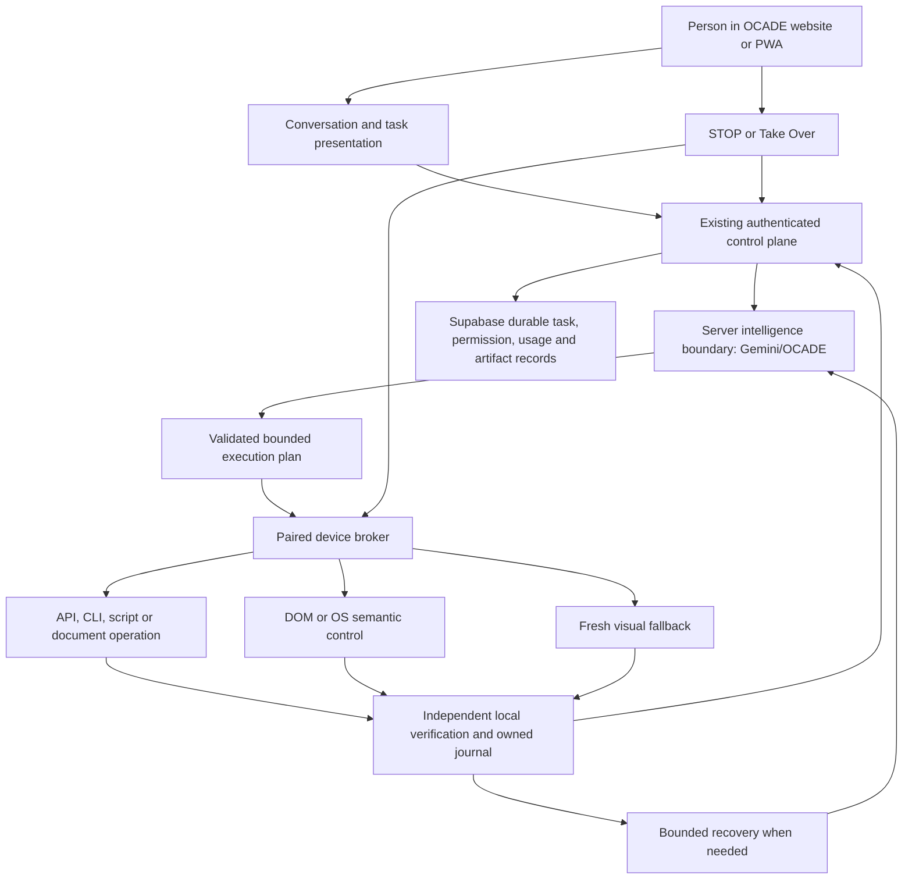

# OCADE JARVIS Master Commercial-Readiness Plan — Phases 1–49

## Owner authority — 2026-09-29

This is the single active execution plan for OCADE JARVIS. It deliberately restores the useful older phases and integrates the newer donor-first/device/admin/commercial-readiness phases into one continuous roadmap from Phase 1 through Phase 49.

Earlier phases are not assumed correct merely because an old report once called them complete. On a fresh clone Claude must inspect the current implementation, run the required evidence for that phase, preserve anything already correct, repair anything incomplete or broken, and move forward only after the phase exit gate is satisfied. Do not rebuild working code just to match a phase number.

The baseline main SHA when this master plan was authored is `2f178f7dab2d55c6985ffad235b19ae01f663513`. Re-check latest `main` at session start.

## Permanent owner decisions

- CARCC is the company. OCADE is the product.
- Chat and OCADE JARVIS remain distinct protected experiences.
- JARVIS is Online-only. It never silently falls back to Chat Offline Intelligence.
- If approved Online capacity is unavailable, JARVIS enters a truthful temporary locked/unavailable state while durable task state is preserved.
- The immutable owner-supplied donor under `imports/ocade-jarvis/source-original/` and the preserved ZIP remain unchanged.
- Target approximately 98% reuse of useful donor capability/logic where safe by copying/adapting it into active `jarvis-runtime/`, renaming/wiring it correctly, and hardening it under OCADE authority.
- Never run production directly from the immutable donor.
- Do not ship the old donor GUI, old provider-key entry/config, old phone dashboard GUI, or generic customer plugin product.
- There is no active OCADE customer browser add-on dependency. Existing authorized Chrome/browser profile is preferred.
- Browser control uses secure CDP/Playwright/DevTools where available, then browser/OS accessibility, local vision, and fresh PyAutoGUI coordinates.
- Windows final local UX uses one OCADE tray identity; no required floating Windows mini-control.
- Android receives the floating JARVIS bubble and legitimate Android deep-control components/permissions.
- iPhone/iPad remain PWA/Home Screen + Apple-supported integrations + Remote PC.
- macOS deep control uses a trusted Device Agent/menu-bar and must receive real macOS evidence before being claimed.
- JARVIS must remain conversational while working. Users may talk/type during execution and ask status, redirect, pause, continue, or stop.
- Hey OCADE pre-wake detection is local where supported.
- Provider/model/vendor/key identity remains hidden from customers.
- Primary Owner/Backup Owner/Admin/Staff authorization is server-side and stable-user-ID based, never frontend email authorization.
- The current OCADE TOTP/2FA enrollment failure is a real bug and must be repaired/proven.
- Device removal during an active action must cancel the local work before device authority is forgotten.
- Physical execution must fail closed when safety-control state cannot be verified.
- Offline Chat model installation must survive normal source merges/deployments without unnecessary redownload.
- Sentry project creation, payment-provider implementation, paid leaked-password protection, public browser-store work, and public signing identity remain separately reported deferred/owner dependencies unless later owner authority changes them.
- Every phase reports evidence-based commercial-launch readiness percentage.

## Global implementation standard for every function, button, executor and workflow

Every meaningful implementation must be treated as a production function, not a demo.

For each function/button/executor/workflow Claude must consider:
- correct input and output;
- account/device/task ownership;
- permissions and role;
- loading/in-progress state;
- disabled state;
- cancellation;
- STOP behavior where applicable;
- success verification;
- recoverable failure;
- terminal failure;
- retries and idempotency;
- duplicate clicks/requests;
- stale state;
- navigation/reload/restart;
- network interruption;
- account switch;
- permission revocation;
- concurrency/races;
- security boundaries;
- accessibility;
- desktop/tablet/mobile UI where applicable;
- logging/audit without leaking secrets;
- cleanup/resource release;
- performance and bounded resource use.

A button is not complete because it renders. It is complete only when its backend authority, visible state, error/recovery path, security rule, regression test and real UI evidence agree.

For every meaningful implementation wave use:

`inspect -> reproduce -> implement/fix -> targeted tests -> integration tests -> applicable MCP/real UI -> inspect actual result -> root-cause repair -> exact retest -> adversarial attempt -> broader regression -> cleanup -> retest`.

Do not claim mathematical zero bugs. The target is zero known/reproducible Critical or Major blockers in shipped scope and no unexplained required-evidence failure.

---

## Phase 1 — Baseline, authority reconciliation, donor preservation and complete inventory

### Purpose
Start from a clean factual baseline and preserve every useful donor capability before any migration decision.

### Build / repair
- Read `AGENTS.md`, `CLAUDE.md`, this plan, `ToRemove.md`, `docs/MEMORY.md`, all canonical docs required for the current work, and relevant historical audits.
- Run `/caveman ultra` and `/ponytail ultra` before implementation and again after proven cleanup.
- Record exact main SHA, working tree, deployed Cloudflare source identity, Supabase migration head, current Device Agent/protocol version and current test totals.
- Preserve the uploaded ZIP byte-for-byte and preserve `imports/ocade-jarvis/source-original/` unchanged.
- Inventory every donor action/core/memory/dashboard/voice/browser/computer/file/development/wake/confirmation/undo/monitoring/remote-control path.
- Create a donor capability ledger: KEEP, ADAPT, REPLACE, PRESERVE UNUSED, REMOVE FROM ACTIVE.
- Fold the older Phase 0 baseline duties into this phase so the master roadmap begins at Phase 1.
- Record current MCP/tool health and real hardware availability.

### Required proof
- immutable donor hashes unchanged;
- baseline tests recorded;
- exact source/deploy/database identities recorded;
- no execution capability omitted from the donor ledger.

### Exit
Phase 1 is complete only when Claude knows exactly what exists, what is preserved, what is already working, and what must be repaired.

---

## Phase 2 — OCADE JARVIS web GUI and real orb/graph

### Purpose
Replace old active donor GUI behavior with the OCADE web experience while retaining donor execution logic.

### Build / repair
- Keep the old GUI only in immutable provenance.
- Maintain production JARVIS UI under `src/jarvis/`.
- Build the round 3D orb/knowledge graph from real conversations, JARVIS memory, tasks, devices, apps, workspaces and meaningful relationships.
- Support cursor reaction, pan, zoom, semantic zoom, selection, accessible representation and reduced motion.
- Keep the orb simple for new users and grow it only from real data.
- Dim the orb behind conversation/task content without destroying context.
- Maintain dark/light themes and restrained OCADE design language.
- Remove prototype fake replies, fake graph relationships, fake metrics, decorative desktop chrome and duplicate theme/settings controls.
- Verify mobile/tablet/desktop layouts and hydration stability.

### Required proof
- real data drives graph state;
- no horizontal overflow at 360/375;
- dark/light/reduced-motion passes;
- reload/hydration cannot wipe user input;
- old GUI is not on the production path.

### Exit
The JARVIS UI is clean, responsive, data-driven and production-routed without old GUI dependence.

---

## Phase 3 — Route, authentication and account boundaries

### Purpose
Make `/ocade-jarvis` a correct OCADE surface without weakening Chat or authentication.

### Build / repair
- Keep JARVIS in OCADE navigation without replacing Chat.
- Signed-out users may view the safe surface but cannot invoke intelligence, account state or device work.
- Preserve deep-link return after sign-in.
- Keep normal Chat and JARVIS conversation/history logically distinct.
- Ordinary informational questions remain conversation; explicit execution requests become tasks.
- Account switching must clear or re-scope drafts, task state, cached queries and device permissions correctly.
- Refresh/back/forward/multi-tab must preserve correct owner identity.
- Late responses from an old account/conversation must never render into the new one.

### Required proof
Use at least Customer A and Customer B for cross-account isolation and signed-out/direct-route tests.

### Exit
Authentication, route ownership and conversation separation remain correct across reloads, tabs and account changes.

---

## Phase 4 — Hidden server-side Online intelligence authority

### Purpose
Remove donor/customer provider configuration and make OCADE the only intelligence authority.

### Build / repair
- Remove active customer-facing provider-key entry.
- Remove active plaintext provider-key configuration.
- Route JARVIS reasoning and conversation through OCADE's approved server-side Online intelligence authority.
- Keep provider/model/vendor/key identity out of normal UI, logs, exports, errors and device runtime.
- Preserve only the donor concepts needed for orchestration; do not give provider keys to Device Agent/mobile runtime.
- Keep primary/secondary/tertiary configured capacity as legitimate redundancy, not quota evasion.
- If all Online capacity is unavailable, lock JARVIS safely and keep Chat Offline behavior separate.

### Required proof
Secret scan, browser bundle inspection, runtime config inspection, unavailable-capacity tests and normal-answer tests.

### Exit
JARVIS works through OCADE Online intelligence with no customer key management and no Offline fallback.

---

## Phase 5 — JARVIS usage, entitlement and exact account-wide accounting

### Purpose
Make JARVIS usage enforceable, understandable and independent from Chat accounting.

### Build / repair
- Keep server-side JARVIS usage authority distinct from Chat usage.
- Keep owner-approved free-plan accounting behavior and reset windows.
- Ensure account-wide usage is shared correctly across the user's devices.
- Reconcile failed/no-result work rather than charging blindly.
- Make repeated/retried internal work idempotent where required.
- Display clean customer usage state without internal token/provider details.
- Keep Owner unlimited entitlement represented explicitly while internal usage/cost telemetry still records.

### Required proof
Multiple devices/accounts, reset boundary, failed request, retry, concurrent request and meter hydration tests.

### Exit
Usage cannot be bypassed, double-charged or split incorrectly by device.

---

## Phase 6 — Voice foundation and conversational continuity

### Purpose
Make typed and spoken JARVIS use one coherent context.

### Build / repair
- Request microphone only when voice/wake behavior actually needs it.
- Support text-to-text, voice-to-text, text-to-voice and voice-to-voice where platform/audio capability permits.
- Preserve donor STT/TTS/audio-device/echo-guard concepts where useful.
- Add explicit Pause, Continue, Interrupt and End behavior.
- Cleanly release audio on navigation, sign-out, errors and permission revocation.
- Keep spoken and typed turns in the same correct JARVIS context.
- Ensure the user can talk naturally during execution rather than switching to a separate assistant mode.

### Required proof
Permission denial/recovery, device change, interruption, task-in-progress conversation and cleanup tests.

### Exit
Voice is bounded, interruptible and context-correct.

---

## Phase 7 — Existing-browser real-control foundation

### Purpose
Create the first reliable browser execution path using the user's existing browser without an OCADE add-on.

### Build / repair
- Reuse donor `browser_control.py` logic where safe.
- Prefer existing authorized Chrome/profile; detect other installed/default browsers where appropriate.
- Use secure CDP/Playwright/DevTools attachment when available.
- Use semantic DOM/accessibility before vision/coordinates.
- Support multiple tabs/windows, navigation, forms, downloads/uploads, back/forward/reload and existing login state.
- Re-observe after navigation, popup, scroll, zoom, responsive reflow, tab/window change or content mutation.
- Use Take Over and Continue with fresh observation.
- Human handles CAPTCHA, OTP, passkey and protected authentication.
- Never extract browser password/cookie databases.
- Never complete final purchase/payment.

### Required proof
Existing-profile Chrome journey plus clean Chrome, Edge, Firefox and WebKit compatibility passes where applicable.

### Exit
Browser tasks succeed without a customer add-on and without stale-coordinate behavior.

---

## Phase 8 — Tasks, Allowed Apps, Devices and Activity

### Purpose
Turn execution into a first-class, observable OCADE workflow.

### Build / repair
- Represent each task with stable account/conversation/task identity, target device, current step, checkpoint, result and cancellation state.
- Keep task details concise by default and expandable.
- Allowed Apps reflects real capabilities/policy, not a customer plugin marketplace.
- Devices show friendly names and simple Ready/Working/Needs permission/Offline states.
- Activity uses customer language such as “Opened Excel” instead of raw commands.
- Provide global JARVIS execution enable/disable plus appropriate device/capability permissions.
- Remember safe user tool preferences without storing secrets.
- Prevent stale/duplicate task state from leaking between conversations/devices.

### Required proof
Task start/stop/retry, device switch, permission change, activity correctness and multi-account tests.

### Exit
Tasks/devices/activity are real authorities rather than placeholders.

---

## Phase 9 — Data, memory, retention and privacy

### Purpose
Keep JARVIS durable state useful without creating uncontrolled duplicate databases or privacy leakage.

### Build / repair
- Reuse approved account/conversation/message authorities with a clear JARVIS discriminator.
- Keep JARVIS memory logically separate from Chat memory.
- Keep screenshots/frames transient by default.
- Retain only structured durable task results with clear purpose.
- Keep detailed activity retention bounded.
- Keep any future credential vault separate from conversation memory.
- Never retain OTP/CVV/raw provider credentials.
- Ensure delete/archive/retention behavior matches OCADE's current product authorities.

### Required proof
RLS, retention, account isolation, memory namespace and transient-screen tests.

### Exit
JARVIS data is scoped, auditable and privacy-safe.

---

## Phase 10 — Permissions, confirmations and prompt-injection security

### Purpose
Make autonomy safe enough for real device control.

### Build / repair
- Device-sensitive permissions are revalidated at execution time.
- Smart autonomy is default; high-risk actions cross explicit confirmation boundaries.
- Destructive/security-sensitive/public-submission actions use strong confirmation.
- Final payments remain prohibited.
- Treat pages, files, screenshots, model output and tool output as untrusted.
- Prompt injection cannot grant new capability or expand scope.
- STOP and permission revoke affect active and queued work.
- Private-network/router/admin pages require explicit authorization.

### Required proof
Permission bypass, prompt injection, stale grant, account switch, confirmation replay and private-network tests.

### Exit
Policy is enforced in runtime/backend, not only UI.

---

## Phase 11 — Deep-control capability interfaces

### Purpose
Preserve donor desktop/file/app/system capability behind clean OCADE interfaces before broad exposure.

### Build / repair
- Reuse donor computer control, computer settings, app launch, files, screen processing, messaging, reminders, monitoring and developer-agent logic where safe.
- Route them through typed capabilities rather than exposing arbitrary Python/model code.
- Keep unsupported capability hidden/unavailable until a trusted execution path exists.
- Build clear executor interfaces for browser, files, apps, system, terminal, screen and voice.
- Remove direct provider intelligence from device-side executors.
- Preserve donor undo/confirmation concepts under OCADE authority.

### Required proof
Capability registry reports only actually available actions and rejects unsupported operations.

### Exit
The runtime can grow without duplicate ad-hoc execution authorities.

---

## Phase 12 — Foundational web/browser adversarial verification

### Purpose
Prove Phases 1–11 against real failures before deeper hardware expansion.

### Build / repair
Run build/typecheck/lint/format/security/unit/integration/browser journeys and deliberate:
- duplicate send;
- account switch;
- stale result;
- stale coordinate;
- permission revoke;
- cancellation;
- multi-tab;
- malformed state;
- prompt injection;
- session expiry;
- responsive breakpoints;
- cache/service-worker update.

Keep Chat/Offline/Library/Settings/auth regression green.

### Required proof
Use exact evidence labels: SOURCE, LOCAL TEST, MCP BROWSER, REAL BROWSER, DATABASE TEST, LIVE, BLOCKED, UNTESTED.

### Exit
No known Critical/Major foundational web/browser blocker remains.

---

## Phase 13 — Latest UI donor/reference reconciliation

### Purpose
Reconcile the latest JARVIS UI ZIP/reference with the actual production design without carrying prototype scaffolding.

### Build / repair
- Preserve `imports/UI OCADE JARVIS.zip`.
- Reuse useful orb/motion/layout concepts.
- Remove fake responses, random data, placeholder metrics, duplicate history, Plugins surface and unnecessary settings.
- Keep clean OCADE navigation and Settings authority.
- Ensure voice permission timing, task presentation and mobile responsiveness match current owner decisions.
- Verify conversation composer never loses input during hydration.

### Required proof
Visual journey across desktop/tablet/phone, dark/light and loading/error/empty states.

### Exit
UI reference has been distilled into production behavior, not copied blindly.

---

## Phase 14 — Shared protocol and cryptographic device authority

### Purpose
Create one secure contract between OCADE web/cloud and local device runtimes.

### Build / repair
- Version the protocol.
- Give every paired device a unique revocable cryptographic identity.
- Keep private key local.
- Rotate credentials safely.
- Bind requests/results to account, device, task, request, protocol version and timestamp/replay protection.
- Support effortless same-account pairing without manual raw token copying.
- Notify the account of new devices.
- Reject incompatible protocol/agent versions safely.

### Required proof
Enrollment, rotation, replay, revoke, protocol mismatch and cross-account tests.

### Exit
Device identity is unique, revocable, replay-safe and independent from account password.

---

## Phase 15 — Trusted Windows/macOS Device Agent packaging

### Purpose
Turn the active runtime into a customer-installable local execution product.

### Build / repair
- Package Windows 10/11 first and prepare macOS.
- End users must not install Python/dependencies manually.
- Use one Windows tray/menu-bar identity only.
- Start a minimal dormant supervisor at OS login after setup.
- Support health, reconnect, exit, uninstall and credential removal.
- Implement verified update staging, health check and rollback.
- Development installers may be unsigned; public Windows/macOS release signing remains final-release owner action.
- Keep idle CPU/RAM/network extremely low.

### Required proof
Real Windows install/start/duplicate launch/tray/exit/uninstall/reinstall/update health tests.

### Exit
The Device Agent behaves like a reliable product, not a developer script.

---

## Phase 16 — Existing-browser autonomous control without an OCADE add-on

### Purpose
Replace the old extension-era concept completely with existing-browser autonomous control.

### Build / repair
- Remove the assumption that product browser control needs an OCADE add-on.
- Use the normal authorized user Chrome/profile first when browser work is requested.
- Attach through secure CDP/DevTools/Playwright when technically available.
- Fall back to browser/OS accessibility, vision and fresh PyAutoGUI.
- Detect Edge/Firefox/Brave/other installed/default browsers where appropriate.
- Keep isolated browser contexts available for risky/untrusted research not needing personal session state.
- Never extract credential stores.
- Keep browser UI visible by default for user takeover.
- Make browser control work even when DOM automation is unavailable by switching methods safely.

### Required proof
Existing Chrome authenticated journey, browser restart, multi-tab/window, Take Over, download/upload and fallback tests.

### Exit
No active product dependency or user workflow requires an OCADE browser add-on.

---

## Phase 17 — Deep Windows/macOS computer control

### Purpose
Make donor-derived real desktop execution broad and dependable.

### Build / repair
- Reuse donor mouse/keyboard/window/system/app-launch logic.
- Prefer native APIs and existing app windows.
- Maintain live application/process/window mapping.
- Verify foreground target before input.
- Support multi-monitor and DPI scaling.
- Use clipboard safely for complex text and restore previous content where practical.
- User physical input pauses automation; Co-work alternates ownership.
- UAC/admin-password remains a user boundary.
- Avoid unnecessary terminal windows.
- Stop task-owned process trees safely.
- Support common and unknown applications through native -> accessibility -> vision -> coordinates.

### Required proof
Real Windows physical tests across representative apps, DPI/window changes, takeover and STOP.

### Exit
OCADE can perform genuine computer work safely beyond the browser.

---

## Phase 18 — Coding workspace, terminal, Git and isolated execution

### Purpose
Make JARVIS a serious development worker.

### Build / repair
- Scope file/terminal work to selected workspace by default.
- Use direct filesystem operations, terminal commands, Git and tests.
- Use VS Code UI when useful rather than typing every change visually.
- Build lightweight isolation for risky generated/code execution where host support exists.
- Never execute unconstrained model-generated code outside validated/sandboxed authority.
- Support status/diff/branch/fetch/pull/local commit.
- Remote push must be clearly authorized; force-push/history destruction needs stronger confirmation.
- Kill task-owned command process trees on STOP.

### Required proof
Real seeded bug-fix journey with failing test -> edit -> fix -> passing verification.

### Exit
Coding tasks are evidence-backed, scoped and recoverable.

---

## Phase 19 — Background execution, checkpoints, reboot recovery and Remote PC

### Purpose
Allow long work to continue safely beyond one open browser tab.

### Build / repair
- Durable checkpoints before significant boundaries.
- Continue safe local work only where policy/intelligence requirements permit.
- Pause Online-dependent work when disconnected.
- Reconcile state after crash/restart/reboot before resuming.
- Never blindly replay completed destructive actions.
- Support multiple paired computers.
- One UI-control owner per device; different devices may work concurrently.
- Mobile/another device can start, observe and STOP a paired-PC task.
- If one eligible PC is Ready, choose it automatically; ask when ambiguous.

### Required proof
Network loss, browser close, agent restart, reboot simulation, multi-device and late-result tests.

### Exit
Long and remote tasks are durable without unsafe replay.

---

## Phase 20 — Voice, Hey OCADE and correct control surfaces

### Purpose
Combine donor voice/wake strengths with the final OCADE interaction model.

### Build / repair
- Hey OCADE local wake model downloads/verifies once when enabled and remains installed.
- Pre-wake microphone audio stays local.
- Windows uses tray only; do not require a floating desktop mini-control.
- Android floating bubble is the compact mobile control surface.
- Voice can continue while tasks execute.
- Spoken “Stop”, “Wait”, “Continue”, “Use the other file” updates task control immediately.
- Locked-screen security is respected.
- Tray/bubble/web status all reconcile to the same task state.

### Required proof
Wake enable/restart, voice during task, interruption, tray STOP and Android-bubble state tests where available.

### Exit
Voice/wake/control surfaces behave as one coherent OCADE system.

---

## Phase 21 — Online capacity, locked state and recovery

### Purpose
Make intelligence outages bounded and customer-safe.

### Build / repair
- Primary -> secondary -> tertiary capacity selection remains server-side.
- Distinguish slot-local failure from wider provider/project failure.
- Do not use rotation to evade provider-wide limits.
- When all Online capacity is unavailable, stop new JARVIS intelligence turns, preserve task/checkpoint state and show a clear locked/unavailable state.
- Restore automatically when capacity returns.
- Never expose provider/key-slot details.
- Never route to Chat Offline.

### Required proof
Each failure class, all-capacity failure, recovery and in-progress task behavior.

### Exit
JARVIS failure mode is explicit, finite and recoverable.

---

## Phase 22 — Mobile web/PWA and Remote PC foundation

### Purpose
Make the core website usable from Android/iPhone/iPad before deep native/mobile integration.

### Build / repair
- Full responsive JARVIS web/PWA.
- Add-to-Home-Screen friendly behavior.
- Remote PC start/status/STOP from phone/tablet.
- Phone browser may be minimized while PC Agent owns execution.
- Mobile composer/keyboard/task controls remain usable.
- Do not claim unsupported global cross-app control from a pure PWA.
- Keep model/storage/service-worker update behavior stable.

### Required proof
Android-class Chromium and iPhone/iPad WebKit compatibility plus Remote PC.

### Exit
Mobile web is a reliable controller even before deep Android companion features.

---

## Phase 23 — Foundational full verification and merge gate

### Purpose
Close the original foundational roadmap with evidence.

### Build / repair
Re-run:
- protected OCADE regressions;
- browser matrix;
- device protocol;
- Agent packaging;
- browser control;
- voice;
- usage;
- permissions;
- tasks/devices/activity;
- responsive UI;
- recovery/security tests.

Do not depend on paid GitHub Actions; use available trusted local/connector/deployment evidence.

### Exit
The original foundation is proven on current main, not merely accepted from old historical reports.

---

## Phase 24 — Company-scale authority reconciliation and audit ledger

### Purpose
Reconcile the older 57-finding/audit era with current code and current owner authority.

### Build / repair
- Reproduce historical findings on latest main before acting.
- Mark each Reproduced / Fixed / Not reproducible / Superseded / Blocked / Removed.
- Reconcile UI donor, active runtime, schema, deploy identity and MCP toolchain.
- Record one actor/one verifier per physical surface.
- Update durable implementation ledger before long runs or handoff.

### Required proof
Complete current finding ledger and exact latest evidence.

### Exit
No historical issue is silently assumed fixed or silently resurrected.

---

## Phase 25 — Critical and Major safety repair

### Purpose
Eliminate high-severity execution defects before adding more power.

### Build / repair
Re-test and repair as applicable:
- active STOP/cancellation;
- workspace/path/symlink/junction/temp escape;
- terminal/shell boundaries;
- browser private-network/DNS/rebinding/subresource protection;
- session/account ownership;
- stale authentication;
- late responses;
- app identity;
- task authority;
- device permissions;
- update/uninstall;
- debugger/browser detach;
- fresh-screen input;
- voice cleanup;
- enrollment abuse;
- dispatch-time revalidation.

### Required proof
Targeted regression plus strongest available runtime evidence for every still-valid Critical/Major finding.

### Exit
No known Critical/Major safety blocker remains in the scope Claude is about to expand.

---

## Phase 26 — One execution authority

### Purpose
Eliminate duplicate/conflicting execution paths.

### Build / repair
- One broker validates and dispatches device actions.
- Every executor gets cancellation token and immutable validated context.
- Revalidate permission/capability immediately before dispatch.
- Enforce canonical paths/network scope.
- Verify result before settlement.
- Reject late/stale results.
- Keep specialized executors small and capability-focused.
- Avoid duplicate browser/file/app permission authorities.

### Required proof
Cross-executor cancellation, permission revoke, retry/idempotency and result-verification tests.

### Exit
There is one clear execution authority from cloud intent to local result.

---

## Phase 27 — Product UI rebuild and debloat

### Purpose
Make OCADE commercially clean while preserving power.

### Build / repair
- Remove redundant pages/settings/explanations/cards.
- Keep Chat, JARVIS, Library, Settings/Account, Help/Support.
- Keep task controls contextual inside JARVIS.
- Preserve real orb/graph behavior.
- Use OCADE black/white/silver with restrained blue/green/red semantics.
- Use skeleton loading and stable hydration.
- Keep free usage exact and paid usage clean.
- Move long explanations to Help.
- Make errors concise and actionable.

### Required proof
Real visual pass across desktop/tablet/mobile, dark/light/reduced-motion and all important async states.

### Exit
The UI is simpler after the phase than before without hiding necessary control/security state.

---

## Phase 28 — Windows and professional-software elite execution

### Purpose
Make the generic PC control layer strong enough for serious real software rather than a few demos.

### Build / repair
- Use native APIs/scripting/CLI/macros when available.
- Fall back to accessibility, vision and fresh coordinates.
- Support Office, browsers, IDEs, File Explorer, Store/UWP apps, creative/video-editing/CAD/accounting/engineering tools when installed and legally testable.
- Unknown applications should be inspected safely rather than immediately declared unsupported.
- Discover installed apps and user aliases.
- Preserve app-specific automation knowledge where useful without storing secrets.
- Test representative professional software rather than claiming universal proof from one app.
- For video editing, support general workflows such as import media, timeline/navigation, trim/cut operations, text/title/formatting/export where the selected editor exposes accessible/scriptable controls; claim only what was actually tested.
- Keep final user review/confirmation at destructive/publishing boundaries.

### Required proof
Real physical tasks across multiple software families and at least one representative complex creative/professional application available on the machine.

### Exit
The control architecture is general and adaptable; public claims remain evidence-specific rather than “works with every app” without proof.

---

## Phase 29 — Android installed OCADE and floating JARVIS

### Purpose
Add legitimate Android deep control without Play Store dependence.

### Build / repair
- Installation begins from `ocade.in` with simple “Install OCADE” wording.
- Use the Android native components required for true overlay/accessibility/background behavior.
- Guide, never bypass, install/accessibility/overlay/notification/screen-capture restrictions.
- One OCADE identity; no technical helper clutter.
- Floating bubble supports chat, voice, current task/progress, STOP and Open OCADE.
- Use intents/native APIs -> accessibility -> vision -> fresh coordinates.
- Support share/files/media/contact/message/call flows within permissions.
- Final payment/security authentication remains human.
- Keep Chat Offline model persistence stable across normal deployments where storage remains intact.

### Required proof
Pixel emulator/device: Appium full pass, then independent Mobile MCP pass, plus Chrome/DevTools/Playwright web diagnostics.

### Exit
Android deep control is genuinely tested rather than inferred from a mobile viewport.

---

## Phase 30 — iPhone/iPad and macOS supported control

### Purpose
Deliver only Apple capabilities that are technically real and provable.

### Build / repair
- iPhone/iPad: PWA/Home Screen, Siri/Shortcuts, notifications/share flows and Remote PC.
- Do not fake global overlay/arbitrary third-party app control.
- macOS: Device Agent/menu-bar, supported scripting/accessibility/files/browser/vision.
- Hey OCADE on macOS only after required permissions.
- WebKit remains compatibility evidence.
- Seek legitimate real Apple hardware/remote device; paid reservation requires owner approval.
- If Apple blocks a local behavior, use Remote PC/Apple-supported workflow.

### Required proof
WebKit plus real Apple evidence when available, separately labeled.

### Exit
Apple product claims exactly match evidence.

---

## Phase 31 — Owner/Admin/Staff company backend

### Purpose
Give the company a real operational control plane.

### Build / repair
- Canonical privileged surface `admin.ocade.in`.
- Stable server-side roles: Primary Owner, Backup Owner, Admin, Support, Billing, Developer/Operations, Read-only.
- Granular permission overrides.
- Primary Owner can grant staff by email after server resolves verified stable UUID.
- Normal customers see no privileged labels/links/data.
- Staff sees only permitted modules.
- Add customers, usage, devices, JARVIS tasks, security, support, system health and audit modules as real data allows.
- Privileged actions use role/RLS/strong-auth/audit.
- Owner can create scoped temporary Support conversation access.
- Emergency revoke all staff sessions and global JARVIS execution stop.

### Required proof
Primary Owner + Staff + Customer A + Customer B isolation and privilege escalation tests.

### Exit
No admin capability depends on frontend hiding.

---

## Phase 32 — Support, legal and commerce-ready surfaces

### Purpose
Finish company/customer support/legal architecture without blocking current coding on a payment-provider decision.

### Build / repair
- First-party Help/Support and troubleshooting.
- Accurate Terms/Privacy/device-control/permission disclosures.
- Refund/cancellation/payment architecture documentation and hidden UI modules until a real provider exists.
- Do not fake revenue/payment metrics or provider operations.
- Existing entitlement/usage support operations remain functional.
- When future provider work resumes, use hosted/tokenized payment methods and webhook-backed state.
- Keep final purchase prohibited in JARVIS.

### Required proof
Help/legal navigation, access, responsive UI and no fake provider behavior.

### Exit
Support/legal are real and payment-specific UI remains honestly deferred.

---

## Phase 33 — Autonomous testing team and continuous bug hunting

### Purpose
Use all available MCP/test tools as an independent verification team throughout implementation.

### Build / repair
- Existing Chrome: Playwright/CDP actor + Chrome DevTools observer.
- Clean Chrome, Edge, Firefox, desktop WebKit and iPhone/iPad WebKit compatibility.
- Windows: Physical Computer Use.
- Android: Appium first, Mobile MCP second.
- Filesystem for outputs.
- Supabase for Auth/RLS/data.
- Cloudflare for deployed runtime/source identity.
- GitHub for source/merge identity.
- Do not let controllers fight for the same UI.
- Tool failure blocks only its evidence class.
- Test normal, failure, recovery, cancellation, permission, race, account/device switch, restart and adversarial states.

### Required proof
Per-tool health ledger and repeated real journeys during coding, not one ceremonial final run.

### Exit
Every shipped capability has the strongest available evidence.

---

## Phase 34 — Cleanup, release hygiene and first production proof

### Purpose
Simplify the current product only after functionality/security are proven.

### Build / repair
- Run Caveman/Ponytail.
- Review `ToRemove.md`.
- Remove duplicate authorities, stale prototypes, unused dependencies, obsolete files and giant mixed-responsibility code only when replacement proof exists.
- Keep immutable donor/audits/applied migrations.
- Re-run affected tests after every cleanup.
- Merge through reviewed branch/PR.
- Verify deployed production SHA matches merged main.

### Required proof
Clean diff, full regression, production health/source identity.

### Exit
The repo is cleaner without capability/security regression.

---

## Phase 35 — Current-authority re-baseline and donor capability ledger closure

### Purpose
Begin the newest owner-approved hardening wave from the already-built product rather than assuming earlier phases remain perfect.

### Build / repair
- Re-read all active authorities.
- Re-check latest main/deployment/database/agent/Android/MCP state.
- Close every donor ledger classification with exact active replacement path.
- Confirm no immutable donor files are touched.
- Confirm deferred items remain separately tracked.
- Verify Inno Setup/Android environment/browser remote-debugging/test tools actually work now.
- Recalculate commercial-readiness baseline.

### Required proof
Current—not historical—environment and capability status.

### Exit
Every next phase starts from verified current truth.

---

## Phase 36 — TOTP/2FA, active revoke and fail-closed lifecycle repair

### Purpose
Fix the three known high-impact lifecycle/security gaps before further release work.

### Build / repair

#### TOTP/2FA
- Reproduce current fresh authenticator code rejection.
- Trace Supabase enrollment/challenge state, assurance level, factor lifecycle, clock/time-window behavior, retry/cancel and account switch.
- Build clean setup UI with QR/secret handling that never leaks secrets into logs.
- Verify fresh code, wrong code, expired code, replay, cancelled setup, re-enrollment, recovery and privileged challenge.
- Owner may view bootstrap console while sensitive mutations remain locked.
- Require appropriate 2FA for Owner/Admin/Staff privileged work after repair.

#### Active device removal
- Removing/revoking a device during real local work immediately sets cancellation, stops owned input/process/browser work, waits/joins safely, cancels cloud task/action, revokes credentials and rejects late results.

#### Fail closed
- If physical-execution safety/service-control state cannot be read, stop/refuse execution rather than assuming allowed.

### Required proof
Real browser MFA plus real Windows device-remove-mid-action and backend-control-outage adversarial tests.

### Exit
2FA and execution lifecycle safety are production-grade.

---

## Phase 37 — Donor runtime consolidation to ~98% useful reuse

### Purpose
Finish the donor migration without duplicate architectures.

### Build / repair
- For every KEEP/ADAPT donor family, copy/adapt the proven logic into active runtime.
- Rename/wire files cleanly.
- Do not cut/move immutable donor files.
- Preserve donor strengths: browser, mouse/keyboard, app launch, files, document processing, developer agent, screen, confirmations, undo, voice, wake, messaging, reminders, monitoring and remote concepts.
- Replace old GUI/provider-key/customer-plugin/dashboard product paths.
- Consolidate duplicate active implementations.
- Keep model-generated operations behind validated capability/sandbox, not arbitrary execution.
- Add per-family tests and cancellation/security coverage.

### Required proof
Donor ledger shows exact donor -> active runtime mapping and test evidence.

### Exit
Useful donor logic is integrated rather than merely preserved.

---

## Phase 38 — Hardened existing-browser autonomous control

### Purpose
Take Phase 16 from capability to commercial reliability.

### Build / repair
- Existing user Chrome/profile first.
- Automatic safe launch of normal browser/profile when needed.
- Real existing tab reuse when relevant.
- Structured CDP/DOM/accessibility path with automatic fallback.
- Multi-tab/multi-window.
- download/upload chain.
- password-manager interaction without secret extraction.
- human-auth takeover.
- private-network permission.
- stale geometry/focus protection.
- browser crash/restart recovery.
- user mouse/keyboard takeover.
- STOP mid-type/navigation.
- isolated context only when safer/no personal login required.

### Required proof
Playwright/CDP + Chrome DevTools + compatibility browsers + adversarial browser journey.

### Exit
Browser control is reliable enough for daily authenticated workflows.

---

## Phase 39 — Hardened Windows Device Agent and tray

### Purpose
Make Windows local execution commercially dependable.

### Build / repair
- One tray identity.
- Ready/Working/Waiting/Needs permission/Offline/Stopped truthfully.
- Open OCADE, STOP, Pause/Resume where relevant, Exit.
- autostart;
- duplicate protection;
- low idle resources;
- app discovery;
- current-window verification;
- multi-monitor/DPI;
- clipboard restore;
- local cancellation;
- task-owned process trees;
- reconnect;
- update/rollback;
- clean uninstall/reinstall.
- Remove active Windows floating mini-control only after tray replacement proof.

### Required proof
Real Windows Physical Computer Use acceptance suite.

### Exit
The Windows Agent is a polished product surface and reliable local executor.

---

## Phase 40 — Files, Office and elite spreadsheet execution

### Purpose
Make document work substantially smarter than manual clicking.

### Build / repair
- Direct safe filesystem first.
- Explicit folder/workspace grants.
- Trash/undo.
- safe overwrite.
- Excel workbook structural inspection.
- correct formulas/references/lookup logic.
- smart fill/arrays/tables/named ranges/Power Query where appropriate.
- number formats, borders, alignment, conditional formatting, filters, charts/tables where requested.
- preserve unrelated workbook structure/formulas/formatting/macros.
- use real Excel UI where it adds value.
- save/reopen/verify.
- apply same hybrid model to Word/PowerPoint.
- direct PDF extraction/search before visual fallback.

### Required proof
A nontrivial real Excel workbook solved end-to-end with formula and formatting verification.

### Exit
Office work is efficient, accurate and preservation-safe.

---

## Phase 41 — Development, professional and creative/video-editing workflows

### Purpose
Make JARVIS useful across serious software categories using generic control rather than one-off demos.

### Build / repair
- Coding: inspect/edit/test/fix/verify.
- Professional apps: discover capabilities, scripts/CLI/macros/accessibility.
- Creative/video editors: use available scripting/native controls first, accessibility/vision next, coordinates last.
- Support representative workflows such as media import, project navigation, timeline selection, trim/cut, titles/text, format/settings, export where the installed editor exposes safe accessible control.
- CAD/design/accounting/engineering: adapt the same layered control model.
- Unknown app: inspect window/accessibility state and learn the current task safely.
- Store safe user-specific app preferences/aliases, never passwords.
- Never claim “all software works” solely from architecture; maintain tested-app evidence and fallback quality.

### Required proof
VS Code real bug-fix plus representative creative/professional application tasks available on the test PC.

### Exit
The engine is broadly adaptive and evidence-backed across software categories.

---

## Phase 42 — Live conversational JARVIS, wake and partnership

### Purpose
Make JARVIS feel like an active partner while it operates the computer.

### Build / repair
- User can talk/type during execution.
- JARVIS answers “what are you doing?” from real task state and continues.
- User can redirect without losing completed safe work.
- Voice interruption updates cancellation/replanning immediately.
- Hey OCADE model downloads/verifies once and remains.
- pre-wake audio local.
- microphone/speaker/audio-device changes bounded.
- speech output can be muted while voice input remains useful.
- camera/screen permissions requested only when needed.

### Required proof
Live voice conversation during actual browser/Excel/Word task, including redirect, pause, continue and stop.

### Exit
Conversation and execution are simultaneous parts of one JARVIS experience.

---

## Phase 43 — Background work, reminders, proactive behavior and Remote PC

### Purpose
Unify donor background concepts under OCADE Tasks instead of duplicate systems.

### Build / repair
- Adapt donor reminder/background monitor/proactive concepts into canonical task/automation authority.
- User authorizes classes of proactive behavior.
- Long tasks checkpoint.
- Background/reboot recovery reconciles.
- Remote PC works from phone/tablet.
- Multi-PC routing.
- safe notifications/results.
- no blind replay.
- transient screenshots by default.

### Required proof
Scheduled/background, reboot/reconnect, Remote PC and notification journeys.

### Exit
Background automation is durable and controlled.

---

## Phase 44 — Android installed OCADE commercial hardening

### Purpose
Turn the Android foundation into a full supported mobile execution product.

### Build / repair
- Guided website install.
- one OCADE identity.
- floating bubble.
- voice/wake where Android permits.
- app launch/intents/accessibility/vision.
- notifications/share/files/media/contact/message/call.
- account isolation.
- permissions health.
- background/foreground/restart.
- uninstall/reinstall.
- offline Chat model persistence across normal web deployments when underlying storage remains.
- explicit Clear Data/Remove semantics.

### Required proof
Appium then independent Mobile MCP plus web/PWA browser diagnostics and adversarial recovery tests.

### Exit
Android is real-device/emulator proven beyond responsive web.

---

## Phase 45 — Apple-supported paths and real Apple test strategy

### Purpose
Finish Apple support without false claims.

### Build / repair
- iPhone/iPad PWA/Home Screen quality.
- Siri/Shortcuts and supported triggers.
- notifications/share/Remote PC.
- macOS Device Agent/menu-bar.
- macOS accessibility/scripting/files/browser.
- real Apple testing through available hardware/cloud.
- paid cloud requires owner approval.
- keep blocked evidence explicit.

### Required proof
WebKit + physical/remote Apple when available, separately labeled.

### Exit
Every Apple claim has matching evidence.

---

## Phase 46 — Full Owner/Backup Owner/Admin/Staff backend

### Purpose
Complete every privileged workflow and button at production depth.

### Build / repair
- Primary Owner bootstrap to stable UUID.
- Backup Owner grant/protection.
- Admin and staff role/permission matrix.
- Owner Console / Staff Console conditional visibility.
- secure SSO to `admin.ocade.in`.
- staff email -> stable UUID grant.
- pending invite when account absent.
- immediate revoke across sessions.
- 2FA/recent-auth.
- customers/usage/devices/tasks/security/support/system health/audit.
- conversation case access with reason/expiry.
- emergency staff revoke.
- global JARVIS execution STOP.
- no fake data.
- hide payment-specific modules while provider work is deferred.
- every button gets loading/disabled/error/retry/audit/test coverage.

### Required proof
Owner + Backup Owner where available + Staff + Customer A/B browser/database isolation matrix.

### Exit
Privileged operations are usable, auditable and server-enforced.

---

## Phase 47 — Whole-product security, account isolation, UI and performance proof

### Purpose
Attack the integrated product after all major features exist.

### Build / repair
Test:
- auth/session/account switching;
- role escalation;
- RLS/IDOR;
- task/device ownership;
- stale/late work;
- permission revoke;
- prompt injection;
- path/network escape;
- device removal;
- service-control outage;
- restart/recovery;
- rapid/repeated actions;
- mobile/desktop responsive UI;
- accessibility;
- startup;
- memory/CPU;
- idle resource use;
- long-task performance;
- service worker/cache/model persistence.

### Exit
No known Critical/Major integrated-product blocker remains in tested scope.

---

## Phase 48 — Final cleanup and legacy retirement

### Purpose
Remove obsolete active systems only after all replacements have real evidence.

### Build / repair
- Remove active old browser-bridge/add-on product path and forward-retire related schema/control state.
- Remove active Windows floating mini-control.
- Remove active generic customer plugin paths.
- remove duplicate GUI/provider-key/executor systems.
- remove stale dependencies/adapters/docs.
- never rewrite historical donor/audits/applied migrations.
- run Caveman/Ponytail.
- rerun all affected real/MCP tests.

### Exit
The product is simpler and smaller without capability regression.

---

## Phase 49 — Final commercial-launch proof and production identity

### Purpose
Prove the exact release candidate end-to-end.

### Required real-world acceptance journeys
1. Existing authenticated Chrome task.
2. Nontrivial Excel formula/format/save/reopen task.
3. File-management task.
4. VS Code/repository real bug-fix task.
5. Representative professional/creative app task where available.
6. Multi-app browser -> download -> Office/editor -> saved result -> OCADE.
7. STOP during active physical work.
8. User takeover/Co-work.
9. Device restart/reconnect.
10. Tray lifecycle.
11. Active device removal.
12. Android bubble/local/Remote PC journey.
13. Owner/Staff/Customer role isolation.
14. 2FA enrollment/challenge and privileged mutation.
15. Offline Chat model survives a normal web deployment/source update without unnecessary redownload.

### Full release gates
- build;
- typecheck;
- lint/format;
- tests;
- secret/dependency/security gates;
- browser matrix;
- real Windows;
- Android Appium + Mobile MCP;
- Apple compatibility/real evidence where available;
- Supabase Auth/RLS/database;
- Cloudflare production;
- GitHub source identity;
- cleanup regression.

### Final identity checks
- final main SHA;
- deployed Cloudflare SHA;
- Supabase migration head;
- Device Agent version/protocol;
- mobile/runtime version;
- immutable donor preservation state.

### Commercial readiness
Report one evidence-based `Commercial-launch readiness: XX%` with explicit remaining owner/hardware/legal/signing/payment/platform blockers.

100% is allowed only when every required shipped-capability gate is green and remaining deferred items are explicitly outside the launch scope or completed.

---

## Mandatory phase report format

After every phase Claude must report:

`Phase N — Complete / Partial / Blocked`

- Purpose accomplished:
- Tasks completed:
- Files/systems changed:
- Donor files inspected/reused:
- Bugs found:
- Bugs fixed:
- Local tests:
- MCP / real-browser / real-device / physical evidence:
- Security/adversarial evidence:
- Performance/visual evidence where applicable:
- Remaining blockers / untested:
- Commercial-launch readiness: XX%
- Commit / push / deploy identity:
- Exact next phase:

## Fresh-clone execution rule

On a new clean clone, start at Phase 1.

For Phases 1–34, do not mindlessly rewrite already-working implementation. Inspect current main, run the phase proof, fix every gap found, update tests/evidence, and mark the phase complete only when current evidence satisfies this plan.

Then continue Phases 35–49 without stopping for a handoff unless a genuine owner-only action, paid action, unavailable hardware/platform, or destructive approval blocks that specific evidence class. Continue all independent work.

The final goal is a commercially credible OCADE JARVIS that talks naturally while working, controls real software through a safe donor-derived execution engine, verifies its results, survives failure/restart/update, keeps account/security boundaries strong, and exposes only evidence-backed capabilities.
---

# Owner authority addendum — 2026-10-02

This addendum is a follow-up to the existing Phase 1–49 plan. It does not erase or rewrite completed phases, historical evidence, donor provenance, applied migrations, or earlier implementation history. Where this addendum conflicts with an older sentence in this file, this newer owner authority controls future implementation and verification.

## Universal OCADE execution engine instead of per-application product code

OCADE JARVIS must use one universal intelligence-driven execution architecture rather than growing a separate hard-coded controller for every software product. The permanent target is one OCADE task planner and one validated action broker connected to generic browser, computer, files, terminal, mobile, voice, background, and device capabilities. The Online intelligence authority may reason about an unfamiliar application's purpose, commands, menus, file formats, scripting facilities, accessibility controls, documentation, and likely workflows, but every important action must still be grounded in current observed state before execution.

For an unfamiliar installed application, OCADE should first identify the application, version, process, active window, available accessibility/UI tree, supported file/project formats, registered URI or automation interfaces, and any discoverable official API, CLI, scripting, macro, COM, AppleScript, plugin, or documented automation surface. OCADE should use current official documentation when model knowledge may be stale. If an official automation route does not exist or is insufficient, OCADE should use OS accessibility/UI Automation, live screen understanding, screenshots/vision, and finally fresh PyAutoGUI coordinates. Coordinates must never be treated as durable app knowledge and must be refreshed after any layout, focus, scroll, window, display, DPI, navigation, popup, or content mutation.

The intelligence layer may dynamically create small task-specific scripts, command sequences, macros, or temporary helpers when that is the strongest legitimate path for the user's requested task. These temporary task tools must still execute through the local OCADE authority, remain cancellable by STOP, stay within the current task/device/file scope, and be removed or retained only according to explicit lifecycle rules. New system-wide third-party installations, protected elevation, OS-owned permission dialogs, CAPTCHA, OTP, passkey, authenticator, or equivalent human-security boundaries must not be bypassed; OCADE may navigate to the boundary, wait for the user to complete it, detect completion, and immediately continue.

OCADE should learn compact sanitized control recipes after successful work. A recipe may record application identity/version, the reliable control route, stable semantic controls, useful official automation entry points, validation steps, recovery strategy, and measured reliability. It must not store customer passwords, tokens, private file contents, raw screenshots, OTPs, cookies, or other secrets as generic reusable knowledge. When an application version or UI materially changes, stale recipe assumptions must be invalidated and rediscovered rather than blindly replayed.

Specialized adapters may remain only when measured evidence proves that they materially improve reliability, safety, performance, preservation fidelity, or platform integration beyond the universal engine. A new application must not receive bespoke production code merely because JARVIS encountered it. The universal engine must be attempted first. Existing app-specific code that has become redundant must be replaced only after equivalent or better universal-control behavior is proven, then removed through the `ToRemove.md` proof sequence.

The acceptance goal for universal control is that OCADE can encounter an unfamiliar installed application, understand the requested task through the Online intelligence authority plus current official documentation and live observation, select a legitimate execution method, complete the task, independently verify the actual result, recover from normal failures, and do so without requiring someone to first add production source code for that specific application.

## Internal OCADE tool plane and browser control

Customers must not be required to install Playwright MCP, Chrome DevTools MCP, Appium MCP, PyAutoGUI packages, or other developer tooling manually. Development MCPs remain test instruments. The shipped OCADE Device Agent and Android application must expose OCADE-owned internal typed capabilities that provide equivalent product functions through one secure action authority.

The browser capability must support the user's existing authorized browser/profile where technically available, including Chrome, Edge, Brave, Firefox, and other installed/default browsers where practical. A user should complete any required browser/device authorization during setup rather than facing repeated prompts during ordinary work that they already asked JARVIS to perform. OCADE must never weaken or bypass a browser or operating-system security boundary to remove such prompts. If the platform requires a genuine human approval, OCADE may bring the user to the correct prompt once and continue automatically after approval.

For browser work, OCADE should use the fastest reliable path in this order: structured browser/DOM/CDP or equivalent protocol, official browser or site automation interfaces, accessibility, vision, and fresh coordinates. Existing signed-in sessions should be reused without extracting cookies or saved passwords. If Chrome or the selected browser is closed, the Device Agent may open the normal browser/profile automatically for a user-requested browser task. The product must automatically reconnect after normal browser restart/update where supported.

A simple informational request inside JARVIS must remain a conversation and return a normal answer without creating unnecessary device work. A request that asks JARVIS to act, edit, open, control, download, solve, save, send, or otherwise change real state must route into the execution system while remaining in the same conversation. The user may ask questions, ask for status, redirect the task, pause, resume, or stop while execution continues.

## Clarification and target selection

JARVIS must not ask unnecessary questions when context identifies one obvious target. If the user uploads one workbook and says “solve this”, OCADE should use that workbook. If the user says “open Chrome” from an Android phone and does not name another device, OCADE should default to the device the user is currently interacting from. If the user says “open Chrome on my PC”, the same conversation must route the action to the paired PC.

When several plausible files, applications, devices, projects, windows, or destinations exist and choosing the wrong one would materially change the result or create risk, JARVIS should ask one concise clarification and show likely choices rather than asking a vague open question. When one target is overwhelmingly obvious, or when a wrong choice is harmless, easily reversible, and context strongly favors one option, JARVIS may proceed and state what it selected. Destructive, publishing, security, financial, permanent-deletion, or other irreversible boundaries retain explicit confirmation.

For file work, OCADE should preserve the original by default when the user has not clearly asked for overwrite, save the completed copy with a clear name near the source where appropriate, and independently reopen or inspect the result when practical. This behavior applies to Excel, Word, PowerPoint, PDFs, code, media projects, design projects, engineering files, and other supported formats.

## Local file and application discovery

The Device Agent may discover installed applications automatically and maintain lightweight local capability metadata so JARVIS can choose the best app without requiring the user to configure every program manually. The same principle applies to accessible local drives, user folders, external drives, USB storage, and supported network locations. OCADE should maintain lightweight local metadata/indexing rather than continuously uploading or deeply reading every file. File contents should be read only when needed for an authorized task or other explicit product function.

External drives should become discoverable when connected. Learned machine-specific application/file metadata should remain local/device-scoped by default. Generic non-private reliability knowledge may improve reusable OCADE strategies without uploading customers' private screenshots, documents, project contents, credentials, or local secrets.

## Professional work quality

OCADE must choose the strongest execution method for the actual task rather than imitating manual clicking for its own sake. For Excel and other Office tasks, it should inspect the workbook/document structure, choose formulas, tables, arrays, Power Query, direct file manipulation, scripting, application automation, or real UI interaction as appropriate, preserve unrelated content, save safely, and verify the final artifact. The same principle applies to coding, creative work, video editing, CAD, design, accounting, engineering, and other professional software.

Direct project/file modification should be used when it is safer, faster, and semantically correct, but simple work should not become unnecessarily invasive. When an application's own scripting or automation API is the best path, JARVIS may use it and then verify the visible/final application state where practical. When no useful API or script exists, OCADE should use accessibility, vision, and computer-use fallbacks rather than declaring the application unsupported merely because there is no custom adapter.

The product goal is expert-grade, validated work. OCADE must not promise that every result is inherently better than every human professional. It must instead use objective checks, application/file validation, output verification, and iterative correction to reach the strongest demonstrable result.

## Wake word, voice, and always-available companion

The final wake system must support both `OCADE` and `Hey OCADE`, with `OCADE` treated as the fast primary wake phrase while `Hey OCADE` remains fully supported. The production wake model must be CARCC/OCADE-controlled, bundled inside the signed Windows Device Agent and Android OCADE application, and must not require a separate customer model download after the product is installed. This newer rule supersedes older sentences in this plan that say the wake model downloads after Wake Mode is enabled.

The large training corpus must never ship to customers. Hugging Face must not be used as a required source or runtime dependency for the OCADE wake model. Development may use directly licensed datasets, OCADE-generated synthetic speech, owner-approved recordings, or other legitimate direct non-Hugging-Face sources after provenance/license review. The finished bundled model should be small and optimized for extremely low idle CPU, RAM, network, storage, and battery use; literal zero resource use must not be claimed.

Pre-wake audio must remain local. When Wake Mode is enabled, the lightweight companion may remain available in the background like a normal assistant service. On Windows the Device Agent/tray must remain available even when Chrome or `ocade.in` is closed, because wake, background work, reminders, reconnect, and Remote PC depend on it. When necessary, the companion may open OCADE JARVIS automatically. On Android, always-listening wake behavior may use the legitimate foreground-service/notification model required by Android; the user accepts a minimal truthful Wake Mode notification where the platform requires one.

Any nearby person may trigger the wake phrase, while optional owner/speaker recognition may be added as an extra signal for sensitive operations. Speaker recognition must never replace account/device authorization, lock-screen security, recent authentication, or other security boundaries. When the device is locked, JARVIS may answer safe questions/status where the platform allows it but must not perform sensitive file/account/computer actions that require an unlocked session.

During an active JARVIS conversation or task, the user should not need to repeat the wake phrase before every follow-up. Voice input and text output must remain usable when spoken responses are disabled. With spoken replies enabled, JARVIS should speak naturally while working, allow interruption, answer status questions from real task state, and continue or replan without losing already-completed safe work.

## Android and cross-device execution

Windows and Android should share the same planning/task authority, with platform-specific execution adapters rather than separate assistants. Android should use intents/native APIs where available, then Accessibility/UIAutomator-like structured control, UI hierarchy/accessibility, vision, and fresh taps/coordinates. Android must not require separate per-app controllers for every application.

If a user on Android asks to open or use an Android app, OCADE should perform the work on the current Android device when the installed OCADE app has legitimate capability. If the requested work requires a paired PC or the user explicitly names the PC, JARVIS should keep the same conversation and transparently route execution to the paired PC. A user should be able to say from a phone, for example, “Open my PC and finish this Excel file,” and follow the same task until completion.

Initial Android setup should guide the user through the legitimate permissions needed for enabled capabilities so later nuisance prompts are minimized. Android-owned security and permission screens must not be bypassed. Android final evidence uses the stable Pixel 6a Android 14/API 34 Google Play emulator as the primary emulator unless a newer owner decision changes it. A newer Android version may be used as supplementary compatibility evidence only after the stable baseline is green.

iPhone/iPad support remains limited to Apple-supported behavior, PWA/Home Screen, Siri/Shortcuts/App Intents/share/notifications where applicable, and Remote PC. WebKit emulation is compatibility evidence only. Free legitimate remote Apple evidence may be used; any paid reservation remains skipped unless the owner separately approves it.

## Owner Console expansion

The Owner/Staff authority must continue to be server-enforced, audited, and stable-user-ID based. Normal `ocade.in` should expose an Owner Console or Staff Console entry only to legitimately authorized accounts. If keeping privileged operations on `admin.ocade.in` remains materially safer or simpler, retain that separation; if the privileged UI can be presented under normal `ocade.in` without weakening isolation, session authority, 2FA, audit, CSP/origin boundaries, or customer concealment, implementation may choose the smaller and safer architecture. Frontend visibility must never be the authorization boundary.

The Owner customer-management surface should support searching verified OCADE accounts by approved identifiers such as email, name, or account ID and should show safe operational information including verified email, safe profile fields, plan/entitlement, usage state, account creation, devices, sessions, grants, support/security state, and JARVIS/device operational state where appropriate. It must never expose passwords, provider keys, OAuth tokens, raw cookies, MFA secrets, recovery secrets, or equivalent credentials.

Depending on role/permission, the Owner Console should support legitimate plan/access grants and revocation, usage/credit adjustments through append-only authority, session revocation, device removal/revoke, account suspension/disable workflows, supported security recovery, audited account-deletion workflow, and audit history. Permanent account deletion must use a strong audited workflow that first terminates relevant sessions/devices and applies the product's retention/legal/data-deletion rules. The Primary Owner must have strong protection against accidental self-removal or demotion.

Final role testing must include a real temporary entitlement/grant lifecycle and staff-access lifecycle on test accounts when safe: grant, verify the target account receives exactly the intended capability, revoke, and prove the privilege disappears immediately. Do not forge authorization or expose credentials for testing.

## Final test architecture and release sequence

Before merge, execute two deliberately separate assurance waves in addition to normal continuous testing.

First, perform a full source-read audit of the active codebase and current authorities. Read for security defects, races, stale assumptions, duplicate authorities, incorrect lifecycle behavior, dead code, inconsistent policies, error handling, and capability gaps without relying only on existing tests. Reproduce and fix every valid finding, add regression coverage, then rerun the relevant regression suite.

Second, after implementation reaches the final candidate, freeze application source changes temporarily and perform a testing-only evidence wave. During this wave, do not fix product source immediately when a failure is discovered. Finish the complete Windows, browser, Android, Owner/Staff, JARVIS, background, update, file, Office, voice, and security matrix first and record every failure. After the matrix is complete, enter one dedicated fix wave, repair every reproducible release-scope defect at the root cause, run exact regressions and the broader suite, then proceed to cleanup.

The testing-only wave must include actual work, not ceremonial clicking. On Windows verify Device Agent download/install, tray lifecycle, Open OCADE, autostart, background survival, browser control, file discovery, app discovery, Excel, Word/PowerPoint/PDF where available, coding/repository work, multi-app workflows, STOP, Pause/Resume, Take Over, update/rollback, uninstall/reinstall, Remote PC, and software-problem diagnosis. Verify real file/process/application results independently rather than trusting JARVIS's own success message.

For the universal app engine, select several installed applications at runtime, including at least one application that has no specialized OCADE adapter. Do not add app-specific source code merely to make the test pass. Include one case where an official scripting/API route is discovered and used, and one case where structured automation is insufficient and OCADE must use accessibility/vision/fresh-coordinate fallback. Record whether success came from intelligence/planning, documentation/API discovery, app discovery, accessibility, vision, coordinates, file manipulation, or another legitimate route.

For final real-user browser validation, use a preview/staging deployment of the branch first so production/main remain untouched. Use the dedicated authorized Chrome testing profile with Playwright/CDP and Chrome DevTools diagnostics, plus Physical Computer Use for real native/tray interactions. Sign in through Google using the already authorized test account when available; password, OTP, passkey, CAPTCHA, authenticator, or equivalent protected authentication remains a human step. Test the entire reachable product with real tasks, including Owner/Staff surfaces and a temporary grant/revoke cycle on safe test accounts.

For Android, run the full Appium pass first, release/reset controller ownership, then run the independent Mobile MCP pass on the emulator. Include Google sign-in, permission setup, bubble, notification/STOP, Chrome, Files, Settings, at least one additional installed app, basic and complex tasks, background/foreground, orientation, restart/recovery, and Remote PC.

After the dedicated fix wave is green, run Caveman/Ponytail and `ToRemove.md` cleanup. Remove only proven dead/duplicate/obsolete active code and dependencies. Then run the complete acceptance matrix again on the cleaned tree. Follow with a second independent adversarial/attack pass and a final real-user browser/native pass.

No merge to `main` is permitted merely because tests are green. The branch must remain unmerged until all executable Phase 1–49 requirements, this addendum, final source-read audit, frozen testing-only wave, fix wave, cleanup, final regression, adversarial pass, and final real-user pass are complete and the owner explicitly approves the merge.

## Evidence and reporting required by this addendum

The final report must identify the exact branch and SHA, all Phase 1–49 statuses, all addendum requirements, test totals, real-browser/MCP evidence, real Windows evidence, Android emulator/Appium/Mobile MCP evidence, Apple compatibility and blocked physical evidence, Supabase status, Cloudflare preview/production identity, GitHub status, billing-only GitHub Actions limitations separately from real code failures, known accepted limitations, all remaining manual owner-only actions, cleanup/debloat work, unresolved bugs if any, and a conservative commercial-readiness percentage.

A final claim of readiness requires zero known reproducible Critical or Major release blockers and no unexplained required-evidence failure. It does not mean undiscovered bugs are mathematically impossible.

---

# Owner authority extension — 2026-10-03 — Phases 50–56

This extension converts the previously approved post-Phase-49 addenda into explicit numbered phases and adds the newest Owner/Staff/usage/control requirements. It is append-only authority. It does not rewrite or erase Phases 1–49, prior evidence, immutable donor history, applied migrations, or the 2026-10-02 addendum. Where an older sentence conflicts with this newer authority, this section controls future implementation and verification.

## Phase 50 — Universal Gemini/OCADE intelligence-driven software control

### Purpose
Finish the universal execution architecture so Gemini/OCADE intelligence understands real tasks and unfamiliar software while the local OCADE broker remains the validated execution authority.

### Build / repair
- Do not grow separate hard-coded controllers for every application.
- For every task, inspect the real current app/browser/device/file state, application identity/version, process/window, accessibility structure, relevant project/file structure, available official automation surfaces, and current UI.
- Let Gemini/OCADE choose the strongest legitimate route: official API/CLI/script/macro/COM/automation or direct file/project manipulation first; structured browser/app accessibility next; local vision next; fresh PyAutoGUI/computer-use coordinates last.
- Use current official documentation when model knowledge may be stale or insufficient.
- Keep the Device Agent/action broker responsible for account/device/task ownership, scope, permissions, STOP, cancellation, confirmation, idempotency, execution, verification, and recovery. Raw model output must never bypass it.
- Do not add app-specific production code merely because an unfamiliar app appears in testing. Keep a specialized adapter only when measured evidence proves a meaningful reliability, safety, fidelity, performance, or platform advantage.
- Learn only sanitized reusable recipes; never store passwords, tokens, OTPs, cookies, raw private screenshots, or private file contents as generic knowledge.
- Preserve already proven functionality while retiring redundant app-specific paths only after universal equivalence is proven.

### Required proof
- At least one unfamiliar installed application selected at runtime with no new app-specific production code added for that test.
- At least one dynamically discovered official API/script/automation route.
- At least one accessibility/vision/fresh-coordinate fallback case.
- At least one simple task and one complex multi-step task.
- Independent verification of the real result after JARVIS reports success.
- STOP, recovery, stale UI, app restart, rerouting, and user takeover tests.

### Exit
Universal control is complete only when OCADE can understand and operate unfamiliar software through Gemini/OCADE intelligence plus generic execution capabilities without requiring prior per-app coding.

---

## Phase 51 — Wake, browser, background companion and device-runtime hardening

### Purpose
Turn the previously approved wake/browser/device addendum into a commercial runtime phase.

### Build / repair
- Bundle the signed OCADE wake model inside the Windows Device Agent and Android app; no separate customer wake-model download after install.
- Support both `OCADE` and `Hey OCADE`.
- Keep pre-wake audio local and resource use very low.
- Keep the Windows tray/Device Agent available when Chrome or `ocade.in` is closed where wake/background/Remote PC requires it.
- Keep Android Wake Mode truthful through Android's required foreground-service/notification model.
- Prefer the user's existing authorized browser/profile and product-owned browser control; development MCPs remain testing tools only.
- Maintain one action authority across browser, computer, files, terminal, apps, mobile, voice, tasks, background work, and devices.
- Continue fixing runtime/resource/reconnect/update/rollback/tray/bubble regressions until current evidence is green.

### Required proof
Real Windows and Android wake/runtime evidence, existing-browser control, restart/reconnect, update/rollback, STOP, background behavior, and low-resource measurements.

### Exit
Wake, browser, background, tray/bubble and device runtime behave as one reliable OCADE product.

---

## Phase 52 — High-speed Android/mobile control and Remote PC completion

### Purpose
Finish mobile execution so Android control and Remote PC are fast, reliable, account-correct, and share the same intelligence/task authority as Windows.

### Build / repair
- Use one Gemini/OCADE planning authority for PC and Android; only the executor changes by platform.
- Android hierarchy remains intents/native APIs -> Accessibility/UI hierarchy -> vision -> fresh taps/coordinates.
- Do not create per-app Android production controllers merely to make test applications pass.
- Test simple and complex Android tasks, Chrome, Files, Settings, bubble, notifications, Wake Mode, background/foreground, orientation, keyboard, app switching, STOP, restart/recovery, uninstall/reinstall, and Remote PC.
- Reduce unnecessary latency, duplicate observations, repeated setup, excessive screenshots, and redundant network round trips without weakening correctness/security.
- Run Appium first, release/reset controller ownership, then run Mobile MCP independently.
- If a non-owner test account reaches its legitimate usage limit during testing, use the normal audited Owner usage-reset or temporary/permanent unlimited entitlement flow rather than bypassing enforcement.
- The Primary Owner defined in Phase 53 is permanently unlimited while internal usage/cost telemetry still records.

### Required proof
Full Appium and independent Mobile MCP passes, Remote PC routing, simple and complex task success, STOP/recovery, account isolation, and responsive behavior.

### Exit
Mobile control is commercially usable, fast, recoverable, and uses the same universal execution architecture as PC control.

---

## Phase 53 — Integrated Owner and Staff Consoles on normal ocade.in

### Purpose
Remove the separate `admin.ocade.in` product surface and make privileged console visibility a role-driven part of normal `ocade.in` without weakening backend authorization.

### Permanent owner identity
- The initial Primary Owner account is the verified OCADE account for `carecadane28@gmail.com`.
- Bootstrap may locate that verified account by email once, but persistent authorization must resolve/store its stable user UUID/role server-side. Frontend email comparison must never be the authorization boundary.
- The Primary Owner has full product access and permanently unlimited Chat/JARVIS usage while internal usage/cost telemetry continues to record.
- Normal customers see no Owner/Staff Console wording, route hint, disabled menu item, or privileged data.

### Owner Console behavior
- When the Primary Owner signs into normal `ocade.in`, an `Owner Console` navigation entry appears in the normal authenticated product navigation beneath normal product entries such as Chat, JARVIS and Library.
- The Owner Console is served inside the normal `ocade.in` application.
- Retire the active `admin.ocade.in` console/product route only after the integrated replacement has equivalent-or-stronger server-side authorization, recent-auth/2FA, audit, session/CSP isolation, and full regression evidence.
- Sensitive Owner actions require recent 2FA/re-authentication; ordinary viewing does not require repeated nuisance challenges.
- Owner capabilities include safe customer lookup, plans/entitlements, usage reset/adjustment, permanent or time-bounded unlimited access, sessions, devices, staff/roles/permissions, security/support actions, audited deletion flows, global JARVIS controls, system state, and audit history.
- Owner can track staff usage using safe metadata including usage count, time, JARVIS/Chat type, device, plan, last activity, and task-level operational activity where appropriate, but private message contents are not broadly exposed by default.
- Never expose passwords, OAuth tokens, cookies, provider keys, MFA secrets, recovery secrets, or equivalent credentials.

### Staff Console behavior
- When a verified account has an active staff role, a `Staff Console` entry appears automatically in normal `ocade.in` beneath normal product navigation.
- Staff permissions are granular and selected by the Owner per staff member.
- Staff accounts remain on their normal usage limits by default.
- Owner may grant a staff account unlimited usage until manually revoked, unlimited usage until a specified date/time, or return the account to normal limits.
- All grants/revokes are server-side, audited, stable-user-ID based, and reflected immediately.
- If staff role is revoked while Staff Console is open, privileged backend access is revoked immediately, active privileged requests fail closed, the console disappears/redirects automatically, and refresh/relogin must not restore it.
- A revoked former staff account behaves like an ordinary customer unless another active role/entitlement applies.

### Required proof
- Primary Owner signs into normal `ocade.in` and sees Owner Console.
- Normal customer signs in and sees no privileged surface.
- Staff grant -> Staff Console appears -> granular allowed actions work -> disallowed actions fail server-side.
- Staff revoke while console is open -> backend authority disappears immediately -> UI removes/redirects -> refresh/relogin remains revoked.
- Staff normal usage -> temporary unlimited grant -> verify -> timed/permanent behavior -> revoke -> normal limit returns.
- Owner unlimited usage remains unlimited while telemetry records.
- Retired `admin.ocade.in` cannot bypass the integrated authority.

### Exit
Owner and Staff operations are securely integrated into normal `ocade.in` and role/usage changes are immediate, audited, and server-enforced.

---

## Phase 54 — Ownership transfer, additional owners, entitlements and usage authority

### Purpose
Make ownership and privileged-role lifecycle safe, transferable, auditable, and recoverable.

### Build / repair
- Primary Owner may grant an additional Owner role to another verified OCADE account or transfer Primary Owner status to another verified account.
- Ownership grant/transfer requires recent 2FA/re-authentication, explicit high-impact confirmation, target-account verification, audit, and transaction-safe role changes.
- Never allow a transfer to leave the system with no valid Owner.
- Protect the current Primary Owner from accidental self-demotion or self-deletion through ordinary controls.
- A deliberate transfer may change which account is Primary Owner. The former Primary Owner may remain an Owner or be reduced only according to the explicit transfer choice and safeguards.
- Owner-role revocation/transfer/permission change must invalidate privileged sessions/claims immediately where required and force authorization re-evaluation.
- Maintain granular per-staff permissions and audited Owner grants.
- Owner usage remains unlimited by default. Staff/customer limits remain enforced unless an Owner grants a supported temporary/permanent entitlement.
- Owner may reset legitimate testing usage or grant temporary unlimited usage to test accounts/mobile test accounts when needed for the product test matrix; use the normal entitlement authority and audit trail, never a hidden bypass.
- Usage, entitlement, and primary -> secondary -> tertiary Online intelligence capacity/key-rotation behavior remain server-side, hidden from customers, correctly accounted, and tested for recovery/failure without exposing provider identities or keys.

### Required proof
Additional Owner grant, Primary Owner transfer, last-owner protection, staff granular permission grant/revoke, usage reset, timed unlimited, permanent unlimited, expiry/revoke, session invalidation, and audit evidence.

### Exit
Ownership, staff authority, and usage entitlements operate safely without frontend privilege shortcuts or orphaned administrative control.

---

## Phase 55 — Full real-task control, whole-site verification, debloat and second-pass testing

### Purpose
Finish the updated product by proving real work, fixing every reproducible defect, removing redundant hard-coded systems, and proving the cleaned tree again.

### Build / repair
- Continue from the current working tree/failure ledger; do not restart or re-code already proven completed work.
- Test PC control heavily with Gemini/OCADE intelligence across Chrome, files, Office, coding, unfamiliar Windows software, multi-app workflows, creative/professional software, STOP, Take Over, restart/recovery, and Remote PC.
- Include simple and complex tasks. Include DaVinci Resolve or another installed serious video editor when available: discover the strongest legitimate route, perform a real edit/export, and independently verify the output.
- Do not add app-specific production code to make frozen test applications pass.
- Test Android/mobile control deeply and efficiently as defined in Phase 52.
- Sweep the whole site in real Chrome and responsive/mobile contexts. Exercise every relevant page, route, button, menu, form, Devices surface, Owner Console, Staff Console, JARVIS panel, loading/disabled/error/retry state, account switch, permission revoke, session expiry, and security boundary.
- The Devices button/panel, routing, connection, reconnect, revoke, status, stale-device behavior, and related controls must be fully functional and tested.
- Fix every reproducible release-scope defect at root cause and add/update regression coverage.
- Once universal-control equivalence is proven, use Caveman/Ponytail and `ToRemove.md` to remove redundant hard-coded app controllers, duplicate browser/control systems, stale privileged routes, dead code, obsolete wake-download logic, unused build outputs, and unnecessary dependencies.
- Preserve immutable donor/imports, applied migrations, audit evidence, rollback/recovery logic, and specialized paths still proven necessary.
- Rerun the complete affected matrix after cleanup.
- Do not stop after a partial pass because one external evidence class is blocked; continue every independent executable test/fix.

### Required proof
Real simple/complex PC tasks, unfamiliar-app proof, Chrome, Excel, coding, professional/creative task, whole-site button/route sweep, Devices flows, Owner/Staff lifecycle, Android Appium/Mobile MCP, regression suite, performance, security/adversarial, cleanup diff, and cleaned-tree retest.

### Exit
No known reproducible Critical/Major release blocker remains, no unexplained required-evidence failure remains in executable scope, universal control is proven without test-specific app coding, and the cleaned tree passes the required matrices.

---

## Phase 56 — Final commercial-release proof and explicit main-merge gate

### Purpose
Provide the final post-49/post-addendum release proof after every newer requirement is implemented and tested.

### Required final sequence
1. Confirm all executable requirements from Phases 1–56 and all owner addenda are complete or explicitly BLOCKED only by genuine external owner/hardware/legal/signing dependencies.
2. Run the final source-read audit and resolve every valid release-scope finding.
3. Run the final testing-only real-task matrix on the candidate without adding app-specific code to rescue test applications.
4. Fix every reproducible defect at root cause and rerun exact + broad regressions.
5. Run Caveman/Ponytail and `ToRemove.md` final cleanup only on proven redundant code.
6. Rerun the complete cleaned-tree matrix.
7. Run a second independent adversarial/security pass.
8. Run the final real-user Windows/browser/Android/Owner/Staff/whole-site pass against preview/staging.
9. Verify exact source, preview/deploy, Supabase migration/function, Device Agent, Android runtime, protocol, wake-model, and immutable-donor identities.
10. Produce the final commercial-release report with exact branch/SHA, Phase 1–56 status, test totals, real-task evidence, remaining blockers, security state, cleanup performed, deployment identities, and evidence-based readiness percentage.
11. Do not merge to `main` even if all tests are green. Stop at the merge gate and wait for explicit Owner approval.

### Reporting rule
Every meaningful update in Phases 50–56 must stay concise and show current phase/workstream, phases complete out of 56, commercial-readiness percentage, percentage remaining, current blockers, and exact next step. Percentages must be evidence-based.

### Exit
Phase 56 ends only when the release candidate is fully evidenced and waiting solely for the Owner's explicit approval to merge to `main`.

---

# Owner authority addendum — 2026-10-06 — Commercial simplification, universal millisecond-class control and A–Z completion

This addendum is the newest Owner authority and overrides older conflicting implementation detail while preserving historical evidence. The goal is a commercially credible OCADE that feels effortless, fast, clean and trustworthy, with one universal control architecture rather than a growing collection of app-specific automation.

## A. Mandatory starting point: fix the evidence, then simplify

Before new feature expansion:

1. Read `FULL_ERROR_AUDIT_LEDGER.md`, `PONYTAIL_DEBLOAT_LEDGER.md`, `ELITE_PRODUCT_STRATEGY.md`, `FINAL_AUDIT_LEDGER.md`, `docs/DEFERRED_GEMINI_ISSUES.md`, `ToRemove.md`, this `PLAN.md`, and every active authority they reference.
2. Reproduce and fix every valid release-scope error that is still present on current `main`. Never treat an old ledger count as current truth without reproduction.
3. After each fix, run the narrow regression, the relevant real workflow, an adversarial break attempt, and the broader matrix required by the affected authority.
4. Resolve false-success behavior first: OCADE may say a task is complete only after an independent result check proves the requested result.
5. Preserve immutable donor/source provenance, historical audits, applied migrations, legal/licensing evidence, security boundaries, STOP/recovery, and user data. These are not cleanup targets merely to reduce line count.
6. After correctness is proven, run Ponytail Ultra / equivalent deep proof-based cleanup and Caveman-style simplicity review. Cleanup is a first-class product phase, not cosmetic work.

## B. Code-size and simplicity authority

The active product should become materially smaller. Target approximately **50% reduction in active product/control/UI implementation lines where safe**, and continue beyond 50% when equivalent behavior can be proved with less code. The target applies to active implementation, not immutable donor snapshots, historical audits, already-applied migrations, required generated artifacts, legal/provenance evidence, or tests that still prove real risk.

Reduction rules:

- KISS: prefer the shortest clear linear solution that correctly owns the requirement.
- YAGNI: delete or do not build speculative frameworks, unused extension points, duplicate future-proof abstractions, unused adapters and placeholder systems.
- DRY with judgment: remove true duplicate authorities and repeated mechanics, but never create a high-coupling abstraction merely to remove two similar lines.
- WET threshold: two local copies may be clearer; the third genuinely equivalent implementation is the trigger to consider one small shared helper.
- Prefer one authority per concern.
- Prefer deleting a redundant path over adding a routing layer in front of two equivalent paths.
- Prefer data/configuration over repeated branches.
- Prefer events over polling when an authoritative event exists.
- Prefer existing standard/platform primitives over new frameworks.
- Avoid wrappers that only rename another function.
- Avoid app-name conditionals, giant alias tables, copied menu trees and stored coordinates as the definition of application support.
- No line-count victory may weaken correctness, permissions, accessibility, account isolation, cancellation, update safety, recovery, fidelity or verification.

Every proposed deletion must name the replacement authority and the exact proof required before removal.

## C. Universal control: one engine, no hard-coded application architecture

The final production architecture is one universal OCADE execution engine. Familiar and unfamiliar applications use the same decision path.

Application-specific controllers, aliases, menu maps, click recipes and one-off branches are retirement targets once equivalent or better universal behavior is proven. A specialized adapter may remain only when measured evidence shows a material fidelity, safety, latency or platform advantage that the universal engine cannot yet match. It must remain behind the same canonical broker and may not become a separate execution authority.

The runtime must dynamically discover:

- operating system and device;
- installed application identity and version;
- current active window/project/document;
- available official API/object model;
- local scripting interface;
- CLI/command surface;
- file/project format capability;
- browser DOM/CDP capability;
- OS accessibility/semantic tree;
- Android intent/content/accessibility capability;
- available result-verification method.

For unfamiliar software, OCADE inspects the real installed version and current state, consults current official documentation when required, asks Online intelligence for a bounded plan, validates it, executes deterministic local segments, verifies the real outcome, and returns to intelligence only for recovery or a genuine decision boundary.

## D. Fast-control authority: Gemini is the brain, not the mouse

The normal execution hierarchy is:

1. documented application/native OS API;
2. local CLI, application scripting or object model such as COM where supported;
3. direct file/project transformation when fidelity can be preserved and verified;
4. browser DOM/CDP/structured control;
5. Windows UI Automation / macOS Accessibility / equivalent semantic control;
6. Android intents/content APIs and structured accessibility hierarchy;
7. live vision plus fresh input coordinates only as an emergency fallback when no faster trustworthy semantic route exists.

Do not route ordinary supported work through screenshot -> model -> one click -> screenshot -> model loops.

For a complex known or discoverable task:

user goal -> one detailed bounded plan -> validate -> execute many local machine-native operations -> independent local verification -> recover only if verification fails.

Online intelligence should reason deeply enough to produce a high-quality task plan. Once the plan is approved and bounded, the local executor should not call the model between deterministic sub-actions.

### Latency targets

These are engineering objectives for control overhead, not promises that rendering/exporting/network/model inference takes milliseconds:

- cached intent/capability route: single-digit to tens of milliseconds;
- warm local typed dispatch: target p95 <= 50 ms where the platform permits;
- bounded semantic read/small metadata operation: target <= 100 ms where realistic;
- immediate UI acknowledgement: target <= 100 ms;
- local STOP flag: target <= 100 ms, with controlled cancellable actions quiescing as quickly as the underlying platform permits;
- model inference, app launch, CAD solve/render, media export, upload/download and other intrinsic work are measured separately and must never be falsely described as millisecond completion.

Instrument p50/p95/p99 end-to-end segments. Optimize total verified completion time, not artificial click benchmarks.

## E. Event-driven execution instead of slow polling

Polling means repeatedly asking "is it done yet?" every 400 ms, 1 s, 4 s or 30 s. This introduces avoidable waiting even when the result became available immediately after the previous poll.

The preferred design is event-driven:

executor completes/change occurs -> executor emits authenticated event immediately -> task authority records it -> UI updates immediately.

Replace ordinary high-frequency polling with events/subscriptions/callbacks where there is a trustworthy owner. Keep bounded polling only as reconnect/recovery/fail-safe behavior. Do not remove durable server state, acknowledgements, fencing or recovery merely to gain milliseconds.

Review and either replace or justify the current polling/wait intervals identified by the strategy, including action-result polling, task refresh, STOP acknowledgement and device exchange waits.

## F. Capability cache and learned recipes

Maintain a small sanitized local capability cache keyed by OS/device + app identity/version + interface version where useful.

A recipe may store:

- preferred API/script/semantic route;
- capability identifiers;
- stable semantic selectors;
- required permissions/scopes;
- safe bounded execution pattern;
- independent verification method;
- recovery strategy.

Never store reusable screen coordinates. Never store secrets, raw private screenshots, customer file contents, credentials, cookies, OTPs or MFA material. Invalidate only affected knowledge when app version, interface schema, project context, account scope, security policy or UI generation changes.

## G. Professional software: batch machine-native work

Blender, CAD, Fusion-style engineering, video editing, Office, IDEs and other professional tools must not be defined by manual clicking.

Preferred pattern:

- inspect actual application/version/project;
- discover the strongest supported automation/object model;
- let Online intelligence generate or select a bounded task-specific script/plan;
- execute the complete deterministic segment inside or beside the target application;
- verify semantic/project/output properties independently;
- return to intelligence only on changed assumptions or failed verification.

Examples of the architectural pattern:

- Blender-like tools: native scripting/object API for hundreds of scene changes in one local segment, followed by object/scene/output verification.
- CAD/Fusion-style tools: parametric/object APIs and supported scripting for sketches, dimensions, features, assemblies and exports; verify model properties and exported artifacts.
- Video tools: project/timeline scripting/API where available and media-native tooling where appropriate; verify duration, codec/container, track/timeline/output properties rather than merely checking that a file exists.
- Spreadsheets/documents: object model or structured file operations for bulk work; never enter hundreds of cells manually when a structured transformation exists.
- Browsers: DOM/CDP/structured interaction and assertions before visual interaction.

Heavy computation still takes the time required by the application and hardware. OCADE's job is to eliminate unnecessary orchestration latency.

## H. Vision/input fallback

Vision and raw mouse/touch remain available only because some canvas/custom interfaces expose no adequate semantic control. They are not the default architecture.

When required:

- capture only the relevant fresh window/crop;
- carry window/device/viewport/DPI/generation identity;
- use frame/state deltas where safe;
- reject stale coordinates after any meaningful UI change;
- batch a bounded set of actions when state is stable;
- re-observe after navigation, scroll, zoom, window movement, dialog, monitor/DPI change or other invalidation;
- verify the resulting state.

Do not preserve permanent click coordinates or giant per-app screenshot maps.

## I. Website-first PC architecture

OCADE remains the customer-facing website/PWA. Deep PC control uses one small trusted local Device Agent/broker because normal browser security does not permit unrestricted native window, filesystem, COM, process and OS input control.

The Device Agent is not a second OCADE desktop application. It is the local hands:

- one tray/menu-bar identity;
- autostart after explicit setup;
- very low idle CPU/memory;
- signed authenticated outbound pairing;
- local execution and verification;
- local emergency STOP independent of cloud availability;
- status, STOP, Pause/Resume where meaningful, Open OCADE and Exit;
- safe signed update/health/recovery.

No floating Windows mini-dashboard. No duplicate chat/settings product.

## J. One-button Android setup and minimal customer options

The Android customer experience must collapse setup complexity.

Primary setup surface:

**Set up OCADE**

One press begins a guided setup flow. OCADE automatically completes everything it can legitimately configure and opens only the Android-owned permission/settings screen when Android requires direct user consent.

Customer language stays simple:

- Setting up
- Needs your permission
- Ready

Do not expose implementation vocabulary such as broker, MCP, Appium, UIAutomator, accessibility backend, overlay backend, device key, wake backend, CDP or internal route selection.

After setup, the normal visible controls are intentionally minimal:

- Ready / Offline / Needs permission;
- Wake on/off;
- STOP;
- Remove device;
- floating OCADE bubble.

### Android floating bubble

Keep the Android bubble. Make it visually minimal, responsive and consistent with the website. Collapsed state is a clean OCADE affordance. Expanded state provides:

- mini chat/composer;
- voice/talk;
- concise active task/progress;
- STOP;
- Open OCADE/full JARVIS.

Do not turn the bubble into another settings/dashboard surface.

Routine application discovery is automatic. Remove/hide routine customer-facing "Allowed Apps" complexity once the universal permission model is proven. Ask only at a real new scope/security/consent boundary.

## K. Android distribution and updates without a Play Store launch

Current low-cost direction:

- PWA remains usable without installing a native package.
- Deeper Android control is provided by an optional OCADE-signed APK distributed from the official OCADE website when appropriate.
- Use one stable application ID, one protected long-lived signing authority and monotonically increasing version codes so legitimate in-place Android updates are accepted.
- Publish only release-signed artifacts from the official domain with a signed release manifest, cryptographic hash, version, minimum supported version and rollback/recovery metadata.
- The installed companion checks the signed manifest, downloads only an authenticated update, verifies signature/hash before install handoff, preserves pairing/settings/app data across compatible updates, and asks for Android-owned confirmation only when the OS requires it.
- Never silently install or bypass Android package/security controls.
- Do not implement APK downgrades as rollback. If a released APK is bad, stop rollout and ship a higher-version recovery build; server/web compatibility must fail safe meanwhile.
- Website/PWA code updates through normal verified deployments without forcing APK replacement when native capabilities did not change.
- A Git merge by itself is never considered an Android release. Build/sign/publish/update-manifest/verify is a separate release gate.

### Android "unsupported / unsafe" friction

OCADE itself must not show generic "unsupported" messaging on a compatible device. Detect the exact missing capability and guide the person to the one required action.

Android/Google security warnings are platform-owned and must not be bypassed. Minimize legitimate warning/risk by:

- completing Android developer verification/registration applicable to outside-Play distribution as rollout requirements evolve;
- using a stable package identity and protected release signing key;
- serving APKs only from the official HTTPS domain;
- publishing hashes/release identity;
- avoiding downloaded executable/Dex/native code after install;
- explaining why sensitive permissions are needed at the moment they are requested;
- requesting only the permissions actually required;
- preserving visible STOP and active-control indicators;
- never telling users to disable Play Protect or device security.

If Android Advanced Protection or another platform policy blocks outside-store installation/control, present the PWA/Remote-PC supported path and truthful limitation rather than instructing the user to weaken security.

Re-check current Android developer-verification and sideload requirements before every commercial release because enforcement is changing.

## L. Apple strategy without owned hardware

For current development, maximize legitimate non-physical evidence:

- automated WebKit browser matrix;
- iPhone/iPad responsive viewport matrix;
- PWA manifest/installability/static capability checks;
- touch/keyboard/focus/safe-area/orientation/text-zoom/reduced-motion checks;
- Safari/WebKit API compatibility review;
- Apple-specific source/lifecycle review;
- Shortcut/share/deep-link payload contract tests;
- Remote-PC workflow tests that do not claim local iOS control.

This can establish compatibility evidence, not physical iPhone/iPad proof. Never relabel WebKit emulation as a physical-device pass.

Before broad commercial claims requiring real Apple behavior, use a legitimate real-device service or actual Apple hardware when budget/owner approval permits. iPhone/iPad scope remains PWA/Home Screen + Apple-supported integrations + Remote PC; do not promise Android-style unrestricted cross-app automation.

## M. UI/UX simplification authority

Keep the product visually premium, calm and effortless.

Primary JARVIS experience:

conversation + real-data Orb/threads + current task/status + STOP/Take Over.

Navigation simplification:

- Conversations remains.
- Devices remains.
- Activity is folded into task/history where that removes duplicate surfaces.
- "Allowed Apps" is removed from major navigation after its permission/security function is safely represented by automatic discovery and contextual permission decisions.
- Rare controls move under Advanced; ordinary customers should not choose internal execution tools.

Use the strongest donor visual identity as reference, but reimplement it inside current OCADE web rendering and real OCADE state. Never revive the donor desktop GUI/runtime architecture.

### Shape and surface direction

Prefer soft, premium geometry throughout:

- medium/large rounded rectangles;
- pill/semi-circular controls where appropriate;
- soft bottom sheets/drawers on mobile;
- rounded composer/task cards/dialogs;
- consistent radius tokens rather than arbitrary per-component shapes;
- generous touch targets and spacing;
- restrained borders/shadows;
- no cluttered sci-fi panels merely because JARVIS is visually futuristic.

The reference is the calm usability of modern premium conversational software, not visual copying of another company's proprietary UI.

### Interaction quality

- one obvious primary action per state;
- skeleton/progressive loading instead of layout jumps where useful;
- truthful pending/success/error/blocked states;
- never render failed server reads as "empty";
- immediate local interaction feedback;
- reduced-motion support;
- strong keyboard/focus/dialog lifecycle;
- mobile-first layouts;
- no hidden hover-only mobile actions;
- no fake progress;
- no decorative graph data masquerading as memory/activity;
- expensive visual panels render on demand and remain bounded.

## N. Permission philosophy

Ask once where the platform legitimately permits remembered authorization. Reuse safe scoped grants for routine sub-actions inside the requested task.

Ask again when:

- scope materially expands;
- destructive/permanent deletion occurs;
- financial/public/sensitive submission is reached;
- security/account configuration changes;
- protected OS authentication/elevation is required;
- another existing confirmation rule requires it.

Never replace permission boundaries with permanent unrestricted access.

## O. Customer-visible tool selection is removed

Customers do not select API vs script vs Playwright vs accessibility vs vision vs mouse. The planner/broker chooses the fastest correct legitimate route.

Development/testing tools remain internal evidence tools only.

## P. Usage and cost

Usage should correspond to meaningful intelligence/work, not every deterministic local keypress.

Direction:

- obvious deterministic local sub-actions do not each consume another model turn;
- one complex task should use one detailed planning turn where feasible, bounded local execution, local verification, and model recovery only if needed;
- OCADE's own retry/recovery bug should not silently consume a customer's allowance as though it were new requested work;
- retain server-authoritative accounting, abuse/concurrency limits and truthful task settlement;
- show remaining allowance/task reservation/resumable status clearly;
- measure provider cost per verified completed task, failure cost and support cost before final pricing changes;
- Owner unlimited capacity remains auditable rather than unmetered telemetry.

## Q. STOP, task lifecycle and truth

Unify foreground, background, browser and device work around one lifecycle contract and monotonic cancellation generation.

STOP must:

- set a local cancellation/fence immediately;
- prevent new queued actions;
- cancel owned cancellable local work;
- terminate owned task processes where safe;
- interrupt input automation;
- propagate server/device state;
- distinguish "stop requested" from "device confirmed stopped";
- remain available even if cloud connectivity is impaired.

Completion must be verified from observable output/postconditions. A model statement, tool return code or existing file alone is insufficient.

## R. Testing strategy

Every product change is tested on the cleaned architecture, not only by source inspection.

Required evidence classes include:

- unit/type/lint/build;
- browser semantic and real-browser workflows;
- Windows real Device Agent/tray/control/update/STOP;
- unfamiliar installed application without new app-specific source;
- dynamically discovered API/script application;
- structured-control-insufficient case using live fallback;
- professional project workflow with semantic output verification;
- Android emulator + browser + installed-app automation;
- responsive mobile web;
- WebKit/iOS compatibility matrix;
- security/account isolation;
- Owner/Staff;
- offline/online usage;
- failure/reconnect/background/Remote PC;
- install/update/recovery/uninstall/reinstall;
- cold/warm latency p50/p95/p99;
- memory/CPU/network/battery where applicable;
- accessibility/reduced motion/touch;
- second independent adversarial pass.

Physical-device claims remain blocked unless actually proven on that class of device.

## S. Commercial completion order

1. Reproduce/fix valid current audit failures and trust blockers.
2. Unify task/cancellation/verification semantics.
3. Implement the universal fast execution spine.
4. Introduce event-driven action/result propagation and capability caching.
5. Prove familiar and unfamiliar Windows workflows.
6. Collapse Android setup to one-button guided setup and prove legitimate permissions/control/update.
7. Prove professional workflows through machine-native batch operations.
8. Simplify JARVIS navigation/settings/bubble and adapt donor orb/threads to real data.
9. Run whole-product frozen evidence.
10. Repair reproduced issues.
11. Run aggressive Ponytail/ToRemove debloat toward approximately 50% smaller active implementation.
12. Re-run the entire acceptance/security/performance matrix on the smaller tree.
13. Measure commercial reliability, latency and cost per verified task.
14. Deploy only supported/proven scope.
15. Expand to macOS/Apple physical proof and broader commercial ecosystems only after earlier scope is reliable and profitable.

## T. Commercial quality principle

Do not attempt to beat competitors by adding more buttons, more agents, more models or more code.

Compete on:

- faster verified task completion;
- fewer model round trips;
- universal unfamiliar-software handling;
- cross-device continuation;
- trustworthy STOP/recovery;
- preserved user work;
- simple setup;
- minimal cognitive load;
- transparent capability boundaries;
- low cost per verified task;
- real professional output.

The product promise is:

**Tell OCADE the outcome. OCADE chooses the fastest legitimate route, performs the work, verifies the real result, and stays out of the way.**

## U. Imported Codex/elite strategy baseline

The complete contents of `ELITE_PRODUCT_STRATEGY.md` are incorporated below as part of this master plan so no recommendation, caveat, feature, risk, roadmap item or acceptance boundary is lost. Where this 2026-10-06 Owner addendum explicitly chooses a newer option, this addendum wins. Otherwise the imported strategy remains active guidance.

<!-- BEGIN VERBATIM ELITE_PRODUCT_STRATEGY.md -->

# OCADE: elite product strategy

## Decision and evidence boundary

OCADE's strongest direction is a website/PWA that turns an intention into verified work on a person's own devices. Keep Gemini/OCADE reasoning behind the existing authenticated server boundary. Give a small trusted device broker a bounded, structured plan and let it perform deterministic operations locally. Ask the model again for uncertainty, a new decision, or recovery, rather than for each obvious click. This is a proposed architecture, not an implemented or benchmarked capability. Recommendations R01–R54 below have classification, priority, benefit, risk and implementation order.

The commercial promise should be **“describe the work, choose where it runs, receive a verified result”**. “Controls every application instantly” is not a credible promise: interfaces, permissions, document semantics, application versions and network conditions differ. Universal control means one general execution architecture with discovery and multiple legitimate routes, including unfamiliar software; it does not eliminate domain knowledge, integration work, platform restrictions or human authentication.

Prepared 2026-10-05 against product main **`f277408aaaf5381c949bb62119d84f7fa57ffb09`**. The two existing audit ledgers are frozen inputs, preserved byte-for-byte:

| Input                        | SHA256                                                             | Meaning                                                                |
| ---------------------------- | ------------------------------------------------------------------ | ---------------------------------------------------------------------- |
| `FULL_ERROR_AUDIT_LEDGER.md` | `54c82984a01c6c47caaee9b7152eecef11e8c0d2952d4d39afe3af52e32428df` | 235 unique findings: Critical0, Major69, Minor166; FAIL110, PARTIAL125 |
| `PONYTAIL_DEBLOAT_LEDGER.md` | `a36484edd3af8351396a7eba38b4fb944c5e67167d1cabbbcba4d67c3a7fc226` | 51 unique proposed opportunities; no cleanup executed                  |

Publication representation: the hashes above describe the frozen Windows working files. Existing `.gitattributes` requires Markdown text to use LF in Git. Staging therefore normalizes their CRLF line endings to LF, with no changed text, findings or ordering; the working ledgers remain byte-identical. No attribute/configuration was changed. Remote verification compares against those staged LF bytes and separately verifies the original working hashes.

First source pass:974/974 complete. Second pass:562/974 complete,57.7%; remaining412/974,42.3%, BLOCKED. All remaining second-pass paths belong to the previously rejected Supabase review dispatch. This strategy neither retries that workflow nor credits those files as second-reviewed. It uses prior first-pass evidence, the frozen findings, targeted ordinary-source cross-checks and public official documentation. Source, fixtures, deployed liveness and physical platform evidence remain separate. The audit is incomplete and the checked release blockers remain unresolved. No product fixes, new platform tests, deployments, migrations or configuration changes were performed for this document.

The latest attached request explicitly authorizes publication of these three documentation files after strategy verification, despite the unfinished audit. Publishing them does not certify commercial readiness. The audited SHA above identifies product source, not the later documentation publication commit. Old ledger statements that publication was conditional on audit completion remain intact as historical checkpoint instructions; the new request supersedes that publication condition only.

Repository authorities already reviewed throughout the audit: `AGENTS.md`, `CLAUDE.md`, `ToRemove.md`, `PLAN.md` through Phase56, domain authorities and immutable donor instructions. Targeted checks confirm the newer universal-engine, website/tray/mobile, server intelligence and owner authority in `AGENTS.md:158–212`, `CLAUDE.md:317–352`, `PLAN.md:1341–1449,1451–1642` and `ToRemove.md:114–194`. Historical statements of past successful tests are not new live proof. The approximately98% donor reuse aspiration is an authority goal, not a measured reuse percentage or a reason to retain unsafe mechanics.

## What the current product actually is

OCADE already has a useful spine: a React/TanStack website, authenticated conversations, server-backed Online intelligence, browser-local model installation for offline Chat, a separate JARVIS execution conversation, Library, Devices, Settings and integrated Owner/Staff consoles. Cloudflare hosts the web/server layer; Supabase supplies account/data/storage and intelligence-boundary components. A Python desktop agent and Java Android companion supply capabilities a website cannot exercise directly.

| Concern                | Current source owner / ordinary cross-check                                                                                                                   | Assessment                                                                                                                                                                                           |
| ---------------------- | ------------------------------------------------------------------------------------------------------------------------------------------------------------- | ---------------------------------------------------------------------------------------------------------------------------------------------------------------------------------------------------- |
| Website/navigation     | `src/components/shell/AppShell.tsx`, `src/router.tsx`, `src/routes/ocade-jarvis.tsx`                                                                          | Keep one website identity and normal-account privileged console entry. JARVIS still has substantial separate navigation/control density.                                                             |
| Chat                   | `src/lib/chat/use-chat.ts`, `src/lib/ocade-chat-store.ts`, `src/lib/chat/unsynced-turns.ts`                                                                   | Online/local selection, persistence and pending recovery exist. Races and durable-state defects in F095/F196/F198/F210/F220 prevent assuming seamless recovery.                                      |
| Intelligence           | `src/lib/intelligence/router.ts::createOcadeIntelligence`, `online-client.ts::createOnlineIntelligenceTransport`, `edge-handler.ts::handleOnlineIntelligence` | Preserve the existing contract and server credential boundary. Automatic Chat fallback occurs only before meaningful Online output.                                                                  |
| JARVIS                 | `src/jarvis/agent.ts::runJarvisTurn`, `live-deps.ts::liveDeps`, `JarvisWorkspace.tsx`                                                                         | Online-only model planning. Typed actions are queued and their results fed back. Autonomous offline JARVIS planning/control is not a shipped fallback.                                               |
| Task/device authority  | `task-authority.server.ts::queueTaskAction`, `device.server.ts::exchange`, `src/routes/api/jarvis/device.ts`                                                  | Permission/controller checks and acknowledgements are the right starting point. Persistent result ownership and STOP need stronger proof.                                                            |
| Desktop execution      | `jarvis-runtime/ocade_device.py::Agent`, `ocade_computer.py::Computer`, `ocade_accessibility.py`, `actions/browser_control.py`                                | Generic discovery, semantic controls, browser sessions, files, commands and document operations exist. An instructed route hierarchy is not an enforced capability selector or universal-task proof. |
| Android                | `android/src/in/ocade/app/{MainActivity,AgentService,Control,OcadeAccessibility,WakeService}.java`                                                            | Installed pairing, services, accessibility, bubble and wake are present. Physical end-to-end evidence is absent; the installed emulator build has only partial source alignment.                     |
| Background/schedules   | `src/jarvis/background.server.ts::{taskToCarryOn,carryOn}`, `schedules.server.ts`, `background-model.server.ts`                                               | Persisted continuation design exists. F060 records the missing deployed background intelligence endpoint; implementation is not deployment readiness.                                                |
| Usage                  | `src/lib/commercial/{usage-policy,generation-gate,entitlement-resolver,supabase-ledger}.ts`                                                                   | One canonical policy/gate/ledger separation is valuable. Current JARVIS charges delivered model steps separately, unlike one Chat request.                                                           |
| Offline installation   | `src/lib/brain/{installation-authority,model-transfer,model-store,model-vault,runtime-activation}.ts`                                                         | Separate transfer, verified bytes, durable activation and runtime readiness are useful boundaries. F069/F072/F077/F188/F192 show why these cannot simply be deleted as bloat.                        |
| Real-data visual graph | `src/jarvis/graph.ts`, `Orb.tsx`                                                                                                                              | Account-derived nodes and relations already have an owner. Keep that owner when adapting visual identity.                                                                                            |

### Strong foundations to keep — R01, R02, R05, R08, R15, R19

The product is web-first already. Customers need not learn developer MCP setup to ask for work. Server-held inference credentials, typed action contracts, account-scoped tasks, local execution, permission checks, versioned capability recipes and separate Online/offline modes are sound foundations. The local broker can preserve user data and use fast interfaces without transmitting every observation. Existing offline Chat is a differentiator when genuinely ready, but should stay optional on constrained mobile devices.

The audit provides a more useful basis than a clean-looking demo:493 bounded ordinary pure/mock/filesystem tests passed, plus selected local browser and native-readiness checks. They do not establish unrestricted device control or hosted customer isolation. Preserve this evidence discipline as a product capability.

### Broken, unfinished and weak — R03, R04, R10, R21, R29, R35

Trust failures outrank visual polish. F001/F002 concern wake signature authority; F003/F004/F009 concern preservation/fidelity; F005/F006/F007 concern coordinate safety; F028/F032/F099/F115/F116/F129/F151 concern cancellation, admission or controller lifecycle; F146/F159 concern durable outcomes and scheduling. These are different mechanisms, not one generic “STOP bug”. Some are source-only PARTIAL findings, but all require resolution or an explicit supported-scope exclusion before a release claim.

Misleading success is a recurring family: usage settlement F016, failed reads shown as empty F039/F097, deletion F098, stream health F208 and partial answer F210, notifications F079/F214/F215/F218. A polished interface cannot compensate for an unverified outcome. Account/staff/recovery issues F014/F018/F019/F035/F044/F062/F067/F093/F119/F164/F224 need independent qualified validation; fixture layouts and RLS-enabled metadata do not prove isolation.

Current orchestration can spend up to30 model steps (`agent.ts:36,583–664`); this is a source ceiling, not evidence that typical customers spend30. Each model turn can add permit acquisition, stream startup, durable writes, action queuing, device exchange, result reads and further inference. Multiple lifecycle implementations—Chat hook, foreground JARVIS, background continuation and native loops—can disagree about stopping, saving and terminal success. Simplify shared semantics, while retaining the distinct security and persistence boundaries.

### What is unnecessarily complicated — R05, R06, R30, R40

The expensive complexity is divergence: repeated request lifecycle logic, fragmented cancellation, independently computed displayed entitlements, duplicated overlay/focus behavior, manual Help indexing, stale source-string tests and historical checkpoint copies that look current. D014/D015/D021/D034/D035/D045/D052 identify concrete candidates. The database gate and ledger are not duplicates merely because both touch usage; reservation and server-side claimed settlement protect different transitions. Likewise, a local pending journal and a server task record serve different connectivity scopes.

Do not replace these with a new agent framework, workflow platform, plugin marketplace, distributed event system and vector database simultaneously. Start with the existing modules and a few shared contracts. Add infrastructure only after a measured bottleneck cannot be addressed there.

## Proposed minimum architecture — R01, R02, R05–R12

Use three principal runtime surfaces: **website/PWA**, **existing server control plane**, and **one local broker per supported device**. Supabase remains durable account/task/usage/file authority; Cloudflare remains web delivery and the existing server entry layer. Gemini reasons behind that boundary. These are logical concerns, not a recommendation to create nine new services.



| Concern                  | Single logical authority                                         | Replicas/adapters that may remain                                                     |
| ------------------------ | ---------------------------------------------------------------- | ------------------------------------------------------------------------------------- |
| Reasoning/model routing  | Existing intelligence boundary/contract                          | Online provider adapter; offline Chat adapter, explicitly separate capabilities       |
| Task lifecycle/ownership | Durable server task state with fencing generation                | Device journal and browser status projection; neither independently invents ownership |
| Device control           | Broker action dispatcher on the selected device                  | Windows/macOS/Android adapters under the same semantic contract                       |
| Browser control          | One broker browser-session owner                                 | Authorized attach, managed profile, semantic/native fallback; no parallel controller  |
| Files/projects           | Scoped artifact/file operations with owned preservation journal  | App-native save/export adapters, local files and Library references                   |
| Permissions              | Server grants plus broker enforcement of scoped capabilities     | Platform-owned prompts and a bounded cached grant; model cannot grant rights          |
| Usage                    | Existing transactional permit/ledger authority                   | Client estimates and displays; local counters only for signed offline leases          |
| Verification             | Typed postcondition contract and evidence receipts               | App-specific queries and output checks are permitted adapters                         |
| Recovery/cancellation    | One lifecycle coordinator with monotonic cancellation generation | Native cancellation, retry timers, voice cleanup and server acknowledgements          |

“One authority” does not mean every local keypress must query Postgres. A plan can carry a short-lived task/device capability, permitted resources, expiry and cancellation generation. The broker checks it locally before each action. Server revocation fences future work when communicated; a disconnected device cannot learn an immediate remote revocation. Require bounded expiry/control-loss behavior and honest pending-stop state. Keep a local STOP independent of cloud availability. Do not advertise instantaneous remote cancellation under a network partition.

Start by reusing task rows, device exchanges and current operation IDs. A durable task record and a small task-owned action journal are enough for the first implementation. Supabase Realtime or an existing authenticated event channel can signal state changes; a reconnect reads the durable record. Notification delivery is not the sole source of truth. Only introduce another Cloudflare coordination service if connection load/order/cost measurements justify it.

The server should handle short reasoning/dispatch operations and checkpoints; it should not host a CAD render loop or assume an Edge Function survives a customer's multi-hour task. Current Supabase documentation lists function wall-clock, memory and CPU limits; local long work needs durable resumability. Cloudflare limits likewise depend on the selected product/plan. Recheck before implementation rather than designing around a free unlimited worker. [Supabase function limits](https://supabase.com/docs/guides/functions/limits), [Cloudflare Workers limits](https://developers.cloudflare.com/workers/platform/limits/).

## Strongest execution hierarchy — R08, R09, R11, R12, R19

Choose the route with the best combination of fidelity, verifiability, permissions and total completion time. The hierarchy is a default, not an inflexible ranking: a badly supported API can be less reliable than an accessible UI. Never sacrifice workbook/CAD/project fidelity just because file editing is faster.

| Route                                       | Prefer when                                                        | Main advantage                                                      | Limit / required verification                                                                           |
| ------------------------------------------- | ------------------------------------------------------------------ | ------------------------------------------------------------------- | ------------------------------------------------------------------------------------------------------- |
| Documented app API / native OS API          | Operation has a supported object model or system method            | Semantic changes, direct outcome queries, fewer intermediate states | Discover installed version, licensing, permission and mutation semantics                                |
| CLI / app scripting / COM                   | App exposes command execution or local automation                  | Many operations in one bounded execution; no click planning         | Quote argv correctly, preserve working scope, bound children/output; scripts are not automatically safe |
| Direct file/project manipulation            | Format is understood and required features can be preserved        | Avoids GUI entirely; bulk transformations                           | Round-trip through target app; preserve formulas, styles, metadata and unsupported elements             |
| Browser DOM / Playwright / CDP              | Authorized webpage control has stable semantic targets             | Locators, assertions, downloads and navigation signals              | Requires legitimate browser ownership/attach; a PWA cannot inspect arbitrary other-origin tabs          |
| Windows UI Automation / macOS Accessibility | Desktop app exposes semantic controls                              | Invoke/Value/Toggle/Selection instead of coordinate guesses         | Provider completeness, elevation boundaries and state freshness vary                                    |
| Android intents / content APIs              | App/platform explicitly exposes requested function                 | Narrow, fast supported handoff                                      | Intent delivery is not completion; background/permission restrictions still apply                       |
| Android accessibility/UI hierarchy          | Supported, explicitly enabled assistive/automation use             | Structured node actions with live state                             | OS capability and distribution-policy permission are separate; protected content may be absent          |
| Vision/screenshot + fresh mouse/touch       | Canvas, image surface or incomplete semantics genuinely require it | General visual fallback                                             | Observe current target, crop/scale correctly, invalidate stale bounds; extra inference and ambiguity    |

Microsoft UI Automation provides cross-framework semantic control patterns and events, but has user/process access limits. macOS AXUIElement provides the accessibility surface. These APIs are preferable to maintaining coordinates for thousands of applications, where available. [Microsoft UI Automation](https://learn.microsoft.com/en-us/windows/win32/winauto/uiauto-uiautomationoverview), [Apple AXUIElement](https://developer.apple.com/documentation/applicationservices/axuielement).

Retain Office adapters if their measured preservation and native integration outperform a generic file library. COM is a Windows technique, not a universal macOS Office interface. Office Scripts is an optional Excel capability where the user's environment supports it; it does not imply every Office application supports the same API. [Office Scripts overview](https://learn.microsoft.com/en-us/office/dev/scripts/overview/excel).

App aliases can remain vocabulary conveniences—“my spreadsheet app” resolves to a discovered executable—but must not become the definition of support. Application-specific adapters deserve to stay when they demonstrably improve fidelity, safety, latency or integration. Route them through the same broker; remove a redundant active adapter only after equivalent workflows, STOP and recovery are proved. This follows `ToRemove.md:118–122`, not a blanket purge of specialized code.

## Universal-control flow and plan contract — R05–R12, R19–R23

1. Understand whether the person is asking a question, an obvious local command or a multi-step task. Reuse conversation context. Resolve device/project ambiguity only when multiple plausible targets materially change the outcome.
2. For a previously authorized unambiguous primitive or verified recipe, choose a deterministic route locally. This is a small rules/capability matcher, not another reasoning model. Commands outside that vocabulary go to server reasoning.
3. Snapshot the relevant capabilities: active target identity/version, current project, available APIs, scoped resources and supported verification. Cache stable inventory; inspect actual state before mutations.
4. For unfamiliar work, retrieve current official documentation for the installed version. Treat it as data, never as permission. Gemini chooses a strategy and produces a bounded structured plan with dependencies, resource limits and postconditions.
5. Validate the plan at the server and broker. A syntactically valid script or model assertion is not authorization. Bind consent to task, target, action digest and current resource/version.
6. Execute deterministic segments locally. Preserve one active writer for a UI/project; parallelize only independent reads/jobs with isolated resources. Stop a segment when its preconditions fail rather than blindly continuing a batch.
7. Verify actual side effects with an independent read. Persist action outcome before acknowledging removal from the server queue. Report partial work, blocked boundaries and created artifacts accurately.
8. Recover locally only within preapproved idempotent bounds. Escalate changed semantics or unresolved failure to Gemini with a compact state delta. Ask the person at a genuine decision boundary.
9. On completion, show artifact/semantic checks and a concise result. On STOP, fence all queued/new actions, cancel owned work and report acknowledged cessation separately from requested cancellation.

Illustrative future data contract, not existing executable code:

```json
{
  "planVersion": 1,
  "taskId": "stable-task-id",
  "ownerGeneration": 7,
  "target": { "deviceId": "paired-device", "appVersion": "observed-version" },
  "scope": { "projectRef": "approved-project", "network": "approved-destinations" },
  "budget": { "actions": 40, "recoveryAttempts": 1, "expiresAt": "server-approved-expiry" },
  "segments": [
    {
      "id": "edit-project",
      "requires": ["expected-project-open", "unchanged-input-version"],
      "route": "documented-app-script",
      "artifactRef": "reviewed-task-script",
      "verify": ["requested-property-values", "output-reopens", "preserved-required-content"],
      "onFailure": "pause-with-evidence"
    }
  ]
}
```

Do not let an action list include unlimited loops, unrestricted filesystem/network access or a “success” boolean accepted without evidence. Generated scripts can be constrained by process permissions, resource limits and approved artifact paths, but no general Python `exec` wrapper makes arbitrary native code safe. Use trusted primitives for common operations; isolate task-specific scripts and require additional approval for new privileges. A script that manipulates a live app may need to run on the application's required thread; a generic subprocess cannot assume app-context APIs exist there.

PhoneHarness is relevant as an architectural idea: its published project combines CLI/MCP and GUI routes, prioritizes exact executable routes and grades observable side effects using traces. Adopt that principle and failure taxonomy; its emulator/Termux/host-proxy setup is not a consumer phone distribution architecture. Do not copy its stack, benchmark results or assume its privileged test environment is available to an OCADE customer. [PhoneHarness primary README](https://github.com/PhoneHarness/PhoneHarness/blob/main/README.md).

## Latency: make the inner loop local — R06–R10, R16–R18, R23, R39

Current source settings identify opportunities, not measured end-user latency: `agent.ts` action-result polling400ms, timeout120s; `JarvisWorkspace.tsx` unfinished-task refresh4s and idle30s; `stop-everywhere.ts` acknowledgement poll1s and deadline8s. The desktop exchange loop in `ocade_device.py:196,409–411` waits up to1s during an active action (returning earlier when it finishes),1s while busy without an active action, and5s when dormant. Its application inventory reporting cadence is hourly (`:45,342`); the computer's separate app-lookup cache is600s (`ocade_computer.py:56,370`). These values exclude network/execution time and must be measured together with server/provider/device delays before tuning.

Approximate accounting model for a task:

`completion time = planning/recovery inference + necessary network/dispatch + app work + observation/verification + human boundaries + avoidable orchestration waits`.

This separates a fast broker from a slow render, upload, app launch, model response or human confirmation. Reducing model calls does not make those operations disappear. A goal involving unknown software may need multiple planning/recovery turns; one Gemini call is a design preference for a known bounded task, not a correctness constraint.

| Operation                                                 | Proposed warm-path objective, not measured result                          | Honest boundary                                                               |
| --------------------------------------------------------- | -------------------------------------------------------------------------- | ----------------------------------------------------------------------------- |
| Intent lookup / capability-cache access / local admission | Single-digit to tens of milliseconds; instrument p50/p95                   | Pure local computation only                                                   |
| Typed API/UIA request dispatch                            | Aim p95≤50ms in supported warm cases                                       | Request acceptance differs from app mutation completion                       |
| Cached semantic read / small file metadata query          | Aim≤100ms for bounded supported cases                                      | Cross-process providers or hierarchy dumps can take much longer               |
| Visible UI acknowledgement                                | Aim≤100ms input feedback and first status                                  | Show “queued/planning”; never invent completion                               |
| Local STOP cancellation flag                              | Aim≤100ms; controlled actions quiescent≤1s where cancellable               | Blocking COM, render and OS operations require truthful stopping state        |
| Remote acknowledgement                                    | Measure separately; network plus device wake/availability                  | No universal sub-second guarantee or zero-latency claim                       |
| Gemini planning / vision / documentation retrieval        | Network/provider latency, generally outside millisecond-class local budget | Stream meaningful progress; disclose actual measured distribution later       |
| CAD render, media export, large model transfer            | Application/data/hardware work                                             | Track actual progress; cache/reuse may help, dispatch speed does not bound it |

For20 dependent trivial operations, a GUI loop could require20 model requests; a validated API/script segment could require one planning request and one local verification summary. That is an architectural comparison, not a measured20× product speedup. If each cloud turn adds `t`, the removable planning overhead is approximately19×`t`, while actual app work and safety checks remain.

Concrete optimization sequence:

- R06/R07: share foreground/background lifecycle semantics; use event notifications for completed actions/status with durable reconnect and bounded polling fallback. Do not remove acknowledgement/fencing to shave milliseconds.
- R08/R09: execute a bounded multi-operation API/CLI segment instead of repeatedly choosing tools. Avoid a separate “select tool” model call when the plan already specifies a supported route.
- R16/R17: send only relevant semantic deltas or cropped images; reuse a recent still-valid observation. Do not repeatedly capture full desktops for unchanged deterministic work.
- R18: invalidate capability recipes selectively on app/version/schema/UI changes. Discovery can run once per relevant session with event/version checks, rather than before every operation.
- R23: coalesce progress/audit writes and batch independent results where durability permits. Save the outcome before acknowledgement; never batch away the only recovery checkpoint.
- R39: mount expensive task/detail/visual panels on demand, bound canvas work and avoid full-page redraws for every streamed token.

Do not parallelize two mutations in the same foreground UI, remove consequential confirmations or accept stale coordinates to win a benchmark. Prefer completion latency and correctness together to an isolated click-duration number.

## Efficient observation and grounding — R16–R19, R21

Use semantic trees before screenshots when the surface exposes names, roles, states, values, selected objects and stable identifiers. Return the active window/subtree and the controls relevant to the next segment, not an unbounded whole-desktop dump. A tree must retain disabled/error/selected/modal information; token reduction that hides a dialog is a false economy.

Observe using generation-bound IDs: device/window identity, document/tab identity, UI generation, viewport scale and an observation timestamp. A node index is only meaningful within its observation. The broker should reject an obsolete generation, reobserve and re-resolve a semantic target. Window title equality alone is insufficient; F007 records same-window layout drift.

Vision is necessary for canvas geometry, visual quality, complex custom widgets and missing semantic interfaces. Capture the relevant window or crop; include enough context to understand the target. Store crop origin, resolution and scale. Re-ground after scrolling, navigation, zoom/DPI/monitor changes, dialogs, window movement or meaningful UI updates. A “fresh within five seconds” coordinate can still be wrong after a one-millisecond layout change.

Use frame differencing to avoid retransmitting unchanged areas, with periodic full context or explicit re-grounding when ambiguity rises. Diffing cannot prove a control's semantic identity. OCR is a local optional helper for text-only gaps; a heavy local vision model is not the default companion requirement. For stable app scripts, verify through the object model and save/render checks instead of sending screenshots after every instruction.

Screenshots, project text and semantic trees can contain private data. Redact password/token fields locally, crop irrelevant windows, retain only task-needed evidence and let the user see what leaves the device. Do not build a shared recipe from private screenshots or customer document contents. Keep server-only model keys hidden while honestly disclosing that selected content is sent to an Online provider; “hidden intelligence” is not a promise of wholly local inference.

## Website and companion relationship — R01, R02, R13–R15, R24

Choose **website/PWA + small local broker**, not a new full desktop app and not a pure-web promise of unrestricted PC control. Browser sandboxes do not grant arbitrary native window access, COM, desktop input or background process ownership. Screen sharing supplies permissioned observation, not a general OS input authority. A broker is necessary for those deep local capabilities. [W3C Screen Capture](https://www.w3.org/TR/screen-capture/).

“Small/invisible” means low idle cost and no duplicate chat/settings desktop shell. Keep one recognizable tray/menu-bar identity, a first-run permissions/setup surface and an emergency STOP. Active control and microphone use must remain visible; invisibility must never mean covert operation. Website owns Chat, tasks, history, subscription, Library, Devices and permission management. Tray opens the website and offers STOP/Pause/Exit; it is not another product dashboard.

Reuse current Python broker first. Measure packaged size, cold start, idle memory/CPU and dependency footprint before rewriting it in Rust/C++/Swift. `jarvis-runtime/packaging/ocade-agent.spec:20–52` already excludes donor Qt/FastAPI/provider-heavy stacks. Native platform code is justified for a specific reliability/footprint requirement, not a speculative “tiny AI companion”. Do not bundle another large language model just to route obvious commands.

Use paired outbound authenticated connectivity for cross-device commands so customer PCs need no publicly exposed inbound ports. A same-device fast channel can be considered later, subject to browser local-network permissions, origin checks, authenticated pairing and current-browser testing. Do not use localhost as proof of trust, require disabling browser safeguards or assume HTTPS websites can always contact local software silently. [Chrome Local Network Access](https://developer.chrome.com/blog/local-network-access).

### Existing browser, managed browser or extension — R13

The current `ocade_existing_browser.py:1–12,58–109` attaches when a legitimate `DevToolsActivePort` endpoint exists and can open the browser's setup page. It does not magically grant DOM control of every signed-in browser. Historical “extension removed” entries in `ToRemove.md` remain evidence of that decision, not a reason to repeat cleanup.

Prefer, in order, an explicitly authorized supported browser attach; a product-owned managed profile in which the person signs in normally; and native accessibility/vision for the existing browser when attach is unavailable. Do not copy cookies/password stores to bridge profiles. Chrome136 changed remote-debugging switches for the default data directory; authorized browser features and version-specific attach paths must be evaluated separately. Never advertise that an arbitrary default-profile debug-port restart works. [Chrome remote-debugging changes](https://developer.chrome.com/blog/remote-debugging-port).

A browser extension can provide a consented DOM bridge, but adds installation, permissions, review/distribution and another lifecycle. It cannot replace the PC broker's native execution. Do not reintroduce the retired extension now. Consider one narrowly scoped bridge only if measured existing-profile workflows cannot be served reliably by legitimate product-owned routes, with an explicit authority decision and security/maintenance proof. Development Playwright/CDP/MCP tools are evidence tools; customers should receive OCADE's bundled capability rather than developer setup instructions. Playwright CDP attach is Chromium-specific and has compatibility limits. [Playwright BrowserType](https://playwright.dev/docs/api/class-browsertype).

## Mobile first, with honest platform limits — R24–R28

Mobile-first distribution can be cheap because the website is immediately available; mobile-first deep native control is a separate capability. Mobile users should get useful work before installing anything: conversation, file review, task requests, approvals, status, supported sharing and Remote PC. A phone can command a paired PC without pretending the work happened locally on the phone.

| Surface                             | Best initial customer experience                                          | Native capability boundary                                                                                            |
| ----------------------------------- | ------------------------------------------------------------------------- | --------------------------------------------------------------------------------------------------------------------- |
| Android browser/PWA                 | Full web product, foreground voice where supported, task/status/Remote PC | Cannot inspect/control arbitrary other apps or provide a reliable always-on global wake listener                      |
| Android installed companion         | Optional guided website APK installation and explicit capability setup    | Native intents/APIs and permitted enabled accessibility; foreground service, battery/overlay/microphone limits remain |
| iPhone/iPad browser/Home Screen PWA | Web product, notifications where supported, file/share links, Remote PC   | No unrestricted cross-app taps, global accessibility service or always-on browser wake                                |
| macOS website plus broker           | Same website with menu-bar companion when native work is needed           | Consent for Accessibility, Screen Recording/microphone where required; physical proof pending                         |

### Android no-store distribution — R25, R26

Android officially supports website-hosted release APKs, with the user's opt-in to install from that source. Use one OCADE package identity, owner-controlled signing, HTTPS download, verified update metadata and reversible update handling. Do not automate enabling unknown-source installation or Accessibility. No-store avoids a Play listing requirement, not security, identity, support or maintenance obligations. [Android alternative distribution](https://developer.android.com/distribute/marketing-tools/alternative-distribution).

Current policy must be budgeted accurately. Google's current verification pages describe September30,2026 enforcement for participating stores in selected regions, with broader rollout planned for2027; the current FAQ says direct sideloading is not subject to that initial participating-store deadline. It lists a$25 full-distribution Android Developer Console fee and a free limited-distribution account for up to20 specific devices. This is distinct from a Play Store account. A20-device path is testing/personal use, not a mass-market plan. Do not promise indefinitely fee-free unrestricted public distribution; recheck region/account requirements before release. [Android verification overview](https://developer.android.com/developer-verification), [current FAQ](https://developer.android.com/developer-verification/guides/faq?hl=en).

Accessibility requires special care. Android documentation treats services as specialized assistive tools; technical access is not permission to use it for every business purpose. Google Play's current policy prohibits Accessibility-based autonomous initiation/planning/execution by ordinary apps and distinguishes narrow static rule-based automation; qualifying disability-assistive tools have different treatment. Compiling Gemini's dynamic plan into steps does not automatically turn it into an allowed static human-defined script. Website distribution does not constitute legal/policy clearance. Obtain a qualified review of the actual companion purpose, disclosure, local permissions and chosen distribution channel before promoting cross-app autonomy. Do not mislabel OCADE as a disability tool or recommend OS-security bypass. [Android service guidance](https://developer.android.com/guide/topics/ui/accessibility/service), [Play Accessibility policy](https://support.google.com/googleplay/android-developer/answer/10964491?hl=en).

For the first low-capital release, keep the Android companion optional and its advertised native scope narrow. Prefer intents/official integrations for known operations and an explicitly user-controlled assistive mode where allowed. Do not rely on ADB, root, UiAutomator test privileges or emulator tools as customer onboarding. Android accessibility can expose meaningful trees, but custom canvas, protected content and some WebViews may require visual fallback or remain unsupported.

### iPhone/iPad and macOS — R27, R28

iOS/iPadOS sandboxing and entitlements prevent an ordinary OCADE application/PWA from becoming a general cross-app input controller. Use supported deep links, sharing and user-configured Shortcuts/App Intents integrations where the target app exposes them, plus Remote PC. These integrations act only within their supported capabilities; they do not grant general screen control. Lab WebDriverAgent/XCTest automation is test evidence, not legitimate consumer unrestricted iPhone automation. [Apple runtime security](https://support.apple.com/en-in/guide/security/sec15bfe098e/web), [Apple App Intents](https://developer.apple.com/documentation/appintents).

Home Screen web apps support Web Push on compatible iOS/iPadOS versions with user permission; this can support task-completion/approval notifications. It is not a guarantee that a suspended PWA can listen continuously or run arbitrary background work. Treat website foreground voice and push-driven re-entry as separate features. [WebKit Home Screen Web Push](https://webkit.org/blog/13878/web-push-for-web-apps-on-ios-and-ipados/).

No-store Apple distribution is not a general free alternative. Apple's current program page lists$99 annual membership; free Personal Team testing has short-lived provisioning and is not commercial distribution. EU Web Distribution has authorization, eligibility, notarization and commercial terms. The current support page, updated for unified terms effective October1,2026, lists multiple eligibility routes; it must not be reduced to the older universal “two years and one million EU installs” rule. These requirements are still not a suitable zero-budget global native launch assumption. Use the PWA now. [Apple Developer Program](https://developer.apple.com/programs/), [free testing/account limits](https://developer.apple.com/help/account/basics/about-your-developer-account), [current EU Web Distribution](https://developer.apple.com/support/web-distribution-eu/).

For macOS, direct website distribution of a broker can avoid a Mac App Store listing, but trusted Developer ID signing/notarization and hardware testing still require a real budget and appropriate program access. Do not recommend instructing customers to disable Gatekeeper or bypass TCC. Stage macOS after Windows reliability is proved, retaining the same web interface and action contract. Physical Apple evidence in this audit is BLOCKED; no claim of a working Mac or iPhone companion follows from source packaging files.

## Original JARVIS donor: retain the useful mechanics, not another product — R14, R19, R20, R40

The immutable original is `imports/ocade-jarvis/source-original/ocade jarvis 25-09/`; the ZIP's58 file members were cross-checked against those originals in the completed audit. Its control architecture is a local Python application with Qt/UI/audio/session state, dynamically discovered file-backed action tools, provider integration and screenshot/vision handling. `main.py:58–61,324–328,541–545,608–609` separates session-coupled vision/audio tools from action-file discovery. `core/gemini.py` and `core/llm_client.py` handle inference paths; `actions/computer_control.py`, `browser_control.py`, `open_app.py`, `file_controller.py`, `file_processor.py` and the settings/developer/media helpers perform work.

Its apparent speed comes from executing primitives on the machine: existing browser sessions, direct keyboard/hotkey operations, clipboard-based bulk typing, filesystem transformations and native/script operations. An already chosen operation does not need a server/device round trip. Persistent browser sessions also avoid repeated launch/setup. This is an architecture explanation, not a donor-vs-OCADE latency benchmark. The donor still relies on provider/network inference, synchronization, fixed waits and GUI feedback; its old app-specific macros are not proof of general reliable automation.

`docs/DONOR_CAPABILITY_LEDGER.md:7,11–32,45` maps previous adaptation to active OCADE paths and records historical removal of unwired active copies. Do not repeat those deletions or pretend old removed files remain product bloat. Current `ocade_computer.py:153,187,218` discovers/launches installed application identities; `ocade_discovery.py:124,162,251,361,367` supports SDK/readme/version/recipe discovery. `ocade_accessibility.py:243–300` adds semantic patterns. `ocade_computer.py:490,571,611,756` supplies file, sheet, document and command paths. These are the commercial evolution of useful donor primitives, under current device/task authority.

| Donor concept                             | Keep/adapt through current authority                                                     | Exclude from future active adaptations                                                                                |
| ----------------------------------------- | ---------------------------------------------------------------------------------------- | --------------------------------------------------------------------------------------------------------------------- |
| Generic input, focus and clipboard typing | Typed target-aware input, scoped clipboard restoration, native semantic alternatives     | App-coordinate scripts presented as universal support; global failsafe disabling                                      |
| Persistent browser sessions               | One owned session/page manager with navigation/download verification                     | A second independent browser stack, stale-page success and unsupported incognito claims                               |
| File/document transformations             | Native fidelity where needed, bounded reads, recoverable journal and independent reopen  | Whole-file rewrite from truncated previews; existence-only verification                                               |
| Tool registry/discovery                   | Small first-party typed capability registry and actual installed-app discovery           | Customer plugin marketplace, dynamic dependency installation and unconstrained plugin authority                       |
| Screenshots/vision                        | On-demand relevant observations, preserved coordinate transforms and cancellable capture | Always-streaming whole-screen images or a parallel screen-understanding loop                                          |
| Voice/wake/session state                  | Bundled verified model, explicit recorder/playback ownership and local STOP              | Plaintext provider keys, misleading Listening state, duplicate camera/TTS/wake workers                                |
| Undo/confirmation                         | Task-bound consent and preservation of original bytes/state                              | Time-colliding backups, wrong destination scope and unbound confirmation responses                                    |
| Qt avatar/dashboard                       | Visual inspiration/provenance only                                                       | Shipping the old desktop GUI, remote phone dashboard or separate chat system                                          |
| Per-app aliases/controllers               | Optional naming aliases and adapters with measured unique value                          | Obsolete flight/game/messaging routines, fixed itineraries or unverified “sent/working” shortcuts in a new adaptation |

F003/F004/F008/F066/F068/F070/F075/F087/F147/F162/F169/F172/F178/F189 explain why reuse must preserve semantics rather than copy declarations of success. F041/F084/F199/F216/F229/F230 expose state/resource ownership risks in originals. Many donor findings are conditional on reuse, not current production failures. Keep all immutable source/ZIP/license/provenance. A future deletion recommendation applies only to a redundant active/adapted path after equivalence proof; no original file is authorized for removal.

## Professional work: sell verified outcomes — R08, R11, R19–R22, R46

CAD, editing and creative tasks need domain semantics. A generic click broker is necessary but insufficient: “made a file” does not mean the part dimensions are correct, the workbook still calculates, the video uses the intended clips or the deliverable is editable. The same universal engine can discover official capabilities and generate task-specific scripts without adding a production controller for each new app. It still needs validated operations, application-context execution and independent verification.

Proposed unfamiliar-app procedure: identify app/version/edition and project; inspect supported commands or scripting/API manifests; fetch the relevant official documentation; construct a small scoped operation; validate in a disposable copy or read-only probe where feasible; execute against approved scope; query the real project and reopen/render/export; retain a sanitized verified recipe. Never install arbitrary documentation-suggested dependencies silently or let project text override the person's instructions.

| Work family               | Likely preferred route, subject to actual capability discovery                                                | Result verification beyond file existence                                                                                                           |
| ------------------------- | ------------------------------------------------------------------------------------------------------------- | --------------------------------------------------------------------------------------------------------------------------------------------------- |
| Fusion/CAD                | Supported application API/script, with semantic UI for setup/unsupported operations                           | Units, requested dimensions/constraints, feature/assembly relationships, valid solids, reopen, appropriate export and visual review                 |
| Blender                   | Installed-version Python API and background CLI for suitable batch work; app-context UI where required        | Object/material counts, transforms, camera/lights, editable `.blend`, missing assets, test render and requested visual properties                   |
| Video editing             | Editor-supported scripting/API or versioned project interchange; FFmpeg for appropriate media transformations | Timeline structure, source clips, cuts/transitions, frame rate/duration, audio channels, decoded samples, export completion and visual/audio checks |
| Office                    | Native COM on Windows or supported app/cloud API; format-aware editing only when it preserves requirements    | Formulas/calculation, formatting, charts, macros disabled during appropriate verification, document reopen and meaningful content checks            |
| Browser work              | Authorized semantic DOM actions and navigation/download events                                                | Correct target account/recipient/form values, confirmed actual submission or staged preview, downloaded bytes/content                               |
| IDE/developer work        | Repository tools/CLI, language tooling, source diff and real build/test output                                | Exit status, task-relevant tests, artifacts, regression scope and reproducible run; no “working” claim after failed execution                       |
| Unknown custom/canvas app | Capability discovery, semantic UI, then fresh visual fallback                                                 | Actual requested state, reopened/exported result where possible; disclose unsupported fidelity                                                      |

Fusion's official documentation supports scripts/add-ins and application APIs; discovery must match the installed version and execution context. Blender's official documentation documents background script execution; the fetched3.3 guide establishes the route, not the current API schema. Premiere's current UXP documentation exposes another editor-specific surface; it does not prove OCADE has a working Premiere integration. [Fusion script/add-in guide](https://help.autodesk.com/cloudhelp/ENU/Fusion-360-API/files/WritingDebugging_UM.htm), [Blender background scripting guide](https://docs.blender.org/api/3.3/info_tips_and_tricks.html), [Premiere UXP](https://developer.adobe.com/premiere-pro/uxp/).

For video, ffprobe can read container/stream metadata, while decoded sample frames and audio checks cover additional requirements; metadata alone is not visual quality. Application licensing, API edition availability, export codecs and automated-workflow terms must be checked locally before proposing a route. A private consumer license does not automatically authorize hosted multi-tenant execution. [ffprobe documentation](https://ffmpeg.org/ffprobe.html).

For a CAD edit, run a geometric query independently of the script's returned “success”; reopen a copied result and compare the requested properties. For a workbook, inspect specified formulas and preservation of unrelated structures. For a video, inspect rendered duration/frame rate and sample the requested edits, with human review for subjective quality. The verifier should not simply execute the generator's own assertions uncritically. A first-party trusted verifier can use task-specific values, but a model must not grant its own passing grade.

Commercially, begin with two or three coherent workflow families, such as spreadsheet-to-report, creative project/export preparation and phone-directed PC task continuation. Preserve the generic engine and test at least one unfamiliar app in each benchmark cycle. “Universal” should remain a bounded capability statement with a published support matrix; a narrow reliable launch wedge is stronger than a menu of fifty partial automations.

## UI/UX: calm surface, powerful work — R29–R39

The current visual authority is black/silver/white (`src/shared/ui/tokens/monochrome.css`, `src/styles.css`), with self-hosted Inter and a monospace face. Keep that identity. Premium should come from hierarchy, spacing, restraint and truthful feedback, not an imported rainbow control panel or perpetual motion. Proposed sizes below are design hypotheses to test at320px, zoom, keyboard and real touch; they are not changes performed now.

| Surface            | Specific target direction                                                                                                                                                  | Why / current evidence                                                                                   |
| ------------------ | -------------------------------------------------------------------------------------------------------------------------------------------------------------------------- | -------------------------------------------------------------------------------------------------------- |
| Navigation         | Keep Chat, JARVIS and Library in one shell; Devices as a contextual destination/current-target control, Settings under account; show Owner/Staff only to eligible accounts | Reduces parallel navigation. Preserve direct links/history and same-path drawer closure; F123            |
| Chat               | One stable composer, obvious attachment state, concise mode/readiness labels, accessible conversation actions and visible save/error state                                 | Avoid lost drafts/attachments and completed-looking partial replies; F049/F056/F057/F092/F198/F210       |
| JARVIS             | Same conversation conventions plus one compact task card: target, current phase, evidence, blocker and STOP/Take Over                                                      | Power is revealed when a task needs it, not all control panels at once; F151                             |
| Library            | Search across all retained items with pagination; touch-visible menu; distinguish uploading/indexed/stored/deleting/failed                                                 | F090/F091/F098/F212; a spinner or success toast cannot substitute for storage outcome                    |
| Devices            | Cards showing capability readiness and recent contact, selected execution target, guided pairing, separate permission repair/revoke                                        | “Online” alone does not prove browser/voice/native capability; F127/F171                                 |
| Settings           | Group account/security, appearance/accessibility, usage and devices; show saving/saved/failed per operation                                                                | D014/D015, F039/F040/F173/F215/F218; do not promise unsaved preferences took effect                      |
| Owner Console      | Keep normal-account entry, with Overview/Customers/Staff/Usage/Security as outcome-oriented groupings where existing modules fit                                           | Separate overview from rare dangerous operations; retain granular reauth/audit and stable UUID authority |
| Staff Console      | Render only granted operations, clear read-only data status, scoped search and consistent permission refresh                                                               | F019/F097/F119; hidden buttons do not establish backend enforcement                                      |
| Onboarding         | First ask what work and where; demonstrate one useful web task, then offer companion only for needed capability                                                            | Avoid six permissions before any value; retain genuine platform prompts                                  |
| Error/empty states | Distinguish zero data, unavailable query, denied capability and unfinished action; offer one next recovery step                                                            | Repeated false-empty/success families erode trust more than rough styling                                |

Owner and Staff privilege controls should not become convenient developer backdoors. Primary Owner unlimited usage and transferable ownership must remain canonical backend identity decisions, with recent verification, last-owner protection and audit. Staff uses ordinary limits unless granted timed/permanent unlimited use. Operational visibility must not expose private conversations by default; F014 is directly relevant.

### Spacing, type, theme and controls — R31, R34–R38

Use a small spacing scale, clear reading widths and consistent control heights. Aim for comfortable mobile targets around44px and generous separation for STOP/destructive controls; keep compact information rows readable. Use roughly16px body copy on mobile, with stronger headings rather than tiny grey labels everywhere. These are proposed design starting points, not a replacement for actual contrast/zoom measurements. Keep the monospace face for code/technical values, not for all account information. Ensure fallback fonts support languages outside the self-hosted Latin subsets.

Use restrained neutral gradients/glass on the orb or a small hero area, not behind every form. Light mode needs its own contrast hierarchy; dark mode must not use ultra-low-opacity silver for important status. Retain labels/icons/patterns so monochrome state remains understandable without hue. Apply soft corners consistently to cards/dialogs, bend/organic form only where it helps the orb identity, and preserve clear rectangular alignment for dense administrative tables.

Hover should enhance an already discoverable control, never be the only route to download/rename/actions. Focus-visible styles, keyboard activation, semantic labels, correct dialogs, focus containment/restoration and screen-reader announcements are launch requirements. F048/F057/F124 show that source scanners are not sufficient behavioral proof. Announce completed/error state changes, not every streamed token or animated point.

On mobile, use one primary action per task surface, a stable composer above the keyboard and sticky active-task STOP. Move secondary graphs/details into an accessible sheet with safe-area handling. Do not hide blocking permissions behind the keyboard or floating bubble. Responsive behavior must work with text enlargement and zoom, not just an emulated320px CSS snapshot.

### Orb, strings, threads and motion — R33, R38, R39

The separate `imports/UI OCADE JARVIS.zip` is a visual prototype, not a second product engine. Its `src/components/OrbCanvas.tsx` and CSS provide luminous points, strings/edges, depth, orbit movement and hover/zoom ideas. Its synthetic random graph, canned replies, microphone and color controls are not commercial behavior. F042/F043/F231–F236 cover prototype defects: initialization/cleanup, inert controls, lost pending draft, angular-distance math, mixed DPI coordinate spaces, moving tooltip anchor, narrow-panel clipping and ignored reduced motion.

Adapt the strongest visual language inside current `src/jarvis/Orb.tsx` and `graph.ts`, retaining real account/task relationships and the existing accessible list. Nodes should represent meaningful current objects—tasks, documents, conversation context or linked devices—with an explicit relationship legend and privacy scope. Threads can highlight “this task uses this file on this PC”; they should not be arbitrary connections suggesting knowledge the product does not possess.

The orb should communicate actual states: quiet ready, listening with real recorder liveness, planning, executing, waiting for the person and stopped. Pair every animation with visible text. Do not infer Listening from model availability or animate completion before verification; F160/F213 remain relevant. Graph selection should work through keyboard/touch and a list alternative, with hover treated as optional.

Performance design: one animation owner, reusable buffers, bounded visible nodes/edges, measured DPI scaling, lower-cost mobile density, static reduced-motion treatment and suspension when hidden/offscreen. Preserve needed voice feedback without spinning an expensive graph continuously. Avoid per-frame full-array sorting/allocation if profiling confirms it matters. Do not add WebGL/workers/new dependencies before the existing canvas is measured. D019/D050/D051 already establish the analysis boundary; duplicate PNG payload is archival evidence, not current bundle saving.

Use small transition durations for state continuity, not long reveals before actions. Prefer direct rendering when data is ready; progressive placeholders should preserve layout while real asynchronous content loads. Skeletons must not imitate filled customer records; empty/failed reads need their own state. Reserve motion for transitions, active work and a restrained orb identity. Reduced-motion preference and a deliberate user override should have one owner, not competing CSS rules.

### Ethical psychology and retention — R29, R31, R36, R41–R43

Reduce cognitive load by showing the next decision and the current result, while leaving advanced detail expandable. Make the selected device/project obvious. Use concrete progress—“exporting three clips; two finished”—when actual counters exist; otherwise say the true phase without invented percentages. Acknowledging an input instantly can make the product feel responsive while the slower work proceeds, provided the wording stays truthful.

Trust grows from reversibility, visible STOP, real artifacts, privacy controls and failure explanations. Remember legitimate task/device preferences, but never silently expand permissions. Ask once for routine scope and again for a materially different consequential action, such as sending externally or replacing an original. CAPTCHA, OTP, passkey/elevation and equivalent boundaries remain human/platform-owned.

Retention should come from useful repeatable work and safe cross-device continuation: a user returns because last week's workflow can be resumed/reused with the right inputs. Do not use fake social proof, fabricated success rates, hidden charges, panic countdowns, confirmshaming or notifications designed to manufacture anxiety. Offer opt-in completion/approval reminders with quiet defaults and truthful delivery status.

## Usage: keep the visible unit simple, account for the real cost — R04, R30, R41–R44

Current `usage-policy.ts` states one successful request is one use, with account-anchored6h28m sessions: Free28/session, Pro140/session and700/week, Max10×Pro. `agent.ts` currently gives each delivered JARVIS model step its own permit. This means a task consuming many reasoning turns can consume many visible uses even when much of the work consists of trivial clicks. The audit proves the structure, not current customer usage distribution.

Do not revive the retired Standard Work Equivalents system or introduce opaque token percentages. Separate a customer-readable task allowance from internal provider/token/tool cost telemetry. The default recommendation is one **standard completed work request** with an explicitly stated bounded planning/recovery budget; deterministic sub-actions and OCADE-caused retries should not become individual visible charges. Larger jobs can be quoted as multiple work units before they begin. This is a policy proposal requiring Owner approval, transactional design, anti-abuse limits and measured economics; the current source policy remains unchanged.

| Accounting fact                    | Proposed behavior                                                                                                                     |
| ---------------------------------- | ------------------------------------------------------------------------------------------------------------------------------------- |
| Local deterministic action         | No model-use charge; still authorized, logged and resource-bounded                                                                    |
| Model planning/recovery            | Record actual internal calls/tokens/provider cost under the task; do not hide an unbounded subsidy                                    |
| Initial task reservation           | Estimate maximum supported work units and internal budget, reserve once with stable task identity                                     |
| Successful completion              | Settle agreed charge exactly once after verified outcome                                                                              |
| Product/provider failure           | Release/refund unused reservation; protect any valid saved partial result and show actual status                                      |
| Cancel after material partial work | Apply a clearly disclosed bounded policy; do not surprise-charge each interrupted click                                               |
| Resumption                         | Reuse task/action identities and already verified checkpoints; no charge for replaying identical acknowledged work                    |
| Larger changed scope               | Explain added budget and obtain approval before extending it                                                                          |
| Primary Owner/unlimited grant      | Remove customer allowance gating according to canonical authority, while still recording internal cost and guarding runaway resources |
| Staff                              | Ordinary limits unless Owner grants unlimited; granular permissions and unlimited entitlement are independent                         |

Use the existing permit/reservation/settlement machinery rather than a second billing backend. The existing separation between client reservation and claimed server settlement is a trust boundary. Fix F016 and acknowledgement/stream outcome semantics before changing units. Parent task accounting should group child model requests with stable identities; transactional uniqueness must prevent retries from settling twice. Never count a task as completed because a model stream was handed off; F208/F210 distinguish delivery from successful terminal result.

For resumable work, record step outcome, input version, verification evidence, produced artifact and remaining budget. After interruption, reconcile device journal with durable server state. Never replay a send/payment/destructive mutation simply because its acknowledgement was lost. Query the real side effect or pause for a decision; exactly-once external effects cannot be guaranteed by a local retry flag. F146/F159/F196/F220 make this a release-level design concern.

Owner unlimited is an entitlement, not unlimited business expenditure or immunity from safety. Keep CPU/concurrency/time budgets, internal spend alerts and emergency resource controls without quietly charging Owner usage. Timed grants should display the same effective window selected by the canonical resolver, not an independently sorted badge; F168/D045. Revocation should fence future authority promptly while retaining honest disconnected-device limitations.

The usage UI should show remaining requests/work allowance, reset time, current task reservation and whether a model is ready. Keep advanced internal counters in Owner operations rather than the customer composer. Do not announce Offline ready from another tab's activation or future-window capacity; F184/F204 show these are separate facts. On mobile, offer Online/Remote PC first when local model storage/compute is unsuitable; optional offline Chat should not block first value.

## Security, privacy and release trust — R03, R12, R15, R21, R28, R44, R48

Keep provider keys and privileged Supabase credentials server-side. A typed plan sent to a device is visible to that device and cannot be treated as a secret. Hide provider internals from normal customer controls where appropriate, but disclose material data processing accurately. Browser/client keys are not interchangeable with service-role credentials. Supabase's official guidance distinguishes request-scoped auth/RLS from privileged access; every privileged path must bind the actual caller and account independently. This document does not re-audit blocked hosted isolation. [Supabase auth context](https://supabase.com/docs/guides/functions/auth-legacy-jwt).

Protect the local broker as an execution boundary: paired identity, scoped resources, short-lived capabilities, task fencing, authenticated transport, signed update/manifest validation and controlled process ownership. A valid model plan must still pass permission and current-state checks. Prompt instructions alone cannot enforce these boundaries. Treat webpages, docs, screenshots and tool outputs as untrusted task data.

STOP has two jobs: immediate local admission cancellation, and observed cessation across distributed components. A task can be stopping while an uninterruptible operation completes; show that distinction rather than reporting false success. Never kill unrelated browser/app processes. Bind Take Over to the current task/window, pause automation promptly and obtain fresh state before resuming. `stop-everywhere.ts`, foreground hooks, background controllers and device loops should coordinate rather than each inventing their own terminal flag.

Signed artifacts must validate exact packaged bytes on each platform. Keep F001/F002 visible until actual clean-install verification; no signature bypass. Updates require an atomically consistent release manifest/signature, correct multi-platform feed, rollback and preserved user task/data state; F118/F156/F157/F192 concern different parts of this chain. Do not delete historical migrations or donor evidence to make a checker quieter.

Release confidence needs real platform/customer evidence: clean Windows install/tray/browser/control/wake/update/rollback/uninstall, current physical Android, legitimate Apple evidence for any advertised Apple capability, hosted role/account isolation and provider/background availability. Qualified security validation is still required. PGlite/mocks, local health and an RLS-enabled table count do not establish these. No audit percentage should silently turn BLOCKED into PASS.

## Competing on workflow quality — R22, R45, R46, R48

OpenAI's official computer-use guidance includes browser/code-execution integrations and calls for environment restrictions, untrusted-screen handling and confirmation of consequential actions. Anthropic's current computer-use documentation likewise covers client-controlled execution and distinct safety risks. Neither reference supplies an OCADE-vs-competitor benchmark or guarantees every workflow. Compare real outcomes rather than claiming that competitors only click screenshots or that OCADE is already faster. [OpenAI computer use](https://developers.openai.com/api/docs/guides/tools-computer-use), [Claude computer use](https://platform.claude.com/docs/en/agents-and-tools/tool-use/computer-use-tool).

OCADE's credible potential advantages are local deterministic execution, transparent task verification, retained user-device data, low-friction web entry and phone-to-PC continuity. These are hypotheses until measured. The same workload must be compared with the same permissions, application versions, input files and correctness rubric. Include failed/unavailable runs rather than showing only successes.

| Measure                  | What to publish                                                                         | What would support a real advantage                                   |
| ------------------------ | --------------------------------------------------------------------------------------- | --------------------------------------------------------------------- |
| Verified completion rate | Passed required postconditions / eligible attempted tasks; report sample and confidence | Repeated gains on meaningful workflows, including an unfamiliar app   |
| Total task latency       | p50/p95, cold/warm, app work vs inference/dispatch breakdown                            | Faster completed correct work, not just quicker cursor movement       |
| Model efficiency         | Calls/tokens/cost per verified result, with failed-run cost                             | Deterministic segments reduce cost without reducing fidelity          |
| Human burden             | Setup time, interventions, permission prompts, retry count                              | Fewer unnecessary decisions and explicit consequential control        |
| Cancellation/recovery    | Local STOP latency, acknowledged stop, duplicate effects and recovery success           | Safe interruption and resumption under ordinary failures              |
| Fidelity                 | Preservation of files/project state and task-specific semantic checks                   | Deliverables remain editable and correct, not merely screenshots      |
| Device continuity        | Handoff/resume success under browser closure/disconnection                              | Phone controls a paired PC task with truthful status and no lost work |
| Privacy/resources        | Bytes uploaded, idle CPU/memory/battery, retention controls                             | Necessary observations only and low companion overhead                |

Use held-out installed applications selected at runtime to resist benchmark-specific controllers. Include one discovered official API/script route, one semantic UI route and one necessary visual fallback, plus a no-permission/unsupported case handled honestly. Test partial failures and actual output preservation. Existing test false-PASS findings F020/F027/F030/F101/F102/F125/F126/F128/F132/F138/F139 explain why passing counts alone cannot be the moat.

## Additional useful product ideas — R19, R21, R23, R46, R47, R49, R50

These are small extensions of the proposed task/artifact model, not another platform:

- **Work receipt:** a compact downloadable result containing task target, produced artifacts, verification checks, unresolved limits and elapsed/cost summary. Reuse task/activity evidence; do not expose private reasoning or screenshots by default.
- **Safe dry run/change preview:** show planned file diffs, recipient/target and expected scope before a consequential operation. Reuse the broker's plan validation and preservation journal.
- **Verified recipe replay:** let users rerun a successful workflow with new approved inputs, showing app/version compatibility. No global coordinate macro library or private-data sharing.
- **Device readiness card:** explain which capabilities are ready and one concrete repair step; distinguish browser permission, app availability, wake microphone and server contact.
- **Explicit workflow contracts:** for repeat business tasks, choose output format, acceptance criteria and limits up front. This improves verification and reduces ambiguous recovery calls.
- **Private team recipe sharing:** later share sanitized successful workflows with org access and review. Begin with existing account artifacts; no public plugin marketplace before safety/versioning economics are proved.

Skip autonomous app crawlers, massive plugin ecosystems, always-on screen recording, social-agent gimmicks and multiple local models until they solve a measured customer problem. A feature must improve verified completion, recurring usefulness or unit economics sufficiently to repay its maintenance and privacy cost.

## Monetization and profitability with limited capital — R41–R50

The current catalogue already defines Free/Pro/Max, weekly/monthly cadence and approved price/currency anchors (`src/lib/payments/pricing.ts`). Preserve it during this task. A business tier, new billing unit or altered pricing requires a separate Owner decision and working checkout/entitlement/settlement evidence. Do not assume a displayed price means a verified paid conversion path.

| Proposed value tier | Customer value                                                                                 | Cost discipline                                                                                         |
| ------------------- | ---------------------------------------------------------------------------------------------- | ------------------------------------------------------------------------------------------------------- |
| Free                | Useful web conversation, small bounded verified task trial, clear platform limits              | Tight model/task budgets, no indefinite free remote machines or unlimited retries                       |
| Paid personal       | More completed work, reusable recipes, local/Remote PC continuity and appropriate larger tasks | Budget expensive planning/render work explicitly; local deterministic execution reduces model expense   |
| Business, later     | Shared workflow contracts, org permissions/audit/export/retention, managed rollout and support | Charge for measured organizational value; do not promise compliance or unattended autonomy before proof |

Charge for reliably completed useful work and continuity, not for decorative animation. Examples worth testing with customers: recurring workbook cleanup/report production, version-correct creative exports, approved browser-to-document workflows and phone-requested PC work that is ready when they return. A prospective customer interview plus a paid repeat workflow is stronger pricing evidence than a broad market-size estimate.

Maintain internal cost per verified task:

`model input/output + vision + retrieval + server requests/database + storage/egress + optional relay + payment costs + support + refunds`.

Then compute contribution margin against actual realized revenue, including failed-task costs and support time. Local execution moves CPU to the user's device but does not make provider/relay/storage/free-tier operations free. A lower model-turn count can improve margin and latency together. Unlimited plans for ordinary customers need workload/rate boundaries; Owner unlimited is a distinct privileged entitlement.

A hypothetical$20 net-revenue account with$4 inference,$2 other infrastructure/payment/support allocation and$1 expected refunds leaves$13 before fixed engineering/acquisition/tax costs. These are illustrative assumptions, not OCADE's prices, measured costs, profitability or a revenue forecast. Track the distribution: a few heavy video/vision users can reverse an average margin.

Launch infrastructure should reuse Cloudflare/Supabase, store minimal artifacts, expire unnecessary observation data, cap per-task model recovery, use cached official capability references appropriately and avoid paid always-on cloud PCs. Native execution on a user's existing PC can be the initial value proposition. Hosted workstations or premium compliance features should follow demand and priced unit economics, not precede them.

Conversion should follow a real verified result: show the artifact and next useful repeat action, disclose the available allowance, offer paid capacity when that capacity solves the user's actual bottleneck. Do not trap outputs behind an unexpected paywall after promising a free task. Clear cancellation, export and privacy controls are part of paid trust. Track activation, first verified result, repeat successful work, paid retention and support/refund rate; visits and demo views alone do not show product-market fit.

Enterprise opportunities include managed approved recipes, scoped device permissions, audited tasks and configurable data retention. They require reliable role/account isolation, revocation and signed delivery first. Avoid “SOC2-ready” or compliance claims derived from architecture diagrams. Partnerships with application vendors/consultants may produce trustworthy workflow knowledge and distribution, but do not budget unagreed API access as free.

## Billion-dollar potential: conditions, not a valuation claim — R45–R54

Very large outcomes would require a large population of people who repeatedly pay for completed work, with favorable contribution margins and distribution that scales faster than support cost. No current repository metric demonstrates that. The architecture's potential comes from turning expensive reasoning into reusable verified local execution, not from the number of app names supported or lines of code.

| Requirement               | What would need to be true                                                                                | Present gap                                                                              |
| ------------------------- | --------------------------------------------------------------------------------------------------------- | ---------------------------------------------------------------------------------------- |
| Product moat              | Reliable capability discovery, safe plan execution, recovery and verifiers outperform easily copied demos | Universal unfamiliar-app completion and real-device reliability not established          |
| Learning/recipe advantage | Consented sanitized recipes improve compatibility and completion without leaking private data             | Version invalidation and reusable success evidence need production proof                 |
| Distribution              | Low-friction web entry plus compelling shared outputs/workflows brings suitable users economically        | No acquisition/conversion/retention evidence supplied                                    |
| Retention                 | Users repeat valuable work weekly/monthly and keep paying because it saves effort                         | No measured cohort retention or repeat-work economics supplied                           |
| Unit economics            | Cost per verified output remains below sustainable paid revenue after failures/support                    | Task-level cost and policy proposals need instrumentation                                |
| Trust/security            | Users accept paired-device control because scope, STOP, privacy, updates and recovery are reliable        | Audit69 Major findings include current and conditional defects; release proof incomplete |
| Ecosystem                 | A small reviewed capability/verification SDK eventually allows expert integrations under one authority    | A marketplace now would multiply security/support before product proof                   |
| Partnerships              | Vendors, educators, consultants or teams distribute credible workflows with legitimate API access         | Proposed relationship strategy, no agreements assumed                                    |
| Expansion                 | Windows workflows → mobile continuity → Android legitimate scope → macOS proof → deeper business value    | Apple/physical mobile evidence blocked; no symmetric iOS control assumption              |

Defensibility could be a high-quality library of verified versioned capability recipes, independent professional verifiers, privacy-preserving traces and strong task recovery integrated with user devices. It is not absolute: competitors can adopt deterministic tools too, apps can change interfaces and OS policy can constrain control. A durable moat requires maintained reliability, trusted distribution and customer switching value from completed workflows, rather than hiding a prompt or a provider name.

## Low-budget launch and attention — R45–R48, R52–R54

Earn attention with a few verifiable demonstrations after release blockers are corrected in separately authorized work. Show one request producing an editable professional output, a multi-app workflow and a phone-to-PC continuation. Record full runs, actual app/version/permission requirements, timing breakdown and postcondition evidence. Short clips can link to longer evidence and failure notes; do not fake a hidden hard-coded demo or cut away meaningful intervention.

Use before/after latency comparisons on the same machine/input/app. Publish local action dispatch separately from final completion and model time. Include at least one unfamiliar application chosen without adding app-specific product code and an honest blocked boundary. Transparent reliability numbers with denominators are more persuasive than “works with everything”.

Start distribution through small relevant communities, creator workflows and direct opt-in user feedback. Share useful output templates or sanitized recipes, not spam and unsolicited messages. A result can offer an optional “made with OCADE” provenance link when the user chooses to share it; no forced watermark, public customer content or automatic posting. Partnerships can begin with a consultant demonstrating a real weekly workflow before a developer ecosystem is built.

The first pilot should be small enough that one maintainer can understand every failure. Define a stop condition for a workflow that exceeds support/cost budgets. Improve verified repeat use before paid ads. Do not claim a launch date for unsupported native capabilities merely because the UI or packaging exists.

## Source-specific rerouting and cleanup map — R03–R23, R29–R40

This map names future work, not files changed in this task. References are current files and recorded findings; conditional donor/archive defects stay conditional.

| Current location                                                                   | Future action                                                                                   | Preservation / verification boundary                                                         |
| ---------------------------------------------------------------------------------- | ----------------------------------------------------------------------------------------------- | -------------------------------------------------------------------------------------------- |
| `src/jarvis/agent.ts`, `live-deps.ts`, `background.server.ts`                      | Reuse one task lifecycle/plan executor contract and reduce repeated model decisions             | Foreground/background adapters remain distinct; Online-only JARVIS boundary remains explicit |
| `task-authority.server.ts`, `device.server.ts`, `jarvis-runtime/ocade_device.py`   | Batch validated plan segments, durable outcome receipts, task fencing and event-driven progress | Preserve controller/account/permission checks and persist-before-ack; F146/F159              |
| `stop-everywhere.ts`, `JarvisWorkspace.tsx`, Android `AgentService.java`           | Coordinate monotonic cancellation across admission, active work, timers and acknowledged state  | Preserve local STOP and remote pending state; F028/F032/F099/F115/F116/F129/F151             |
| `ocade_discovery.py`, `ocade_computer.py`, `ocade_accessibility.py`                | Reuse discovery/semantic patterns and validated versioned recipes                               | Bound reads; preserve actual app/project identity and stale-target checks; F005–F008         |
| `ocade_existing_browser.py`, `actions/browser_control.py`, `actions/ocade_page.js` | One supported attach/managed browser owner and semantic verification                            | No secret extraction or unauthorized default-profile debugging; no duplicate extension now   |
| `ocade_documents.py`, `ocade_sheets.py`, `actions/ocade_{word,excel}.ps1`          | Shared narrow process/backup communication mechanics, native fidelity retained                  | F003/F004/F009/F165/F166; no generic file-library substitution without preservation proof    |
| `src/lib/commercial/{generation-gate,usage-policy,entitlement-resolver}.ts`        | Task-grouped accounting/display with canonical entitlement selection                            | Do not remove reservation/claimed-settlement separation or owner usage telemetry             |
| `src/lib/chat/{use-chat,unsynced-turns}.ts`, `ocade-chat-store.ts`                 | Stable durable operation identities and terminal states                                         | One existing pending journal; F095/F196/F198/F210/F220                                       |
| `src/lib/brain/{model-transfer,model-vault,runtime-activation}.ts`                 | Correct durable transfer/activation ownership before simplification                             | F069/F072/F077/F188/F192; keep signature and verified-version boundary                       |
| `public/sw.js`                                                                     | Network success independent of cache-write success; robust staged shell upgrade                 | F191/F194; do not delete offline capability or activate incomplete shell                     |
| `src/jarvis/Orb.tsx`, `src/jarvis/graph.ts`                                        | Keep graph ownership and adapt visual ideas in one renderer                                     | F133/D019 and archive F232–F236; retain real account relationships                           |
| `src/components/{settings,admin}`, `src/lib/admin`                                 | Share truthful async state and permission refresh/display semantics                             | Scoped backend authority remains; F039/F040/F097/F119/F168                                   |
| `src/routes/help.tsx`, `src/components/legal/LegalContent.tsx`                     | One search/contact destination and current truthful mode copy                                   | F064/F073/F108/F109; no invented support addresses                                           |
| `jarvis-runtime/packaging`, Android wake packaging                                 | One canonical release/verification contract and platform adapters                               | F001/F002/F114/F156/F157; signing/notarization and OS prompts remain                         |
| Immutable donor/UI ZIP, applied migrations, audit history                          | Keep original evidence; future adapted paths may omit obsolete duplication                      | D016/D050/D052; no original deletion or historical rewrite                                   |

Static-checker/parser simplifications D007/D017/D039 and generated-schema maintenance D010/D034 can eventually reduce false confidence. They are lower priority than STOP, preservation and hosted isolation. Do not delete a dependency because a local import search misses optional platform, packaging or recovery consumers. No complete current source file is established safe to remove solely by this strategy.

## Recommendation register

This register classifies every actionable proposal in this document. Section recommendations inherit their corresponding IDs; illustrative flows, targets and feature ideas are elaborations of those entries, not untracked implementation instructions. Each row has one primary classification from the requested vocabulary. P0=release trust/blocker, P1=core completion/latency, P2=validated polish/commercialization, P3=demand-dependent future. Order0–7 refers to the roadmap below; dependencies take precedence over the numeric order.

| ID  | Classification / priority / order | Recommendation and reason                                                                                    | Expected benefit                                                 | Risk / required proof                                                            |
| --- | --------------------------------- | ------------------------------------------------------------------------------------------------------------ | ---------------------------------------------------------------- | -------------------------------------------------------------------------------- |
| R01 | KEEP / P1 / 0                     | Keep website/PWA as the primary interface and one product identity                                           | Low-friction distribution and one coherent account/history       | Browser limits; prove deep capabilities via legitimate companions                |
| R02 | KEEP / P0 / 0                     | Keep server-owned Online reasoning/credentials and existing intelligence contract                            | Central policy/cost control without device API keys              | Data-processing transparency; boundary/isolation validation                      |
| R03 | SECURITY / P0 / 1                 | Resolve/exclude recorded STOP, signature, preservation, coordinate and account blockers before launch claims | Prevent lost work, unauthorized scope and misleading safety      | Cross-platform fixes require qualified independent evidence; no changes now      |
| R04 | CONSOLIDATE / P0 / 1              | Standardize verified terminal, persistence and settlement semantics                                          | Truthful success and reliable retry/refund behavior              | Different failure boundaries must not be collapsed; F016/F146/F208/F210          |
| R05 | CONSOLIDATE / P1 / 2              | One shared foreground/background task lifecycle contract with fencing                                        | Fewer ownership/recovery divergences                             | Controller transitions and offline journals need behavioral proof                |
| R06 | REROUTE / P1 / 2                  | Route model output into validated local execution segments                                                   | Less repeated tool selection/inference                           | Never treat a model batch as authorization or blindly run failed preconditions   |
| R07 | PERFORMANCE / P1 / 3              | Event-driven status with durable reconnect and bounded polling fallback                                      | Faster observed results and lower unnecessary request load       | Lost/reordered events; benchmark cost and reconnect consistency                  |
| R08 | REROUTE / P1 / 2                  | Prefer verified app/OS APIs, CLI/scripts and semantic controls by task fidelity                              | Fewer fragile clicks and stronger outcome queries                | Unsupported versions/editions/context; no universal API guarantee                |
| R09 | OPTIMIZE / P1 / 3                 | Batch bounded deterministic operations, avoid redundant discovery/plan/tool calls                            | Lower model cost and serial latency                              | Preserve stop/precondition checks between dependent actions                      |
| R10 | ADD / P1 / 2                      | A small local rule/capability router for obvious authorized commands                                         | Warm primitive actions can begin without another model call      | Narrow vocabulary only; no semantic guessing or permission bypass                |
| R11 | KEEP / P0 / 1                     | Retain native fidelity adapters and scoped files/projects with preservation                                  | Editable correct outputs and recoverable changes                 | Do not replace COM/project APIs with lossy generic files merely for brevity      |
| R12 | SECURITY / P0 / 1                 | Bind plan consent/capabilities to task/device/resource/generation/expiry                                     | Prevent stale authority and wrong-target execution               | Offline revocation cannot be instantaneous; require bounded fail-closed behavior |
| R13 | REROUTE / P1 / 2                  | One browser owner: legitimate attach, managed profile, native fallback                                       | Reliable browser work without duplicate controllers              | Current Chrome constraints; extension only if separately justified               |
| R14 | REMOVE / P2 / 5                   | Omit old donor GUI/provider/plugin/app-macro duplicates from future active adaptations                       | Smaller runtime and fewer conflicting authorities                | Preserve immutable originals; many active copies were already removed            |
| R15 | OPTIMIZE / P1 / 3                 | Reuse small visible-on-demand companion; profile before language rewrite/local AI                            | Lower idle/startup cost without a second desktop product         | Packaging footprint unmeasured; retain STOP/tray and permission visibility       |
| R16 | PERFORMANCE / P1 / 3              | Bounded semantic observations/deltas before full-screen vision                                               | Lower tokens/upload/observation latency                          | Do not hide modal/errors/disabled state; measure completeness                    |
| R17 | SECURITY / P0 / 1                 | Generation-bound targets and correct crop/DPI transforms; invalidate stale coordinates                       | Safer vision fallback on changing UI                             | F007 same-window changes; freshness age alone insufficient                       |
| R18 | OPTIMIZE / P1 / 3                 | Cache sanitized app/version capabilities and selectively invalidate recipes                                  | Faster repeated tasks with current grounding                     | UI/API/policy/account scope can change; no secret/private-data cache sharing     |
| R19 | KEEP / P1 / 2                     | Keep generic discovery, semantic action primitives and proven versioned recipes                              | Extensible unfamiliar-app control                                | Discovery is not completion; validated app-specific adapters may remain          |
| R20 | CONSOLIDATE / P1 / 2              | Adapt donor mechanics through current broker, not its full provider/UI stack                                 | Reuse useful speed without a duplicate product                   | Donor PARTIAL/FAIL findings constrain reuse; no measured98% claim                |
| R21 | ADD / P0 / 1                      | Independent typed postconditions and task-owned work receipts/change previews                                | Verifiable outputs, safer consequential actions                  | Verifier independence/subjective quality; existence alone insufficient           |
| R22 | ADD / P1 / 4                      | Professional workflow benchmarks with held-out apps and real outputs                                         | Measurable universal capability and commercial quality           | No benchmark-specific controllers; app licences/platform evidence required       |
| R23 | OPTIMIZE / P1 / 3                 | Coalesce progress/evidence writes and preserve stable task/action checkpoints                                | Lower chatter and reliable resumability                          | Persist outcome before ack; unknown external effects cannot be replayed blindly  |
| R24 | REROUTE / P1 / 2                  | Mobile-first web value and phone-to-PC continuation before compulsory installs                               | Larger accessible audience with limited capital                  | Remote work must be clearly identified; no false phone-local control             |
| R25 | ADD / P1 / 4                      | Optional signed website APK with guided legitimate permissions/updates                                       | No Play listing needed for a supported Android scope             | Verification fees/rollout and support obligations; physical proof missing        |
| R26 | SECURITY / P0 / 1                 | Review Accessibility purpose/policy/channel before advertising autonomy                                      | Avoid an architecture dependent on prohibited/misrepresented use | Compiled dynamic plans are not automatically static allowed rules; no OS bypass  |
| R27 | KEEP / P1 / 2                     | iOS/iPadOS PWA, supported integrations/Shortcuts/share and Remote PC                                         | Useful Apple mobile product without a native-store launch        | No general cross-app taps/wake; test real compatible Apple devices               |
| R28 | FUTURE / P2 / 6                   | macOS broker via trusted signing/notarization after Windows proof                                            | Deep Mac work within the same web identity                       | Hardware/program budget and TCC; no Gatekeeper workaround                        |
| R29 | UI/UX / P1 / 2                    | One shell/conversation pattern with task details progressively revealed                                      | Less clutter and cognitive load                                  | Preserve Chat/JARVIS semantics, links and visible execution target               |
| R30 | CONSOLIDATE / P1 / 2              | Canonical readiness/entitlement/state presentation across surfaces                                           | Less contradictory “ready/unlimited/saved” UI                    | Readiness, capacity and runtime activation are distinct facts                    |
| R31 | UI/UX / P1 / 2                    | Clear next action, truthful empty/error/progress states and useful onboarding                                | Faster first verified result and trust                           | No fake progress/capability claims or permissions before value                   |
| R32 | UI/UX / P1 / 2                    | Simplify Devices/Owner/Staff around target readiness and granted operations                                  | More understandable administration without customer clutter      | Backend isolation/reauth/granular permission proof still required                |
| R33 | UI/UX / P2 / 5                    | Adapt donor orb/threads into current real-data graph renderer                                                | Distinctive visual identity without fake memories                | Archive DPI/graph/tooltip defects; one data/theme/motion authority               |
| R34 | UI/UX / P1 / 2                    | Consistent mobile hierarchy/spacing/targets and monochrome typography                                        | Cleaner premium readable surfaces                                | Test zoom/languages/safe areas; preserve existing design authority               |
| R35 | UI/UX / P0 / 1                    | Truthful saved settings, theme/account reset and async acknowledgement                                       | Prevent false-success/control drift                              | Account-crossing state and save failure; behavioral tests required               |
| R36 | UI/UX / P0 / 1                    | Visible sticky STOP/Take Over and explicit stopping/blocked states                                           | User control and safer active task experience                    | UI acknowledgement cannot prove remote quiescence                                |
| R37 | UI/UX / P0 / 1                    | Shared keyboard/dialog focus and touch-discoverable actions                                                  | Accessible reliable navigation/forms                             | No source-scanner-only passing claim; test assistive flows                       |
| R38 | UI/UX / P1 / 2                    | One reduced-motion preference/override and truthful voice feedback                                           | Inclusive calming motion and clear listener state                | Real recorder/speech lifecycle needed; no simulated physical proof               |
| R39 | PERFORMANCE / P2 / 5              | Profile/render only needed graph/details, bound canvas buffers and mobile density                            | Lower startup/animation/battery cost                             | No current savings claim; benchmark cold TBT and real-device resources           |
| R40 | REMOVE / P2 / 5                   | Remove only proven redundant active paths/dependencies after replacement proof                               | Reduced maintenance and misleading historical guidance           | Keep applied migrations, platform packages, recovery, licences and originals     |
| R41 | BUSINESS / P1 / 3                 | Keep simple visible work units; evaluate task-grouped bounded billing                                        | Fairer predictable customer usage                                | Owner approval/economics needed; do not revive opaque work-equivalent formulas   |
| R42 | OPTIMIZE / P1 / 3                 | No individual model-use charge for deterministic actions or OCADE retries                                    | Less waste and understandable usage                              | Internal costs remain; abuse/concurrency budgets needed                          |
| R43 | UI/UX / P1 / 2                    | Clear task reservation, remaining allowance and resumable status                                             | Fewer quota surprises and useful repeat work                     | Policy transition must match server authority; no hidden partial charges         |
| R44 | SECURITY / P0 / 1                 | Canonical Owner/staff grants, telemetry, revocation and last-owner protection                                | Safe operational authority with unlimited-owner accounting       | Privilege distinct from capacity; hosted lifecycle/transfer validation pending   |
| R45 | BUSINESS / P1 / 4                 | Benchmark verified completion/latency/cost/privacy against equivalent workflows                              | Evidence-backed positioning                                      | No unsupported competitor superiority or selective success reporting             |
| R46 | BUSINESS / P1 / 4                 | Launch two–three high-value workflow families using the generic engine                                       | Focused commercial value and supportable quality                 | Pilot demand must validate task selection; avoid many partial features           |
| R47 | BUSINESS / P2 / 5                 | Free useful trial, paid repeat work/continuity, clear conversion and cancellation                            | Sustainable recurring value without dark patterns                | Existing prices unchanged; paid path and willingness-to-pay need proof           |
| R48 | BUSINESS / P0 / 1                 | Instrument cost per verified task, failed-run cost/support and release quality                               | Margin control and honest reliability                            | No revenue guarantees; budget distribution/tail costs matter                     |
| R49 | FUTURE / P3 / 7                   | Private team recipe sharing and explicit workflow contracts                                                  | Reusable organizational value and possible defensibility         | Org isolation/licensing/retention review; no marketplace now                     |
| R50 | FUTURE / P3 / 7                   | Small reviewed capability/verification SDK and vendor/consultant partnerships                                | Expertise and distribution beyond app-specific source growth     | Demand, agreements and security maintenance must precede ecosystem expansion     |
| R51 | BUSINESS / P2 / 5                 | Shareable voluntary output provenance and opt-in completion reminders                                        | Organic retention/discovery tied to useful results               | No forced watermark, public private content or spam                              |
| R52 | BUSINESS / P1 / 4                 | Full-run real multi-app/phone-PC demos with latency and failure denominators                                 | Earn attention without fake hype or large ad spend               | Only after supported-scope release proof; obtain consent for recordings          |
| R53 | KEEP / P0 / 0                     | Preserve audit/provenance and blocked evidence distinctions                                                  | Honest decisions and recoverable history                         | Docs publication does not certify audit completion                               |
| R54 | FUTURE / P3 / 7                   | Expand only after reliability/retention/margins/permissions support the next market                          | Large-company potential grounded in useful work                  | Moat and scale unproved; OS/API/competition constraints persist                  |

## Ordered roadmap and exit conditions

Implementation below requires a separately authorized product work task. This document creates no implementation/deployment authority.

| Order | Stage / principal recommendations                                                                                                                                                         | Exit evidence before proceeding                                                                                                                                               |
| ----- | ----------------------------------------------------------------------------------------------------------------------------------------------------------------------------------------- | ----------------------------------------------------------------------------------------------------------------------------------------------------------------------------- |
| 0     | Preserve current product/evidence and agree supported scope; R01/R02/R53                                                                                                                  | Frozen ledgers retained, product baseline known, current-vs-target and platform limits explicit                                                                               |
| 1     | Release trust: STOP/admission, signatures, preservation, truthful persistence/settlement, account/permission lifecycle, Accessibility review; R03/R04/R11/R12/R17/R21/R26/R35–R37/R44/R48 | No unexplained Critical/Major blocker in advertised scope; independent outcomes/cancellation/isolated-account and clean-install evidence; excluded platforms honestly labeled |
| 2     | One execution spine plus coherent web/mobile entry; R05/R06/R08/R10/R13/R19/R20/R24/R27/R29–R32/R34/R38/R43                                                                               | One task authority, deterministic segment with independent verifier, unfamiliar-app discovery, device target clarity, accessible active-task flow                             |
| 3     | Measured speed and usage; R07/R09/R15/R16/R18/R23/R41/R42                                                                                                                                 | Instrumented cold/warm p50/p95, lower cost/calls per verified task, durable reconnect/resume, no degraded fidelity/safety                                                     |
| 4     | Supported Windows/Android pilot and professional benchmark/demos; R22/R25/R45/R46/R52                                                                                                     | Physical supported-device evidence, verified outputs, transparent reliability sample, working paid entitlement path before paid claims                                        |
| 5     | Visual polish and evidence-backed cleanup/commercial retention; R14/R33/R39/R40/R47/R51                                                                                                   | One responsive/reduced-motion graph, measured resource/TBT budget, proven parity before removals, repeat successful customer work and cost margin                             |
| 6     | macOS trusted companion proof; R28                                                                                                                                                        | Genuine Mac hardware/TCC/signing/install/update/control/STOP/voice evidence; same website/task contract                                                                       |
| 7     | Business/team SDK/partnerships and broader expansion; R49/R50/R54                                                                                                                         | Real demand, org isolation, sustainable support/security maintenance, healthy retention and unit economics                                                                    |

Do not interpret a roadmap number as permission to skip P0 evidence because an animation or demo is ready. The existing `PLAN.md` phase gates remain product authority; this is a strategic grouping of work and dependencies, not an edit/replacement of that roadmap. Any conflict between a new policy proposal and current approved usage/design/distribution authority requires an explicit Owner decision before implementation.

## Final target, and what remains unproved

| Target            | Proposed outcome                                                                                                              | Acceptance boundary                                                                         |
| ----------------- | ----------------------------------------------------------------------------------------------------------------------------- | ------------------------------------------------------------------------------------------- |
| Architecture      | Website + existing server intelligence/task plane + one scoped broker per supported device                                    | No extra agent framework or duplicate authority without measured need                       |
| User experience   | Ask, select obvious target, watch one truthful task card, inspect verified output, STOP/Take Over at any time                 | No hidden wrong device, false completion or inaccessible blocking dialog                    |
| Universal control | Discover actual app/version; strongest legitimate route; bounded local segment; independent result; recovery only when needed | Held-out unfamiliar apps and honest unsupported boundaries                                  |
| Latency           | Local deterministic inner loop with few model turns and compact observations                                                  | Published measured dispatch/inference/app/completion distributions, not zero-latency claims |
| Mobile            | Useful PWA everywhere; optional legitimate Android companion; supported Apple integrations/Remote PC                          | No unrestricted iOS cross-app control promise or free-distribution assumption               |
| Website/companion | Website is the product; tray/menu/bubble is status/permission/local execution                                                 | Small resource footprint measured, active presence visible                                  |
| UI direction      | Monochrome premium hierarchy, real-data orb/threads, restrained motion and accessible alternatives                            | Real mobile/keyboard/contrast/reduced-motion and performance evidence                       |
| Usage             | Customer-readable bounded work allowance with internal cost telemetry and stable resumable task identity                      | Existing accounting reused, policy approved, settlement/retry correctness proved            |
| Commercial model  | Paid repeat verified workflows/continuity, later team controls and integrations                                               | Working conversion, repeat use, retention and positive contribution margin                  |

The present audit still has235 findings,51 debloat opportunities and412 blocked second-pass files. Required physical Apple/Android, native active control/voice/background, customer/provider/isolation and privileged deployment evidence remains BLOCKED/UNTESTED as recorded. Public docs research is architectural evidence only. No new operational testing or security-review workaround occurred, and no recommendation was implemented.

Final verification for documentation publication must check: both frozen ledger hashes; every referenced F/D ID; current source path/function/line anchors; recommendation metadata/roadmap consistency; exactly three staged documentation files; an empty product diff against the audited SHA; latest remote main and a non-forced publication; then remote file/content verification. The ledger counts remain audit counts, not the number of strategic recommendations or a claim that every Major finding is active production failure.


<!-- END VERBATIM ELITE_PRODUCT_STRATEGY.md -->

