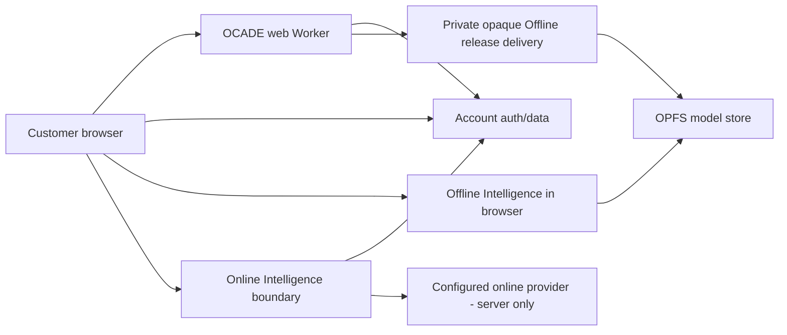

# OCADE Architecture

## System overview

CARCC builds OCADE. OCADE's current architecture is a website with one connected intelligence path and one on-device intelligence path behind a single Chat contract.

Provider/model identity is intentionally omitted from product/client architecture. It is server-only operational configuration.

## Tech stack

- React + TypeScript + TanStack + Vite + Tailwind.
- Node/npm.
- Supabase for auth/durable account data.
- Cloudflare Worker for web serving.
- Private R2 release delivery for Offline Intelligence.
- Browser OPFS as the only model store.

## Repository structure

- `src/routes/` — app/public/API routes.
- `src/components/` — Chat, Settings, shell/legal UI.
- `src/lib/intelligence/` — normalized Online/Offline contract/router.
- `src/lib/brain/` — Offline installer/runtime lifecycle.
- `src/lib/commercial/` — usage, entitlements, devices.
- `src/lib/library/` — Library/file authority.
- `src/lib/security/` — auth assurance/session/security headers.
- `supabase/` — migrations/functions/verification/rollback.
- `scripts/` — verification, build, browser journeys and Offline release tooling.
- `docs/` — canonical product/technical/design/test documentation.

## Application layers

1. UI/route layer.
2. Product hooks/functions.
3. Canonical intelligence and commercial boundaries.
4. Account/database or Offline runtime authorities.
5. Deployment/external integration boundaries.

Do not bypass a lower authority with UI-local rules.

## Data architecture

Supabase is canonical for durable signed-in account data.

Local browser persistence is intentionally narrow:
- OPFS: Offline model bytes/chunks/checkpoints/model metadata/runtime model assets only.
- encrypted pending reconciliation journal: disconnected account work that must survive restart.
- small device/UI preferences where appropriate.
- no duplicate durable conversation/library database in the browser.

## Online architecture

Browser → one OCADE Online Intelligence boundary → configured provider.

The browser sees normalized OCADE events only. Real provider/model identity stays out of the client bundle and customer-facing diagnostics. The boundary validates auth, request bounds and a commercial generation permit before provider work.

## Offline architecture

One installer owns:
- release resolution;
- storage check;
- ranged transfer;
- checkpoint/resume;
- digest verification;
- activation;
- repair;
- remove/reinstall.

### OPFS rule

There is one model store: OPFS. Model bytes/chunks/checkpoints/metadata/pointers do not live in IndexedDB, Cache Storage or localStorage.

Explicit uninstall preference is separate product state because it must survive deletion of model storage.

## Routing

The router owns Auto/Online/Offline selection. No component may implement a second fallback policy.

## Commercial architecture

One permit/ledger authority handles successful logical generations across all modes/devices. Entitlement resolves from the canonical account state and audited temporary grants. Current paid checkout is closed.

## Security architecture

- Server-side secrets.
- RLS + grants.
- Strong auth for privileged operations.
- Canonical origin/HTTPS.
- Hostile file handling.
- No client trust for entitlement/usage/ownership/security-sensitive fields.
- Cross-account async state must be scoped to account/conversation/request.

## Deployment architecture

Production proof includes:
- exact Git SHA;
- Cloudflare Worker deployment;
- Supabase migration/type state;
- Online Intelligence function version/source;
- Offline opaque release contract.

## Scalability

Use indexed bounded queries and pagination. Avoid whole-table reads. Offline transfer uses bounded ranges/streaming. Keep current product scope small rather than scaling unused modules.

## Constraints

- Website only for current mission.
- No live Paddle/paid checkout.
- No current Projects/Tasks/Automations/Monitors/Organizations/Code/native-app architecture.
- Normal users never see provider/model/runtime/infrastructure identities.
