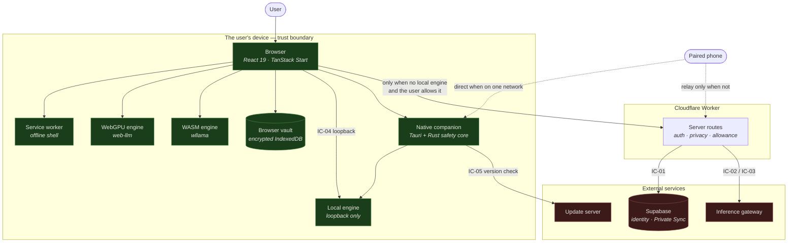
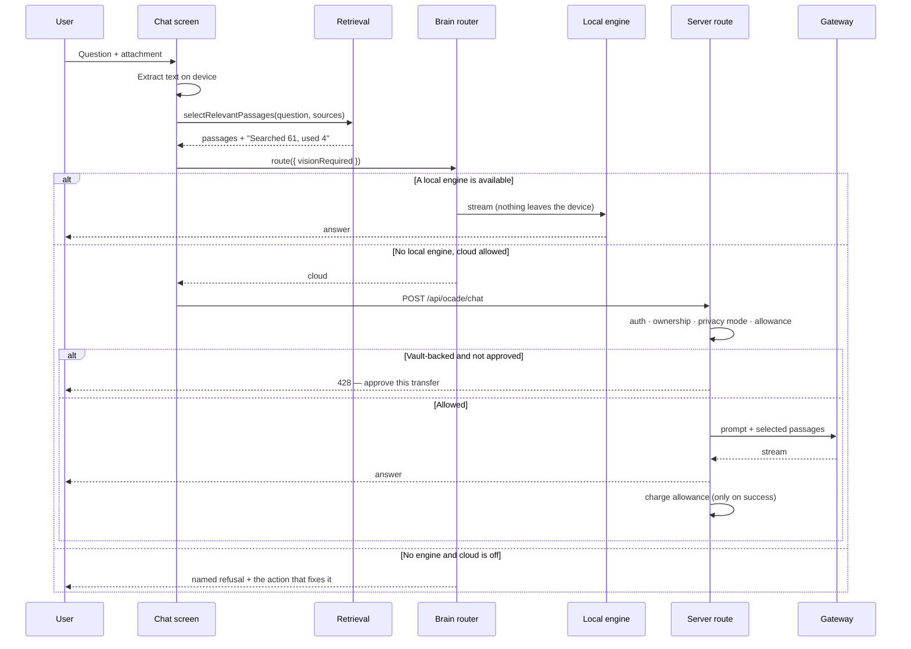

# OCADE — Architecture

Register rows: AZ-041 ADRs · AZ-042 context diagrams · AZ-043 trust boundaries ·
AZ-044 runtime boundaries · AZ-045 integration contracts · AZ-046 ownership maps ·
AZ-047 compatibility.

Every fact below that can be checked is checked. The machine-readable form is
[`boundaries.json`](boundaries.json); the assertions are in
`src/lib/__tests__/governance-artefacts.test.ts`. This file explains *why* each
boundary exists — a test can prove a rule holds but cannot say what it is for.

---

## 1. Context (AZ-042)

Green stays on the device. Red leaves it. The product's entire argument is the number of
paths that have to cross from green to red, and when.

## 2. The request path

The `428` branch is the one worth reading twice: a conversation stored in a browser or PC
vault does not go to the cloud because a model was selected. It goes when the user
approves that specific turn.

## 3. Trust boundaries (AZ-043)

Six, each with an enforcing module and a test. Full detail in
[`boundaries.json`](boundaries.json).

| id | Boundary | What a breach would cost |
|---|---|---|
| TB-01 | Service-role database credential | A key that bypasses row-level security shipped in the browser bundle |
| TB-02 | Untrusted document content | A document saying "ignore your instructions" being obeyed |
| TB-03 | Provider identity | The product's stated identity and the screen disagreeing |
| TB-04 | Local engine bind address | An unauthenticated prompt and file-read endpoint on the user's network |
| TB-05 | Paired-device link | Conversations crossing a shared network in clear text |
| TB-06 | Cached HTTP responses | A cached `200` for a request that should now be `401` |

TB-01 deserves a note on mechanism. The service-role client is a `Proxy` that constructs
lazily and is imported with `await import()` *inside* handler bodies, never at module
scope. The test asserts no static import exists outside a `.server.ts` module, because a
static import is what puts a module into the client bundle graph.

## 4. Runtime boundaries (AZ-044)

Four runtimes, and the rule is which built-ins each may reach.

| id | Runtime | Constraint |
|---|---|---|
| RB-01 | Browser | No Node built-ins. Resolves at build time, fails on the edge |
| RB-02 | Cloudflare Worker | Cannot spawn a process — which is why engine supervision is companion-only |
| RB-03 | Node (scripts) | Unrestricted; nothing here ships to a user |
| RB-04 | Native companion | The only runtime with OS authority; its safety rules are Rust, executed in CI on all three desktop platforms |

The enforcement is not the filename. It is that no module statically imports a
Node-touching module into the client graph — `generated-sandbox-node.ts` spawns a process
and is perfectly safe, because the only thing that reaches it is an `await import()`
inside a server function.

## 5. Integration contracts (AZ-045)

Five external dependencies. Each declares what it carries, which credential it uses, and
what happens when it fails — the third being the field that matters at 3am and the one
usually missing.

| id | Service | Carries | Credential | On failure |
|---|---|---|---|---|
| IC-01 | Supabase | Identity, Private Sync rows, allowance | Caller-scoped key; service-role server-side only | Named 503, never a partial-context answer |
| IC-02 | Inference gateway | Prompt, approved history, passages | Server-only key | 502; allowance not charged |
| IC-03 | Provider direct | Prompt, approved history, passages | Server-only key, opt-in per user | 502; allowance not charged |
| IC-04 | Local engine | Prompt and passages, on-device | None | Honest refusal naming the obstacle |
| IC-05 | Update server | Version check only | None | Skipped; application continues |

The test enforces this **in the direction that catches drift**: it scans the shipping
code for external hosts and requires each to be declared. A list checked the other way
is complete on paper and silent about the host somebody added last week.

## 6. Ownership (AZ-046)

Every directory under `src/lib` maps to one of five owning areas — OCADE engine, chat,
control plane, devices, privacy, release — in [`boundaries.json`](boundaries.json). The
test asserts both directions: no directory without an owner, and no owner pointing at a
directory that no longer exists. The second half is the one that rots; FICIA's areas were
listed until its code was removed.

## 7. Compatibility (AZ-047)

- **Node 20 and 22**, both proven by the CI matrix rather than asserted here.
- **Three shared type surfaces** — the Supabase schema types, the mobile secure channel,
  and the brain adapter interface. Removing or renaming an exported member of any of them
  is breaking.
- **The mobile protocol carries an explicit version.** A peer on a different version is
  refused with `Unsupported protocol` rather than having its bytes misread — the failure
  mode that produces corrupted state instead of an error.
- Schema drift is caught by `scripts/check-supabase-types.mjs`: generated types must
  describe the committed migrations, because when they fall behind the usual workaround
  is an `any` escape that disables checking for a whole file. That is not hypothetical —
  it is what four `pendingFrom()` helpers were doing across ~55 database calls.

## 8. Architecture decisions (AZ-041)

Records live in [`adr/`](adr/). Each carries Status, Context, Decision and Consequences;
the test rejects any that does not.
