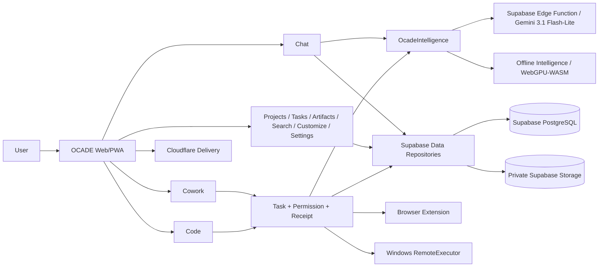

# Architecture

## System Overview

OCADE is a browser-first AI workspace centered on Chat, Cowork and Code with Projects, Tasks, Artifacts, Search, Customize, Settings, organizations/Admin, Offline Intelligence, online intelligence and permissioned browser/Windows control. The target architecture uses one account/session authority, one persistent-data boundary, one intelligence boundary, one commercial-usage authority, one task/receipt authority, one permission system and one set of platform adapters. Historical local-first, duplicate provider/task/native-control paths are migration inputs rather than parallel long-term systems.

The current audited baseline for the production-completion plan is `main` at `5b967735267fb650df63d02d76788ba620353cc4`, which already contains React/TanStack web code, Supabase, Cloudflare delivery, WebGPU/WASM local inference, browser extension, Windows/native control, Capacitor mobile/PWA projects and extensive tests/evidence. `PLAN.md` owns the ordered migration from that baseline to the target below.

## System Diagram



## Tech Stack

The current stack is TypeScript, React 19, TanStack Start/Router, Vite 8, Tailwind CSS 4, TanStack Query, Radix-style primitives, Lucide icons and Zod. Node 22.23.2 and npm 10.9.8 are pinned; `package-lock.json` is the dependency authority. Supabase provides PostgreSQL, Auth, Storage, RLS, selective Realtime and Edge Functions. Cloudflare/Wrangler is the web deployment path. Browser-local inference uses the existing WebLLM/WebGPU and wllama/WASM authorities with OPFS model storage. Capacitor source supports Android/iOS/PWA. Browser control uses the existing extension/host boundary. Windows control is supporting Cowork/Code infrastructure, not a separate marketed desktop product.

## Repository Structure

The current repository contains historical source organization under `src/components`, `src/hooks`, `src/lib`, `src/routes`, `src/primary-logic`, integrations and platform roots. Implementation converges dependency-closed families toward:

```text
src/
  app/        bootstrap, routing, providers, shell, session entry
  features/   route-facing product use cases and UI
  core/       domain policy, state machines, intelligence, agents, tools, permissions
  platform/   browser, extension, Windows host, mobile/PWA, voice, workers
  data/       Supabase repositories, server APIs, transient RAM buffers
  shared/     reusable UI primitives, tokens, validation and utilities
```

Platform/tooling roots such as `supabase/`, `extension/`, `native/`, `android/`, `ios/`, `scripts/`, `.github/`, `public/` and `release/` remain where they serve a real boundary. Do not mass-move files cosmetically; move only when ownership becomes clearer and every caller can migrate safely.

## Application Layers

`app` composes routes/providers and owns no product persistence or domain policy. `features` owns Chat/Cowork/Code/Projects/Tasks/Artifacts/Search/Customize/Settings and organization/Admin presentation/use cases but does not create duplicate database/provider/native clients. `core` owns environment-neutral invariants such as intelligence requests, usage permits, task states, permissions, agent/tool policy and entitlement rules. `platform` implements environment-specific adapters behind core contracts. `data` owns ordinary persistence and server APIs. `shared` cannot import feature/route modules.

## Database Architecture

Supabase PostgreSQL is canonical for ordinary account/user content: profiles/settings/session metadata, conversations/messages/branches/shares, Projects and typed links, files metadata, Tasks/schedules/runs/events/approvals/receipts, Artifacts/versions/provenance, Memory, organizations/members/groups/seats/policies, notifications, commercial usage/permits/leases/entitlements, billing events/subscriptions/refunds/Admin grants and audit/support-access records. Private Supabase Storage owns uploaded file and durable artifact bodies.

Persistent ordinary content must not have competing IndexedDB, localStorage, Cache Storage, browser/PC vault or OPFS authorities. OPFS is model-only. Incognito is memory-only. If Supabase is temporarily unavailable, eligible local-inference turns may stay only in open-tab RAM, warn before loss and synchronize exactly once on reconnection.

Existing live/source tables and migrations are reused or transformed forward-only; do not create duplicate replacement tables merely for preferred naming. Source/live migration histories are reconciled by schema effect before production application. RLS is mandatory on exposed user/tenant tables and identity comes from trusted Auth/server context, not client-submitted user/org IDs.

## API Architecture

Browser code calls typed feature/data contracts rather than privileged provider/database implementations. `OcadeIntelligence` is the single AI boundary. Every AI-generating surface acquires one server-authoritative generation permit before provider/model initialization. The online Edge Function uses Gemini 3.1 Flash-Lite with exactly three optional server secret slots—primary, secondary, tertiary—and primary-first pre-output health failover. Local-only performs zero provider network activity.

Task/remote execution uses one `RemoteExecutor` contract for capability advertisement, claim/lease/heartbeat, approvals, cancellation/emergency stop, receipts, reconnect and recovery. Browser control prefers DOM/accessibility semantics and re-observes after actions/context changes. Windows control consolidates UIA/PyWin32/Win32/native helpers, vision and PyAutoGUI, using semantic/native APIs first and coordinates only as guarded fallback.

## External Services

Supabase is the canonical database/Auth/Storage/Edge Function service. Cloudflare delivers/deploys the web release. Gemini is the pinned online AI provider behind the server boundary. Payment-provider, email/push, OAuth and connector integrations are exposed only when fully configured and proven. A source file, icon or partial secret never makes an external capability available.

## Data Flow

Online Chat/AI flow is: authenticated request → commercial permit → `OcadeIntelligence` → Gemini server boundary → normalized streamed output → permit finalize/release → Supabase persistence. Local flow uses the same logical permit and normalized boundary; when Supabase is unavailable, unsynchronized turns stay RAM-only until reconnection.

Cowork/Code flow is: user goal → task plan → permission policy → tool/platform action → re-observe → verify postcondition → receipt/event → persistence → continue/recover. Issuing a click/command is never proof of success.

Payment flow, implemented last, is: server checkout intent → provider-hosted payment → signed webhook/server reconciliation → immutable normalized billing event → idempotent atomic subscription/entitlement update. Admin grants are separate audited entitlements, never fake provider payments.

## Architectural Patterns

Use one canonical authority per subsystem, ports/adapters for environment-specific implementations, fail-closed external capability checks, idempotent logical operations, append-friendly evidence/audit history, observed postconditions for side effects, progressive disclosure in UI and machine-generated evidence where practical. Generated files remain generated.

## System Boundaries

Browser bundles never contain Gemini keys, service-role credentials, payment secrets or native-only APIs. OPFS contains model data only. Browser extension acts only in approved user mission/site context. Windows host accepts only authenticated/scoped local requests and enforces permission/protected-input/emergency-stop rules. Plugins/connectors cannot bypass identity, tenant, usage or permission policy. Browser payment redirects/client prices/profile text cannot mutate entitlement.

## Scalability Considerations

Five performance failures are treated as architecture defects: N+1 query loops, missing evidence-backed indexes, unbounded list loading, unoptimized media and giant eager JavaScript bundles. Batch related reads; use query-plan evidence before adding indexes; cursor-paginate growing feeds/search/activity; keep stable admin lists bounded; optimize responsive/lazy media; lazy-load Code editor/PDF/Jarvis/model/native/media tooling. Batch startup calls and clean up workers/processes to avoid memory/resource leaks.

## Security Architecture

Supabase Auth provides account identity. MFA is optional for ordinary users but recent AAL2 is required for dangerous organization/Admin/support-content/billing operations. RLS/Storage policies enforce tenant/user isolation. Privileged functions are narrow, validate ownership/role and use safe search paths. Protected inputs such as passwords, OTPs, CAPTCHAs, CVV/PIN and recovery codes remain user-controlled. Secrets never enter browser bundles/logs. Support content access, where authorized, is case-scoped, time-bound, read-only and immutably audited rather than general raw database access.

## Deployment Architecture

Implementation stays on one isolated completion branch until the final matrix passes. The exact verified tree is reconciled against latest `origin/main`, reverified, fast-forwarded without force and remote SHA/tree checked. Production deployment then confirms backups/restore/rollback, applies reviewed forward-compatible Supabase migrations, deploys matching Edge Functions/secrets, stages the exact Cloudflare release, runs staging smoke/critical journeys, promotes that exact version and verifies production health. Release regression triggers rollback.

## Architecture Decisions

Durable reasons for major choices live in `docs/DECISIONS.md`. Current accepted decisions include Supabase-authoritative ordinary data, model-only OPFS, Gemini 3.1 Flash-Lite with three server key slots, Normal/Jarvis Cowork over one runtime, no separately marketed desktop product, maximum useful donor reuse without parallel donor architecture, payments/Admin grants last and Claude/ChatGPT/OpenClaw as behavioral references while OCADE remains independently implemented.

## Constraints

`PLAN.md` is the sole implementation authority. `CLAUDE.md` is the single AI-agent handbook; `AGENTS.md` is intentionally absent. Never create duplicate routers/stores/agent loops/task systems/model installers/usage authorities/payment stacks/native engines/design systems. Preserve Lovable-connected Git history; no force-push/rebase/squash of published history. External capabilities must be truthfully configured/proven or hidden/unavailable.
