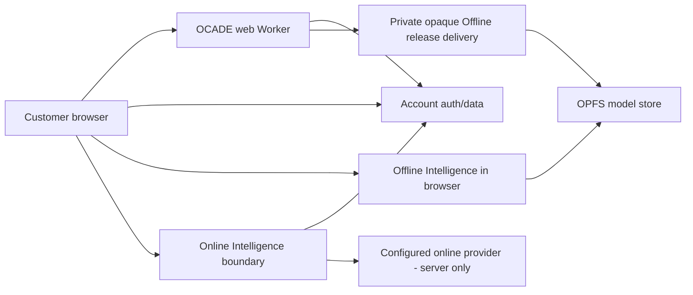

# OCADE Architecture

## System overview

CARCC builds OCADE. OCADE's current architecture is a website with one connected intelligence path and one on-device intelligence path behind a single Chat contract.

Provider/model identity is intentionally omitted from product/client architecture. It is server-only operational configuration.

## Tech stack

- Build the frontend with React, TypeScript, TanStack, Vite and Tailwind.
- Use Node with npm as the runtime and package-management toolchain.
- Use Supabase for authentication and durable account data.
- Use the Cloudflare Worker to serve the website.
- Use private R2 delivery for the opaque Offline Intelligence release.
- Use browser OPFS as the only Offline model store.

## Repository structure

- Keep app, public and API routes under `src/routes/`.
- Keep Chat, Settings, shell and legal UI components under `src/components/`.
- Keep the normalized Online/Offline contract and router under `src/lib/intelligence/`.
- Keep the Offline installer and runtime lifecycle under `src/lib/brain/`.
- Keep usage, entitlement and device logic under `src/lib/commercial/`.
- Keep the Library and file authority under `src/lib/library/`.
- Keep authentication assurance, session and security-header logic under `src/lib/security/`.
- Keep database migrations, functions, verification and rollback artifacts under `supabase/`.
- Keep verification, build, browser journeys and Offline release tooling under `scripts/`.
- Keep canonical product, technical, design and testing documentation under `docs/`.

## Application layers

1. UI/route layer.
2. Product hooks/functions.
3. Canonical intelligence and commercial boundaries.
4. Account/database or Offline runtime authorities.
5. Deployment/external integration boundaries.

Do not bypass a lower authority with UI-local rules.

## Data architecture

Supabase is canonical for durable signed-in account data.

Local browser persistence is intentionally narrow:
- Use OPFS only for Offline model bytes, chunks, checkpoints, model metadata and runtime model assets.
- Use an encrypted pending reconciliation journal for disconnected account work that must survive restart.
- Keep only small device or UI preferences in their appropriate lightweight preference store.
- Do not create a duplicate durable conversation or Library database in the browser.

## Online architecture

Browser → one OCADE Online Intelligence boundary → configured provider.

The browser sees normalized OCADE events only. Real provider/model identity stays out of the client bundle and customer-facing diagnostics. The boundary validates auth, request bounds and a commercial generation permit before provider work.

## Offline architecture

One installer owns:
- The installer resolves the approved release.
- The installer checks storage before transfer.
- The installer performs ranged transfer.
- The installer checkpoints progress and resumes interrupted transfers.
- The installer verifies the final digest.
- The installer activates only a verified release.
- The installer repairs only missing or corrupt model data.
- The installer owns remove and reinstall behavior.

### OPFS rule

There is one model store: OPFS. Model bytes/chunks/checkpoints/metadata/pointers do not live in IndexedDB, Cache Storage or localStorage.

Explicit uninstall preference is separate product state because it must survive deletion of model storage.

## Routing

The router owns Auto/Online/Offline selection. No component may implement a second fallback policy.

## Commercial architecture

One permit/ledger authority handles successful logical generations across all modes/devices. Entitlement resolves from the canonical account state and audited temporary grants. Current paid checkout is closed.

## Security architecture

- Keep secrets on the server side.
- Enforce both row-level security and explicit grants.
- Require strong authentication for privileged operations.
- Enforce the canonical HTTPS origin.
- Treat uploaded files as hostile input.
- No client trust for entitlement/usage/ownership/security-sensitive fields.
- Cross-account async state must be scoped to account/conversation/request.

## Deployment architecture

Production proof includes:
- Record the exact Git SHA used for the release.
- Record the matching Cloudflare Worker deployment.
- Record the matching Supabase migration and generated-type state.
- Record the matching Online Intelligence function version and source.
- Record the matching opaque Offline release contract.

## Scalability

Use indexed bounded queries and pagination. Avoid whole-table reads. Offline transfer uses bounded ranges/streaming. Keep current product scope small rather than scaling unused modules.

## Constraints

- Keep the current mission limited to the website.
- Do not include live Paddle or paid checkout in the current architecture.
- Do not add Projects, Tasks, Automations, Monitors, Organizations, Code or native-app architecture to the current mission.
- Never expose provider, model, runtime or infrastructure identities to normal users.
