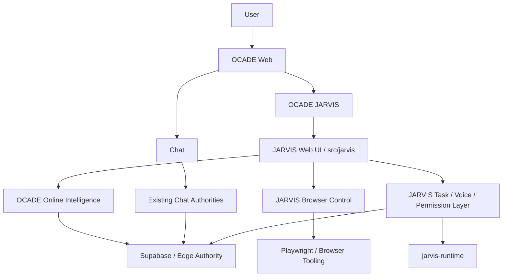

# OCADE Architecture

## System overview

OCADE is one repository with a protected Chat product and a new OCADE JARVIS product surface.

JARVIS is integrated as a web-controlled agentic experience while preserving the original JARVIS source and working runtime as separate runtime layers.

## High-level architecture

## Repository structure

- imports/ocade-jarvis/ stores the uploaded original ZIP and preservation documentation.
- imports/ocade-jarvis/source-original/ stores the immutable extracted original source.
- jarvis-runtime/ stores the active working JARVIS Python/runtime engine.
- src/jarvis/ stores the production web UI and browser-facing JARVIS integration.
- src/routes/ continues to own TanStack routes, including /ocade-jarvis.
- supabase/ continues to own database migrations and Edge Functions.

## Preservation boundary

The uploaded ZIP and source-original snapshot are immutable evidence.

The working jarvis-runtime is allowed to change as required for OCADE integration.

Ponytail cleanup never targets immutable source.

## Product boundary

Chat and JARVIS share authentication, account identity, server security patterns, and approved storage authorities.

Chat and JARVIS remain distinct user experiences.

JARVIS is Online-only and must not use Chat Offline inference.

## Conversation and data boundary

JARVIS reuses the existing conversation/message authority with a clear JARVIS surface discriminator or equivalent schema mechanism.

The system must never mix normal Chat and JARVIS history unintentionally.

JARVIS memory is logically separate from Chat memory even though both use Supabase account security.

Detailed JARVIS activity has a 90-day retention policy.

## Intelligence boundary

All active JARVIS intelligence routes through OCADE's approved server-side Online intelligence authority.

The original local/manual provider-key route is disabled in production.

The provider key is never sent to the browser or exposed in the working runtime UI.

## Browser-control boundary

Browser control is the first deep JARVIS control capability.

The hierarchy is semantic DOM/accessibility targeting first, Playwright/browser tooling second, authorized browser integration third, visual understanding fourth, and coordinates last.

Coordinate actions are ephemeral observations, not stable selectors.

Every resize, zoom, scroll-context change, responsive reflow, navigation, or tab switch invalidates stale geometry and requires re-observation.

Take Over pauses automation, and Resume begins from a new observation.

## Runtime boundary

The existing Python JARVIS modules remain the primary runtime foundation.

Existing voice, desktop, file, screen, system, task, undo, confirmation, development-agent, and related modules are preserved unless the owner explicitly rejected active behavior.

Unsupported runtime capabilities are capability-gated rather than simulated.

## Voice boundary

Voice is a JARVIS interaction mode rather than a separate product.

Voice and typed input share the same JARVIS conversation/task state.

## Permission boundary

The system supports a global JARVIS enable/disable control plus granular capability permissions.

Device-sensitive permissions are evaluated per device.

Prompt or website content never grants permissions.

## Usage boundary

Chat and JARVIS have separate plan usage authorities.

JARVIS can account for multiple resource-bearing internal steps.

Failed/no-result steps are reconciled.

## Deployment boundary

The web product remains deployed through the current Cloudflare Worker path.

Supabase remains the durable account/security authority.

The working JARVIS runtime must not create a second customer identity or provider-secret system.

## Planned later capability boundary

Deeper computer and mobile control begins only after the browser-controlled web mission is stable.

Current documentation intentionally does not select or describe a desktop-wrapper technology.
