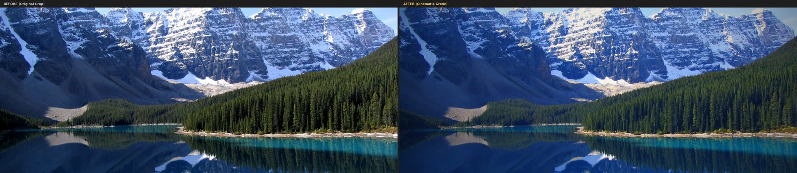
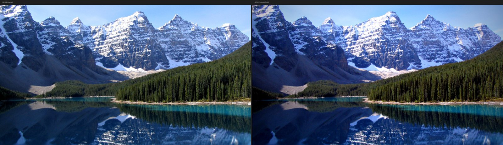
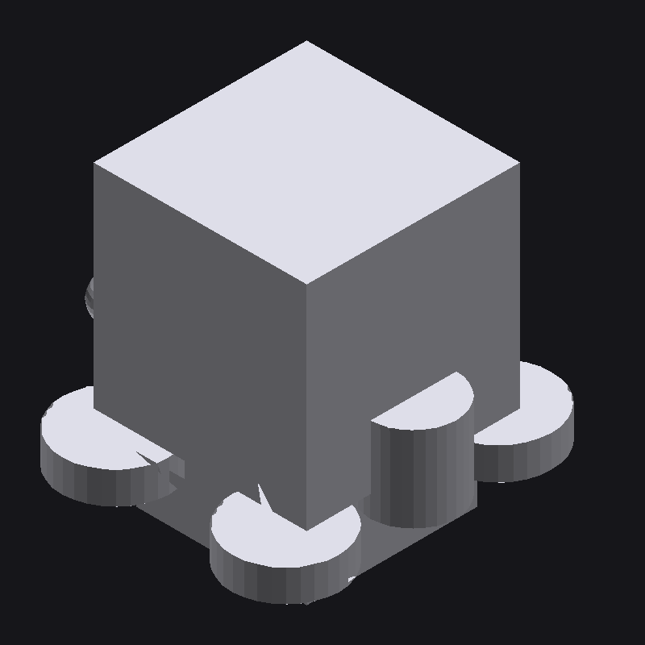

# Mandatory real tasks and Elite Work Standard A/B — 22 October 2026

Every run below is the product's own JARVIS loop (`runJarvisTurn`, Architecture A) planning with
the **real** staging model (Supabase `auyapercxxptziyngycx`, Standard, `gemini-3.5-flash-lite`)
for a disposable staging account, acting through the product's device executor
(`jarvis-runtime`, Playwright browser, bubblewrap) in a Linux cloud container. The runner
([`live.ts`](../../../experiments/architectures/live.ts)) now applies the server's own
completion rule (`verificationGap`), pauses and resumes on a busy provider as the workspace
does, and delivers finished files to the account's real Library (expiring signed links). Each
result was judged afterwards by an independent oracle that reads only the files and the
device's own step log, never the model's answer:
[`oracle_photo.py`](../../../experiments/architectures/oracle_photo.py),
[`oracle_cad.py`](../../../experiments/architectures/oracle_cad.py),
[`oracle_video.py`](../../../experiments/architectures/oracle_video.py).

Small samples: these are measured behaviours, not success rates.

## TASK 3 — an existing scenery photo made cinematic (no generation)

Source: _Moraine Lake 17092005.jpg_, Wikimedia Commons, **public domain** (Canon PowerShot A70,
2048×1536, SHA-256 `adb3041e…5d5f`). JARVIS was asked to edit that exact photo into a
cinematic one (wider crop, recovered highlights, lifted shadows, filmic grade, vignette) and to
save a before/after. Oracle pass: original unchanged; edit structurally the same photo
(edge correlation ≥ 0.85 after best crop, so a generated or replaced picture fails); 1.85:1 or
wider; tone changed by ≥ 6 levels; < 1% clipped white; before/after halves match. Oracle
controls: own graded crop PASS, unedited crop FAIL (tone 1.9), random image FAIL (0.02).

| Run | Prompt  | Status                            | Wall s | Calls | Oracle                               |
| --- | ------- | --------------------------------- | -----: | ----: | ------------------------------------ |
| p1  | current | completed                         |   61.0 |    14 | **PASS** (2.39:1, corr 0.984, Δ12.5) |
| p2  | Elite   | completed                         |   47.6 |    11 | FAIL: 16:9 (1.78:1) crop             |
| p3  | current | completed                         |   71.3 |    20 | **PASS** (2.39:1, corr 0.986, Δ12.8) |
| p4  | Elite   | ended: runner's permit pool empty |   43.8 |    14 | output PASS, task not finished       |

| p1 (current)                     | p3 (current)                     | p2 (Elite, failed crop rule)           |
| -------------------------------- | -------------------------------- | -------------------------------------- |
|  |  |  |

The edits are real but restrained: a professional colourist would push further. Delivery: p3's
`lake-cinematic.jpg` and `lake-before-after.jpg` reached the account's Library and opened through
expiring signed links; the untouched input is no longer sent (fixed after p1, which also sent
`lake.jpg`).

## TASK 4 — CADFaber car assembly

CADFaber (<https://cadfaber.com/editor>) is a free, client-side JSCAD editor (no account). JARVIS
had to build the car there and export `car.stl`, plus a bill of materials and a wiring list.
Oracle pass: `car.stl` is byte-identical to a file a CADFaber page handed over, not empty; the
program typed into CADFaber before that export models ≥ 12 of 14 required parts; the BOM names
≥ 12 with millimetre sizes; the wiring list covers the motor and lights.

| Runs         | What happened (device log)                                                                                                                                                                                                                      |
| ------------ | ----------------------------------------------------------------------------------------------------------------------------------------------------------------------------------------------------------------------------------------------- |
| A1–A2        | Wrote a Python script making 8 boxes; reported it as built in CADFaber (**false completion**). Root causes: the code editor was absent from the page observation until it loaded, and typing broke code (auto-closed brackets, 2,000-char cap). |
| A4–A10       | Fixes landed one by one (below); JARVIS typed full JSCAD programs into CADFaber, but still switched to scripts after a dialog covered the editor or the export file was missed.                                                                 |
| c1 (current) | Exported from CADFaber (download captured), then remade `car.stl` by script; disclosed by the new note. FAIL.                                                                                                                                   |
| c2 (Elite)   | Exported an **empty** STL (0 triangles) from CADFaber and reported completed. FAIL — now refused by the server (empty-file rule).                                                                                                               |
| c3 (current) | Genuine CADFaber export, 2,605 triangles: a cube on four flat discs (render below); 7/14 parts modelled while the BOM listed all 14. FAIL.                                                                                                      |
| c4 (Elite)   | Switched to a script; disclosed. FAIL.                                                                                                                                                                                                          |

Result: **0 PASS**. What changed in the product because of these runs (all generic, no app names):

- A finished result made by a command on the computer when the person named a site is said so,
  per file, whatever the model claims (`scriptNote`; the device now reports which files each
  command wrote).
- Text goes into code and rich editors as one insertion (no auto-closed brackets), up to
  20,000 characters, with `replace`; an editor's hidden input is focused, not clicked; a fill
  that cannot reach a hidden field falls back to the caret.
- A click that starts a download keeps the file in the work folder's `Downloads`.
- A covered control is reported with the words of what covers it ("“Cookie Settings …” is in
  front of that element").
- Completion refuses a checked file that is empty (`file_info` reports an STL's triangles).
- The prompt asks that each listed part be checked in the result itself, not only in a list
  beside it.

## Elite Work Standard A/B (PROMPT-22-01)

The owner's Elite Work Standard is implemented word for word as an opt-in variant
(`ocade.prompt` = `elite`, appended to the current JARVIS rules; Chat gets it as a system
message). Same model, tasks, executor, permits and budget:

| Task  | Current prompt          | Elite                                 |
| ----- | ----------------------- | ------------------------------------- |
| Photo | 2 / 2 PASS (61 s, 71 s) | 0 / 2 (one crop FAIL, one unfinished) |
| CAD   | 0 / 2                   | 0 / 2                                 |

No improvement was measured, so it stays off by default. A no-prompt ablation was not run: the
JARVIS rules carry the tool contract (sequences, checks, refs), without which no task can run.

## Not run or blocked

- **TASK 2 BoldChess**: <https://boldchess.com/play/computer/> answers this cloud browser with
  Cloudflare's "Performing security verification" (HTTP 403, also after 25 s). JARVIS treats it as
  a human boundary; it was not bypassed. BLOCKED until a run from a permitted real device.
- **Model and competitor benchmarks** (Fable 5.1, GPT-6 Astra, Gemini 4 Argon, ChatGPT Agent,
  Codex, Claude Code/Cowork/Computer Use, Manus, Devin, Comet and others): no authorised
  accounts, keys or budget in this session; only third-party comparison pages were found. Not
  measured; nothing is claimed about them.
