# JARVIS workspace redesign, first slice — 21 October 2026

Commit `a8bef28` on `ocade/p00-p22-implementation`. Screenshots come from the repository's own
`visual-journey.mjs` (Chromium, loopback Supabase stub, production build). Every "before" image
was taken on the commit before `a8bef28`, every "after" image on `a8bef28`, at the same sizes and themes.

| Before                                            | After                                           |
| ------------------------------------------------- | ----------------------------------------------- |
| 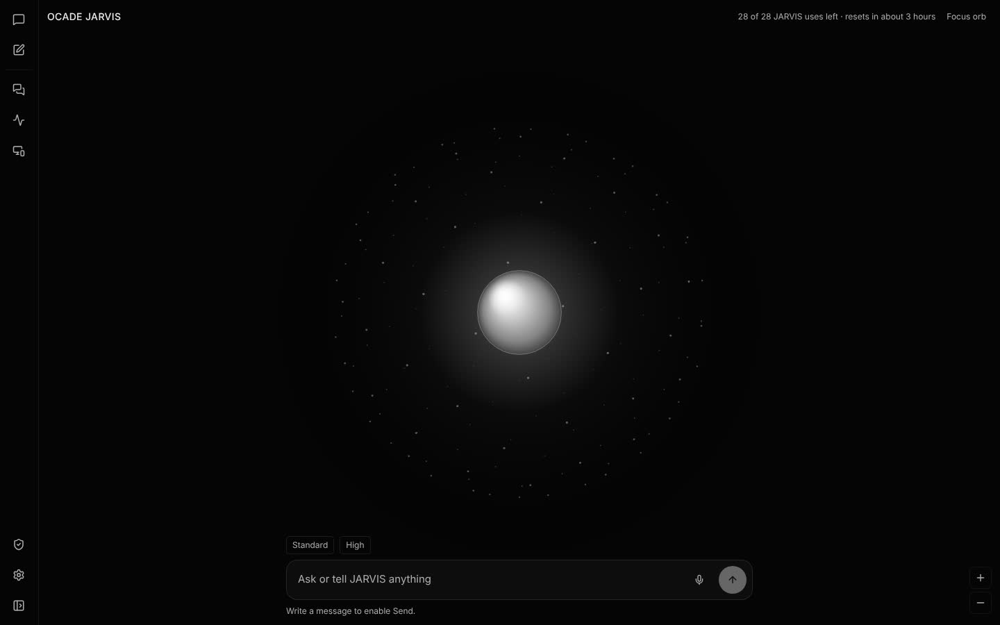         | 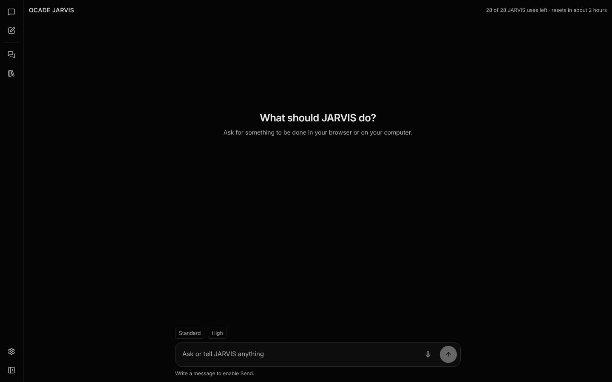         |
| 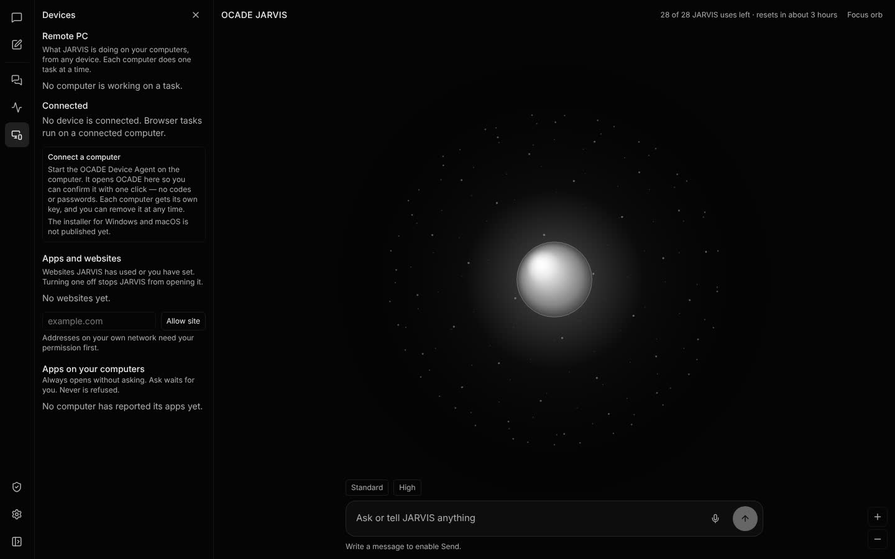 | 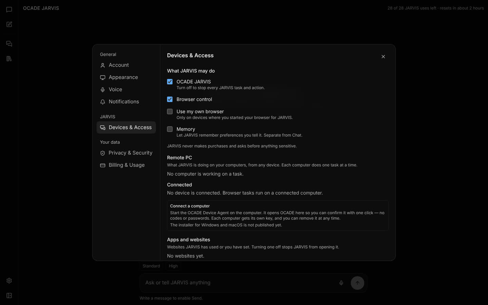 |
| 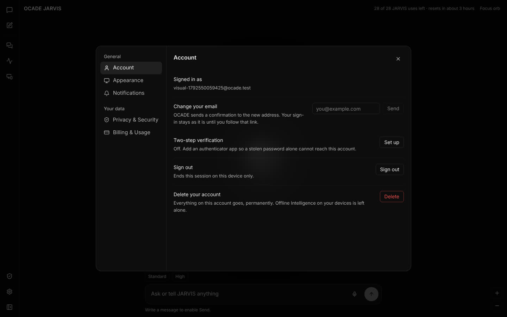       | 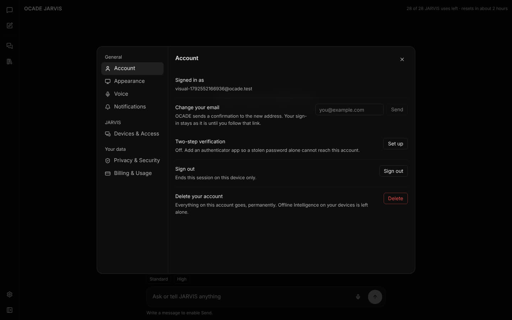       |
| 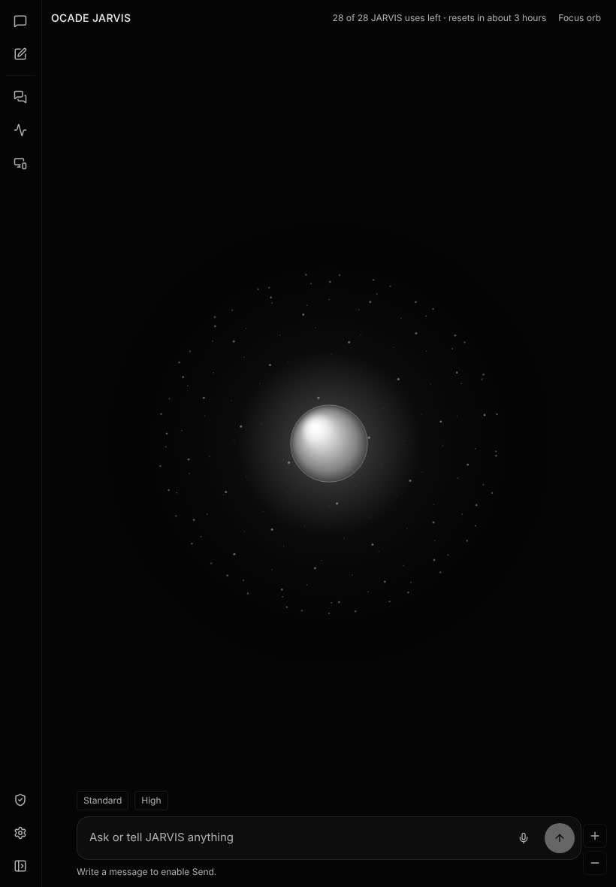          | 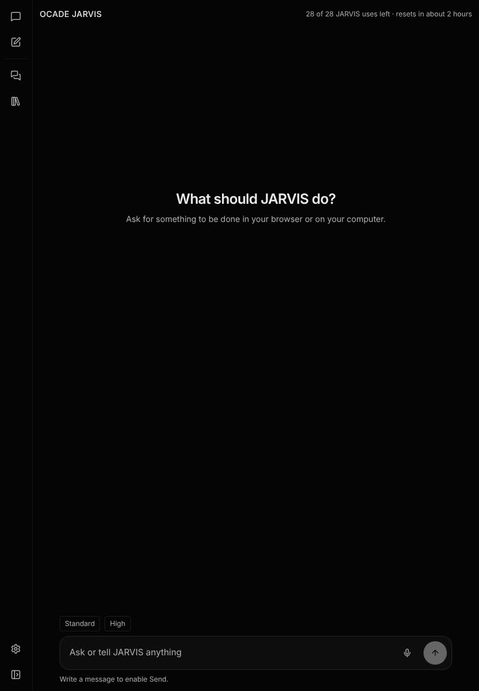          |
| 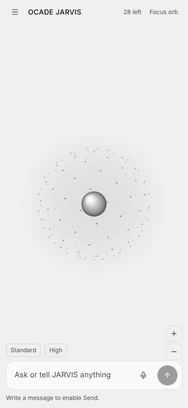          | 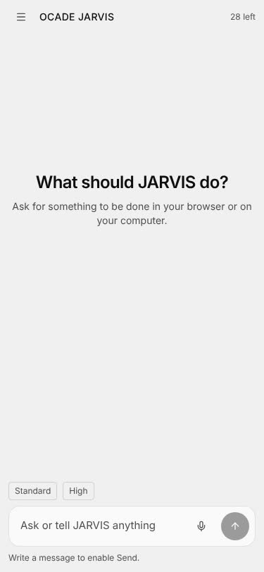          |

## What changed

- **No orb.** The full-screen orb, Orb Focus (fading controls, double-click, Escape), its zoom
  buttons, its node panel and the graph behind it are removed. An empty conversation asks
  "What should JARVIS do?".
- **Sidebar holds only the work:** Chat, New conversation, Conversations, Files (the Library)
  and Settings. Removed from it: Activity, Devices and Permissions.
- **Activity panel removed.** The records stay on the server; a task's device checks are in its
  card under Details. Reminders and scheduled work, which only the Activity panel listed, moved
  to the top of Conversations with their Remove buttons.
- **Devices & Access in Settings:** what JARVIS may do, saved memories with Forget (before, only
  reachable by clicking orb nodes), computers, their permissions, Background Mode, Remote PC
  and Apps and websites. The chosen Remote PC is now a per-device preference.
- **Settings categories:** Account, Appearance, Voice (new: voice choice and Reset JARVIS),
  Notifications, Devices & Access (new), Privacy & Security, Billing & Usage. Orb colour removed.
- **Browser only | Whole PC** beside the composer, once a computer is connected: one choice over
  each computer's apps, files, commands, screen and mouse/keyboard permissions. The server still
  enforces each permission per step.
- **@App mention:** "@Excel make a chart" uses Excel; while drafting "JARVIS will use Excel.",
  while working "Continuing with Excel…". Matching is the longest app name the computer reported,
  whole names only (`mentionedApp`, unit-tested).
- **Compact task card:** title and status, "Using: <computer> · <app>", "Working · Step n of m"
  with a bar, the live stage line from the record, then View progress (plan and device checks),
  Take Over and STOP (36 px controls, 16 px radius). A stopped or finished task keeps its card and
  its result in its conversation instead of disappearing.
- **No installed-software permission list.** Ordinary apps open without asking. Terminals,
  shells and system tools still ask; any app opened after the task read a web page asks first,
  so a page cannot make JARVIS open something unasked. A person's existing Always and Never
  decisions still apply.

## Removed controls

Orb canvas, Focus orb / Leave focus, orb zoom + and −, graph item list and node panel (Open,
Show saved text, Forget moved to Devices & Access), Activity rail button and panel ("Detailed
activity is kept for 90 days" list), Devices rail button (moved), Permissions rail button and
drawer (moved), Apps on your computers list with Find an app and per-app Always/Ask/Never, Orb
colour and Monochrome.

## Measured

| Measure                                   | Before            | After             | Change                   |
| ----------------------------------------- | ----------------- | ----------------- | ------------------------ |
| Source lines in `src` (diff of `a8bef28`) |                   |                   | +502 / −1,459 (net −957) |
| `Orb.tsx`, `graph.ts`, `graph.test.ts`    | 861               | 0                 | deleted                  |
| `JarvisWorkspace.tsx` lines               | 1,499             | 1,392             | −107                     |
| `JarvisPanels.tsx` lines                  | 1,040             | 954               | −86                      |
| `JarvisTask.tsx` lines                    | 480               | 507               | +27                      |
| JARVIS route chunk (raw / gzip)           | 71.5 KB / 20.9 KB | 34.9 KB / 10.8 KB | −51% / −48%              |
| All client assets                         | 9,368,191 B       | 9,352,577 B       | −15.6 KB                 |

Bundle "before" is the build of `6aeb70a` (the last UI-identical commit built in this session).

## Tests

- Unit: 124 files, 1,525 tests pass (new: `mentionedApp`; ordinary vs powerful apps; an app opened
  after reading a web page asks first — that test fails without the server change).
- Browser journeys after the change: settings 26/26, carry-on PASS (it had failed since
  `fbdcad2`: its fixture never re-read a script after running it), controls, visual, bubble,
  polish 36/36, final 67/67, shell 28/28, chat 51/51 PASS. jarvis: every check PASS except the
  pre-existing JOURNEY-20-01 ("and the task still finishes — Waiting for you", same failure at
  `10901f8`).
- No horizontal overflow at 375, 360 and 820 px; no page errors (jarvis and visual journeys).

## Not done in this slice (honest gaps)

- Completed-card **Preview / Open file / Download**: tasks record no output files, so these buttons
  would have nothing true to open. Needs a deliverable record per task first.
- **Natural female-presenting JARVIS voice** via licensed TTS: not started; Voice still lists the
  device's own voices.
- The main Chat sidebar is unchanged (it already holds Chat, OCADE JARVIS, Library and recents);
  the two sidebars are not yet one component.
- Design-token pass (8 px grid, radii, 120–220 ms transitions) applied to the new card and toggle
  only, not across every screen. No screen-reader or keyboard audit beyond the journeys' checks.

## Wave 2 (owner's continuation brief, same day)

| Devices                                           | Preferences                                                 | Task card while working                |
| ------------------------------------------------- | ----------------------------------------------------------- | -------------------------------------- |
| 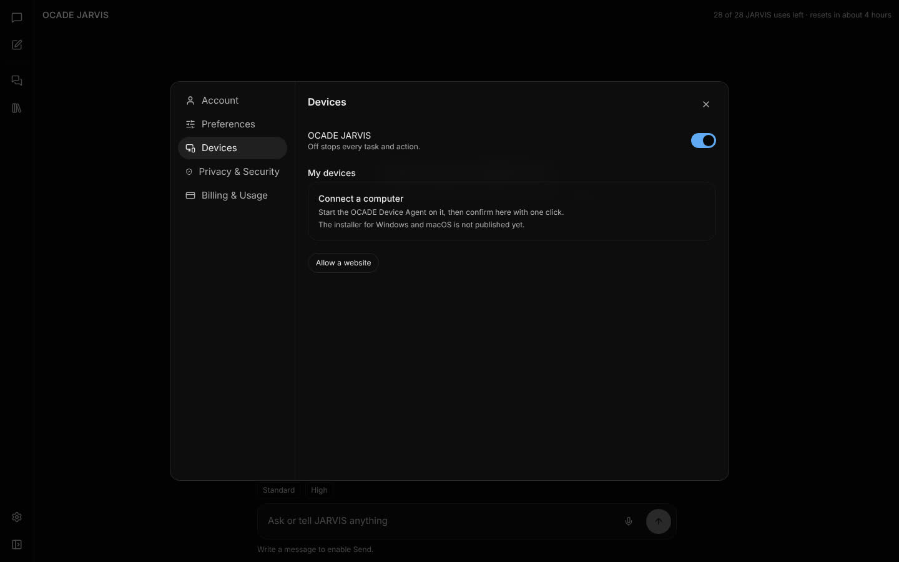 | 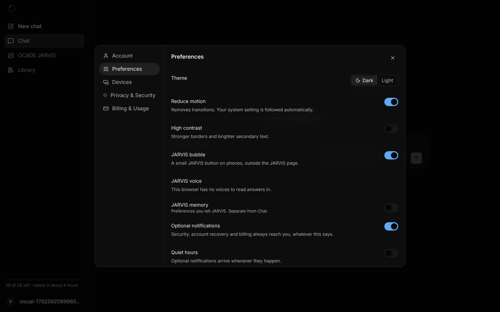 | 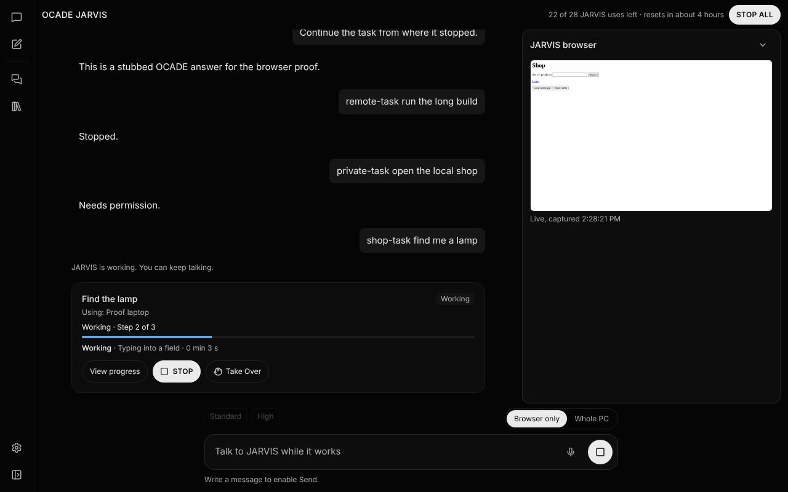 |

- Settings: five categories (Account, Preferences, Devices, Privacy & Security, Billing & Usage);
  old links to Appearance, Voice and Notifications open Preferences.
- Devices: "My devices" with a status per device (Connected, Working, Needs permission, Offline),
  its running task with Open and Stop, and its own pill switches with no paragraphs; one "Connect
  a computer" card when none is paired; the website field hides behind "Allow a website";
  account-level browser switches removed (duplicates of each device's).
- Every JARVIS on/off control is a pill switch (`role="switch"`, keyboard and screen-reader
  operable, label as its name).
- STOP: the floating round STOP is gone; "Stop all" sits in the JARVIS header while any task runs
  anywhere; each task's STOP and Take Over are on its card only (the live browser panel no longer
  repeats them); the composer's own Stop stays while JARVIS works.
- Progress speaks plainly (Thinking, Working, Checking, Fixing, Searching the web), shows pages by
  site name only (`plainStep`, unit-tested: no query strings or tokens), and View progress shows a
  step timeline from the record. The conversation scrolls to the newest turn, card or question.
- JARVIS's default voice: a natural female-presenting device voice of the page's language when
  the device has one (`pickVoice`, unit-tested); the person's choice wins. No licensed cloud TTS
  was added (no approved provider or budget).
- Journeys on the wave-2 build: jarvis all PASS (speech service BLOCKED here), carry-on, settings
  26/26, controls, visual, bubble, polish 36/36, final 67/67, shell 28/28, chat 51/51, auth 23/23,
  usage 22/22, pricing 22/22, online 30/30, offline 26/26, library 18/18, mfa PASS. browsers
  BLOCKED (no Firefox/WebKit in this container). admin: 1 FAIL ("the new Primary Owner holds it"),
  outside the changed code; checked separately.
